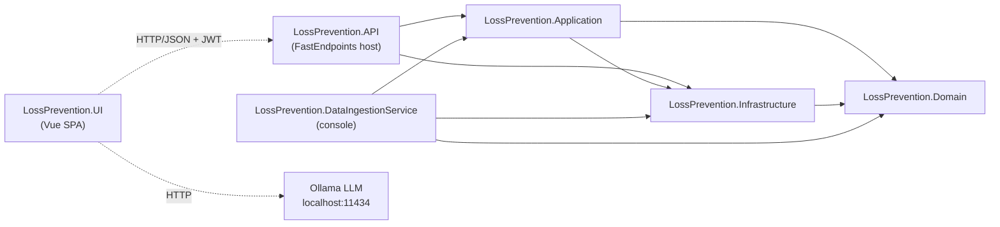
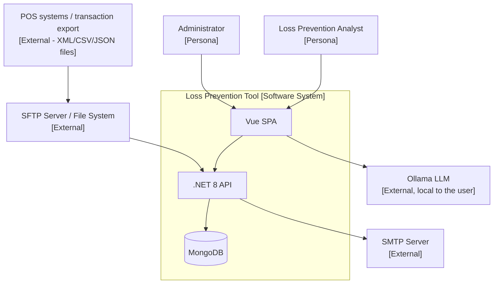

<!-- IMPACT-META
schema: 1
mode: how
step: 00_deep_dive
commit: fc7d820908b8b230fb47a2669920ba7efdb413a8
commit_short: fc7d820
branch: main
worktree: dirty
baseline_date: 2026-10-07T18:19:51+02:00
generated_at: 2026-10-08T09:33:09+02:00
-->
# Deep Dive - LOSS_PREVENTION Project (Loss Prevention Tool)

> **Baseline commit:** `fc7d820` (`main`) · worktree `dirty` (local changes only in `Docs/` and `.github/`; application code identical to the commit)

**Analysis Date**: 2026-10-08  
**Codebase Version**: `fc7d820` (`main`) — `fc7d820908b8b230fb47a2669920ba7efdb413a8`  
**Analyzed root**: `customspa-it-loss-prevention-d098a8b97860/` (the only application subfolder of the Git repository `LOSS_PREVENTION`)  
**Document version**: 1.1 (IMPACT verification of 2026-10-08)  
**Conventions**: paths are relative to the analyzed root; `file:riga` references refer to the baseline commit. The vendor documentation (17 files) **does not exist at the baseline**: it was present only in commit `593f6de` and was removed in `d768cd9`; every citation is therefore historical and can be verified with `git show 593f6de:customspa-it-loss-prevention-d098a8b97860/Docs/<file>` (see [§10](#10-documentation-inventory)).

---

## 1. Executive Summary

The **Loss Prevention Tool** is a full-stack web application for the analysis of retail (POS) transactions aimed at identifying losses and fraud. It consists of a **.NET 8 / FastEndpoints 6** backend (5 projects, **78 REST endpoints**, 37 `CAN_*` permissions) on **MongoDB 8.x** as the sole datastore (15 collections referenced by the code), a .NET console job for bulk ingestion of XML files, and a **Vue 3.5 + Vite 6 + Vuetify 3 SPA** (41 SFCs, 15 Pinia stores) that hosts a significant part of the business logic (statistical anti-fraud engine with 30 heuristics, Ollama LLM integration, report designer). The code measures **≈25.3 KSLOC** (cloc 2.10: C# 10,143, Vue 10,773, TypeScript 3,868; details in [14_metrics.md](14_metrics.md)) and is organized as a **layered modular monolith** with a shared document database. The stack is recent, but .NET 8 LTS goes out of support on November 10, 2026; the overall status is **pre-production**: 0 automated tests, no CI/CD or containerization, CORS limited to `localhost`, npm lockfile out of sync (`npm ci` fails), 12 imports with incorrect upper/lower case that break the build on Linux/macOS (plus an unresolvable import in the orphan component `ScheduleForm.vue`) and several architectural vulnerabilities (arbitrary MongoDB pipeline sent by the client, row-level security applied only in the browser, password hashes returned by the API, LLM on `localhost:11434` called from the browser). The "intelligent" features declared by the vendor are only partially present (single-field rule-engine, non-persisted client-side statistics, top-10 Euclidean similarity, LLM limited to NLQ and template generation): details in [§11](#11-critical-observations) and in [02_functional_overview.md](02_functional_overview.md) (section «Verification of features declared by the vendor»).

---

## 2. Project Structure

This section describes how the repository is organized, what the build produces, and which history/branching strategy is observable in Git.

### 2.1 Repository Organization

**Monorepo**: .NET backend, npm frontend, database dump/seed and documentation coexist in the same Git repository. The Git root (`LOSS_PREVENTION/`) contains only `README.md` (1 line, created by `08d0eed Initial commit`) and the application folder.

```
customspa-it-loss-prevention-d098a8b97860/
├── LossPrevention.sln                     # 5 progetti .NET (nomi "01. ...API", "02. ...DataIngestionService")
├── README.md                              # README di prodotto (link a docs/ inesistenti, vedi §10)
├── .gitignore                             # template Visual Studio; riga 369 ignora .github/
├── LossPrevention.API/                    # Host ASP.NET Core + FastEndpoints (79 file .cs, 78 endpoint)
│   ├── Program.cs                         # composition root (132 righe): JWT, CORS, DI, Swagger, hosted service
│   ├── appsettings.json                   # Mongo (13 collezioni), JWT, SMTP, retention
│   ├── Properties/launchSettings.json     # profili http 5264 / https 7110 / IIS Express 55993
│   └── Endpoints/                         # Dashboard 5 · Data 3 · DataIngestion 8 · FraudDetection 3 · Groups 7
│                                          # Mappings 4 · Notifications 5 · Rules 6 · User/{Users 12, Roles 10,
│                                          # Permissions 10} · Workspaces 5
├── LossPrevention.Application/            # 121 file .cs: servizi, DTO, helper, mapping, validator
│   ├── Services/{Data,Data/Rules,DataIngestion,Users,Workspaces}
│   ├── Helpers/{BsonHelper,DistanceHelper,JsonHelper,MappingHelper,RuleHelper,XmlToBsonConverterHelper}.cs
│   ├── Handlers/{Requests,Responses}      # request/response model degli endpoint
│   ├── DTO/ · Interfaces/ · Mappings/ · Validators/
├── LossPrevention.Domain/                 # 21 file .cs (19 in Entities/), POCO con attributi MongoDB.Bson
├── LossPrevention.Infrastructure/         # 10 file .cs: MongoRepository<T>, DI repository, PasswordHasher,
│                                          # EmailService, DapperRepository (interamente commentato)
├── LossPrevention.DataIngestionService/   # console app batch (1 file): XML da C:\xmlstore5\xml → Mongo
├── LossPrevention.UI/                     # SPA Vue 3 + Vite + Vuetify + Pinia (npm, name "workflowbuilder")
│   ├── package.json · package-lock.json · vite.config.js · tsconfig.json · nuxt.config.ts (non usato)
│   └── src/{api,components/{ai,dashboard,manage,reports,workspace},helpers,interfaces,plugins,router,stores}
├── Data/
│   ├── LossPrevention/                    # mongodump (12 collezioni, 25 file incl. prelude.json)
│   └── MongoDBScripts/                    # 5 script ordinati 00..04 + rules_export.json + PERMISSIONS_LIST.md
└── Docs/                                  # documenti IMPACT (00..19 + index.md); i Docs del fornitore sono
                                           # stati rimossi in d768cd9
```

Tooling artifacts versioned by mistake: 5 `*.csproj.lscache` files and 2 files in `LossPrevention.UI/.vite/` (Vite cache).

### 2.2 Build Artifacts

| Artifact | Origin | Type | Notes |
|-----------|---------|------|------|
| `LossPrevention.API.dll` | `LossPrevention.API/01. LossPrevention.API.csproj` (`Microsoft.NET.Sdk.Web`) | ASP.NET Core app (Kestrel) | No `<Version>` property in the csproj files |
| `LossPrevention.DataIngestionService.exe` | `02. LossPrevention.DataIngestionService.csproj` (`OutputType Exe`) | Console app | Hardcoded source path |
| Libraries | Application, Domain, Infrastructure | `net8.0` class library | — |
| SPA bundle | `LossPrevention.UI` → `npm run build` = `vite build` | static assets in `dist/` (ignored by the UI `.gitignore`) | No type-check (`vue-tsc` not invoked); `version: 0.0.0` |

No Dockerfile, Kubernetes manifest, deployment package or pipeline producing versioned artifacts.

### 2.3 Branching Strategy

The repository has **13 commits**, a single branch (`main`, tracked by `origin/main`) and **a single author** (`saristot`):

| Commit | Date | Content |
|--------|------|-----------|
| `08d0eed` | 2026-10-05 | Initial commit (root `README.md`) |
| `593f6de` | 2026-10-05 | "add codice": bulk import of the entire application code **and** of the 17 vendor documents in `Docs/` |
| `d768cd9` | 2026-10-07 | Removal of the vendor `Docs/` folder (17 files, 17,577 lines) |
| `5ea5bc9` … `fc7d820` | 2026-10-07 | 10 commits via the GitHub web interface ("Create …", "Add files via upload", "Delete … docs directory") that only add/remove IMPACT documentation |

The application code never changed after `593f6de`: the original development history is **not available** and no branching strategy is observable (no feature branches, tags or releases). The vendor roadmap (`Docs/roadmap.txt`, historical: present only in `593f6de`, removed in `d768cd9`) lists among the future activities "Branching Strategy for ease of development", confirming that a strategy had not been formalized.

---

## 3. Technology Stack

Versions are read from `*.csproj`, `package.json` (declared ranges) and `package-lock.json` (actually resolved versions, lockfile v3).

### 3.1 Backend Stack

| Category | Technology | Version | Notes |
|-----------|------------|----------|------|
| Runtime | .NET | 8.0 (`net8.0` in all 5 csproj files) | LTS, end of support **November 10, 2026** → plan .NET 10 LTS |
| Language | C# | 12 (.NET 8 default) | `Nullable` and `ImplicitUsings` enabled in all projects |
| Web framework | FastEndpoints | 6.0.0 | REPR pattern: 1 class = 1 endpoint; permissions via `permissions` claim |
| Security | FastEndpoints.Security (JwtBearer) | 6.0.0 | Symmetric JWT HMAC-SHA256 (`Program.cs:73-74`) |
| API docs | FastEndpoints.Swagger (NSwag) | 6.0.0 | Enabled only in `Development` (`Program.cs:121-125`) |
| Database driver | MongoDB.Driver / MongoDB.Bson | 3.4.0 | Generic `MongoRepository<T>` access; MongoDB.Bson also in the Domain |
| Validation | FluentValidation | 11.11.0 | Dashboard only: 4 `AbstractValidator` classes in 2 files (`CreateDashboardValidator.cs`, `UpdateDashboardValidator.cs`) |
| SFTP | SSH.NET | 2025.1.0 | `SftpFileProcessingService.cs:56` |
| JSON | Newtonsoft.Json + System.Text.Json | 13.0.3 / BCL | Dual JSON library |
| Configuration / DI | Microsoft.Extensions.* (Configuration, Binder, Options, DI.Abstractions, Hosting) | 9.0.4 | 9.x packages on runtime 8 |
| HTTP features | Microsoft.AspNetCore.Http.Features | 5.0.17 | **Obsolete** (.NET 5 era), referenced by the Application |
| Email | `System.Net.Mail.SmtpClient` | BCL | API discouraged by Microsoft for new development (MailKit) |
| Logging | `Microsoft.Extensions.Logging` | default | Console provider; 6 residual `Console.WriteLine` (`DistanceDataservice.cs:86`, `MappingService.cs:336,421`, `DataIngestionService/Program.cs:80,108,122`) |
| Build tool | MSBuild / `dotnet` CLI, solution `LossPrevention.sln` | — | No `Directory.Build.props`, no `global.json` |
| Test | — | — | **No test project** |

### 3.2 Frontend Stack

| Category | Technology | Version (lock) | Notes |
|-----------|------------|-----------------|------|
| Language | TypeScript | 5.6.3 (range `^5.0.0`) | `tsconfig.json`: `strict: true`, alias `@/*` |
| Framework | Vue | 3.5.14 | Composition API / `<script setup>` |
| Build tool | Vite | 6.4.1 (range `^6.3.5`) | Minimal `vite.config.js` (vue plugin + `@` alias) |
| Package manager | npm | lockfile v3 | **Lockfile out of sync**: `npm ci` fails (`Missing: vue-tsc@2.2.12 from lock file`) |
| Meta-framework | Nuxt | 3.17.3 (range `^3.0.0`) | **Declared but not used**: `nuxt.config.ts` (`ssr: true`) is not referenced; the app is mounted with `createApp` (`src/main.ts:15,21`) and the scripts are Vite-only |
| UI library | Vuetify | 3.7.3 | + `@mdi/font` 7.4.47 |
| State management | Pinia | 2.2.4 | 15 stores in `src/stores/` |
| Routing | vue-router | 4.6.3 | `createWebHistory`; 18 paths (17 routes with a component + 1 redirect alias `/dashboardsList`); `requiresAuth` guard |
| HTTP client | Axios | 1.13.1 | `src/api/api.ts:4` baseURL from `VITE_API_BASE_URL` |
| Forms | Vuetify components | — | No dedicated form/validation library |
| Grid | AG Grid Community/Vue3 35.0.0 + tabulator-tables 6.3.1 | — | Dual grid library |
| Dashboard layout | vue-grid-layout-v3 3.1.2 | — | `grid-layout-plus` and `vuedraggable` declared but never imported |
| Charting | Chart.js 4.5.0 + chartjs-chart-matrix 3.0.0 | — | Heatmap |
| Export | xlsx 0.18.5, papaparse 5.5.3, pdfmake 0.2.20 | — | `xlsx` on npm no longer maintained (CVEs without a fix); `jspdf`/`jspdf-autotable` declared but never imported |
| LLM | `fetch` → Ollama `http://localhost:11434/api/generate` | model `qwen2.5:14b` | Direct call from the browser (`stores/aiStore.ts:8`, `:88`) |
| Test | — | — | No test framework, no `test` script |
| Lint / format | — | — | No ESLint/Prettier configuration; npm scripts only `dev`/`build`/`preview` |

### 3.3 Database & Persistence

| Category | Technology | Version | Notes |
|-----------|------------|----------|------|
| DBMS | MongoDB | 8.3.2 (from `Data/LossPrevention/prelude.json`, mongodump 100.13.0) | Sole datastore, database `LossPrevention` |
| Collections referenced by the code | 15 | — | 13 configured in `appsettings.json` + `PasswordResetTokens` (hardcoded, `InfrastructureServiceExtensions.cs:83`) + `ProcessedFiles` (hardcoded, `FileProcessingCoordinator.cs:391,409`) |
| Versioned dump | 12 collections | — | 10 "live" + `Mappings_old`, `ReportData_old`; `ReportData` 3,000 documents (≈3.5 MB) |
| Schema management | — | — | No migration tool; manual JS scripts in `Data/MongoDBScripts` (00..04) |
| Retention | TTL index `ttl_BeginDateTime` | 180 days (`DataRetention.TransactionRetentionDays`) | Created at startup by `DatabaseInitializationService.cs:97-101` |
| Connection pooling | MongoDB driver internal pool | — | `IMongoClient` registered as **Scoped** (`InfrastructureServiceExtensions.cs:33-36`): one client/pool per request (anti-pattern) |
| Cache layer | `IMemoryCache` | in-process | Only on `POST /data/report/query`, TTL 1 h (`GetReportDataEndpoint.cs:81`) |
| Dapper | `Repositories/DapperRepository.cs` | — | 204 lines **entirely commented out** (dead code) |

### 3.4 Infrastructure & DevOps

| Category | Technology | Version | Notes |
|-----------|------------|----------|------|
| Containerization | — | — | No Dockerfile / compose |
| Orchestration | — | — | Absent |
| CI/CD | — | — | Absent (no `.github/workflows`, `azure-pipelines.yml`, `Jenkinsfile`); `.gitignore:369` excludes `.github/` from versioning |
| Cloud provider | Azure (documentation proposal only) | — | `Docs/roadmap.txt` and `Docs/04_DEPLOYMENT_GUIDE.md` (historical, only in `593f6de`) propose Azure Functions/App Service + Cosmos DB (Mongo API) or MongoDB Atlas |
| IaC | — | — | Absent |
| Monitoring | — | — | No health check, metric or tracing |
| Centralized logging | — | — | Console provider only |
| Service mesh / reverse proxy | — | — | N/A — not present in the code |
| LLM runtime | Ollama | model `qwen2.5:14b` | Must run on the `localhost` of the user's workstation |
| Local development | Visual Studio / `dotnet`, Node.js ≥ 18 (Vite 6 requirement) / npm, local MongoDB `mongodb://localhost:27017`, local SMTP port 25 (comment "smtp4dev") | — | Derived from `appsettings.json` and `EmailService.cs:64` |

---

## 4. Architecture Overview

The system is a layered modular monolith with a separate batch process, synchronous REST/JSON communication and a shared document database; the SPA is a "fat client" that also executes domain logic.

### 4.1 Application Architecture Pattern

**Layered modular monolith** (API → Application → Domain/Infrastructure) + batch ingestion console. Dependencies between projects (from `ProjectReference` in the csproj files):



It is not a "pure" Clean/Hexagonal Architecture: `Application → Infrastructure` (instead of the reverse) makes the application services depend directly on `IMongoRepository<T>` and on the MongoDB driver builders; the Domain depends on `MongoDB.Bson` (persistence attributes in the entities, 19 files out of 21 with `using MongoDB.Bson`); 20 endpoints out of 78 directly access `IMongoRepository<T>` (Dashboard 5, Groups 7, Notifications 5, FraudDetection 3) bypassing the Application. Neither event-driven architecture nor CQRS is present.

C4 Level 1 (context):



### 4.2 Communication Patterns

| Pattern | Where | Evidence |
|---------|------|----------|
| Synchronous REST/JSON | SPA ↔ API (Axios, ******; token in `localStorage`) | `src/api/api.ts:4`, `stores/loginStore.ts:92` |
| Internal scheduled polling | `DataIngestionBackgroundService` checks every 60 s whether to start ingestion (`daily`/`weekly`/`monthly`; `one-time` excluded) | `DataIngestionBackgroundService.cs:13,55,129-140` |
| Batch console | `DataIngestionService` reads `C:\xmlstore5\xml` with `Parallel.ForEachAsync` and `InsertOneAsync` per document | `DataIngestionService/Program.cs:76,85,102` |
| Direct HTTP browser → LLM | `fetch` to Ollama | `stores/aiStore.ts:88` |
| Asynchronous / messaging | **Absent**: no queue/broker, no WebSocket/SignalR; notifications are read with `GET /notifications` on load/refresh | `stores/notificationStore.ts:70-80` |
| gRPC / GraphQL | Absent | — |

### 4.3 Data Architecture

- Single **shared database** (`LossPrevention`) used by the API, the background service and the ingestion console (same connection string `mongodb://localhost:27017` in both `appsettings.json` files).
- `ReportData` is a **schema-less** collection: each XML/CSV/JSON file is "flattened" into BSON (`XmlToBsonConverterHelper`) and the logical schema is reconstructed a posteriori in the `Mappings` collection (name, alias, type, visibility) by `MappingService.ProcessMappings` (`MappingService.cs:147`) by sampling the documents.
- Report queries are **MongoDB aggregation pipelines built by the frontend** (`helpers/queryUtils.ts`), deserialized with `BsonDocument.Parse` (`GetReportDataEndpoint.cs:68`) and executed by `ReportDataservice.cs:42,52`.
- No separate read/write model (no CQRS); in-process cache only (`IMemoryCache`, 1 h).
- In the sample dataset the time fields are `TransactionDateTime`, while the TTL is defined on `BeginDateTime`, a field absent from the 3,000 documents of the dump: retention is effective only if the source files contain `BeginDateTime` (to be verified on real data).

### 4.4 Frontend Architecture

- Client-side **SPA** (`createApp`, `createWebHistory`): not SSR/SSG, although `README.md:31` and the vendor documentation mention "Nuxt 3 for SSR".
- 41 `.vue` SFCs (40 in `components/` + `App.vue`), 15 Pinia stores, 28 `.ts` files; 18 routing paths with a `requiresAuth` guard that validates the JWT expiration at every navigation (`router/index.ts:56-70`).
- "Fat client" logic: `stores/aiStore.ts` (1,994 lines) and `components/reports/resultsGrid.vue` (2,271 lines) concentrate the statistical anti-fraud engine (30 `fraudType` types from `aiStore.ts:696`), compilation of rules with `new Function(...)` (`aiStore.ts:1769`), evaluation of expressions with `eval(...)` (`resultsGrid.vue:1377`) and export.
- Row-level filter ("UserLock") applied in the browser by reading `LockField`/`LockValue` from the JWT (`helpers/fieldLock.ts:1-11`).
- No microfrontends.

---

## 5. Project Metrics

Metrics computed at the baseline commit excluding `node_modules`, `.vite`, `bin`, `obj` and `Docs`.

| Metric | Value | Notes |
|---------|--------|------|
| Total application SLOC | **25,261** | cloc 2.10 (lines of code, without comments/blank lines): C# + Vue + TS + JS + CSS + HTML |
| Backend SLOC (C#) | **10,143** (cloc) · 10,760 non-blank lines | 232 `.cs` files: API 79 (4,347 non-blank lines), Application 121 (5,005), Domain 21 (519), Infrastructure 10 (784), DataIngestionService 1 (105); lizard NLOC 10,140 |
| Frontend SLOC | **14,761** (cloc) · 15,836 non-blank lines in `src/` | Vue 10,773 + TS 3,868 + CSS 96 + HTML 13 + JS 11 (see [14_metrics.md](14_metrics.md)); 69 `.vue`/`.ts` files in `src/` |
| DB scripts (JS) | 368 | 5 Mongo shell scripts (357) + `vite.config.js` (11); no SQL scripts |
| Configuration (JSON/XML/TS config) | ≈350 non-blank lines | csproj, sln, appsettings, launchSettings, package.json, tsconfig, vite/nuxt config (excluding `package-lock.json`, 14,001 lines) |
| .NET projects ("Maven modules" equivalent) | 5 | API, Application, Domain, Infrastructure, DataIngestionService |
| npm packages | 1 | `LossPrevention.UI` (`name: workflowbuilder`); 21 dependencies + 12 devDependencies |
| C# files / functions | 232 files · 475 functions | lizard: average CCN 2.5; 6 warnings |
| Vue components / stores / FE functions | 41 / 15 / 569 | lizard: average CCN 3.1; 14 warnings |
| Files > 1,000 lines | 2 | `resultsGrid.vue` 2,271, `aiStore.ts` 1,994 (backend max: `MappingService.cs` 428) |
| API Endpoints | **78** | 27 GET · 24 POST · 11 PUT · 14 DELETE · 2 PATCH; 4 `AllowAnonymous` |
| MongoDB collections ("tables") | **15** referenced by the code | 12 in the dump; see [08_data.md](08_data.md) |
| RBAC permissions | **37** used by the endpoints | = 37 created by `01_CreatePermissions.js`; 41 distinct in the `.js` scripts (the 4 extra ones are obsolete permissions deleted by `03_CleanupStalePermissions.js:12-16`); `PERMISSIONS_LIST.md` and `README.md:17` declare 41 |
| npm vulnerabilities | 71 | 6 critical · 46 high · 15 moderate · 4 low (`npm audit --package-lock-only`) |
| Automated tests | **0** | No test project/framework |

---

## 6. Team & Development Process

The process evidence is minimal because the code was imported in a single commit.

| Aspect | Evidence | Assessment |
|---------|----------|-------------|
| Commit history | 13 commits, all by `saristot`; code in `593f6de` (2026-10-05), the other 11 commits of 2026-10-07 only on documentation | Original development history not available |
| Commit message style | Messages generated by the GitHub web interface ("Add files via upload", "Create 00_deep_dive.md", "Delete … directory") | No convention (e.g. Conventional Commits) |
| Contributors | 1 visible in Git | The vendor's actual team: N/A — not derivable from the code (imported history) |
| Development workflow | Only `main`; no feature branches, tags or PRs | No observable workflow |
| Code review | No PR template, `CODEOWNERS`, versioned branch protection | Absent |
| Quality gates | No static analysis, lint, SonarQube, coverage | Absent |
| Task management | `Docs/roadmap.txt` (historical, only in `593f6de`) with markers `DONE`, `DONE, need to test`, `Left to do` | Informal process, no issue tracker referenced |
| Frontend origin | `package.json` `"name": "workflowbuilder"`, `LossPrevention.UI/README.md` = "Vue 3 + Vite" template, `index.html` `<title>Vite + Vue</title>` | Scaffold reused from another project |

---

## 7. Integrations & Dependencies

The system has few integrations, all point-to-point and configured locally; there are no external identity providers, payment gateways or message brokers.

### 7.1 External Systems

| System | Direction | Mechanism | Evidence |
|---------|-----------|-----------|----------|
| SFTP server | Inbound | SSH.NET, user/password; files moved to `processed/` or `failed/` | `Services/DataIngestion/SftpFileProcessingService.cs:33-34,56` |
| Local file system/share | Inbound | `Directory.GetFiles(config.FileSystemPath, searchPattern)` | `FileProcessingCoordinator.cs:153` |
| Batch file system | Inbound | Hardcoded path `C:\xmlstore5\xml` | `LossPrevention.DataIngestionService/Program.cs:76` |
| Manual upload | Inbound | `POST /data/create-transactions` (multipart) | `Endpoints/Data/CreateTransactionEndpoint.cs` |
| SMTP | Outbound | `SmtpClient`, `EnableSsl=false`, `UseDefaultCredentials=true` (password reset emails only) | `Infrastructure/Services/EmailService.cs:63-65` |
| Ollama LLM | Outbound (from the browser) | `fetch('http://localhost:11434/api/generate')`, model `qwen2.5:14b` | `UI/src/stores/aiStore.ts:8`, `:88` |
| Identity provider | — | None: internal authentication with users in MongoDB | `LoginEndpoint.cs` |
| Payment gateway / message broker / reverse proxy | — | N/A — not present in the code | — |

### 7.2 Third-Party Services

No SaaS service integrated in the code. The cloud options (Azure Functions/App Service, Cosmos DB with Mongo API, MongoDB Atlas, Container Apps) appear only in the vendor's historical documentation (`Docs/roadmap.txt`, `Docs/04_DEPLOYMENT_GUIDE.md`: present only in `593f6de`, removed in `d768cd9`).

---

## 8. Security & Compliance

The security model is JWT + server-side granular permissions, but with structural gaps in data protection.

### 8.1 Authentication & Authorization

- **JWT HS256** issued by `POST /users/login` (`LoginEndpoint.cs:48-81`), expiration `ExpiryHours=1`. Claims: `name`, `permissions` (one per permission of the roles), optional `LockField`/`LockValue` (`LoginEndpoint.cs:52-68`).
- **Permission-based access control (PBAC)**: every non-anonymous endpoint declares `Permissions("CAN_...")` (37 distinct permissions); 4 anonymous endpoints: `LoginEndpoint.cs:31`, `ForgotPasswordEndpoint.cs:19`, `ResetPasswordEndpoint.cs:19`, `ValidateResetTokenEndpoint.cs:24`. Roles are containers of permissions (dump: 1 `Admin` role with 37 permissions).
- **Password**: PBKDF2-SHA256 600,000 iterations, 16-byte salt, transparent upgrade of legacy 10,000-iteration hashes (`PasswordHasher.cs:7-10,21`; `UserService.cs:206-211`) → good practice.
- **Password reset**: random token (`RandomNumberGenerator`), stored as SHA-256, 1 h expiration, invalidation of previous tokens (`PasswordResetService.cs:50-65,148,158`) → good practice.
- **Anomaly**: `LoginEndpoint.cs:39` does not await (`await`) `CreateTokenAsync`, so it serializes a `Task<string>`; the frontend reads `response.data.token.result` (`loginStore.ts:78`) → it works by coincidence, fragile API contract.

### 8.2 Data Protection

- **Row-level security ("UserLock") client-side only**: `LockField/LockValue` are in the JWT and applied by the browser (`helpers/fieldLock.ts`). The backend executes any pipeline it receives → a "locked" user can read all data by calling the API directly.
- **Arbitrary MongoDB pipeline**: `POST /data/report/query` (`GetReportDataEndpoint.cs:28-29,68`) performs `BsonDocument.Parse` of every stage sent by the client and executes the aggregation → possible `$lookup` to `Users` (password hashes), `$out`/`$merge` (write), `$unionWith`.
- `GET /users` returns `PasswordHash` and `PasswordSalt` (`GetUsersEndpoint.cs:36`; also `GetUserByIdEndpoint.cs:56`, `GetUserByUsernameEndpoint.cs:55`, `GetUserRolesPermissionEndpoint.cs:59`).
- SFTP password in clear text in the entity `DataIngestionConfiguration.SftpPassword` (`DataIngestionConfiguration.cs:19`) and therefore in the `DataIngestionConfigurations` collection.
- The dump `Data/LossPrevention/*.bson` is versioned: it includes `Users.bson` (2 users with password hashes) and 3,000 `ReportData` transactions (≈3.5 MB) with card numbers already truncated (6+4 digits).
- `LossPrevention.API/appsettings.json` versioned with a **real JWT SecretKey (36 characters)**, not a placeholder.
- In transit: no `UseHttpsRedirection`/HSTS in `Program.cs:115-132`; SMTP without TLS. At rest: no application-level encryption; it depends on the MongoDB configuration (not present in the repository).
- **Secrets management**: absent (no Key Vault, user-secrets or documented environment variables).

### 8.3 Compliance Requirements

Retail transaction data, operator/cashier identifiers (`OperatorID`, `RegisterID`, `LocationID`) and payment data (truncated `CardNumber`, `EntryMethod`, `GiftCardNumber`) → **GDPR** applicable; if used for monitoring employees, in Italy art. 4 of Law 300/1970 is also relevant. **PCI-DSS** relevant if the POS files contained full PANs (in the dump they are truncated). **Audit logging**: absent in the code; the historical roadmap lists it under *Left to do* ("Logging/Auditing Section"), while `Docs/01_EXECUTIVE_OVERVIEW.md` (historical) declares "Comprehensive Audit Trail".

---

## 9. Deployment & Operations

The code contains only local development configuration; production target, release strategy and monitoring are not defined.

### 9.1 Deployment Target

Not defined in the code. CORS allows only `http://localhost:5173` and `http://localhost:5174` (`Program.cs:24-29`) → development configuration. `launchSettings.json`: `http://localhost:5264`, `https://localhost:7110`, IIS Express `http://localhost:55993`. The SPA uses `createWebHistory`: in production it requires a web server fallback to `index.html`. Deployment strategy (blue-green/canary/rolling): N/A — not derivable from the code (no deployment artifact).

### 9.2 Configuration Management

A single `appsettings.json` for the API and one for the console job; no `appsettings.{Environment}.json`, no Key Vault, no documented environment variables. The frontend uses `import.meta.env.VITE_API_BASE_URL` (`src/api/api.ts:4`) but neither `.env` nor `.env.example` exists in the repository. Operational parameters in configuration: `DataRetention.TransactionRetentionDays=180`, `JwtSettings.ExpiryHours=1`, `Email.FrontendUrl=http://localhost:5173`.

### 9.3 Monitoring & Observability

No health/liveness/readiness endpoint, no metrics, no tracing. Console logging via `ILogger` (the background service logs ingestion outcomes, `DataIngestionBackgroundService.cs:66-91`), plus 6 `Console.WriteLine` in the backend and 57 `console.log` in the frontend.

---

## 10. Documentation Inventory

At baseline `fc7d820` the documentation available in the repository is limited to READMEs, the permission seed and IMPACT documents; the vendor documentation can be retrieved only from the Git history.

### 10.1 Documentation present at the baseline

| Document | Path | Notes |
|-----------|------|------|
| Git root README | `../README.md` (root `LOSS_PREVENTION/`) | 1 line, created by `08d0eed` |
| Product README | `README.md` | Statements not aligned with the code: "Nuxt 3 for SSR" (`README.md:31`, false), "41 granular permissions" (`:17`, `:144`; the endpoints use 37); all links point to `docs/0X_*.md` (`:39`, `:103-137`) which **do not exist** (lowercase `docs/` folder absent, vendor documents removed) |
| UI README | `LossPrevention.UI/README.md` | Default Vite template ("Vue 3 + Vite") |
| Permissions list | `Data/MongoDBScripts/PERMISSIONS_LIST.md` | 41 permissions, of which 8 not used by any endpoint (e.g. `CAN_ANALYZE_DATA`, `CAN_CREATE_WORKSPACE`) |
| Seed / DB scripts | `Data/MongoDBScripts/00..04_*.js`, `rules_export.json` | Comments at the top of each script (purpose and prerequisites) |
| API documentation | Swagger/OpenAPI generated at runtime (FastEndpoints.Swagger) | Only in the `Development` environment (`Program.cs:121-125`); no Postman collection |
| IMPACT documentation | `Docs/00_deep_dive.md` … `Docs/19_modernization_estimation_spec.md`, `Docs/index.md` | Produced by the reverse engineering (this set) |
| Architecture diagrams, coding standards, runbooks | — | Absent in the code at the baseline |

### 10.2 Historical vendor documentation (not present at the baseline)

The following 17 files were imported in `593f6de` ("add codice") and **removed in `d768cd9`** ("Delete customspa-it-loss-prevention-d098a8b97860/Docs directory"). They can be consulted with `git show 593f6de:customspa-it-loss-prevention-d098a8b97860/Docs/<file>`. Lines from `git show --stat d768cd9` (total 17,577).

| Historical file | Lines | Content / use in this document |
|--------------|------:|-------------------------------------|
| `Docs/01_EXECUTIVE_OVERVIEW.md` | 195 | Declared features ("RBAC with 41+ permissions", "Field-level access control", "Nuxt 3 - Server-side rendering"), "Success Metrics" (30-50% loss reduction, ROI 6-12 months) |
| `Docs/02_SYSTEM_ARCHITECTURE.md` | 526 | Declared architecture |
| `Docs/03_SETUP_INSTALLATION.md` | 654 | Development setup |
| `Docs/04_DEPLOYMENT_GUIDE.md` | 975 | Azure options (Functions/App Service, Cosmos DB Mongo API), MongoDB Atlas, on-premise, Docker/Kubernetes — proposals only |
| `Docs/05_API_DOCUMENTATION.md` | 2,621 | API reference |
| `Docs/06_DATABASE_DATA_MODEL.md` | 2,063 | Data model |
| `Docs/07_FRONTEND_ARCHITECTURE.md` | 1,190 | FE architecture |
| `Docs/08_BACKEND_ARCHITECTURE.md` | 1,532 | BE architecture |
| `Docs/09_SECURITY_DOCUMENTATION.md` | 700 | Security |
| `Docs/10_CONFIGURATION_REFERENCE.md` | 1,660 | Configuration |
| `Docs/11_USER_MANUAL.md` | 2,751 | User/administrator manual |
| `Docs/12_MAINTENANCE_OPERATIONS.md` | 792 | Operational runbooks |
| `Docs/13_TESTING_QA.md` | 996 | Test strategy (no tests present in the code) |
| `Docs/14_CHANGELOG.md` | 351 | Changelog/roadmap |
| `Docs/DISTANCE_ANALYSIS_QUICK_START.md` | 170 | Euclidean analysis guide |
| `Docs/FRAUD_DETECTION_API.md` | 311 | Anti-fraud functions |
| `Docs/roadmap.txt` | 90 | Actual status of the features (`DONE`, `DONE, need to test`, `Left to do`): the most reliable source among the vendor documents |

---

## 11. Critical Observations

The critical issues are ordered by impact; each one reports the evidence in the code at the baseline.

### 🔴 HIGH PRIORITY ISSUES

1. **Execution of arbitrary MongoDB pipelines from the client** (`GetReportDataEndpoint.cs:68`, `ReportDataservice.cs:42,52`): anyone with `CAN_VIEW_REPORT` can read any collection (`$lookup`) and write (`$out`/`$merge`). Impact: data breach, data tampering.
2. **Row-level security only in the browser** (`helpers/fieldLock.ts`): the declared feature "Field-level access control for data locking" is not real protection.
3. **Exposure of password hashes/salts** in `GET /users` (`GetUsersEndpoint.cs:36`) and in `UserDTO` (`UserDTO.cs:7`).
4. **Versioned secrets and data**: real JWT secret in `LossPrevention.API/appsettings.json`; DB dump with users and 3,000 transactions in `Data/LossPrevention`.
5. **Statistical anti-fraud engine and AI entirely client-side**: results not persisted, not verifiable, not reproducible, no audit; rules compiled with `new Function(...)` (`aiStore.ts:1769`) and report designer expressions evaluated with `eval(...)` (`resultsGrid.vue:1377`).
6. **LLM on `localhost:11434` called from the browser** (`aiStore.ts:88`): it works only if every user workstation runs Ollama with the `qwen2.5:14b` model; in multi-user production the AI feature is not operational without changes.
7. **`POST /data/create-transactions` does not persist** the documents: `XmlProcessingService.ProcessAsync` does not insert (as confirmed by the comment "processor does not insert" in `DataIngestionService/Program.cs:100`) and the endpoint accesses `bson["_id"]`, which is never populated (`CreateTransactionEndpoint.cs`) → with high probability it throws an exception for every file (to be confirmed at runtime).
8. **Non-reproducible frontend build**: `npm ci` fails because of the out-of-sync lockfile; 12 imports with upper/lower case different from the actual file (`workspaceStore`→`workspacestore.ts` in `dashboard.vue:123`, `dashboardsList.vue:132`, `tabularBlock.vue:43`, `queryBuilderTabs.vue:131`, `workspace.vue:58`, `home.vue:89`; `roleStore`→`rolestore.ts` in `roles.vue:96`, `users.vue:133`; `./chartBlock.vue` in `dashboardGrid.vue:85`; `./fraudSettingsDialog.vue` in `resultsGrid.vue:511`; `../stores/passwordResetStore` in `ForgotPassword.vue:49`, `ResetPassword.vue:86`) break `vite build` on case-sensitive file systems (Linux/macOS, containers).
9. **Zero automated tests and zero CI/CD**.

### 🟠 MEDIUM PRIORITY CONCERNS

1. `RuleConfigurationService.ApplyRulesAsync` (`RulesService.cs:32-58`) loads **all** of `ReportData` into memory and performs one `ReplaceOneAsync` per document (N round-trips); `UpdateRuleAsync` writes the flag at the root of the document (`Update.Set($"{rule.RuleName}")`, `RulesService.cs:147`) instead of in `FraudFlags.<Rule>` and, in case of renaming, looks up the mapping with the wrong name (without the `FraudFlags.` prefix, `RulesService.cs:155`).
2. Anti-fraud rules **not applied automatically at ingestion** (the historical roadmap marks them "DONE, need to test"): `FileProcessingCoordinator.cs:108-109` only executes `ProcessMappings`/`FinalizeTypesAsync`; `ApplyRulesAsync` is invoked only by `ApplyRulesEndpoint.cs:25`. Moreover, `IXmlEnrichmentRule` has no implementation: the enrichment pipeline is empty.
3. `IMongoClient` registered as **Scoped** (`InfrastructureServiceExtensions.cs:33-36`): one client/connection pool per request.
4. 1 h in-memory report cache (`GetReportDataEndpoint.cs:81`) not invalidated after ingestion/rule application and not partitioned per user.
5. `DataIngestionBackgroundService`: `LastRunAt` updated only in memory (`:86`, with the comment "You might want to save this back to the database") and compared with local `DateTime.Now` (`:97-101`) → risk of double execution within the scheduling window.
6. TTL retention on `BeginDateTime` (`DatabaseInitializationService.cs:97`), a field absent in the sample documents (which use `TransactionDateTime`) → potentially ineffective retention.
7. SFTP host key verification absent (no `HostKeyReceived` handler in `SftpFileProcessingService.cs`) → MITM possible.
8. 71 npm vulnerabilities (6 critical, 46 high): `xlsx` without an upstream fix; the direct critical ones `jspdf`, `jspdf-autotable`, `@nuxt/devtools` concern **unused dependencies** (like `nuxt`, `grid-layout-plus`, `vuedraggable`).
9. 20 endpoints out of 78 directly access `IMongoRepository<T>` bypassing the Application layer.
10. `GET /notifications` returns **all** notifications of all users (`Builders<NotificationDocument>.Filter.Empty`, `ListNotificationsEndpoint.cs:30`).
11. Import unresolvable on any OS in `components/manage/ScheduleForm.vue:27` (`@/store/useDataIngestionStore`): the component is not referenced by any other file (orphan), so it does not break `vite build`, but it would make a `vue-tsc` type-check fail.

### 🟢 POSITIVE FINDINGS

1. Up-to-date stack (.NET 8, Vue 3.5, Vite 6, MongoDB Driver 3.4, FastEndpoints 6).
2. Robust password hashing (PBKDF2-SHA256 600k) with transparent migration; password reset with hashed, single-use tokens.
3. Declarative granular authorization on all 74 non-anonymous endpoints; seed `01_CreatePermissions.js` aligned 1:1 with the 37 permissions used.
4. Multi-format ingestion (XML/CSV/JSON) via Strategy (`IFileProcessingService`, `Program.cs:102-104`) and tracking of processed files (`ProcessedFiles`) with idempotency by file name.
5. Automatic retention via configurable TTL index.
6. Low average cyclomatic complexity (2.5 BE / 3.1 FE): the problems are concentrated in a few hotspots.

---

## 12. Technology Radar

Classification of the technologies by support status at the date of the analysis (2026-10-08).

### 🚨 EOL/Deprecated Technologies
- `xlsx@0.18.5` (SheetJS on npm): no longer published on npm, advisories GHSA-4r6h-8v6p-xvw6 (prototype pollution) and GHSA-5pgg-2g8v-p4x9 (ReDoS) without a fix (`fixAvailable: false`).
- `Microsoft.AspNetCore.Http.Features 5.0.17` referenced by the Application: .NET 5-era package, deprecated.
- `System.Net.Mail.SmtpClient`: discouraged by Microsoft for new development.
- `nuxt.config.ts` with `buildModules` (Nuxt 2 syntax) and unused Nuxt dependencies: to be removed.

### ⚠️ Near EOL
- **.NET 8 LTS**: end of support **November 10, 2026** (about 1 month from the date of the analysis) → migration to .NET 10 LTS to be planned immediately.
- Pinia 2.x (Pinia 3 available), Vite 6 (Vite 7 available), `vue-tsc` 1.x in the lock (2.x required by the current resolution).

### ✅ Current
- Vue 3.5, TypeScript 5.6, Vuetify 3.7, MongoDB 8.x, FastEndpoints 6, MongoDB.Driver 3.4, SSH.NET 2025.1, FluentValidation 11.

---

## 13. Next Steps

Recommended next steps and map of the IMPACT documents that explore the topics of this deep dive in depth.

1. Feature-by-feature verification of the declared features: [02_functional_overview.md](02_functional_overview.md) (section «Verification of features declared by the vendor»).
2. Effort to complete the "in development" and "planned" features: [19_modernization_estimation_spec.md](19_modernization_estimation_spec.md) (section «Completion effort for in-development and planned features»).
3. Security and build quick wins: [17_backend_deep_assessment.md](17_backend_deep_assessment.md), [16_frontend_deep_assessment.md](16_frontend_deep_assessment.md).
4. Validate at runtime (.NET 8 + MongoDB + dump `Data/LossPrevention`) the behaviors marked "to be confirmed" (create-transactions, TTL, login).

| IMPACT document | Topic |
|------------------|------|
| [01_context.md](01_context.md) | Business context, users, landscape |
| [02_functional_overview.md](02_functional_overview.md) | Features, use cases, verification of vendor claims |
| [03_non_functional_overview.md](03_non_functional_overview.md) | Non-functional requirements |
| [04_constraints.md](04_constraints.md) | Constraints |
| [05_principles.md](05_principles.md) | Architectural principles |
| [06_software_architecture.md](06_software_architecture.md) | Software architecture |
| [07_code.md](07_code.md) | Code structure |
| [08_data.md](08_data.md) | MongoDB data model |
| [09_infrastructure_architecture.md](09_infrastructure_architecture.md) | Infrastructure |
| [10_deployment.md](10_deployment.md) | Deployment |
| [11_development_environment.md](11_development_environment.md) | Development environment |
| [12_operation_and_support.md](12_operation_and_support.md) | Operation and support |
| [13_decision_log.md](13_decision_log.md) | Architectural decisions |
| [14_metrics.md](14_metrics.md) | Code metrics |
| [15_fp_cocomo.md](15_fp_cocomo.md) | Function Point / COCOMO |
| [16_frontend_deep_assessment.md](16_frontend_deep_assessment.md) | Frontend assessment |
| [17_backend_deep_assessment.md](17_backend_deep_assessment.md) | Backend assessment |
| [18_antipattern_deep_dive.md](18_antipattern_deep_dive.md) | Anti-patterns |
| [19_modernization_estimation_spec.md](19_modernization_estimation_spec.md) | Modernization estimate |

---

## Appendix A: Tool Commands Used

Commands executed (PowerShell on Windows, from the analyzed root unless otherwise indicated) to make the metrics reproducible.

```powershell
# Metadati commit e storia
git rev-parse HEAD; git rev-parse --abbrev-ref HEAD; git show -s --format=%cI HEAD
git --no-pager log --format="%h %ad %an %s" --date=iso      # 13 commit, 1 autore
git --no-pager show --stat d768cd9                          # 17 file fornitore rimossi (17.577 righe)
git show 593f6de:customspa-it-loss-prevention-d098a8b97860/Docs/roadmap.txt

# File e righe C# per progetto (escl. bin/obj)
Get-ChildItem -Recurse -Include *.cs -Path LossPrevention.* | ? { $_.FullName -notmatch '\\(bin|obj)\\' } |
  Group { $_.FullName.Split('\')[4] } |
  % { "$($_.Name) $($_.Count) " + ($_.Group | % { (Get-Content $_.FullName | ? { $_.Trim() }).Count } | Measure -Sum).Sum }

# SLOC (cloc) e complessità (lizard)
perl cloc-2.02.pl . --exclude-dir=node_modules,.vite,Docs,.git
lizard LossPrevention.API LossPrevention.Application LossPrevention.Domain LossPrevention.Infrastructure LossPrevention.DataIngestionService -l csharp -x "*/bin/*" -x "*/obj/*"
lizard LossPrevention.UI/src -l typescript -l vue

# Endpoint, verbi, permessi
Get-ChildItem LossPrevention.API\Endpoints -Recurse -Filter *.cs | Select-String '^\s*(Get|Post|Put|Delete|Patch)\("' | % { $_.Matches[0].Groups[1].Value } | Group
Get-ChildItem LossPrevention.API\Endpoints -Recurse -Filter *.cs | Select-String 'CAN_[A-Z_]+' -AllMatches | % { $_.Matches.Value } | Sort -Unique

# Frontend: lockfile, vulnerabilità, versioni risolte
cd LossPrevention.UI
npm ci --dry-run --ignore-scripts          # fallisce: lockfile non sincronizzato
npm audit --package-lock-only --json       # 71 vulnerabilità
(Get-Content package-lock.json -Raw | ConvertFrom-Json -AsHashtable).packages['node_modules/vue'].version

# Dump MongoDB: numero documenti per collezione (lettura lunghezze BSON)
Get-ChildItem Data\LossPrevention -Filter *.bson
Get-Content Data\LossPrevention\prelude.json
```

Limitation: the .NET build and the application startup were not executed; the observations derive from static analysis, `npm ci --dry-run` and `npm audit`.

## Appendix B: File Paths Reference

```
Backend:
  - Solution:          LossPrevention.sln
  - API host:          LossPrevention.API/Program.cs
  - Config API:        LossPrevention.API/appsettings.json, Properties/launchSettings.json
  - DI repository:     LossPrevention.Infrastructure/InfrastructureServiceExtensions.cs
  - Password hashing:  LossPrevention.Infrastructure/Helpers/PasswordHasher.cs
  - Login / JWT:       LossPrevention.API/Endpoints/User/Users/LoginEndpoint.cs
  - Report query:      LossPrevention.API/Endpoints/Data/GetReportDataEndpoint.cs, Application/Services/Data/ReportDataservice.cs
  - Rule engine:       LossPrevention.Application/Services/Data/Rules/RulesService.cs, Helpers/RuleHelper.cs
  - Distance (top-10): LossPrevention.Application/Services/Data/DistanceDataservice.cs, Helpers/DistanceHelper.cs
  - Ingestion:         LossPrevention.Application/Services/DataIngestion/*.cs
  - DB init / TTL:     LossPrevention.Application/Services/DataIngestion/DatabaseInitializationService.cs
  - Batch job:         LossPrevention.DataIngestionService/Program.cs, appsettings.json
Frontend:
  - package.json:      LossPrevention.UI/package.json, package-lock.json
  - Build config:      LossPrevention.UI/vite.config.js, tsconfig.json (nuxt.config.ts non usato)
  - Entry:             LossPrevention.UI/src/main.ts
  - Router:            LossPrevention.UI/src/router/index.ts
  - HTTP client:       LossPrevention.UI/src/api/api.ts
  - AI + fraud engine: LossPrevention.UI/src/stores/aiStore.ts, fraudDetectionStore.ts
  - Report grid:       LossPrevention.UI/src/components/reports/resultsGrid.vue
  - UserLock:          LossPrevention.UI/src/helpers/fieldLock.ts
Data:
  - Dump DB:           Data/LossPrevention/*.bson, prelude.json
  - Seed:              Data/MongoDBScripts/00..04_*.js, rules_export.json, PERMISSIONS_LIST.md
```

---

## Change Log

| Version | Date | Author | Changes |
|----------|------|--------|-----------|
| 1.0 | 2026-10-07 | REVERSE how (FULL) | Document creation (replaces run 2026-10-05) |
| 1.1 | 2026-10-08 | IMPACT verify | Header `worktree: dirty`; Git history updated to 13 commits; vendor documents cited as historical (`593f6de`→`d768cd9`) with complete inventory; executive summary in one paragraph; fixed routes (17→18), Ollama references (`aiStore.ts:8`, `:88`), validators (2→4 classes), JS scripts (5 scripts + `vite.config.js`), dump (12 collections); added per-project metrics, version column in §3.4, communication/process tables, build critical issues (lockfile, 12 case-sensitive imports, orphan `ScheduleForm.vue`), TTL on absent field, rules not applied at ingestion, IMPACT document map |
