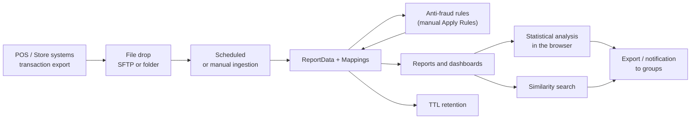
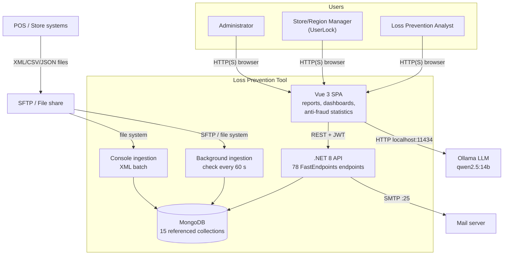

<!-- IMPACT-META
schema: 1
mode: how
step: 01_context
commit: fc7d820908b8b230fb47a2669920ba7efdb413a8
commit_short: fc7d820
branch: main
worktree: dirty
baseline_date: 2026-10-07T18:19:51+02:00
generated_at: 2026-10-08T09:37:27+02:00
-->
# Context - LOSS_PREVENTION Project (Loss Prevention Tool)

> **Baseline commit:** `fc7d820` (`main`) · worktree `dirty` (local changes only in `Docs/` and `.github/`; application code identical to the commit)

**Date**: 2026-10-08  
**Version**: 1.1  
**Authors**: IMPACT reverse engineering (static analysis of the code and of the Git history)  
**Audience**: Technical and non-technical stakeholders, development team, management

**Sources and conventions**: paths relative to the root `customspa-it-loss-prevention-d098a8b97860/`; `file:line` references to the baseline commit. The vendor documentation **does not exist at the baseline**: it was present only in commit `593f6de` and was removed in `d768cd9`; every quotation is historical and verifiable with `git show 593f6de:customspa-it-loss-prevention-d098a8b97860/Docs/<file>`. Information not derivable from code or history is marked «N/A — not derivable from the code».

---

## 1. What Is the System?

The Loss Prevention Tool is an analytics web application for loss prevention in retail: it imports point-of-sale transactions and helps analysts uncover anomalous or fraudulent behavior.

### 1.1 Overview

**Elevator pitch (3 sentences)**
1. The Loss Prevention Tool collects store transactions, received as XML, CSV or JSON files from an SFTP server or from a folder, into a single repository.
2. Analysts build reports and dashboards on their own, apply anti-fraud rules and search for transactions "similar" to a suspicious one.
3. Functions assisted by a language model turn natural-language questions into queries, and an automatic statistical analysis highlights anomalous transactions.

**Description for non-technical readers.** In stores, every receipt, return, void or discount generates a transaction. Losses due to internal fraud (for example a cashier granting undue discounts to acquaintances) or external fraud (fictitious returns, anomalous use of gift cards) are hidden in large volumes of data. The system periodically imports this data, makes it searchable with a "report designer" similar to an advanced spreadsheet, and flags suspicious transactions through configurable rules and statistics (values out of the norm compared with colleagues or with history).

**Concise technical description.** The system consists of a Vue 3 SPA (`LossPrevention.UI`), a .NET 8 API based on FastEndpoints with 78 endpoints (`LossPrevention.API`), a background service that performs scheduled ingestion (`DataIngestionBackgroundService`, check every minute), an XML batch ingestion console (`LossPrevention.DataIngestionService`) and a MongoDB database (sample dump in `Data/LossPrevention`, server 8.3.2 according to `prelude.json`). The AI functions use an Ollama LLM (`qwen2.5:14b`) called **directly from the browser** at `http://localhost:11434` (`LossPrevention.UI/src/stores/aiStore.ts:8`, `:88`). The maturity status is **pre-production**: no automated tests, no CI/CD pipeline, CORS limited to `localhost:5173/5174` (`LossPrevention.API/Program.cs:24-29`) and, according to the vendor's historical roadmap, real client data still awaited ("Real world data to test with … - Waiting for Custom", `Docs/roadmap.txt:27` historical).

### 1.2 Application Domain

**Sector**: Retail — Loss Prevention / Fraud Analytics on POS transactions (suspicious returns and refunds, voids, excessive discounts, *sweethearting*, out-of-hours transactions, splitting, anomalous use of gift cards and manually keyed cards; list derived from the 30 `fraudType` types in `aiStore.ts`).  
**System Type**: B2B Enterprise — internal analytics tool for a retailer's Loss Prevention teams (product of the external vendor `customspa-it`, distributed per client; the historical roadmap envisages future *branding* and *multi-tenancy*).  
**Criticality**: **Business-critical (decision support)**, not mission-critical: the system is not in the operational sales path (the tills work even if it is down), but its results may form the basis for investigations and disciplinary measures. Classification inferred from the domain: N/A — a formal client classification is not derivable from the code.

### 1.3 Acronyms and Nomenclature

| Acronym / Term | Meaning | Notes (context in the system) |
|--------------------|-------------|-----------------------------|
| LP | Loss Prevention | Business domain: loss prevention (inventory shrinkage, fraud) |
| POS | Point of Sale | Store till systems that produce the transaction files |
| ReportData | Transactions collection | Main MongoDB collection; schema-less documents (e.g. `TransactionID`, `TransactionDateTime`, `TotalAmount`, `LineItem`, `Tender`) |
| Mapping | Field metadata | Alias, data type, visibility of each `ReportData` field (collection `Mappings`, 52 in the dump) |
| Rule / FraudFlags | Server-side anti-fraud rule | Outcome saved in `ReportData.FraudFlags.<RuleName>` (`RulesService.cs:46-55`) |
| Fraud thresholds | Statistical thresholds | Percentiles/multipliers of the client-side statistical engine (collection `FraudDetectionSettings`) |
| Workspace / Tab | Report workspace | Each tab contains a query and the selected fields |
| Distance / Similarity | Similarity analysis | Euclidean distance, returns the 10 closest transactions (`DistanceDataservice.cs:119`) |
| KNN | K-Nearest Neighbors | Mentioned in the historical roadmap as to be verified; in the code there is only the Euclidean top-10 |
| NLQ | Natural Language Query | Natural-language question translated into a query by the LLM |
| LLM | Large Language Model | Ollama with model `qwen2.5:14b` (`aiStore.ts:8`) |
| UserLock | Per-user data restriction | User fields `LockField`/`LockValue` (e.g. `StoreID = 1083` in the dump); applied **only in the browser** (`helpers/fieldLock.ts`) |
| JWT | JSON Web Token | Authentication token, 1 h lifetime (`appsettings.json` `ExpiryHours: 1`) |
| RBAC / permissions | Role-Based Access Control | 37 `CAN_*` permissions used by the endpoints, grouped into roles (in the dump a single `Admin` role) |
| SFTP | SSH File Transfer Protocol | Source of the transaction files (SSH.NET) |
| TTL | Time To Live | MongoDB index that deletes transactions beyond retention (180 days per configuration) |
| SPA | Single Page Application | Vue 3 + Vite frontend |
| PAN | Primary Account Number | Payment card number; in the dump it is truncated (first 6 + last 4 digits) |
| SMTP | Simple Mail Transfer Protocol | Used only for the password reset email (`PasswordResetService.cs:73`) |
| Sweethearting | Internal fraud | Cashier favoring acquaintances with undue discounts/voids |
| Void | Void | Cancellation of a line or transaction, a typical fraud indicator |

---

## 2. System Scope

This section distinguishes what the code at the baseline implements from what is only declared or planned by the vendor.

### 2.1 Main Features (In Scope)

1. **Data ingestion**: import of XML/CSV/JSON files from a folder or SFTP (`IFileProcessingService` ×3, `Program.cs:102-104`), manual (`POST /api/data-ingestion/run`) or scheduled **daily, weekly or monthly** (`DataIngestionBackgroundService.cs:129-140`); tracking of processed files (`ProcessedFiles`) and automatic retention with a TTL index. Historical roadmap status: "DONE, need to test".
2. **Dynamic data model**: automatic generation of `Mappings` from the fields encountered and finalization of the types (`FileProcessingCoordinator.cs:108-109`).
3. **Self-service report designer**: workspaces/tabs, field selection, groupings and aggregations, nested conditions, calculated fields, conditional formatting, heatmap with drill-down, CSV/XLSX/PDF export (performed in the browser); queries are sent as a MongoDB pipeline to `POST /data/report/query`.
4. **Dashboard**: grid with charts, tables, text and images (5 `Dashboard` endpoints).
5. **Anti-fraud rules (server)**: rule CRUD and **manual** bulk application on all transactions (`ApplyRulesEndpoint.cs:25`). Automatic application at ingestion, declared "DONE, need to test" in the historical roadmap (`Docs/roadmap.txt:31`), **is not present in the code**.
6. **Anti-fraud statistical analysis (client)**: 30 heuristics on percentiles/deviations, configurable thresholds (3 `FraudDetection` endpoints), executed **only in the browser**; results not persisted.
7. **Similarity search**: top-10 transactions most similar to a given one (Euclidean).
8. **AI functions**: NLQ → query and generation of anti-fraud report templates via local Ollama.
9. **Security and administration**: JWT login, password reset via email, management of users/roles/permissions (32 `User` endpoints), UserLock (client only).
10. **Collaboration**: user groups and notifications with reply (`POST /notifications/{id}/reply`), without real-time push; `GET /notifications` does not filter by recipient (`ListNotificationsEndpoint.cs:30`).

### 2.2 Out of Scope

Features absent from the code at the baseline; where indicated, they are only envisaged by the historical roadmap (`Docs/roadmap.txt`, commit `593f6de`).

- **Case management / investigation management**: not implemented; roadmap "Case Management Tool - Need design" (`:83`). Alternative owner: N/A — not derivable from the code.
- **Workflow / blueprint and automatic alerting**: no workflow engine or alert dispatch; roadmap "Extend Functionality for Alerts and Notifications" (`:66`).
- **Multi-tenancy**: a single database/configuration; roadmap "Multi-Tenancy - Simplified Version" (`:68`).
- **SSO / external identity provider**: local username/password authentication only; roadmap "SSO" (`:76`).
- **Lookup tables**: absent (`IsLookup` flag present in the mappings but without logic); roadmap "Lookup Tables" (`:30`, `:69`).
- **Receipt view** and full **KNN**: roadmap `:86-87`.
- **Audit trail** of investigations and accesses: declared in `Docs/01_EXECUTIVE_OVERVIEW.md` ("Comprehensive Audit Trail", historical) but absent from the code.
- **API for third-party systems / export to other systems**: no application consumer; the only outbound integration is email.
- **Trained machine learning**: the "intelligent" functions are statistical heuristics and LLM prompts, not trained models.

### 2.3 System Boundaries

The system boundary includes SPA, API, ingestion services and database; POS, SFTP, SMTP and Ollama are external. C4 Level 1 diagram in textual form (the graphical diagram is in [§6](#6-context-diagram)).

```
[Loss Prevention Tool System]
  ↑ Input:
    - LP analysts, Store/Region Managers, administrators (via web SPA, HTTP + JWT)
    - Store POS / back-office systems (XML/CSV/JSON files dropped on SFTP or in a folder)
    - SFTP server / file share (file reading, move to processed/failed)
    - Internal scheduler (daily/weekly/monthly trigger, check every 60 s)
    - Ollama LLM on localhost:11434 of the user's workstation (NLQ answers, called from the browser)
  ↓ Output:
    - SMTP mail server (password reset emails)
    - Users (on-screen reports, CSV/XLSX/PDF exports generated in the browser, dashboards, internal notifications)
    - SFTP server (move of processed files to the processed/failed folder)
```

---

## 3. Organizational and Systemic Context

The system supports the loss detection process from the collection of POS data up to the sharing of suspicions; the organizational context can be derived from the repository only to a minimal extent.

### 3.1 Supported Business Process

**Process**: Detection and analysis of losses/fraud on till transactions (Retail Loss Prevention).

**Supported process phases**:
1. **Data collection**: the POS systems export transactions as files to SFTP or a shared folder (outside the system).
2. **Ingestion**: scheduled or manual import, field normalization, mapping update, tracking of processed files.
3. **Classification**: manual application of the anti-fraud rules (`FraudFlags`) and statistical analysis in the browser.
4. **Analysis**: reports, dashboards, heatmaps, similarity search, natural-language questions.
5. **Sharing**: export of results and notifications to user groups.
6. **Retention**: automatic deletion of transactions beyond the configured window (TTL).



**Operational Criticality**:
- **Downtime tolerance**: N/A — not derivable from the code: there are no SLAs, health checks or high-availability configurations.
- **Business impact downtime**: inferred from the architecture — analysts cannot consult reports or apply rules; the scheduled ingestion skips the run (`LastRunAt` is kept only in memory, `DataIngestionBackgroundService.cs:86`) and the files remain on the SFTP server until the next run, so no data is lost. Sales are not impacted.
- **Peak usage periods**: N/A — not derivable from the code: no usage data; the schedule configured in the dump is the only clue about batch loads.
- **Relevant time constraints**: 1 h JWT session without refresh token; ingestion job checked every minute (`DataIngestionBackgroundService.cs:13`).

### 3.2 System Landscape

#### Upstream Systems (Data Providers)

| System | Data Provided | Protocol | Frequency | Criticality |
|---------|--------------|------------|-----------|-----------|
| Store POS / back-office systems | Transactions (header, `LineItem` lines, `Tender` payments, operator, store, register) | XML/CSV/JSON files (format not constrained: the converter flattens any structure) | According to the schedule: daily / weekly / monthly, or manual | High (only data source) |
| SFTP server | Files to import; `processed`/`failed` folders (`SftpFileProcessingService.cs:33-34`) | SFTP (SSH.NET, password authentication, no host key verification) | As above | High |
| File share / local folder | Files to import (`Directory.GetFiles`, `FileProcessingCoordinator.cs:153`; batch console on `C:\xmlstore5\xml`, `DataIngestionService/Program.cs:76`) | File system | As above / manual execution of the console | Medium (alternative to SFTP) |

#### Downstream Systems (Data Consumers)

| System | Data Received | Protocol | Frequency | Criticality |
|---------|---------------|------------|-----------|-----------|
| No application system | — | — | — | No API or automatic export to other systems |
| End users (outside the system) | CSV/XLSX/PDF exports generated in the browser | File download | On demand | Low |
| SFTP server | Processed files moved to `processed`/`failed` | SFTP | At every ingestion | Low |

#### Integrated Systems (Peer-to-Peer)

| System | Integration Type | Protocol | SLA | Owner |
|---------|-------------------|------------|-----|-------|
| Ollama LLM (`qwen2.5:14b`) | NLQ and report generation, called from the browser | HTTP REST `localhost:11434` | N/A — not derivable (local service on the user's workstation) | User / client IT (N/A — not derivable from the code) |
| SMTP mail server | Sending of password reset emails | SMTP `localhost:25`, `EnableSsl = false` (`EmailService.cs:63-65`) | N/A — not derivable from the code | Client IT (N/A — not derivable from the code) |
| MongoDB | Persistence of all collections (15 referenced by the code) | MongoDB wire protocol (`mongodb://localhost:27017`) | N/A — not derivable (no deployment defined) | N/A — to be defined (roadmap: Atlas, Cosmos DB Mongo API or client infrastructure) |

### 3.3 Organizational Context

**Ownership**:
- **Business Owner**: N/A — not derivable from the code (the end client is not named; the historical roadmap refers to it as "Custom"/"Customer").
- **Product Owner**: N/A — not derivable from the code.
- **Technical Owner**: external vendor identified by the folder name `customspa-it-loss-prevention-*` (inference); no `CODEOWNERS` file.

**Governance**:
- **Steering Committee**: N/A — not derivable from the code.
- **Change Approval**: no process tracked in the repository: a single branch (`main`), no pull requests, direct commits; the historical roadmap lists "Branching Strategy" and "DevOps" among the 3-6 month activities.
- **Budget**: N/A — not derivable from the code.

**Team Structure**:
- **Development Team**: N/A — not derivable from the code. The Git history (13 commits, a single author `saristot`, code imported in bulk in commit `593f6de` of 2026-10-05) does not represent the vendor's original development team.
- **Operations Team**: N/A — not derivable from the code (no infrastructure as code, runbooks or monitoring).
- **Support Team**: N/A — not derivable from the code; the historical documentation (`Docs/01_EXECUTIVE_OVERVIEW.md`, section "Licensing & Support") mentions the vendor's "Professional services", "Training" and "Ongoing support and maintenance".

---

## 4. System Users

Users are derived from the `CAN_*` permissions (37 used by the endpoints), from the SPA screens and from the users in the dump; actual numbers and usage habits are not derivable from the repository.

### 4.1 Primary Users

#### User Type 1: Loss Prevention Analyst

| Attribute | Value |
|-----------|--------|
| **Number of users** | N/A — not derivable from the code (the dump contains only 2 test users: `admin` and `lockeddownuser`) |
| **Usage frequency** | N/A — not derivable from the code; inference: daily/periodic use after each ingestion |
| **Technical proficiency** | Medium-High (builds queries with nested conditions, calculated fields, aggregations) |
| **Devices** | Desktop (layout designed for wide screens: a single `@media` in the entire SPA, `home.vue:423`) |
| **Location** | N/A — not derivable from the code; technical constraint: the AI functions require Ollama on the user's own workstation |
| **UI language** | English (`index.html` `lang="en"`, component labels in English) |
| **Typical permissions** | `CAN_VIEW_REPORT`, `CAN_VIEW_WORKSPACES`, `CAN_MANAGE_WORKSPACES`, `CAN_VIEW_DASHBOARD`, `CAN_VIEW_RULE`, `CAN_APPLY_RULE`, `CAN_VIEW_FRAUD_SETTINGS` |

**Main Goals**:
1. Identify suspicious transactions, operators and stores without manual extractions.
2. Investigate a case in depth by finding similar transactions (similarity top-10) and filtering by `FraudFlags`.
3. Produce reports and exports (CSV/XLSX/PDF) and share them with groups via notifications.

**Pain Points to Avoid** (observed in the code):
- Loss of the statistical analysis results at the end of the session (computation and results only in the browser).
- Slowness on large datasets: the statistical analysis is executed in the browser; `ApplyRulesAsync` loads the whole of `ReportData` into memory; 1 h report cache not invalidated after new ingestions (`GetReportDataEndpoint.cs:81`), hence potentially stale data.
- Session that expires after 1 h without automatic renewal.
- AI functions unavailable if Ollama is not installed locally.

**Typical User Journey**:
```
1. Login (username/password, JWT 1 h) → 2. Opens a Workspace and a report tab →
3. Selects fields, filters and groupings (or asks a question in natural language) →
4. Runs the statistical anti-fraud analysis / filters by FraudFlags → 5. Opens a transaction and searches for similar ones →
6. Exports the result or sends a notification to a group
```

---

#### User Type 2: Store/Region Manager (user with UserLock)

| Attribute | Value |
|-----------|--------|
| **Number of users** | N/A — not derivable from the code (in the dump 1 sample user, `lockeddownuser`, with `LockField = StoreID`, `LockValue = 1083`) |
| **Usage frequency** | N/A — not derivable from the code |
| **Technical proficiency** | Low-Medium (consults prepared dashboards and reports) |
| **Devices** | Desktop |
| **Location** | N/A — not derivable from the code (inference: store or regional office) |

**Main Goals**:
1. Consult indicators and suspicious transactions of their own store/region.
2. Receive and reply to notifications from the LP team.

**Pain Points to Avoid**:
- **Data restriction only apparent**: the `LockField/LockValue` filter is applied in the browser (`helpers/fieldLock.ts`); by calling the API directly the user can read the data of all stores.
- The lock field in the dump (`StoreID`) does not appear in the sample transactions, which use `LocationID`: with this data the filter would not return consistent results.

**Typical User Journey**:
```
1. Login → 2. Opens the assigned dashboard → 3. Consults reports filtered on their own store →
4. Reads the notifications and replies to the LP team
```

---

### 4.2 Secondary Users

- **Application administrator**: manages users, roles and permissions (32 `User` endpoints), groups, field mappings, anti-fraud rules, ingestion configuration and scheduling, anti-fraud statistical thresholds. In the dump there is a single role, `Admin`, with all 37 permissions.
- **IT administrator**: installs and configures MongoDB, API, SMTP, SFTP and Ollama on the workstations; runs the seed scripts `Data/MongoDBScripts/00..04_*.js`. No runbook is present at the baseline.
- **Management / LP Manager**: consumer of dashboards and reports; the system does not offer anti-fraud effectiveness KPIs (the "ROI Tracking" declared in the historical documentation is not implemented).

### 4.3 External Actors

- **External systems**: POS/back-office (via files), SFTP server, SMTP mail server, Ollama runtime.
- **Time actor**: `DataIngestionBackgroundService` (check every 60 s, daily/weekly/monthly trigger).
- **Email recipients**: users who request a password reset (the only email sent by the system).
- **External API consumers**: none (all endpoints, except 4 anonymous login/reset ones, require JWT and permissions).

---

## 5. Motivation and Value

The motivation is declared only in the vendor's historical documentation; the code makes it possible to verify what is actually implemented, not the economic benefits.

### 5.1 Business Drivers

**Problem Solved**: centralize heterogeneous POS data (different formats and schemas per chain or store) and give LP teams self-service tools to detect losses and fraud without depending on IT for every extraction. The schema-less model (MongoDB + automatically generated `Mappings`) is the technical answer to the variability of formats.

**Problem metrics**: N/A — not derivable from the code: the repository contains no data on the previous situation (losses, investigation times, volumes).

**Added Value (ROI) declared by the vendor** — historical source: `Docs/01_EXECUTIVE_OVERVIEW.md`, section "Success Metrics" (lines 178-185; present only in commit `593f6de`, removed in `d768cd9`; `git show 593f6de:customspa-it-loss-prevention-d098a8b97860/Docs/01_EXECUTIVE_OVERVIEW.md`):

| Declared KPI | Vendor target | Verifiability in the code |
|----------------|---------------------|---------------------------|
| Fraud-related losses | −30-50% | Not verifiable: no baseline data or measurement |
| Investigation time | −70% | Not verifiable: no case management or time tracking |
| Manual reporting time | −60% | Plausible (self-service report designer present), not measured |
| Self-service user satisfaction | 90% | Not verifiable |
| ROI | 6-12 months | Not verifiable: no economic data |

These metrics are **commercial claims**: there is no data, test or benchmark in the repository to support them, and the historical roadmap indicates that the product has not yet been tried on real data (`Docs/roadmap.txt:27`). Some benefits declared in the same source (section "Business Value": "Comprehensive Audit Trail", "Audit logs … meet regulatory requirements", "Identify suspicious transactions in real-time") **find no match in the code**. The point-by-point verification is in [02_functional_overview.md](02_functional_overview.md), section «Verification of features declared by the vendor».

**Alternatives Considered**: N/A — not derivable from the code: no decision document. Typical market alternatives, given as a reference for the evaluation (not documented by the vendor): commercial loss prevention/exception-based reporting suites for retail; generic BI (Power BI, Qlik) with SQL rules on a data warehouse. The declared distinctive value is the combination of dynamic schema, configurable anti-fraud and AI.

### 5.2 Technical Drivers

**Technology Modernization**:
- .NET 8 LTS ends support on **November 10, 2026**: migration to .NET 10 LTS needed shortly.
- Frontend dependencies to update/remove: 71 npm vulnerabilities (6 critical, 46 high), `xlsx@0.18.5` without a fix, unused Nuxt/jsPDF packages; lockfile out of sync (`npm ci` fails).

**Scalability Requirements**:
- The historical documentation lists among the activities "in development" the optimization for large datasets (`Docs/01_EXECUTIVE_OVERVIEW.md`, section "Current Status (As of February 2026)") and the roadmap envisages possible optimizations "of the back of" real data (`Docs/roadmap.txt:27`).
- Retention to contain volumes: roadmap "We should look at TTL for expiring documents (after say 3 months)" (`Docs/roadmap.txt:39`); the code sets 180 days (`appsettings.json` `TransactionRetentionDays`), with a TTL index on the `BeginDateTime` field (`DatabaseInitializationService.cs:97`), which is absent from the sample data.
- Expected growth of users/stores: N/A — not derivable from the code.

**Integration Needs**:
- Ingestion from SFTP/file system for XML/CSV/JSON formats (implemented).
- SSO and multi-tenancy (planned, roadmap `:68`, `:76`).
- Proposed cloud deployment: Azure Functions, Cosmos DB Mongo API (vCore) or MongoDB Atlas, or client infrastructure; separate Sales/UAT/Production environments (`Docs/roadmap.txt:51-56`) — none of these options is implemented in the repository.

### 5.3 Compliance and Regulatory Drivers

**Applicable Regulations** (identified by the analysis based on the data processed; no regulatory reference in the code):

| Regulation | Relevance to the system | Status in the code at the baseline |
|-----------|--------------------------|--------------------------------|
| **GDPR (EU Reg. 2016/679)** | Personal data of employees (cashiers) and customers; behavioral profiling | Absent: audit logs, minimization, server-side data access control (UserLock client only), effective retention management; password hashes exposed by `GET /users` (`GetUsersEndpoint.cs:36`) |
| **Statuto dei Lavoratori, L. 300/1970 art. 4** (Italy, as amended by D.Lgs. 151/2015) | Tools from which remote monitoring of workers' activity derives | Requires a trade-union agreement or authorization from the Labor Inspectorate and notice to employees; no support in the system (e.g. purpose tracking) |
| **PCI DSS** | If the POS files contain card data | In the dump `CardNumber` is truncated (6+4 digits); no application control prevents the import of full PANs or encrypts the data |
| **AI Act (EU Reg. 2024/1689)** | AI systems used to monitor and evaluate workers' behavior fall among the high-risk cases (Annex III) | AI functions without governance, logs or documented oversight; LLM executed on the user's workstation |

**Compliance Impact** (in case of non-compliance):
- GDPR fines of up to 20 M€ or 4% of annual worldwide turnover.
- Inadmissibility, in disciplinary or judicial proceedings, of evidence collected in breach of art. 4 of the Statuto dei Lavoratori, with a risk of litigation.
- Data breach: the execution of arbitrary MongoDB pipelines (`GetReportDataEndpoint.cs:68`) and the JWT secret versioned in `appsettings.json` expose the system to unauthorized reads/writes.
- Inability to go into production at clients subject to audits (absence of audit trail).

---

## 6. Context Diagram

The C4 Level 1 diagram shows the system, its users and the external systems with which it exchanges data.



Note: `BG` is hosted in the API process (`AddHostedService`); `JOB` is a separate executable (`LossPrevention.DataIngestionService`). The LLM is not a central service: it is called from each user's browser.

---

## 7. Final Considerations

The system is a functionally rich product but in a pre-production state; before use with real data, security, build and validation work is needed.

### 7.1 Points of Attention

- **Maturity**: no automated tests, no CI/CD, no hardening (CORS localhost only, no HTTPS redirection/HSTS in `Program.cs`), non-reproducible frontend build (`npm ci` fails; 12 imports with wrong upper/lower case break the build on case-sensitive file systems).
- **Gap between declared and implemented**: audit trail, field-level access control, automatic application of rules at ingestion and "Nuxt 3 SSR" (`README.md:31`) find no match in the code; the README declares 41 permissions, the endpoints use 37.
- **Dependency on a local LLM**: the AI functions require Ollama and `qwen2.5:14b` on every workstation.
- **Data security**: arbitrary MongoDB pipelines from the client, row-level security only in the browser, exposed password hashes, versioned secrets and dump with data.
- **Real data not yet available** (historical roadmap): risk of rework on mappings, performance and rules; the sample data does not contain the fields used by TTL (`BeginDateTime`) and UserLock (`StoreID`).
- **Platform**: .NET 8 end of support on November 10, 2026.
- **Undocumented organizational context**: owners, governance, SLAs and team are N/A in the repository and must be gathered from the client/vendor.

### 7.2 Success Criteria

**Project KPIs** (proposed by the analysis; dates and budget not derivable from the code):
1. **Go-Live by**: N/A — not derivable from the code (no planning in the repository); minimum prerequisite: migration to .NET 10 before November 10, 2026 or formal acceptance of the risk.
2. **Budget met**: N/A — not derivable from the code.
3. **User Adoption**: ≥ 80% of enabled LP users running at least one report per week after 3 months (measurable only after the introduction of usage logs, currently absent).
4. **Performance**: P95 of `POST /data/report/query` < 3 s on 1 million transactions; rule application on 1 million transactions < 10 min.
5. **Quality**: 0 open critical/high vulnerabilities (currently 6 critical + 46 high npm) and test coverage ≥ 60% on the Application services (currently 0%) before go-live; < 10 critical bugs in the following 6 months.
6. **Data security**: UserLock filter and pipeline validation applied server-side, verified by automated tests.
7. **Validation**: at least 3 real client datasets imported and analyzed, with outcomes confirmed by the LP team.

---

## 8. Reference Documents

IMPACT documents of the set (same `Docs/` folder), historical vendor documentation and regulatory references.

**IMPACT documents**

| Document | Content |
|-----------|-----------|
| [00_deep_dive.md](00_deep_dive.md) | Deep Dive Analysis: technical inventory, metrics, critical issues |
| [01_context.md](01_context.md) | This document |
| [02_functional_overview.md](02_functional_overview.md) | Features, use cases, verification of the vendor's claims |
| [03_non_functional_overview.md](03_non_functional_overview.md) | Non-functional requirements |
| [04_constraints.md](04_constraints.md) | Constraints |
| [05_principles.md](05_principles.md) | Architectural principles |
| [06_software_architecture.md](06_software_architecture.md) | Software architecture |
| [07_code.md](07_code.md) | Code structure |
| [08_data.md](08_data.md) | MongoDB data model |
| [09_infrastructure_architecture.md](09_infrastructure_architecture.md) | Infrastructure architecture |
| [10_deployment.md](10_deployment.md) | Deployment |
| [11_development_environment.md](11_development_environment.md) | Development environment |
| [12_operation_and_support.md](12_operation_and_support.md) | Operation and support |
| [13_decision_log.md](13_decision_log.md) | Decision log |
| [14_metrics.md](14_metrics.md) | Metrics |
| [15_fp_cocomo.md](15_fp_cocomo.md) | Function Points and COCOMO |
| [16_frontend_deep_assessment.md](16_frontend_deep_assessment.md) | Frontend assessment |
| [17_backend_deep_assessment.md](17_backend_deep_assessment.md) | Backend assessment |
| [18_antipattern_deep_dive.md](18_antipattern_deep_dive.md) | Anti-patterns |
| [19_modernization_estimation_spec.md](19_modernization_estimation_spec.md) | Modernization estimate |

**Historical vendor documentation** (present only in commit `593f6de`, removed in `d768cd9`; viewable with `git show 593f6de:customspa-it-loss-prevention-d098a8b97860/Docs/<file>`):
- `Docs/01_EXECUTIVE_OVERVIEW.md` — Business Value, Current Status, Success Metrics.
- `Docs/roadmap.txt` — feature status, remaining activities, suggested deployment, 3-6 month roadmap.
- `Docs/04_DEPLOYMENT_GUIDE.md`, `Docs/11_USER_MANUAL.md` — deployment options and user manual.
- Complete inventory of the 17 files in [00_deep_dive.md](00_deep_dive.md), section «Documentation Inventory».

**Other references required by the template**:
- **Business Requirements**: N/A — not derivable from the code (no requirements document in the repository).
- **User Research**: N/A — not derivable from the code (no interviews or personas documented).
- **Competitive Analysis**: N/A — not derivable from the code (see §5.1, «Alternatives Considered»).

**Regulatory References**:
- GDPR — Regulation (EU) 2016/679: https://eur-lex.europa.eu/eli/reg/2016/679/oj
- AI Act — Regulation (EU) 2024/1689: https://eur-lex.europa.eu/eli/reg/2024/1689/oj
- Statuto dei Lavoratori — Law no. 300 of 20 May 1970, art. 4 (text in force at https://www.normattiva.it)
- PCI DSS — PCI Security Standards Council: https://www.pcisecuritystandards.org

---

## Change Log

| Version | Date | Author | Changes |
|----------|------|--------|-----------|
| 1.0 | 2026-10-07 | REVERSE how (FULL) | Document creation (replaces run 2026-10-05) |
| 1.1 | 2026-10-08 | IMPACT verify | Header `worktree: dirty`; vendor documents cited as historical (`593f6de`→`d768cd9`) with `git show` command; added Sector/System Type/Criticality, 3-column acronyms, numbered features with evidence (scheduling also monthly, rules manual only), justified out of scope, Input/Output boundary, phases and operational criticality, upstream/downstream/peer tables, ownership/governance/team (justified N/A), attribute tables and journeys per user, vendor KPIs with verifiability, technical drivers (TTL "after say 3 months" vs 180 days, .NET 8 EOL), compliance impact, measurable success criteria, complete Reference Documents (00-19, historical, regulatory) |
