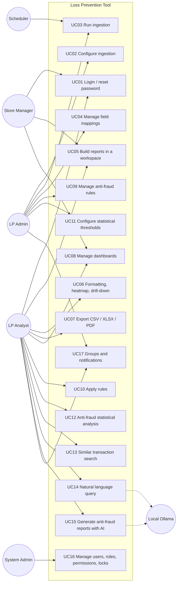
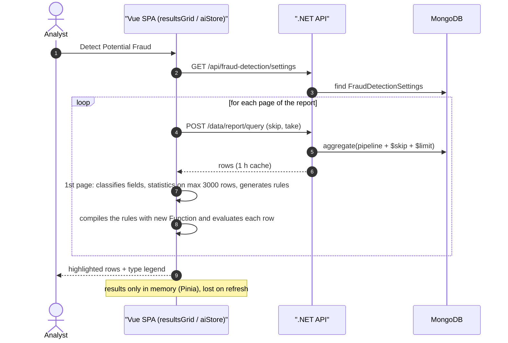
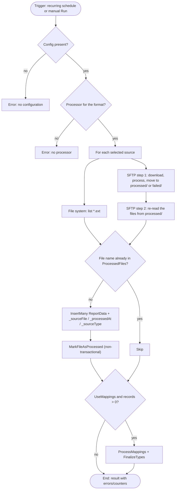
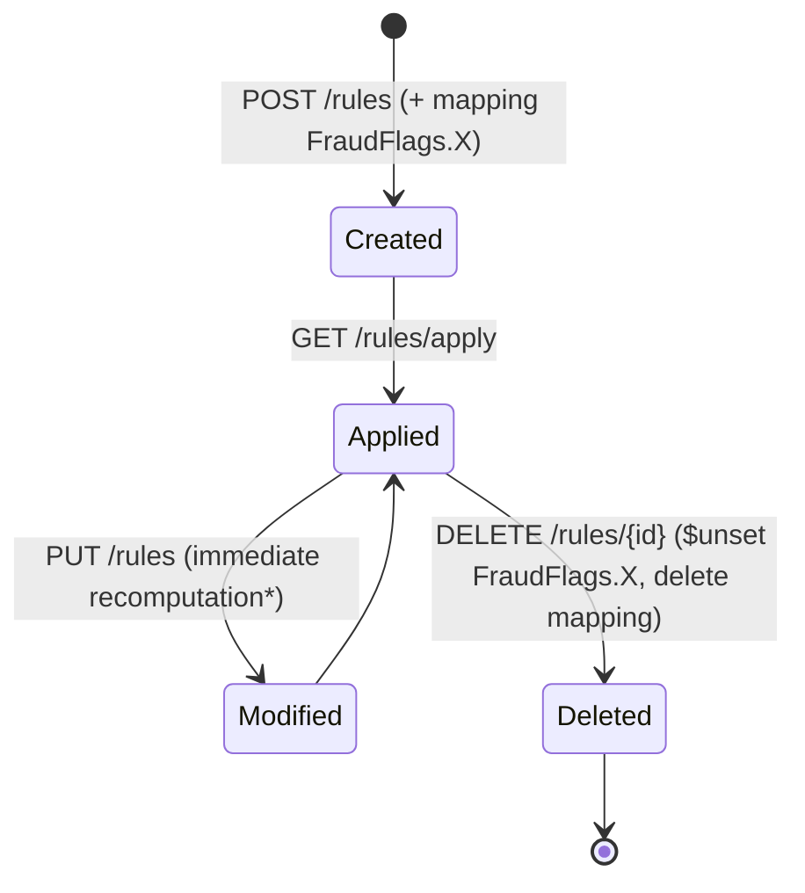
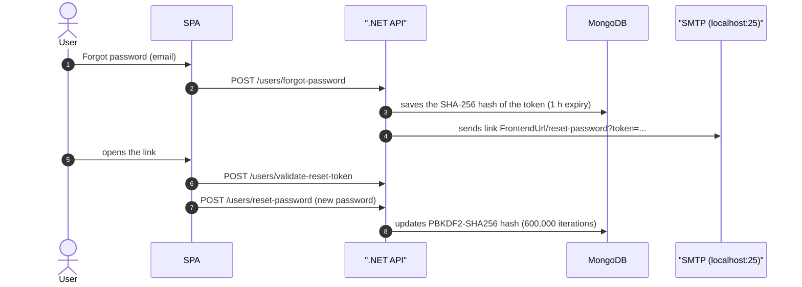
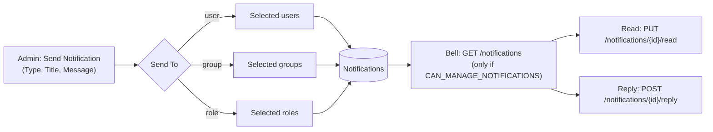
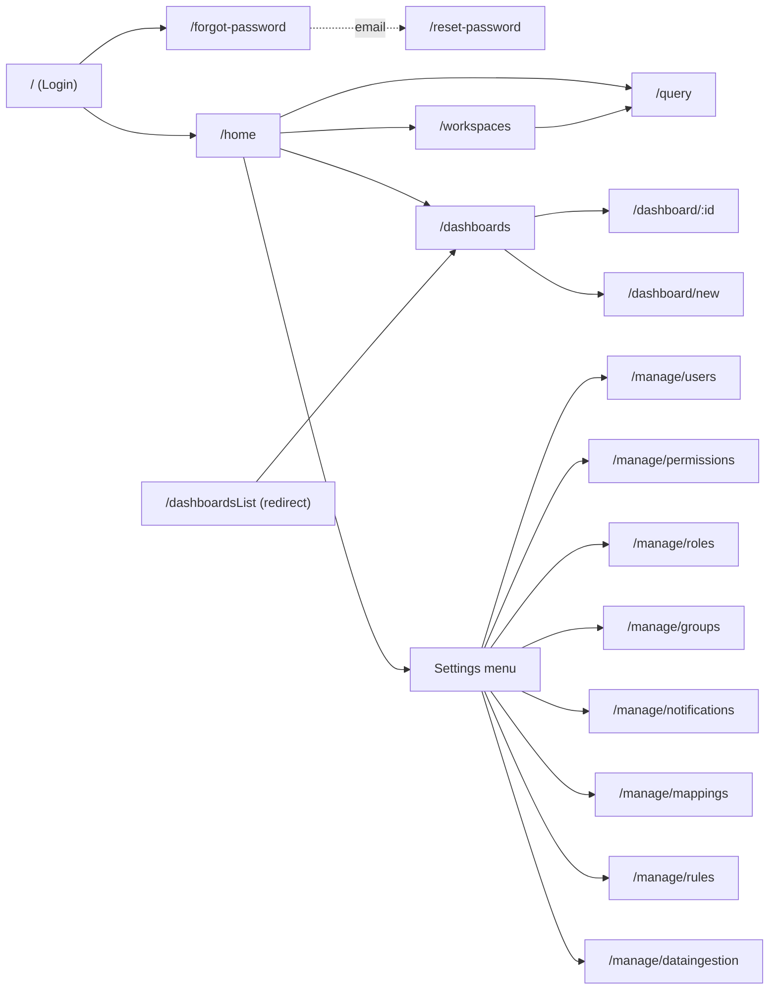

<!-- IMPACT-META
schema: 1
mode: how
step: 02_functional_overview
commit: fc7d820908b8b230fb47a2669920ba7efdb413a8
commit_short: fc7d820
branch: main
worktree: dirty
baseline_date: 2026-10-07T18:19:51+02:00
generated_at: 2026-10-08T09:38:00+02:00
-->
# Functional Overview - LOSS_PREVENTION Project (Loss Prevention Tool)

> **Baseline commit:** `fc7d820` (`main`) · worktree `dirty` (local changes only in `Docs/` and `.github/`; application code identical to the commit)

**Date**: 2026-10-08  
**Version**: 1.1  
**Authors**: IMPACT REVERSE how (static analysis of the code + IMPACT verification)  
**Audience**: Technical and non-technical stakeholders, development team, UX designers

---

### Sources and conventions

- **Code** at commit `fc7d820` (.NET 8 FastEndpoints + MongoDB backend, Vue 3/Vite SPA in `LossPrevention.UI`). All paths are relative to the project root `customspa-it-loss-prevention-d098a8b97860/`.
- **Sample data**: dump `Data/LossPrevention/*.bson` (12 collections: 10 in use + `Mappings_old`, `ReportData_old`) and scripts `Data/MongoDBScripts/00..04`.
- **Historical vendor documentation**: `Docs/01_EXECUTIVE_OVERVIEW.md`, `Docs/11_USER_MANUAL.md`, `Docs/09_SECURITY_DOCUMENTATION.md`, `Docs/roadmap.txt` **do not exist at the baseline**: they were present only in commit `593f6de` and were removed in `d768cd9`. They can be consulted with `git show 593f6de:customspa-it-loss-prevention-d098a8b97860/Docs/<file>` (run from `C:\repository\LOSS_PREVENTION`). They are used only to compare the claims with the code (§7).
- Maturity legend: ✅ implemented · 🟡 implemented with significant limitations · 🔴 absent/not working · ⚠️ security defect.

---

## 1. User Types & Personas

The code defines **a single profiling mechanism**: `CAN_*` permissions grouped into roles and assigned to users, plus an optional per-user filter (`LockField`/`LockValue`). The sample data contains a single role, so the personas below are **reconstructed** from the permission groupings used by the endpoints and from the screens.

### 1.1 Roles and users actually configured

| Element | Value at the baseline | Evidence |
|----------|--------------------|----------|
| Roles present | **1**: `Admin`, with all 37 permissions used by the endpoints | `Data/LossPrevention/Roles.bson`; `Data/MongoDBScripts/02_AddPermissionsToAdminRole.js` |
| Users present | `admin` (Admin role) and `lockeddownuser` (`LockField = StoreID`, `LockValue = 1083`) | `Data/LossPrevention/Users.bson` |
| Permissions used by the endpoints | **37** distinct `CAN_*` (74 endpoints out of 78 have `Permissions(...)`; 4 are `AllowAnonymous`) | `LossPrevention.API/Endpoints/**` |
| Permissions in the seed scripts | `01_CreatePermissions.js` creates exactly the 37; `03_CleanupStalePermissions.js` deletes 4 obsolete names (`CAN_LOGIN`, `CAN_ADD_USERS`, `CAN_DELETE_USERS`, `CAN_UPDATE_USERS`). The scripts therefore name **41** distinct names (37 + 4 obsolete) | `Data/MongoDBScripts/01_*.js`, `03_*.js` |
| `PERMISSIONS_LIST.md` | The header says "40 permissions" but lists 41 names; it includes unused granular ones (`CAN_CREATE/VIEW/UPDATE/DELETE_WORKSPACE`, `CAN_CREATE/UPDATE/DELETE_DASHBOARD`, `CAN_ANALYZE_DATA`) and does not contain `CAN_VIEW_WORKSPACES`, `CAN_MANAGE_WORKSPACES`, `CAN_VIEW_GROUPS`, `CAN_VIEW_NOTIFICATIONS` | `Data/MongoDBScripts/PERMISSIONS_LIST.md` |
| "Administrator / Analyst / Viewer" roles | Described only in the historical vendor manual (`Docs/11_USER_MANUAL.md` §"Default Roles", commit `593f6de`); they are **not** created by any script | `git show 593f6de:…/Docs/11_USER_MANUAL.md` |

### 1.2 Personas (reconstructed)

| Persona | Goals | Key permissions (out of the 37) | Screens (route) | Notes |
|---------|-----------|--------------------------|-------------------|------|
| **Laura – LP Analyst** (central) | Build reports, search for anomalies, compare similar transactions, share dashboards | `CAN_VIEW_REPORT`, `CAN_VIEW_WORKSPACES`, `CAN_MANAGE_WORKSPACES`, `CAN_VIEW_DASHBOARD`, `CAN_MANAGE_DASHBOARDS`, `CAN_APPLY_RULE`, `CAN_VIEW_FRAUD_SETTINGS`, `CAN_VIEW_NOTIFICATIONS` | `/home`, `/workspaces`, `/query`, `/dashboards`, `/dashboard/:id` | Intensive use of `resultsGrid.vue` (export, "Detect Potential Fraud", distance) |
| **Marco – Store/Region Manager** (limited scope) | See only the data of their own store | `CAN_VIEW_REPORT`, `CAN_VIEW_DASHBOARD`, `CAN_VIEW_WORKSPACES` | `/home`, `/dashboards`, `/query` | Real example: `lockeddownuser` with `StoreID = 1083`. The filter is applied **only in the browser** (`src/helpers/fieldLock.ts`); the API does not filter (⚠️) |
| **Giulia – LP Administrator** | Configure ingestion, mappings, rules, statistical thresholds, notifications | `CAN_MANAGE_DATA_INGESTION`, `CAN_*_MAPPINGS`, `CAN_CREATE/UPDATE/DELETE_RULE`, `CAN_MANAGE_FRAUD_SETTINGS`, `CAN_MANAGE_NOTIFICATIONS`, `CAN_MANAGE_GROUPS` | `/manage/dataingestion`, `/manage/mappings`, `/manage/rules`, `/manage/notifications`, `/manage/groups` | The menu items depend on permissions different from those of the endpoints (§1.3) |
| **Paolo – System Administrator** | Manage users, roles, permissions, per-user locks | `CAN_CREATE/VIEW/UPDATE/DELETE_USER`, `CAN_CREATE/VIEW/UPDATE/DELETE/ASSIGN_ROLE`, `CAN_CREATE/VIEW/UPDATE/DELETE/ASSIGN_PERMISSION` | `/manage/users`, `/manage/roles`, `/manage/permissions` | Corresponds to the `Admin` role in the dump |
| **Scheduler (system actor)** | Start the recurring ingestion | n/a (in-process) | n/a | `DataIngestionBackgroundService` (polling every 60 s) |
| **Local LLM (external system)** | Translate questions into queries/reports | n/a | n/a | Ollama at `http://localhost:11434` called from the browser (`src/stores/aiStore.ts:88`) |

### 1.3 "Settings" menu visibility vs API authorization

The ⚙ menu in `src/App.vue` (lines 72-101) shows the items based on the permissions read from the JWT in the browser (`hasPermission`, lines 282-311). The conditions do not match the permissions required by the endpoints:

| Menu item | UI condition (`App.vue`) | Permission required by the API | Effect with the current seeds |
|--------------|---------------------------|-----------------------------|----------------------------|
| Manage Users | `CAN_ADD_USERS` ∨ `CAN_DELETE_USERS` ∨ `CAN_UPDATE_USERS` ∨ `CAN_VIEW_USER` ∨ `CAN_CREATE_USER` ∨ `CAN_UPDATE_USER` (314-323) | `CAN_*_USER` | Visible for Admin |
| Manage Permissions | only `CAN_ADD_USERS` ∨ `CAN_UPDATE_USERS` (325-329) | `CAN_*_PERMISSION` | **Hidden even for Admin** (names deleted by `03_CleanupStalePermissions.js`); the route `/manage/permissions` remains reachable by URL |
| Manage Roles | only `CAN_ADD_USERS` ∨ `CAN_UPDATE_USERS` (331-335) | `CAN_*_ROLE` | **Hidden even for Admin**; route `/manage/roles` reachable by URL |
| Manage Groups | `CAN_ADD_USERS` ∨ `CAN_UPDATE_USERS` ∨ `CAN_MANAGE_GROUPS` (337-343) | `CAN_VIEW_GROUPS` / `CAN_MANAGE_GROUPS` | Visible for Admin |
| Manage Rules | `CAN_UPDATE_MAPPINGS` (359-363) | `CAN_*_RULE` | Inconsistent (permission from another area) |
| Manage Data Ingestion | `CAN_CREATE_TRANSACTION` (365-369) | `CAN_VIEW/MANAGE_DATA_INGESTION` | Inconsistent |

The router (`src/router/index.ts:56-70`) only checks that the token is valid (`requiresAuth`), without per-permission checks.

---

## 2. Core Use Cases

17 use cases are documented, covering all 78 endpoint classes and the 18 SPA routes. The diagram shows the actor → use case relationships (UML use-case notation rendered as a flowchart).



| ID | Use case | Actor | Endpoint (permission) · component | Functional notes |
|----|----------|--------|-----------------------------------|-----------------|
| UC01 | Login, forgot/reset password | All | `POST /users/login`, `/users/forgot-password`, `/users/validate-reset-token`, `/users/reset-password` (anonymous) · `Login.vue`, `ForgotPassword.vue`, `ResetPassword.vue` | JWT token valid `ExpiryHours = 1` (`appsettings.json`); automatic logout on expiry (`loginStore.scheduleExpiryLogout`, `src/stores/loginStore.ts:54-62`); reset token valid 1 h (`PasswordResetService.cs:19`) |
| UC02 | Configure source, format, schedule | LP Admin | `GET /api/data-ingestion` (`CAN_VIEW_DATA_INGESTION`); `PUT`, `DELETE`, `PATCH …/sources`, `PATCH …/schedule`, `DELETE …/schedule`, `PUT …/recurrence-options` (`CAN_MANAGE_DATA_INGESTION`) · `manage/dataingestion.vue` | SFTP / File System sources; CSV / XML / JSON formats (`dataIngestionStore.ts:9-17`); one-time or recurring schedule; in the UI Daily / Weekly recurrence (`dataIngestionStore.ts:29-32`), the backend also handles `monthly` (day 1) |
| UC03 | Run ingestion | LP Admin / Scheduler | `POST /api/data-ingestion/run` (`CAN_MANAGE_DATA_INGESTION`) · `DataIngestionBackgroundService` | Adds `_sourceFile`, `_processedAt`, `_sourceType`; records `ProcessedFiles`; on SFTP moves the files to `processed/` or `failed/` |
| UC04 | Manage mappings | LP Admin | `GET/POST/PUT/DELETE /data/mappings` (`CAN_VIEW/CREATE/UPDATE/DELETE_MAPPINGS`) · `manage/mappings.vue` | Name, Alias, Data Type, Collection, Longest Length, Visible/Calculated/Lookup/Array flags. `IsLookup` is only a flag, without logic |
| UC05 | Report builder | Analyst | `POST /data/report/query` (`CAN_VIEW_REPORT`); `/workspaces*` (`CAN_VIEW_WORKSPACES` / `CAN_MANAGE_WORKSPACES`) · `queryBuilderTabs.vue`, `selectFields.vue`, `conditionGroup.vue` | Multiple tabs per workspace; fields with alias, group-by, aggregations, calculated fields, prefix/suffix; nested AND/OR conditions |
| UC06 | Formatting and heatmap | Analyst | `POST /data/report/query` · `formattingRow.vue`, `toolbar.vue`, `heatmapPreview.vue` | Heatmap: `$match` + `$group` + `$project` pipeline with `take = 100000` (`toolbar.vue:172-199`) and drill-down |
| UC07 | Export | Analyst | Client only · `resultsGrid.vue` (papaparse, xlsx, pdfmake) | Current page, all pages, selected rows, "fraud" rows only; PDF portrait / landscape |
| UC08 | Dashboard | Analyst / Manager | `/dashboards*` (`CAN_VIEW_DASHBOARD` / `CAN_MANAGE_DASHBOARDS`) · `dashboardsList.vue`, `dashboard.vue` | Chart / text / image / tabular blocks on a grid (`dashboard.vue:176-206`) |
| UC09 | Rule CRUD | LP Admin | `POST /rules`, `PUT /rules`, `DELETE /rules/{id}`, `GET /rules`, `GET /rules/{id}` (`CAN_CREATE/UPDATE/DELETE/VIEW_RULE`) · `manage/rules.vue` | Rule = one field + equal value **or** min/max range, optional sum over an array, Enabled flag |
| UC10 | Apply rules | Analyst / Admin | `GET /rules/apply` (`CAN_APPLY_RULE`) · "Apply Rules" button in `rules.vue:21` | Recomputes `FraudFlags` on the **entire** `ReportData` collection; manual start only |
| UC11 | Statistical thresholds | LP Admin | `GET /api/fraud-detection/settings` (`CAN_VIEW_FRAUD_SETTINGS`); `POST`, `PUT …/{id}` (`CAN_MANAGE_FRAUD_SETTINGS`) · `FraudSettingsDialog.vue` | 22 threshold categories (`FraudDetectionSettings.cs:29-50`); Reset, Reset All, Export / Import JSON (`FraudSettingsDialog.vue:378-387`) |
| UC12 | Anti-fraud statistical analysis | Analyst | "Detect Potential Fraud" button (`resultsGrid.vue:148-152`) → `aiStore.analyzeFraudInData` | Executed in the browser page by page; highlights the rows; results not saved |
| UC13 | Similar transactions | Analyst | `POST /distance` (`CAN_VIEW_REPORT`) · "Euclidean Distance" context menu (`resultsGrid.vue:267-271`), `distanceDialog.vue`, `distanceTable.vue`, `radarChart.vue` | Top-10 by score (50% fields in common + 50% distance normalized on the maximum); minimum 3 numeric fields |
| UC14 | NLQ | Analyst | `naturalLanguageQuery.vue` → `aiStore.generateQuery` → Ollama | Converts the question into fields + conditions using the mappings |
| UC15 | Anti-fraud reports with AI | Analyst | "AI Report Generator" dialog (`queryBuilderTabs.vue:99-117`) → `aiStore.generateFraudReports` → Ollama | Generates report templates for 6 fraud families |
| UC16 | Users, roles, permissions, locks | Sys Admin | `/users*`, `/roles*`, `/permissions*` (`CAN_*_USER`, `CAN_*_ROLE`, `CAN_*_PERMISSION`) · `users.vue`, `roles.vue`, `permissions.vue` | User dialog with "Lock User By Field (optional)" and value (`users.vue:93-102`) |
| UC17 | Groups and notifications | Admin / Analyst | `/groups*` (`CAN_VIEW_GROUPS` / `CAN_MANAGE_GROUPS`); `GET /notifications` (`CAN_VIEW_NOTIFICATIONS`); `POST`, `DELETE /{id}`, `PUT /{id}/read`, `POST /{id}/reply` (`CAN_MANAGE_NOTIFICATIONS`) · `groups.vue`, `notifications.vue`, bell in `App.vue:16-69` | Recipients user / group / role (`NotificationDocument.ToType`); reply; mark-as-read |

---

## 3. Feature Catalog

The catalog groups the features by area and indicates where they are implemented (BE = .NET API, FE = browser) and how mature they are.

| Area | Feature | Implementation | Maturity | Evidence |
|------|---------|-----------------|----------|----------|
| **Access** | JWT login, logout on expiry, password reset via email | BE + FE | ✅ | `LoginEndpoint.cs`, `PasswordResetService.cs`, `loginStore.ts` |
| | User / role / permission management | BE + FE | 🟡 | 37 permissions used by the endpoints; "Manage Permissions/Roles" items hidden from the menu (§1.3) |
| | UserLock (per-user data filter) | **FE only** | ⚠️ | `src/helpers/fieldLock.ts`; no API-side filter |
| **Data** | CSV / XML / JSON ingestion from File System / SFTP | BE | 🟡 | `FileProcessingCoordinator.cs`; historical roadmap: "DONE, need to test" |
| | Scheduling | BE (polling 60 s) | 🟡 | Recurring daily / weekly (UI) + monthly (BE only); **one-time never executed automatically** (`DataIngestionBackgroundService.cs:55`) |
| | "Manual Load Only" flag | FE + persistence | 🔴 | Saved (`DataIngestionService.cs:43`) but never read by the scheduler |
| | XML console batch | Console (path `C:\xmlstore5\xml` hardcoded) | 🟡 | `LossPrevention.DataIngestionService/Program.cs:76` |
| | XML upload via API (`/data/create-transactions`) | BE | 🔴 | Responds "Inserted" but does not persist (`CreateTransactionEndpoint.cs:49`) |
| | Automatic field + type mapping | BE | ✅ | `MappingService.ProcessMappings` |
| | TTL retention | BE | ✅ | TTL on `BeginDateTime`, 180 days (`appsettings.json`; dump: 15,552,000 s) |
| | Lookup tables | `IsLookup` flag without logic | 🔴 | `MappingItem.cs` |
| **Reporting** | Report designer, expression editor, prefix/suffix, conditional formatting | FE | ✅ | `selectFields.vue`, `formattingRow.vue` |
| | Heatmap + drill-down | FE | ✅ | `toolbar.vue`, `heatmapPreview.vue` |
| | Export CSV / XLSX / PDF | FE | ✅ | `resultsGrid.vue:1862, 1922, 1941` |
| | Dashboard | BE + FE | ✅ | `/dashboards*`, `dashboard.vue` |
| **Anti-fraud** | Rule engine | BE | 🟡 | 3 rules in the `Rules.bson` dump; 13 after `04_AddLossPreventionRules.js` (= `rules_export.json`); a single field per rule, manual only |
| | Automatic rule application at ingestion | — | 🔴 | No call to the rule engine in `FileProcessingCoordinator` |
| | Statistical engine (30 `fraudType` labels) | **FE only** | 🟡 | `aiStore.ts:696-1520`; not persisted |
| | Configurable thresholds | BE (storage) + FE (use) | ✅ | 22 categories |
| | Similarity (Euclidean, top-10) | BE | 🟡 | Without scale normalization (`DistanceHelper.cs:8-25`) |
| **AI** | NLQ | FE → local Ollama | 🟡 | Not deployable in a multi-user setup |
| | Anti-fraud report generation | FE → local Ollama | 🟡 | `aiStore.generateFraudReports` (line 308) |
| | AI configuration (tokens, creativity) | — | 🔴 | Hardcoded parameters (`aiStore.ts:8-17`) |
| **Collaboration** | Groups | BE + FE | ✅ | `/groups*` |
| | Notifications + reply | BE + FE | 🟡 | No push; `GET /notifications` returns **all** notifications (`ListNotificationsEndpoint.cs:30-31`); `IsRead` global per notification |
| **Cross-cutting** | Audit log | — | 🔴 | No audit log in the code |
| | Multi-tenancy, SSO, branding | — | 🔴 | Only planned (historical roadmap) |

---

## 4. User Journeys

Each journey reports the nominal path (happy path), the error scenarios observed in the code and the derivable quantitative values. End-to-end times (e.g. "minutes to complete") **N/A — not derivable from the code: no measurements, telemetry or usability tests in the repository**.

### 4.1 Journey A – From file delivery to the first report

**Happy path**
1. Admin opens ⚙ → **Manage Data Ingestion** (`/manage/dataingestion`), chooses *SFTP*, format *XML*, host / port / user / password / folder, enables *Use Field Mappings*, sets *Recurring – Daily 02:00* → `PUT /api/data-ingestion`.
2. The background service checks every 60 s; at 02:00 (±1 min window, server local time) it calls `FileProcessingCoordinator.RunIngestionAsync`: it downloads the files, converts them, moves them to `processed/`, re-inserts them into `ReportData`, records `ProcessedFiles` and regenerates the `Mappings`.
3. Analyst opens **/workspaces** → creates a workspace → opens **/query**, adds a tab ("Report Name"), selects fields, conditions, group-by → `POST /data/report/query`.
4. Applies formatting and heatmap, saves (`PUT /workspaces/{id}`) and exports XLSX.

**Error scenarios**

| Scenario | Observed behavior | Evidence |
|----------|------------------------|----------|
| Wrong SFTP credentials / unreachable host | Manual run: the API responds HTTP 500 (`RunDataIngestionEndpoint`), axios goes into the `catch` branch and the toast shows only `Data ingestion failed: <errore HTTP>`, without the `errors` list; scheduled run: error only in the server logs | `dataingestion.vue:458-472`; `DataIngestionBackgroundService.cs` |
| File already processed | Skipped (check by file name in `ProcessedFiles`, both File System and SFTP) | `FileProcessingCoordinator.cs:270, 349` |
| No configuration / source / file type / processor | `InvalidOperationException` → HTTP 500 with message | `FileProcessingCoordinator.cs:59-83` |
| "one-time" schedule | Never executed by the scheduler (manual run only) | `DataIngestionBackgroundService.cs:55` |
| Invalid pipeline or `take ≤ 0` | HTTP 400 with the exception message | `GetReportDataEndpoint.cs:45, 85-88` |
| Freshly loaded data not visible | The response of `/data/report/query` stays cached for 1 h for the same pipeline | `GetReportDataEndpoint.cs:81` |

**Quantification**: polling 60 s; execution window ±1 min; default page size 50 rows (options 10/25/50/100/1000, `resultsGrid.vue:613-615`); query cache 1 h.

### 4.2 Journey B – Anti-fraud statistical analysis

**Happy path**: on the open report the analyst presses **Detect Potential Fraud**. The browser downloads all the pages of the report and evaluates them with rules generated from the first page; suspicious rows are highlighted and *Show Only Fraud* can be enabled or only the fraud rows can be exported.



**Error scenarios**: empty page → snackbar "No data on current page to analyze" (`resultsGrid.vue:1133-1135`); the user can cancel the loop; an invalid generated expression returns `false` (`try/catch` in `aiStore.ts:1769`), so the row is not flagged, without any warning.

**Quantification**: statistical sample ≤ 3,000 rows (`aiStore.ts:1546`); synthetic confidence `min(85 + 5·n, 99)` (`aiStore.ts:1893`); one HTTP request per page.

### 4.3 Journey C – Server-side rules

**Happy path**: Admin opens ⚙ → **Manage Rules** → *Add Rule* (`rules.vue:71-161`) and creates *ExcessiveVoids* (`VoidsCount` in [3, 9999], Range Check) → `POST /rules` also creates the mapping `FraudFlags.ExcessiveVoids` → the Analyst presses **Apply Rules** → `GET /rules/apply` recomputes the flags on all documents → the boolean column is available in the reports.

**Error scenarios**
- Editing a rule (`PUT /rules`): the recomputation writes the result into the root field `<RuleName>` instead of `FraudFlags.<RuleName>` (`RulesService.cs:147`) and the mapping is not renamed, because the lookup uses the name without the `FraudFlags.` prefix (`RulesService.cs:155`).
- Error during `Apply Rules`: the flags have already been removed with `$unset` (`RulesService.cs:40-41`), so the collection remains without flags until a new run.
- Field missing from the document: no value found, the rule returns `false` (`Helpers/RuleHelper.cs:13, 23`); with `SumValues` enabled the sum is 0 and is still compared with the range.

**Quantification**: one `ReplaceOne` per document (`RulesService.cs:58`); on the 3,000 documents of the dump ≈ 3,000 writes per run.

### 4.4 Journey D – Similar transaction

**Happy path**: in the grid the analyst opens the context menu on a row → **Euclidean Distance** → in the dialog chooses the interval (1 Day / 1 Week / 1 Month / 6 Months / 1 Year, `distanceDialog.vue:61-65`), the date fields, the identifier field and the comparison fields → `POST /distance` → table of the top-10 with score and radar chart.

**Error scenarios**: fewer than 3 usable numeric fields → no results (`DistanceDataservice.cs:98`); non-string key field → exception on `AsString` (`DistanceDataservice.cs:176`); wide interval → all documents of the period loaded into memory (`DistanceDataservice.cs:39`).

**Quantification**: maximum 10 results (`DistanceDataservice.cs:119`); score = 0.5·field match + 0.5·(1 − d/d_max) (`DistanceDataservice.cs:109-111`).

### 4.5 Journey E – Access, session expiry and password reset

**Happy path**: login (`POST /users/login`) → JWT saved in `localStorage` (`loginStore.ts:92-93`) → redirect to `/home`. After 1 h the timer expires and the user is logged out (`loginStore.ts:54-62`). Forgotten password: `/forgot-password` → email with link `{FrontendUrl}/reset-password?token=…` (`EmailService.cs:29`) → new password.

**Error scenarios**: wrong credentials → error `v-alert` in `Login.vue:26-31`; reset token expired (> 1 h) or already used → rejected (`PasswordResetService.cs:85-95` in validation, `:111-118` in reset); SMTP unreachable (`localhost:25`, `EnableSsl = false`) → email not sent.

### 4.6 Journey F – User with limited scope (Store Manager)

**Happy path**: the System Admin creates the user in `/manage/users`, sets "Lock User By Field" = `StoreID` and value `1083` (`users.vue:93-102`). At login the token contains `LockField` / `LockValue` (`LoginEndpoint.cs:65-67`). The SPA adds the filter to the grid queries (`resultsGrid.vue:1687`) and to the heatmap queries (`toolbar.vue:180`).

**Error scenarios**: the dashboard chart blocks (`chartblock.vue`, `buildPipeline` at line 88) do not apply the lock; the tabular blocks apply it but without type conversion, because `[]` is passed to `getUserLockFromToken` (`tabularBlock.vue:259`), so on a numeric field the comparison with the string `"1083"` may find no rows. The API does not enforce the filter: a direct call to `POST /data/report/query` or `POST /distance` returns data of all stores (⚠️).

---

## 5. Process Flows

This section shows the main flows as process diagrams (simplified BPMN) and state diagrams.

### 5.1 Ingestion (simplified BPMN)



Note: files on the File System are **not** moved; the recurrence is `daily`, `weekly` (selected days) or `monthly` (day 1) in local time (`DataIngestionBackgroundService.cs:117-145`); `LastRunAt` is set but not saved (lines 86-87).

### 5.2 Lifecycle of a rule



\* The recomputation in `UpdateRuleAsync` writes the value into a root field named after the rule instead of into `FraudFlags.<nome>` (`RulesService.cs:147`, defect).

### 5.3 Password reset



### 5.4 Notifications



The SPA loads the notifications only if the user has `CAN_MANAGE_NOTIFICATIONS` (`App.vue:164-175`), even though the read endpoint requires `CAN_VIEW_NOTIFICATIONS`; the API returns all notifications without filtering by recipient.

---

## 6. Wireframes & UI Mockups

The repository contains no graphical mockups or design files. The wireframes below are **reconstructed from the `.vue` templates** (41 SFCs) and show real labels and controls; sizes are indicative.

### 6.1 Navigation map (18 routes in `src/router/index.ts:22-48`)



### 6.2 Application shell and Home (`App.vue:1-105`, `home.vue`)

```text
+--------------------------------------------------------------------------------+
| Welcome <username>          [Home] [Workspaces] [Dashboards] [Logout] (bell) (gear)|
+--------------------------------------------------------------------------------+
| Welcome to Loss Prevention                                                      |
| Recent Dashboards [View All] | Recent Workspaces [View All] | Alerts & Notifications [View All] |
|  - Test Dashboard  <date>    |  - <workspace>  <date>       |  - <title> [read][delete]         |
+--------------------------------------------------------------------------------+
(every list row is clickable and opens the dashboard / workspace)
(bell) -> popup: unread list [Open][Read][Dismiss] | Mark all read | Manage Notifications
(gear) -> Manage Users / Permissions / Roles / Groups / Notifications / Field Mappings / Rules / Data Ingestion
```

The "Query" button in the app bar is commented out (`App.vue:148`); `/query` is reached from Home (`home.vue:133`) or from Workspaces (`workspace.vue:82`). The workspace dates in Home are `new Date()` (fictitious value).

### 6.3 Query Builder + results grid (`queryBuilderTabs.vue`, `selectFields.vue`, `toolbar.vue`, `resultsGrid.vue`)

```text
+--------------------------------------------------------------------------------+
| Query Builder                       [Design/View switch]  [+ tab]              |
| [Tab 1 (edit)(x)] [Tab 2 (edit)(x)] ...                                         |
+------------------------------+-------------------------------------------------+
| Fields: [+][+list][A-Z][eye][clear] | Toolbar: [Save][Copy Report][Chart][AI Assistant][Heat Map] |
| Field | Alias | Grp | Aggregate | Format | Actions(fx, copy, x) | Conditions: nested AND/OR groups   |
+------------------------------+-------------------------------------------------+
| Sort by [..] Order [..] Records per page [50]   [Export v] [Detect Potential Fraud] [gear] [Show Only Fraud] |
| AG Grid: rows (highlighted if suspicious)  -- context menu: Euclidean Distance, Export Selected Rows ...    |
+--------------------------------------------------------------------------------+
Dialog "AI Report Generator": Fraud Detection Question, NQL Query (Optional), [Generate Report] [Close]
Dialog "Heat Map": X Axis, Y Axis, Metric (e.g., Count or Sum), preview + drill-down
```

### 6.4 Dashboard (`dashboard.vue`, `dashboardGrid.vue`, `dashboardEditorBar.vue`)

```text
+--------------------------------------------------------------------------------+
| <dashboard name>                       [Save] [Revert]                          |
| [+ Chart] [+ Text] [+ Image] [+ Tabular]                                        |
| +-----------------+ +----------------------+                                    |
| | Chart block     | | Tabular block (AG Grid)|  <- draggable and resizable blocks (vue-grid-layout-v3)          |
| +-----------------+ +----------------------+                                    |
+--------------------------------------------------------------------------------+
Dialog "Save Dashboard": Name [Cancel][Save]
```

### 6.5 Administration (common pattern: table + dialog)

| Screen | List actions | Dialog fields (real labels) | Evidence |
|-----------|--------------|--------------------------------|----------|
| Manage Rules | Add Rule, Apply Rules, Refresh | Rule Name, Description, Document Field, Range Check, Match Value / Min Value / Max Value, Enabled, Sum Values | `rules.vue:20-161` |
| Manage Users | Add User, Refresh | Username, Email, First Name, Last Name, Registration Date, Active, Roles, Password, Lock User By Field (optional), Value for … | `users.vue:21-108` |
| Manage Field Mappings | Add Mapping, Refresh | Name, Alias, Data Type, Collection Name, Longest Length, Is Visible, Is Calculated, Is Lookup, Is Array | `mappings.vue:22-66` |
| Manage Notifications | Send Notification, Refresh; per row: view, mark read, reply, delete | Type, Title, Message, Send To, Select Users / Groups / Roles; Reply: Your Reply | `notifications.vue:24-292` |
| Manage Data Ingestion | Set/Edit Schedule, Save, Run (`dataingestion.vue:116, 197-198`) | Data Source Configuration (Source, File Type, SFTP host/port/user/password/remote dir or path), Field Mapping Configuration (Use Field Mappings), Load Configuration (Manual Load Only), Schedule (One-time date+time / Recurring Daily-Weekly + days) | `dataingestion.vue:1-170` |

---

## 7. Verification of features declared by the vendor

This section compares the claims in the vendor documentation with the code at commit `fc7d820`. Sources:
- `README.md` (present at the baseline);
- `Docs/01_EXECUTIVE_OVERVIEW.md`, `Docs/09_SECURITY_DOCUMENTATION.md`, `Docs/11_USER_MANUAL.md`, `Docs/roadmap.txt`: **historical** vendor documentation, present only in commit `593f6de` and removed in `d768cd9`. Viewable with `git show 593f6de:customspa-it-loss-prevention-d098a8b97860/Docs/<file>`.

Every claim quoted has been verified with this command.

### 7.1 Fraud detection engine

| Claim (source) | Outcome | Evidence in the code |
|-----------------------|-------|---------------------|
| "Configurable rule-based fraud detection engine with 15+ fraud types" (`README.md`) | ✅ **Present (basic)** | `RulesService.cs`, `RuleHelper.cs`: one rule = **a single field**, equality (case-insensitive) or numeric range, optional sum over an array. No AND/OR combination, weight, time window or per-entity aggregation. "15+ types": 13 server rules (`rules_export.json`) + 30 client heuristic labels (`aiStore.ts`) |
| "Real-time fraud analysis using configurable thresholds" (`01_EXECUTIVE_OVERVIEW.md:10`, historical) | ❌ **Not present** | Rules applied only on request (`GET /rules/apply`) on the entire collection; on-demand statistical analysis in the browser |
| "Rule Engine, Ability to switch on to be applied on ingestion automatically - DONE, need to test" (`roadmap.txt`, historical) | ❌ **Not found** | No flag in `DataIngestionConfiguration`, no call to the rule engine in `FileProcessingCoordinator` |
| "Cash shortages" (`01_EXECUTIVE_OVERVIEW.md:20`, historical) | ❌ Not found | No dedicated rule or heuristic |
| "Comprehensive Audit Trail: Track all fraud investigations and actions" (`01_EXECUTIVE_OVERVIEW.md:83`, historical) | ❌ Not present | No audit log, no saving of the analysis results |

### 7.2 Statistical analysis

| Claim (source) | Outcome | Evidence |
|-----------------------|-------|----------|
| "Statistical anomaly detection (percentiles, standard deviations)" (`01_EXECUTIVE_OVERVIEW.md:11`, historical) | ✅ **Present, client-side only** | `aiStore.computeStats` (called at line 1568): percentiles, mean and σ on the fields classified as amount or count, with thresholds from `FraudDetectionSettings`. Statistics computed **on the first page** (max 3,000 rows) and reused for the entire dataset |
| Velocity, temporal, split, sweethearting, return fraud, cross-transaction | ✅ Present (heuristics) | `generateFraudRules` (`aiStore.ts:1534`) calls the builders at lines 1582, 1591, 1600, 1609, 1618, 1627 |
| "Pattern recognition for suspicious activities" (`01_EXECUTIVE_OVERVIEW.md:12`, historical) | 🟡 Partial | Heuristics and regexes on field names (`SEMANTIC_PATTERNS`, `aiStore.ts:111`), not pattern mining algorithms |
| "Euclidean Distance Analysis" (`README.md`) | ✅ Present | `DistanceDataService` + `DistanceHelper` (server) |
| "K-Nearest Neighbors (KNN): Behavioral profiling and pattern matching" (`01_EXECUTIVE_OVERVIEW.md:25`, historical) | 🟡 **Partial** | Search for the 10 most similar neighbors, but **without** feature normalization (fields with different scales dominate the distance), without k-NN classification and without a behavioral profile. The historical roadmap itself lists "K-Nearest Neighbors (KNN), ensure functionality is working as expected" and "Behavioral Profiling" among the *Suggested Next Steps* |
| "Reduced False Positives: Configurable thresholds" (`01_EXECUTIVE_OVERVIEW.md:82`, historical) | ✅ Present | 22 threshold categories persisted in `FraudDetectionSettings` |

### 7.3 AI component

| Claim (source) | Outcome | Evidence |
|-----------------------|-------|----------|
| "AI-Powered Natural Language Queries" (`01_EXECUTIVE_OVERVIEW.md:24`, historical; `README.md`) | ✅ **Present with strong constraints** | `aiStore.generateQuery` (line 249) → `fetch("http://localhost:11434/api/generate")` (line 88), model `qwen2.5:14b` (line 8), temperature 0.05. Requires **Ollama on every user's machine**; no backend proxy, no per-environment configuration |
| "AI Report Generation - DONE" (`roadmap.txt`, historical) | ✅ Present | `generateFraudReports` (line 308): report templates (title, fields, conditions) for 6 fraud families |
| "AI" anti-fraud analysis label | ⚠️ **It is not AI** | `analyzeFraudInData` (line 1667) is entirely **deterministic/statistical**; the LLM is not invoked |
| Trained ML models / predictive scoring | ❌ Absent | No ML library (ML.NET, ONNX, TensorFlow.js) in the dependencies |
| "Nice to have - AI Configuration - Ability to set tokens, creativity configuration" (`roadmap.txt`, historical) | ❌ Not present | Hardcoded parameters in `aiStore.ts:8-17` |

### 7.4 Other relevant claims

| Claim (source) | Outcome | Evidence |
|-----------------------|-------|----------|
| "Field-Level Security: Lock specific data fields" (`README.md`); "Field-level access control for data locking" (`01_EXECUTIVE_OVERVIEW.md:47`, historical) | ⚠️ UI only | `fieldLock.ts`; no server filter |
| "Role-Based Access Control: 41 granular permissions" (`README.md`); "RBAC with 41+ permissions" (`01_EXECUTIVE_OVERVIEW.md:44`, historical) | 🟡 Clarification | **37** permissions used by the endpoints and created by `01_CreatePermissions.js`; 41 is the number of distinct names in the seed scripts (37 + 4 obsolete ones deleted by `03_CleanupStalePermissions.js`) |
| Predefined roles Administrator / Analyst / Viewer (`11_USER_MANUAL.md` §"Default Roles", historical) | ❌ Not present | Dump and scripts create only `Admin` |
| "✅ Audit logging" (`09_SECURITY_DOCUMENTATION.md:596`, historical) | ❌ Absent | No `USER_LOGIN` or similar event in the code; the historical roadmap lists "Logging/Auditing Section" among the activities to be done |
| "Real-time notification system" (`01_EXECUTIVE_OVERVIEW.md:51`, historical) | 🟡 | Loading at startup and on refresh, no push |
| "Nuxt 3 for SSR" (`README.md`) | ❌ | Vite SPA (`package.json` scripts `dev/build/preview`); `nuxt.config.ts` present but not used |
| "Export capabilities (PDF, Excel, CSV)" (`01_EXECUTIVE_OVERVIEW.md:39`, historical) | ✅ | `resultsGrid.vue` |

**Summary**: the three declared families (fraud detection, statistical analysis, AI) **exist** in the code but are less mature than described. The rule engine is elementary; statistics and AI run in the browser, without persistence or audit; the AI depends on a local LLM that cannot be deployed in a multi-user architecture; there is no machine learning. The completion effort is estimated in [19_modernization_estimation_spec.md](19_modernization_estimation_spec.md).

---

## Reference Documents

- **Deep Dive Analysis**: [00_deep_dive.md](00_deep_dive.md)
- **Context**: [01_context.md](01_context.md)
- Related IMPACT documents: [03_non_functional_overview.md](03_non_functional_overview.md) · [04_constraints.md](04_constraints.md) · [05_principles.md](05_principles.md) · [06_software_architecture.md](06_software_architecture.md) · [07_code.md](07_code.md) · [08_data.md](08_data.md) · [09_infrastructure_architecture.md](09_infrastructure_architecture.md) · [10_deployment.md](10_deployment.md) · [11_development_environment.md](11_development_environment.md) · [12_operation_and_support.md](12_operation_and_support.md) · [13_decision_log.md](13_decision_log.md) · [14_metrics.md](14_metrics.md) · [15_fp_cocomo.md](15_fp_cocomo.md) · [16_frontend_deep_assessment.md](16_frontend_deep_assessment.md) · [17_backend_deep_assessment.md](17_backend_deep_assessment.md) · [18_antipattern_deep_dive.md](18_antipattern_deep_dive.md) · [19_modernization_estimation_spec.md](19_modernization_estimation_spec.md)
- The vendor's detailed functional specifications (historical, commit `593f6de` only): `Docs/11_USER_MANUAL.md`, `Docs/05_API_DOCUMENTATION.md`, `Docs/FRAUD_DETECTION_API.md`, `Docs/DISTANCE_ANALYSIS_QUICK_START.md`. Viewable with `git show 593f6de:customspa-it-loss-prevention-d098a8b97860/Docs/<file>`.

---

## Change Log

| Version | Date | Author | Changes |
|----------|------|--------|-----------|
| 1.0 | 2026-10-07 | REVERSE how (FULL) | Document creation (replaces run 2026-10-05) |
| 1.1 | 2026-10-08 | IMPACT verify | Header/baseline `dirty`. Added: §1.1 real roles and users (only `Admin`; `lockeddownuser` `StoreID = 1083`), §1.3 menu ↔ API permission inconsistencies, permissions column in the use cases, journeys E-F, error scenarios and quantification for each journey, flows 5.3-5.4, §6 Wireframes & UI Mockups. Fixed: `ProcessedFiles` dedup also on File System and two-step SFTP flow (§5.1), `monthly` recurrence backend only, one-time schedule never executed, 37/41 permissions clarification. Vendor sources marked as historical (`593f6de`, removed in `d768cd9`) and re-verified; complete Reference Documents |
