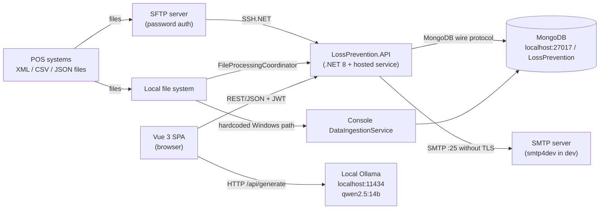
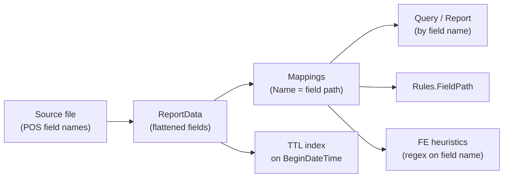

<!-- IMPACT-META
schema: 1
mode: how
step: 04_constraints
commit: fc7d820908b8b230fb47a2669920ba7efdb413a8
commit_short: fc7d820
branch: main
worktree: dirty
baseline_date: 2026-10-07T18:19:51+02:00
generated_at: 2026-10-08T09:38:00+02:00
-->
# Constraints - LOSS_PREVENTION Project

> **Baseline commit:** `fc7d820` (`main`) · worktree `dirty` (local changes only in `Docs/` and `.github/`; application code identical to the commit)

**Date**: 2026-10-08  
**Version**: 1.1  
**Authors**: IMPACT REVERSE how (static code analysis + IMPACT verification)  
**Audience**: Technical team, architects, developers

---

### Sources and conventions

- **Code** at commit `fc7d820`, cited as `file:riga`.
- **Historical vendor documentation**: `Docs/roadmap.txt`, `Docs/01_EXECUTIVE_OVERVIEW.md`, `Docs/04_DEPLOYMENT_GUIDE.md` and `Docs/09_SECURITY_DOCUMENTATION.md` **do not exist at the baseline**. They were present only in commit `593f6de` (initial import, 2026-10-05) and were removed in commit `d768cd9` ("Delete …/Docs directory"). They can be read, from the root `C:\repository\LOSS_PREVENTION`, with:
  `git show 593f6de:customspa-it-loss-prevention-d098a8b97860/Docs/<file>`
  Their statements are **intentions/declarations**, not constraints verified in the code.
- Each constraint has a stable ID (`C-xxx`), reused by the downstream documents. Mapping to the IDs of version 1.0: C-O01 → C-I04, C-O02 → C-I03, C-O03 → C-D01, C-O04 → C-D04, C-O05 → C-P05, C-O06 → C-P06; C-S01 → C-L01, C-S02 → C-L03, C-S03 → C-L04, C-S04 and C-S05 → C-I02. C-T01..08 and C-A01..07 are unchanged.

---

## Main Sections

## 1. Time, Budget, Resources

The code contains no information on time, budget or resources. The only indications come from the vendor's historical roadmap, which set windows of 3 and 3-6 months and favored low-cost solutions.

| ID | Constraint | Evidence | Impact on choices |
|----|---------|----------|----------------------|
| C-P01 | Initial delivery window **within 3 months**, then a **3-6 month** roadmap | `roadmap.txt:1` "Suggested Deliverables - Within 3 Months Time frame"; `roadmap.txt:62` "Initial Roadmap - 3-6 Months" (historical, `593f6de`) | Push towards tactical solutions (logic in the client, in-process scheduler) at the expense of tests and CI |
| C-P02 | **Hosting cost containment** | `roadmap.txt:52` "Azure Functions - Spins up only when needed - reduces costs"; `roadmap.txt:56` "Development can be done locally to reduce costs" (historical) | Preference for serverless/consumption and local development; however, the current code (ASP.NET API + hosted service) is not compatible with Azure Functions without a rewrite |
| C-P03 | Separate **Sales/UAT** and **Production** environments | `roadmap.txt:56` (historical) | The code has a single `appsettings.json` and CORS hardcoded to `localhost` (`Program.cs:29`): per-environment configurations are needed |
| C-P04 | Product status as of "February 2026": lookup tables, "large datasets (1000+ rows)" optimization and testing on real data **still in development** | `01_EXECUTIVE_OVERVIEW.md:103-122` (historical) | Performance and correctness on real volumes not validated (see [03_non_functional_overview.md](03_non_functional_overview.md) NFR-PERF-00) |
| C-P05 | **No real data** for testing | `roadmap.txt:27` "Real world data to test with … - Waiting for Custom" (historical); the repository only contains a development dump with ≈ 3,000 `ReportData` documents (`Data/LossPrevention`) | Rules and statistical thresholds calibrated on synthetic data |
| C-P06 | Deployment target **proposed** by the vendor: Azure (Front Door, Static Web Apps, Functions/App Service, Cosmos DB API Mongo or Atlas, Key Vault), alternatively on-premise (IIS or Kestrel), hybrid or Docker/Kubernetes | `04_DEPLOYMENT_GUIDE.md:17, 34-46, 83`; `01_EXECUTIVE_OVERVIEW.md:135-149` (historical, `593f6de`) | No deployment artifacts in the repository (neither Dockerfile nor IaC): the choice of platform is still open (see [09_infrastructure_architecture.md](09_infrastructure_architecture.md)) |
| C-P07 | Budget | **N/A — not derivable from the code**: no financial data in the repository or in the historical documentation | — |

---

## 2. Technology Constraints

The stack is imposed by the existing code: .NET 8 + FastEndpoints + MongoDB on the server side, Vue 3 + Vuetify on the client side, local LLM via Ollama. Some choices (MongoDB, schema-less, logic in the browser) strongly constrain any evolution.

| ID | Constraint | Evidence | Impact on choices |
|----|---------|----------|----------------------|
| C-T01 | **.NET 8** as backend runtime | `<TargetFramework>net8.0</TargetFramework>` in the 5 csproj files | Microsoft end of support 10/11/2026: upgrade to .NET 10 LTS required shortly |
| C-T02 | **FastEndpoints 6.0.0** as API framework | `PackageReference FastEndpoints 6.0.0` (`01. LossPrevention.API.csproj`); 78 endpoint classes (74 with `Permissions(...)`, 4 `AllowAnonymous`) | Authorization based on the `permissions` claim; changing framework means rewriting all endpoints |
| C-T03 | **MongoDB** as the only datastore, native driver `MongoDB.Driver 3.4.0` | `IMongoRepository<T>` exposes `Collection` (`IMongoRepository.cs:170`, `MongoRepository.cs:27`); `Builders<T>` used in the services (e.g. `RulesService.cs:40-41`) | Strong coupling to Mongo. Cosmos DB (Mongo API), proposed in the historical roadmap (`roadmap.txt:53`), must be verified on aggregation pipelines and TTL indexes before adopting it |
| C-T04 | **Schema-less transactional data** | `XmlToBsonConverterHelper.ConvertFlattened`; mappings generated from the data (`MappingService.ProcessMappings`) | No structural validation; indexes, rules and reports depend on the field names of the source files (see §3.2) |
| C-T05 | **Vue 3.5 + Vuetify 3.7 + Pinia 2.2 + Vite 6** | `LossPrevention.UI/package.json` | The statistical anti-fraud logic lives in TypeScript in the browser (`aiStore.ts`, 1,994 lines) |
| C-T06 | **Ollama LLM on `localhost:11434`**, model `qwen2.5:14b` | `aiStore.ts:8` (`MODEL`), `aiStore.ts:88` (`fetch("http://localhost:11434/api/generate")`) | Every user workstation must run Ollama with the 14B model (about 9 GB in the Q4 quantized version) or a server-side LLM gateway must be introduced |
| C-T07 | **Password-only SFTP** | `new SftpClient(host, port, username, password)` (`SftpFileProcessingService.cs:56`); no use of keys or host key | No support for SSH keys / host key pinning; the SFTP password is stored in clear text in Mongo (`DataIngestionConfiguration.cs:19`) and re-exposed by the DTO (`DataIngestionConfigurationDTO.cs:13`) |
| C-T08 | **SMTP without TLS** | `EmailService.cs:63-64` (`EnableSsl = false; // smtp4dev doesn't use SSL`); `Email:SmtpHost=localhost`, `SmtpPort=25` in `appsettings.json` | Configured for smtp4dev in development; not usable with real providers without a code change |
| C-T09 | **Modern browser** with `fetch`, ES modules and `localStorage` (token and username) | Vite 6 build; `loginStore.ts` | No support for legacy browsers; session tied to the single browser |

### 2.1 Architectural constraints derived from the code

| ID | Constraint | Evidence | Impact |
|----|---------|----------|---------|
| C-A01 | Monolith with **in-process scheduler** | `AddHostedService<DataIngestionBackgroundService>()` (`Program.cs:111`) | Multiple API instances would run the ingestion multiple times: scale-out requires a single-leader scheduler |
| C-A02 | **In-process cache** | `AddMemoryCache()` (`Program.cs:49`) | Not shared between instances; no invalidation after ingestion or rules |
| C-A03 | **Queries built by the client** as a Mongo pipeline | `GetReportDataRequest.QueryPipeline: List<object>`; `BsonDocument.Parse` (`GetReportDataEndpoint.cs:66-69`) | The API contract coincides with the Mongo query language: changing DB also means changing the client |
| C-A04 | **Statistical anti-fraud logic in the client** | `aiStore.ts` (`analyzeFraudInData`, line 1667), `fraudDetectionStore.ts` | Results neither persisted nor auditable; dependency on the power of the workstation |
| C-A05 | **Shared database** among API, background service and console | same `MongoDbSettings` section; console `LossPrevention.DataIngestionService` writing to `ReportData` | No data ownership boundary |
| C-A06 | **Single-tenant**: a single `DatabaseName` | `appsettings.json` → `MongoDbSettings:DatabaseName = LossPrevention` | The "white-label per client" declared in the historical documentation (`01_EXECUTIVE_OVERVIEW.md:155-156`) requires one instance per client |
| C-A07 | A single ingestion configuration document and a single global thresholds document | `GetConfigurationAsync()`; `GET /api/fraud-detection/settings` | No per-store or per-source configuration |

---

## 3. Existing Systems & Reuse

The system depends on existing external systems (POS files, SFTP, MongoDB, SMTP, Ollama) and on a development data dump. The diagram shows the integration landscape at the baseline.

### 3.1 Existing systems and assets

| ID | System / asset | Use in the code | Constraint it imposes |
|----|-----------------|----------------|--------------------|
| C-E01 | **POS transactional files** (XML, CSV, JSON) | 3 `IFileProcessingService` strategies (XML, CSV, JSON) registered in `Program.cs:102-104`; fields such as `StoreID`, `OperatorID`, `BeginDateTime`, `Tender.CardNumber` | The POS format is an uncontrolled input: every change of field names propagates downstream (§3.2) |
| C-E02 | Client's **SFTP server** | `SftpFileProcessingService` (download + move to `processed/`) | Password authentication only; no host key verification |
| C-E03 | **MongoDB** (`mongodb://localhost:27017`, db `LossPrevention`) | `appsettings.json`; 13 collections configured in `MongoDbSettings` | Seed and migrations with manual `mongosh` scripts `00..04` in `Data/MongoDBScripts` |
| C-E04 | **Development dump** | `Data/LossPrevention/*.bson` (≈ 3,000 `ReportData` documents with `_sourceFile` field; collections `Mappings_old` and `ReportData_old`) | The only available dataset; PANs already masked (e.g. `472805******1016`) |
| C-E05 | **SMTP server** | `EmailService.cs:63-64` (`localhost:25`, `EnableSsl=false`) | Required for password reset and email notifications |
| C-E06 | **Ollama** (local LLM) | `aiStore.ts:88` | Must run on the same machine as the user's browser |
| C-E07 | **FE configuration** | `src/api/api.ts:4` → `baseURL: import.meta.env.VITE_API_BASE_URL`; no `.env` file in the repository | The API base URL must be provided at build time |
| C-E08 | Internal reusable components | Generic `MongoRepository<T>`; `RuleHelper` (`Application/Helpers/RuleHelper.cs`); `PasswordHasher` PBKDF2 | Reusable as the basis for the refactoring; however, the repository must be "closed" (today it exposes `Collection`) |

### 3.2 Data constraints

Every downstream component depends on the **field names** produced by the source files: a change in the POS format breaks rules, saved reports, TTL and heuristics.

| ID | Constraint | Evidence |
|----|---------|----------|
| C-D01 | Retention based **only** on `BeginDateTime`: documents without that field never expire | TTL index created by `DatabaseInitializationService.cs:98-109` |
| C-D02 | Retention duration from configuration: 180 days in the repository, **90 days** by default if the key is missing | `appsettings.json` → `DataRetention:TransactionRetentionDays = 180`; default in `DatabaseInitializationService.cs:23`; the dump reports `expireAfterSeconds = 15552000` (= 180 days) in `ReportData.metadata.json` |
| C-D03 | The statistical heuristics classify fields with regexes on the name | e.g. `refund_amount: [/refund.*amount\|return.*amount\|…/i]` (`aiStore.ts:117`) |
| C-D04 | The console job reads files from a hardcoded Windows path | `Directory.GetFiles(@"C:\xmlstore5\xml")` (`LossPrevention.DataIngestionService/Program.cs:76`) |

---

## 4. Integration Standards

The integrations use de facto standards (REST/JSON, JWT, SFTP, SMTP, Mongo protocol) but without versioning, formal contracts or configured secure channels.

| ID | Integration | Standard / protocol | Evidence | Constraint / gap |
|----|--------------|-----------------------|----------|---------------|
| C-I01 | SPA → API | REST/JSON with FastEndpoints | 78 endpoints | **No API versioning** (0 occurrences of `Version(`/`AddApiVersioning`); mixed routes with `/api/...` prefix (e.g. `/api/data-ingestion`) and without prefix (e.g. `/users/id/{UserId}`, `/rules/{id}`) |
| C-I02 | Authentication | JWT ****** with `permissions` claim | `LoginEndpoint.cs:72` (`SecurityAlgorithms.HmacSha256`); validation in `Program.cs:62-76` | Symmetric key in `appsettings.json` (`JwtSettings:SecretKey`); 1 h expiry (`ExpiryHours: 1`), no refresh token |
| C-I03 | API documentation | OpenAPI/Swagger | `Program.cs:54, 121-126` (`UseSwaggerGen/UseSwaggerUi` only in Development) | No published contract for non-development environments |
| C-I04 | CORS | `AllowVueDev` policy | `Program.cs:24-34` (`WithOrigins("http://localhost:5173", "http://localhost:5174")`), `Program.cs:128` | Hardcoded origins: deployment requires a code change |
| C-I05 | Transport | HTTP | No `UseHttpsRedirection` / `UseHsts` | TLS delegated to a possible reverse proxy, not provided for in the repository |
| C-I06 | File ingestion | SFTP (SSH.NET 2025.1.0) | `SftpFileProcessingService.cs:56` | Password only |
| C-I07 | Email | SMTP | `EmailService.cs:63-64` | No TLS |
| C-I08 | LLM | HTTP JSON to Ollama's `/api/generate`, `format: "json"`, `stream: false` | `aiStore.ts:87-99` | Direct call from the browser, without authentication or proxy |
| C-I09 | Datastore | MongoDB wire protocol, connection string without credentials | `appsettings.json` → `mongodb://localhost:27017` | No authentication/TLS towards the DB in the versioned configuration |

---

## 5. Team Size & Skills

The git history does not allow the real team to be reconstructed: the code was imported in a single commit. The required skills are instead inferred from the stack.

| ID | Aspect | Evidence | Constraint |
|----|---------|----------|---------|
| C-R01 | Team size | 13 commits, all by author `saristot` between 2026-10-05 and 2026-10-07; the application code arrives in a block with commit `593f6de` | **N/A — not derivable from the code**: the original development history (authors, duration, pace) is not present in the repository |
| C-R02 | Backend skills | .NET 8 / C#, FastEndpoints, MongoDB.Driver and aggregation pipelines, FluentValidation, SSH.NET, BackgroundService | Senior .NET profile with MongoDB experience |
| C-R03 | Frontend skills | Vue 3 Composition API, TypeScript, Pinia, Vuetify, AG Grid, Chart.js, Tabulator, Vite | Senior Vue frontend profile: the domain logic is in the largest files (`resultsGrid.vue` 2,271 lines, `aiStore.ts` 1,994 lines) |
| C-R04 | Data/AI skills | Prompt engineering on a local LLM (Ollama/Qwen), descriptive statistics (z-score, Euclidean distance) | Required to maintain `aiStore.ts` and `DistanceDataservice` |
| C-R05 | Domain skills | Retail loss prevention, structure of POS files, labor/privacy regulations (§6) | Domain knowledge not documented in the code |
| C-R06 | DevOps skills | No pipeline, Dockerfile or IaC in the repository | To be built from scratch (the historical roadmap planned "Devops setup - Automatic Deployments", `roadmap.txt:70`) |

---

## 6. Legal Constraints (GDPR, Accessibility, Licensing, Log Retention)

The system processes personal data of employees and customers for anti-fraud control purposes: it is subject to GDPR and, in Italy, to the rules on remote monitoring of workers. Accessibility, licenses and log retention are not addressed in the code.

### 6.1 GDPR and labor regulations

| ID | Constraint | Origin / evidence | Status in the code |
|----|---------|--------------------|------------------|
| C-L01 | **GDPR**: personal data of employees (`OperatorID`, e.g. `OP928`) and customers; profiling for fraud detection | Domain; fields in `ReportData` | No minimization/pseudonymization at ingestion; no record of processing activities |
| C-L02 | **Right to erasure** | The historical documentation (`09_SECURITY_DOCUMENTATION.md:302`, `593f6de`) declared "Right to erasure implemented via deletion endpoints" and a `DELETE /api/users/{id}` that "anonymizes data" | Only `DELETE /users/id/{UserId}` exists (`DeleteUserByIdEndpoint.cs:20`), which deletes the application user (`UserService.cs:113-116`) without anonymization; **no** deletion of transactional data per data subject |
| C-L03 | **Remote monitoring of workers** (art. 4 L. 300/1970, Statuto dei Lavoratori) | Domain (Italy): analysis per cashier operator | Organizational requirement (union agreement or authorization) external to the code; must be verified before release |
| C-L04 | **PCI-DSS** if card data arrives | Rules on `KeyedCardEntry`; `Tender.CardNumber` field | In the dump the PANs are already masked (`472805******1016`); the code neither masks nor rejects clear-text PANs |
| C-L05 | Security of processing (art. 32 GDPR) | See [03_non_functional_overview.md](03_non_functional_overview.md) §2.5 | Gaps: arbitrary pipeline from the client, client-side-only lock, exposed password hashes, secrets in configuration |

### 6.2 Accessibility

| ID | Constraint | Evidence |
|----|---------|----------|
| C-L06 | Accessibility requirements (e.g. WCAG 2.1 AA / EN 301 549 if required by the client) | **Not addressed**: only 1 `aria-` attribute (`App.vue:19`) and only 1 `alt=` in `src/`; no a11y tests; English-only interface, without i18n |

### 6.3 Licensing

| ID | Component | License | Constraint / note |
|----|------------|---------|----------------|
| C-L07 | Product code | No `LICENSE` file in the repository | **N/A — not derivable from the code**: ownership and license of use not declared. The historical documentation mentions "White-label options" and "Customizable branding per client" (`01_EXECUTIVE_OVERVIEW.md:152-156`) |
| C-L08 | .NET packages (FastEndpoints, MongoDB.Driver, FluentValidation, SSH.NET, Newtonsoft.Json, Microsoft.Extensions.*) | MIT / Apache-2.0 | No copyleft constraint |
| C-L09 | `ag-grid-community` / `ag-grid-vue3` ^35 | MIT (Community edition) | Enterprise features (pivot, server-side row grouping, native Excel export) require a commercial license |
| C-L10 | `xlsx` ^0.18.5 (SheetJS) | Apache-2.0 | It is the last version published on npm, with known vulnerabilities; later versions are distributed only from the SheetJS CDN |
| C-L11 | Other FE packages (Vue, Vuetify, Pinia, Chart.js, chartjs-chart-matrix, pdfmake, papaparse, tabulator-tables, axios) | MIT | No copyleft constraint |
| C-L12 | Dependencies declared but not used: `nuxt`, `@nuxt/devtools`, `jspdf`, `jspdf-autotable`, `grid-layout-plus` | MIT | Unnecessary license and vulnerability surface; to be removed |
| C-L13 | LLM model `qwen2.5:14b` (`aiStore.ts:8`) | Apache-2.0 (license of the Qwen2.5 14B model, to be re-verified for commercial use) | Must be verified by a legal expert before use in production |

### 6.4 Log Retention

| ID | Constraint | Evidence | Status |
|----|---------|----------|-------|
| C-L14 | Application log retention | Console-only logging by default (`appsettings.json` → `Logging:LogLevel:Default = Information`) | **No retention implemented**: logs are not persisted |
| C-L15 | Audit log with 1-year retention | Declared in the historical documentation (`09_SECURITY_DOCUMENTATION.md:304` "Audit logs: 1-year retention" and line 555 "Log Retention: 1 year minimum", `593f6de`) | **Not implemented** in the code |
| C-L16 | Transactional data retention | TTL index on `BeginDateTime`: 180 days configured, 90 by default (see C-D01/C-D02) | Implemented only for `ReportData`; no retention for `Notifications` or for reset tokens |

---

## Reference Documents

- **Deep Dive Analysis**: [00_deep_dive.md](00_deep_dive.md)
- **Context**: [01_context.md](01_context.md)
- **Functional Overview**: [02_functional_overview.md](02_functional_overview.md)
- **Non-Functional Overview**: [03_non_functional_overview.md](03_non_functional_overview.md)
- Related IMPACT documents: [05_principles.md](05_principles.md) · [06_software_architecture.md](06_software_architecture.md) · [07_code.md](07_code.md) · [08_data.md](08_data.md) · [09_infrastructure_architecture.md](09_infrastructure_architecture.md) · [10_deployment.md](10_deployment.md) · [11_development_environment.md](11_development_environment.md) · [12_operation_and_support.md](12_operation_and_support.md) · [13_decision_log.md](13_decision_log.md) · [14_metrics.md](14_metrics.md) · [15_fp_cocomo.md](15_fp_cocomo.md) · [16_frontend_deep_assessment.md](16_frontend_deep_assessment.md) · [17_backend_deep_assessment.md](17_backend_deep_assessment.md) · [18_antipattern_deep_dive.md](18_antipattern_deep_dive.md) · [19_modernization_estimation_spec.md](19_modernization_estimation_spec.md)

---

## Change Log

| Version | Date | Author | Changes |
|----------|------|--------|-----------|
| 1.0 | 2026-10-07 | REVERSE how (FULL) | Document creation (replaces run 2026-10-05) |
| 1.1 | 2026-10-08 | IMPACT verify | Header/baseline `dirty`. Document restructured into the 6 sections of the prompt; C-T/C-A IDs kept, C-O and C-S redistributed. Added: §1 Time/Budget/Resources (historical roadmap, budget N/A); §3 Existing Systems (integration landscape diagram, systems/assets table); §4 Integration Standards (REST without versioning, JWT HS256, CORS, SFTP, SMTP, Ollama, Mongo); §5 Team & Skills (team N/A, skills from the stack); §6 Legal split into GDPR, accessibility, licensing, log retention. Corrected: retention 180 days configured / 90 by default; constraints with `file:riga` evidence; vendor documents (`roadmap.txt`, `01_EXECUTIVE_OVERVIEW.md`, `04_DEPLOYMENT_GUIDE.md`, `09_SECURITY_DOCUMENTATION.md`) cited as historical (`593f6de`, removed in `d768cd9`). Reference Documents complete |
