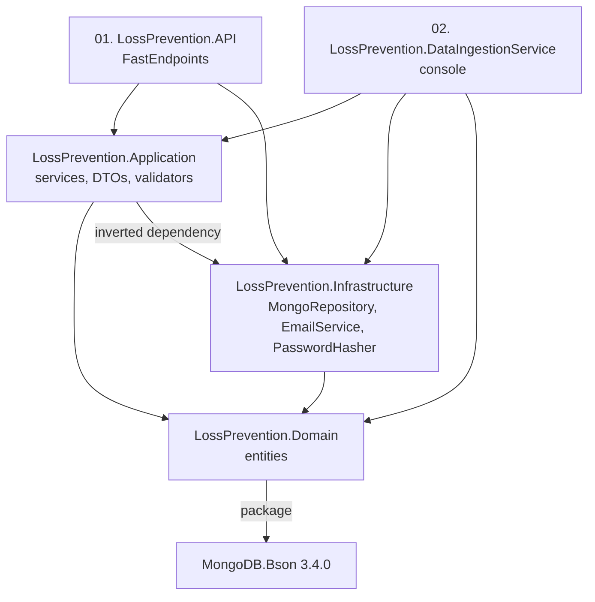
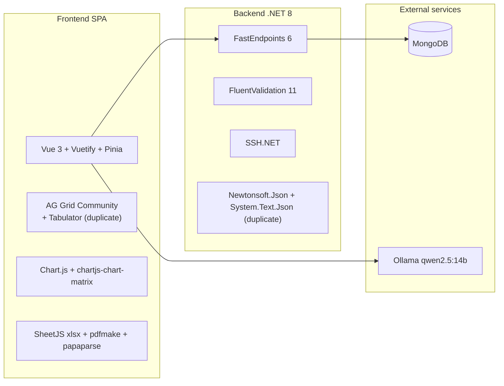
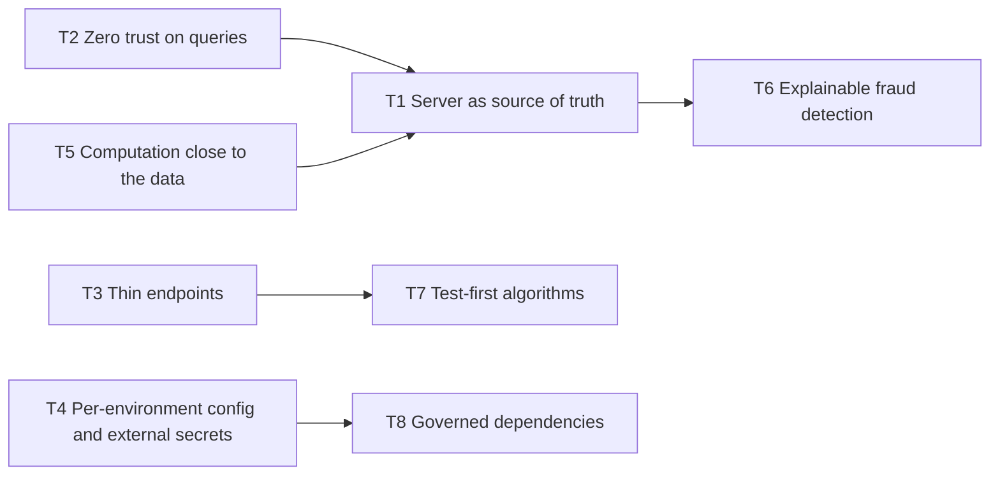

<!-- IMPACT-META
schema: 1
mode: how
step: 05_principles
commit: fc7d820908b8b230fb47a2669920ba7efdb413a8
commit_short: fc7d820
branch: main
worktree: dirty
baseline_date: 2026-10-07T18:19:51+02:00
generated_at: 2026-10-08T09:38:00+02:00
-->
# Principles - LOSS_PREVENTION Project

> **Baseline commit:** `fc7d820` (`main`) · worktree `dirty` (local changes only in `Docs/` and `.github/`; application code identical to the commit)

**Date**: 2026-10-08  
**Version**: 1.1  
**Authors**: IMPACT REVERSE how (static code analysis + IMPACT verification)  
**Audience**: Technical team, architects, developers

---

### Method and conventions

- The repository **does not declare any** architecture or development **principles**: no technical README, ADR, `.editorconfig` or contribution guide. This document **reconstructs the implicit principles** from the code at commit `fc7d820`, measures adherence to them and proposes the target principles.
- Adherence scale: 🟢 High (applied with few exceptions) · 🟡 Medium (applied with significant violations) · 🔴 Low (absent or contradicted).
- The vendor's historical documentation (`Docs/roadmap.txt`, etc.) **does not exist at the baseline**: it was present only in commit `593f6de` and was removed in `d768cd9`. It can be read with `git show 593f6de:customspa-it-loss-prevention-d098a8b97860/Docs/<file>` from the root `C:\repository\LOSS_PREVENTION`.

---

## Main Sections

## 1. Architectural Principles

The backend follows a 5-project layering and the FastEndpoints REPR pattern; the data is schema-on-read. However, these principles are weakened by inverted dependencies, "leaky" abstractions and a large share of logic in the client.

### 1.1 Implicit architectural principles

| # | Principle (implicit) | Positive evidence | Violations | Adherence |
|---|-----------------------|-------------------|-----------|----------|
| P1 | **Layer separation** (API / Application / Domain / Infrastructure + console) | 5 projects; request/response in `Application/Handlers/Requests`, DTOs in `Application/DTO` | `LossPrevention.Application` **references** `LossPrevention.Infrastructure` (`LossPrevention.Application.csproj`), so the dependency is inverted with respect to Clean Architecture; the Domain depends on `MongoDB.Bson 3.4.0`; 20 endpoints use `IMongoRepository<T>` directly; inline DTO↔entity mapping in the FraudDetection endpoints (388/407 lines) | 🟡 Medium |
| P2 | **REPR / one endpoint per class** (FastEndpoints) | 78 endpoint classes, each with `Configure()` + `HandleAsync()` | — | 🟢 High |
| P3 | **Least privilege with declarative permissions** | `Permissions("CAN_…")` on 74/78 endpoints (4 `AllowAnonymous`: `LoginEndpoint`, `ForgotPasswordEndpoint`, `ResetPasswordEndpoint`, `ValidateResetTokenEndpoint`) | Row-level lock applied only in the client (`fieldLock.ts`); arbitrary query pipeline from the client (`GetReportDataEndpoint.cs:66-69`); 37 permissions used by the endpoints, 41 defined in the seed scripts, so the catalog is not aligned | 🟡 Medium |
| P4 | **Schema-on-read** | Mappings generated from the data (`MappingService.ProcessMappings`), types finalized afterwards | No validation of incoming files; the source field names become the contract (see [04_constraints.md](04_constraints.md) §3.2) | 🟢 Consistent |
| P5 | **Generic repository** | A single `MongoRepository<TDocument>` reused by all services | Exposes `Collection` (`IMongoRepository.cs:170`, `MongoRepository.cs:27`): leaky abstraction used in `RulesService.cs:41, 58` | 🟡 Medium |
| P6 | **Modular monolith with in-process jobs** | Ingestion scheduled as a `BackgroundService` in the same process as the API (`Program.cs:111`) | Prevents scale-out (see [03_non_functional_overview.md](03_non_functional_overview.md) NFR-AV-01) | 🟡 Medium |
| P7 | **Externalized configuration** | `MongoDbSettings`, `JwtSettings`, `DataRetention`, `Email` in `appsettings.json` | JWT secret in clear text in the repository; CORS (`Program.cs:29`), SMTP SSL (`EmailService.cs:64`), LLM URL (`aiStore.ts:88`) and console path (`DataIngestionService/Program.cs:76`) hardcoded | 🔴 Low |
| P8 | **Fat client / smart UI** | Rich and reactive report builder | Business logic (statistical engine, `aiStore.ts`) and security logic (lock) in the browser | 🔴 Problematic |
| P9 | **Security by design on credentials** | PBKDF2-SHA256 600,000 iterations with upgrade of legacy hashes (`PasswordHasher.cs:9-10`); hashed reset tokens, valid for 1 h | Hash and salt returned by the API (`GetUsersEndpoint.cs:36`); no rate limiting | 🟡 Medium |

### 1.2 Dependency structure between projects (as-is)



### 1.3 Concrete examples

**P2 – REPR (positive)** — `LossPrevention.API/Endpoints/Rules/ApplyRulesEndpoint.cs:18-19`:
```csharp
Get("/rules/apply");
Permissions("CAN_APPLY_RULE");
```

**P5 – leaky abstraction** — `LossPrevention.Application/Services/Data/Rules/RulesService.cs:40-41`:
```csharp
var unsetUpdate = Builders<BsonDocument>.Update.Unset("FraudFlags");
await _reportDataRepository.Collection.UpdateManyAsync(FilterDefinition<BsonDocument>.Empty, unsetUpdate);
```

**P8 – violation** — `LossPrevention.UI/src/stores/aiStore.ts:1768-1773`:
```ts
const fn = new Function(
  "row",
  `try { return (${rule.condition}) } catch { return false }`
);
```
The anti-fraud rules are generated as JS strings and compiled in the browser: not reusable by the backend, not testable in isolation, not auditable.

---

## 2. Design Principles (SOLID, DRY, KISS)

The code correctly applies DI and Strategy, but violates DRY and KISS precisely in the most critical points of the domain (anti-fraud configuration and statistical engine).

| Principle | Adherence | Positive evidence | Violation (evidence) |
|-----------|----------|-------------------|-----------------------|
| **S** – Single Responsibility | 🔴 Low | Small endpoints for simple entities (e.g. `DeleteUserByIdEndpoint`) | `aiStore.ts` (1,994 lines) mixes LLM client, rule generation, cross-transaction metrics and analysis; `resultsGrid.vue` 2,271 lines (grid, export, analysis, pagination); `GetFraudDetectionSettingsEndpoint` 222 lines |
| **O** – Open/Closed | 🟢 High | New file format = new `IFileProcessingService` class + 1 registration (`Program.cs:102-104`) | Extension point `IXmlEnrichmentRule` planned but with no implementations (speculative code) |
| **L** – Liskov Substitution | 🟡 Medium | XML/CSV/JSON interchangeable in the `FileProcessingCoordinator` | `XmlProcessingService.InsertManyAsync` throws `NotImplementedException("Use FileProcessingCoordinator.RunIngestionAsync instead")` (`XmlProcessingService.cs:43`) |
| **I** – Interface Segregation | 🟡 Medium | Service interfaces per area (`IRuleConfigurationService`, `IPasswordResetService`, `IMappingService`, …) | "Fat" `IMongoRepository<T>`: CRUD, aggregations, indexes **and** raw `Collection` |
| **D** – Dependency Inversion | 🟡 Medium | Constructor injection everywhere; services registered in `Program.cs:83-107` | Application depends on Infrastructure (§1.2); `PasswordHasher` is a `static class` (`PasswordHasher.cs:5`), not replaceable in tests; `AddSingleton<MongoDbSettings>()` (`Program.cs:83`) alongside the `IOptions` |
| **DRY** | 🔴 Low | Shared helpers (`RuleHelper`, `DistanceHelper`) | `CreateFraudDetectionSettingsEndpoint` (388 lines) and `UpdateFraudDetectionSettingsEndpoint` (407 lines) contain the same manual DTO→entity mapping; `UpdateDashboardValidator` defined **twice** (`Validators/CreateDashboardValidator.cs:18`, namespace `LossPrevention.Application.Dashboards.Validation`, and `Validators/UpdateDashboardValidator.cs:6`, namespace `LossPrevention.Application.Handlers.Requests.Dashboard`) |
| **KISS** | 🔴 Low | `DistanceHelper.ComputeDistance` (Euclidean distance in 18 lines, `DistanceHelper.cs:8-25`) | `buildGenericFraudRuleTemplates` CCN 87 / 254 NLOC (`aiStore.ts:1203-1530`); `enrichWithCrossTransactionMetrics` CCN 43 (lines 986-1142); `analyzeFraudInData` CCN 34 (lines 1667-1922), measured with lizard. The temporary `ServiceProvider` built to read `JwtSettings` (`Program.cs:41-47`, with a comment "Load rules from MongoDB" that does not match the code) |
| **YAGNI** | 🟡 Medium | — | Unused npm dependencies (`nuxt`, `jspdf`, `jspdf-autotable`, `grid-layout-plus`); `ManualLoad` flag saved but never read; `POST /data/create-transactions` endpoint that does not persist. The historical roadmap already asked for "Refactor - Clean up code, remove any YAGNI code and ensure DRY is adhered to" (`roadmap.txt:43`, `593f6de`) |

**OCP/Strategy example (positive)** — `LossPrevention.API/Program.cs:101-104`:
```csharp
// File Processing Services (XML, CSV, JSON)
builder.Services.AddScoped<IFileProcessingService, XmlProcessingService>();
builder.Services.AddScoped<IFileProcessingService, CsvProcessingService>();
builder.Services.AddScoped<IFileProcessingService, JsonProcessingService>();
```

**KISS/DIP example (negative)** — `LossPrevention.API/Program.cs:41-47`:
```csharp
// Load rules from MongoDB using a temporary provider
var tempServices = new ServiceCollection();
tempServices.AddInfrastructureServices(builder.Configuration);
tempServices.AddRepositoryServiceCollection(builder.Configuration);
using var tempProvider = tempServices.BuildServiceProvider();
var settings = tempProvider.GetRequiredService<IOptions<JwtSettings>>().Value;
```
`builder.Configuration.GetSection("JwtSettings").Get<JwtSettings>()` would suffice; the temporary provider duplicates the Infrastructure registrations.

---

## 3. Development Principles

There are no codified development practices: no traceable tests, CI, branching or code review. The historical roadmap indicated them as goals, but the code at the baseline does not implement them.

| Practice | AS-IS status (evidence) | Adherence | Historical indication / target |
|---------|------------------------|----------|------------------------------|
| Automated tests | 0 .NET test projects; no `test` script in `package.json` (scripts: `dev`, `build`, `preview`) | 🔴 Absent | "Unit Tests as part of pipeline" (`roadmap.txt:71`, historical) |
| CI/CD | No workflow, pipeline or Dockerfile for the application code | 🔴 Absent | "Devops setup - Automatic Deployments" (`roadmap.txt:70`, historical) |
| Branching / versioning | 13 commits by a single author (`saristot`, 2026-10-05..07); the code arrived in a block with `593f6de`; no tags | 🔴 Not reconstructible | "Branching Strategy for ease of development" (`roadmap.txt:65`, historical) |
| Code review | **N/A — not derivable from the code**: no PR or review history in the repository | — | Mandatory review on every PR |
| Reproducible build | `package-lock.json` not aligned with `package.json` (`npm ci` fails); `^` ranges on all dependencies; 12 imports with wrong case and one unresolvable import (`ScheduleForm.vue:27`) | 🔴 Low | Green CI build on Linux |
| Debt management | 13 `TODO` items in the C# code, 4 in the frontend; 57 `console.log` and 6 `Console.WriteLine` | 🟡 Medium | Debt tracked in the backlog, lint that blocks `console.log` |
| Test data | Only a development dump (`Data/LossPrevention`); no real data ("Waiting for Custom", `roadmap.txt:27`, historical) | 🟡 Medium | Representative anonymized dataset |

---

## 4. Coding Standards

No automatic standards are configured (no `.editorconfig`, no linter/formatter, no blocking analyzers). The only quality settings are `Nullable`/`ImplicitUsings` in C# and `strict: true` in TypeScript; naming conventions are applied inconsistently.

### 4.1 Standards configuration

| Aspect | Backend (C#) | Frontend (TS/Vue) |
|---------|--------------|-------------------|
| Style tools | No `.editorconfig` or `Directory.Build.props` | No ESLint/Prettier configuration |
| Static analysis | `Nullable` and `ImplicitUsings` enabled in the 5 csproj files; no `TreatWarningsAsErrors` | `tsconfig.json:6` `"strict": true`; `vue-tsc ^1.2.0` installed but not used in the scripts |
| Input validation | FluentValidation 11.11.0, but only 4 validators (all for dashboards) | Validation in Vuetify forms |
| Error handling | 31 `catch (Exception …)` blocks, often with `ex.Message` returned to the client | `try/catch` with toast; 57 `console.log` |

### 4.2 Naming conventions (inconsistencies found)

| Scope | Examples | Problem |
|--------|--------|----------|
| C# files | `DistanceDataservice.cs`, `ReportDataservice`, `IDistanceDataservice` | Lowercase "service", different from the rest (`RulesService`, `UserService`) |
| Projects | `01. LossPrevention.API.csproj`, `02. LossPrevention.DataIngestionService.csproj` | Numeric prefixes with a dot and a space in the project name |
| Namespaces | `Domain/Entities/Workspaces/{Query,Tab,Workspace}.cs` → `LossPrevention.Application.Entities.Workspaces`, while `Condition.cs` and `Field.cs` in the same folder → `LossPrevention.Domain.Entities.Workspaces`; Dashboards/Groups/Notifications → `LossPrevention.Domain.Dashboards` (without `.Entities`) | Namespace that does not reflect folder and layer |
| Placement | `DatabaseInitializationService` (concrete class) in `Application/Interfaces/Data/`; `IndexService` in the file `IndexSuggestionHelper.cs`; `RuleConfigurationService` in the file `RulesService.cs` | File / folder name different from the type |
| FE files | `rolestore.ts`, `workspacestore.ts`, `chartblock.vue` alongside `PasswordResetStore.ts`, `loginStore.ts`, `resultsGrid.vue` | Mix of lowercase, camelCase and PascalCase; causes the 12 imports with wrong case |
| FE package | `package.json` → `"name": "workflowbuilder"` | Name unrelated to the product (template leftover) |
| Comments | `// NEW: Include ManualLoad` (5 occurrences, e.g. `DataIngestionService.cs:43, 62, 87`) | "Chronological" comments instead of descriptive ones |

---

## 5. Technology Selection Principles

The technology choices favor mainstream and lightweight open source frameworks. However, dependency governance (duplicates, unused packages, misaligned versions) and an explicit selection principle are missing.

### 5.1 Implicit selection principles

| Implicit principle | Evidence | Assessment |
|---------------------|----------|-------------|
| Lightweight frameworks instead of classic MVC | FastEndpoints 6.0.0 (+ `.Security`, `.Swagger`) instead of ASP.NET controllers | 🟢 Consistent with REPR |
| Document database for heterogeneous data | MongoDB.Driver 3.4.0, dynamic mappings | 🟢 Consistent with schema-on-read |
| Full-featured UI component framework | Vue ^3.5.12, Vuetify ^3.7.3, Pinia ^2.2.4, vue-router ^4.6.3, Vite ^6.3.5, TypeScript ^5 | 🟢 Modern stack |
| On-premise / local AI | Ollama + `qwen2.5:14b` (`aiStore.ts:8`) | 🟡 No data sent to the cloud, but deployment not scalable |
| Version governance | `Microsoft.Extensions.*` 9.0.4 on `net8.0`; `Microsoft.AspNetCore.Http.Features 5.0.17` (obsolete) in the Application; `vue-tsc ^1.2.0` far behind TypeScript 5 | 🔴 Absent |
| One library per need | Two serializers (`Newtonsoft.Json 13.0.3` and `System.Text.Json`); two grids (`ag-grid-vue3` in `resultsGrid.vue`/`tabularBlock.vue`, `tabulator-tables` in `distanceTable.vue`); two layouts (`vue-grid-layout-v3` used in `dashboardGrid.vue`, `grid-layout-plus` not used); two PDF libraries (`pdfmake` used, `jspdf` not used); `axios` used both via `api/api.ts` and directly in `userStore.ts` | 🔴 Violated |

### 5.2 Map of technology choices



---

## 6. Buy vs Build Philosophy

The project **buys (open source) the technical commodities** and **builds in-house** even components for which established solutions exist: authentication/RBAC, scheduler, rule engine. This is the main source of risk and maintenance.

| Capability | Choice | Evidence | Assessment |
|------------|--------|----------|-------------|
| API framework | **Buy (OSS)** FastEndpoints | `01. LossPrevention.API.csproj` | 🟢 Adequate |
| Persistence | **Buy (OSS)** MongoDB + driver | `MongoDB.Driver 3.4.0` | 🟢 Adequate |
| Grids, charts, export | **Buy (OSS)** AG Grid Community, Chart.js, SheetJS, pdfmake, papaparse | `package.json`; used in `resultsGrid.vue`, `heatmapPreview.vue` | 🟢 Adequate (beware of the Community license limits, see [04_constraints.md](04_constraints.md) C-L09) |
| File transfer | **Buy (OSS)** SSH.NET | `SftpFileProcessingService.cs:56` | 🟢 Adequate |
| LLM | **Buy (OSS)** Ollama + Qwen2.5 | `aiStore.ts:8, 88` | 🟡 Valid choice, integration to be centralized |
| Authentication and RBAC | **Build**: users, roles, permissions on Mongo, JWT issued by `LoginEndpoint.cs:72`, custom PBKDF2 `PasswordHasher` | No ASP.NET Core Identity or external IdP (Entra ID, Keycloak) | 🔴 Risk: no MFA, lockout, SSO or audit |
| Scheduler | **Build**: polling every minute (`DataIngestionBackgroundService.cs:13, 41`) | No Quartz.NET / Hangfire | 🔴 State not persisted (`LastRunAt`), no history, not clusterable |
| Rule engine | **Build**: `RuleHelper` + `RuleConfigurationService` (file `Services/Data/Rules/RulesService.cs`) | No rules engine library | 🟡 Simple and adequate for the domain, but without rule versioning |
| Statistical anti-fraud engine | **Build** in TypeScript in the browser (`aiStore.ts`) | — | 🔴 To be moved server-side and tested |
| Data mapping | **Build**: schema-on-read (`MappingService`, `XmlToBsonConverterHelper`) | — | 🟢 Domain-specific, justified |
| Distance between transactions | **Build**: `DistanceHelper.ComputeDistance` (Euclidean distance, `Math.Sqrt` at line 24) | — | 🟢 Simple, justified |

---

## 7. Proposed target principles

The target principles translate the violations found into automatically verifiable rules (fitness functions), to be used as guidance for [06_software_architecture.md](06_software_architecture.md) and [19_modernization_estimation_spec.md](19_modernization_estimation_spec.md).

| # | Principle | Rationale | Verifiable rule (fitness function) |
|---|-----------|-----------|----------------------------------------|
| T1 | **The server is the source of truth** for security and anti-fraud decisions | Compliance, audit, reproducibility | No client-only security filters; anti-fraud results are persisted |
| T2 | **Zero trust on query inputs** | Prevent data exfiltration | Pipeline validated by a whitelist of stages/operators; tests that reject `$lookup`, `$out`, `$merge`, `$unionWith`, `$function`, `$where` |
| T3 | **Thin endpoints, thick services** | Testability | ArchUnitNET: no type in `LossPrevention.API.Endpoints` depends on `IMongoRepository<>` |
| T4 | **Per-environment configuration, secrets outside the repository** | Security | Secret scanning in CI (e.g. gitleaks); `appsettings.json` without sensitive values |
| T5 | **Batches and heavy computations close to the data** | Performance | No `GetAllAsync()` on `ReportData`; bulk operations with `BulkWrite` / pipeline-based updates |
| T6 | **Explainable fraud detection** | Applied to employees (GDPR, Statuto dei Lavoratori) | Each flag stores rule, threshold version, values and timestamp |
| T7 | **Test-first on algorithms** | Rules and distances are pure functions | Coverage ≥ 80% on `RuleHelper`, `DistanceHelper` and the statistical engine |
| T8 | **One library per need, governed dependencies** | Vulnerability and license surface | Dependency audit in CI; 0 unused packages; `Microsoft.Extensions.*` versions aligned with the runtime |



---

## Reference Documents

- **Deep Dive Analysis**: [00_deep_dive.md](00_deep_dive.md)
- **Context**: [01_context.md](01_context.md)
- **Functional Overview**: [02_functional_overview.md](02_functional_overview.md)
- **Non-Functional Overview**: [03_non_functional_overview.md](03_non_functional_overview.md)
- **Constraints**: [04_constraints.md](04_constraints.md)
- Related IMPACT documents: [06_software_architecture.md](06_software_architecture.md) · [07_code.md](07_code.md) · [08_data.md](08_data.md) · [09_infrastructure_architecture.md](09_infrastructure_architecture.md) · [10_deployment.md](10_deployment.md) · [11_development_environment.md](11_development_environment.md) · [12_operation_and_support.md](12_operation_and_support.md) · [13_decision_log.md](13_decision_log.md) · [14_metrics.md](14_metrics.md) · [15_fp_cocomo.md](15_fp_cocomo.md) · [16_frontend_deep_assessment.md](16_frontend_deep_assessment.md) · [17_backend_deep_assessment.md](17_backend_deep_assessment.md) · [18_antipattern_deep_dive.md](18_antipattern_deep_dive.md) · [19_modernization_estimation_spec.md](19_modernization_estimation_spec.md)

---

## Change Log

| Version | Date | Author | Changes |
|----------|------|--------|-----------|
| 1.0 | 2026-10-07 | REVERSE how (FULL) | Document creation (replaces run 2026-10-05) |
| 1.1 | 2026-10-08 | IMPACT verify | Header/baseline `dirty`. Document restructured into the 6 sections of the prompt; P1-P9 kept in §1. Added: dependency diagram between projects, with the Application→Infrastructure dependency and the Domain tied to `MongoDB.Bson`; §2 SOLID/DRY/KISS/YAGNI with evidence, CCN measured with lizard and snippets; §3 Development Principles; §4 Coding Standards (configuration and naming/namespace inconsistencies); §5 Technology Selection (duplicate or unused libraries, technology map); §6 Buy vs Build; target principle T8. Mermaid of the target principles with all nodes labeled (previously T4 was isolated and unlabeled). Corrected: `new Function` snippet reported as in the code (`aiStore.ts:1768-1773`), `file:line` references, roadmap quotations marked as historical (`593f6de`, removed in `d768cd9`). Reference Documents complete |
