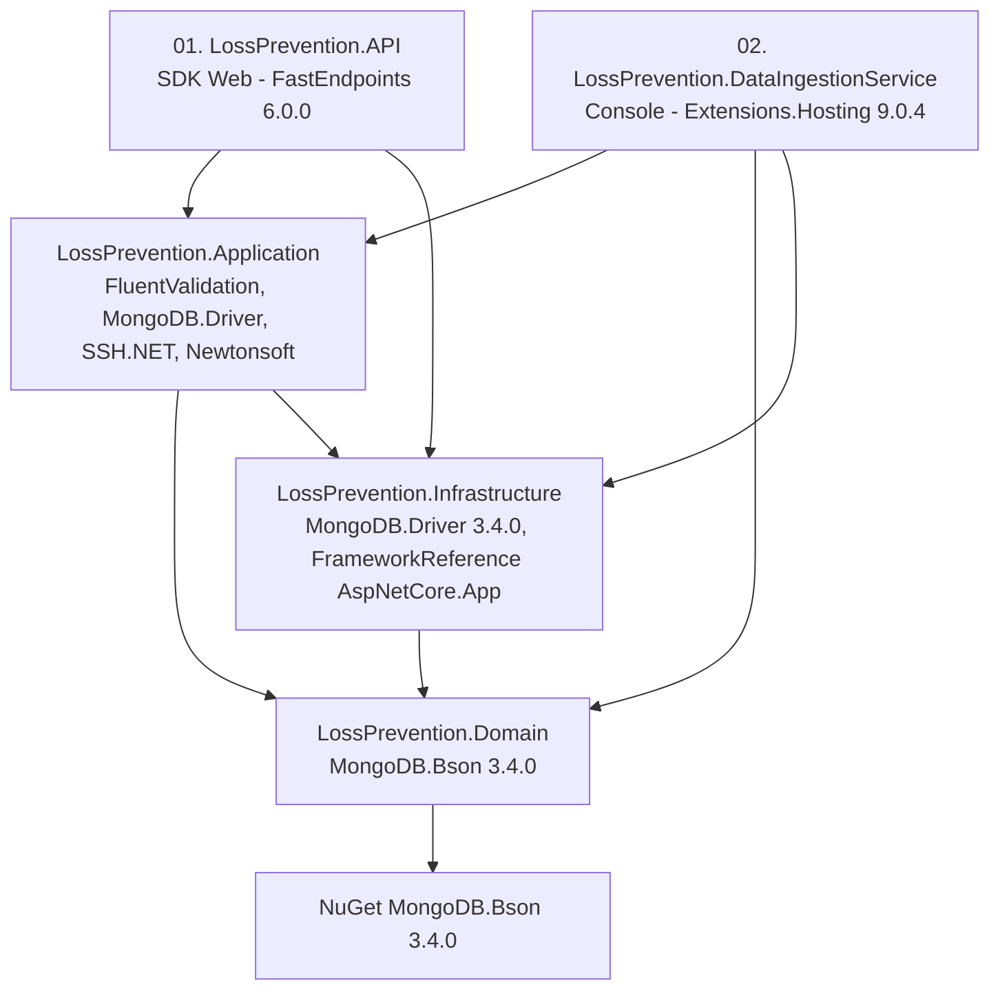
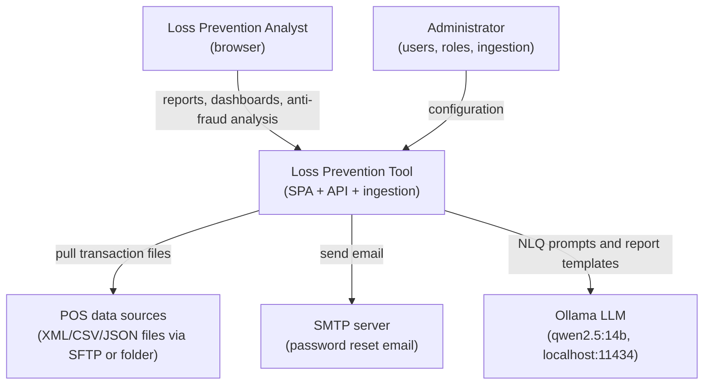
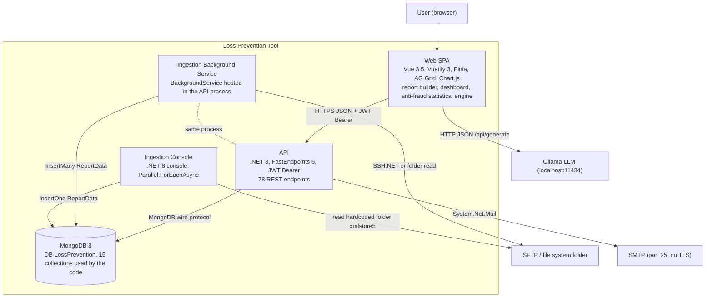
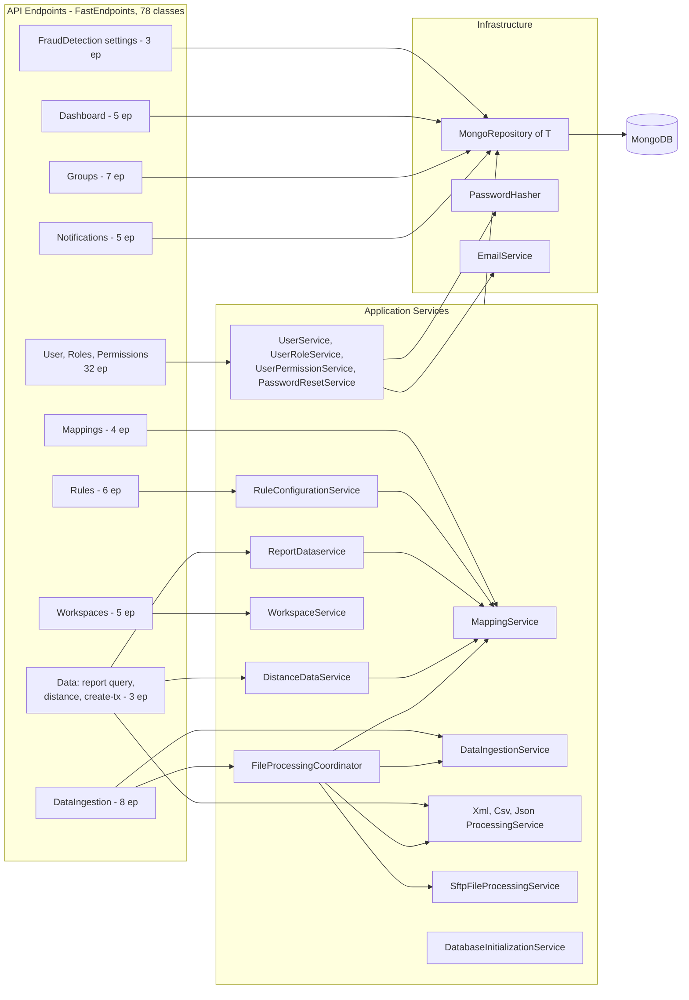
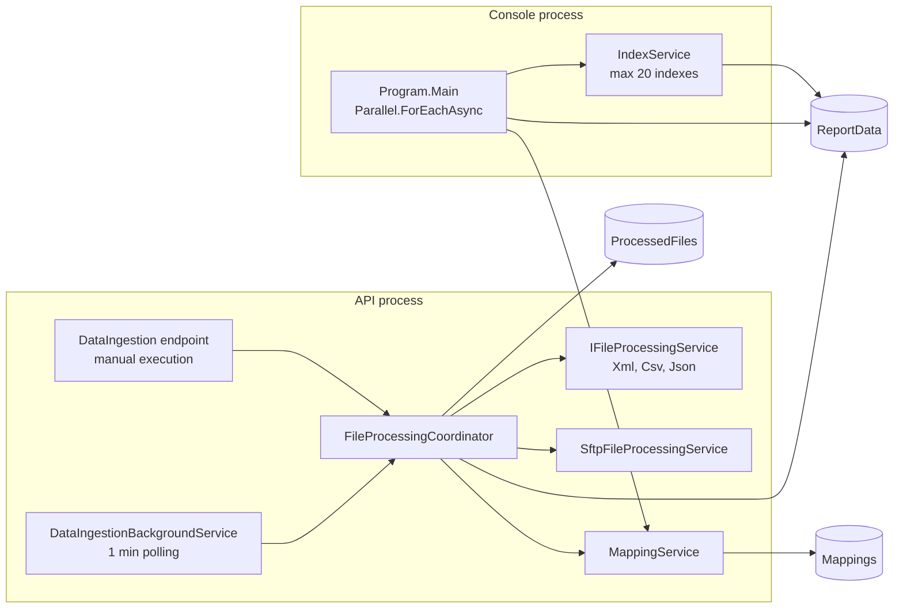
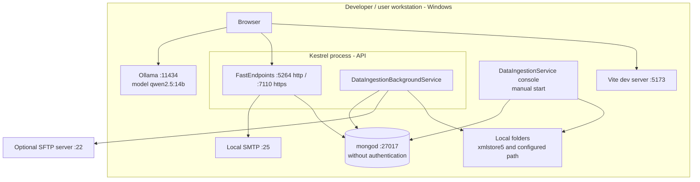
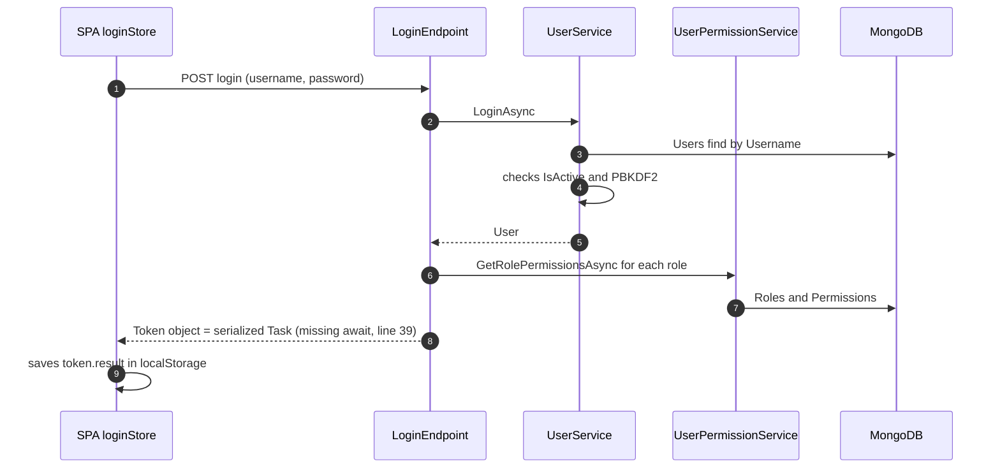
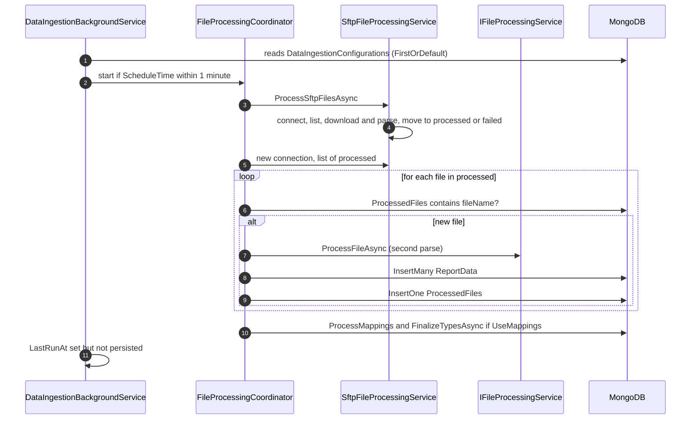
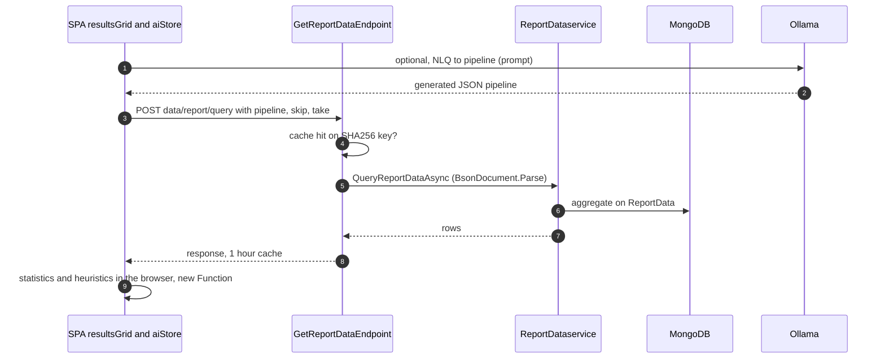

<!-- IMPACT-META
schema: 1
mode: how
step: 06_software_architecture
commit: fc7d820908b8b230fb47a2669920ba7efdb413a8
commit_short: fc7d820
branch: main
worktree: dirty
baseline_date: 2026-10-07T18:19:51+02:00
generated_at: 2026-10-08T09:21:30+02:00
-->
# Software Architecture - LOSS_PREVENTION Project

> **Baseline commit:** `fc7d820` (`main`) · worktree `dirty` (local changes only in `Docs/` and `.github/`; application code identical to the commit)

**Date**: 2026-10-08  
**Version**: 1.1  
**Authors**: IMPACT REVERSE how (verification 2026-10-08)  
**Audience**: Technical team, architects, developers

---

## Main Sections

1. [Architecture Style & Patterns](#1-architecture-style--patterns) — style, actual dependency graph between projects, patterns with evidence
2. [Containers & Technology Choices](#2-containers--technology-choices) — C4 Level 1 (context) and Level 2 (container)
3. [Component Diagram](#3-component-diagram) — C4 Level 3 of API, ingestion and SPA
4. [Deployment Diagram](#4-deployment-diagram) — AS-IS deployment view derivable from the code
5. [Integration Architecture](#5-integration-architecture) — integrations, contracts, sequences
6. [Architectural Risks Mitigation](#6-architectural-risks-mitigation) — architectural risks and mitigations

Conventions: paths are relative to `customspa-it-loss-prevention-d098a8b97860/`; `file:N` indicates the line number at commit `fc7d820`.

---

## 1. Architecture Style & Patterns

**Summary.** The system is a **layered modular monolith** (5 .NET 8 projects in a single solution) with a shared document database (MongoDB) and a **Vue 3 SPA** that contains a significant share of the business logic. The layering is only nominal: `Application` depends on `Infrastructure` and `Domain` depends on the MongoDB driver, so it is **not** a Clean/Hexagonal Architecture.

### 1.1 Architectural style by level

| Level | Style / pattern | Evidence |
|---------|-----------------|----------|
| System | **Modular monolith** + separate batch process (console), **shared database** | `LossPrevention.sln` (5 projects); same DB `LossPrevention` in `LossPrevention.API/appsettings.json` and `LossPrevention.DataIngestionService/appsettings.json` |
| Backend | **"Relaxed" layered**: API → Application → Infrastructure → Domain (Application skips down to Infrastructure) | `ProjectReference` in the 5 csproj files (see §1.2) |
| API | **REPR** (Request-Endpoint-Response) with FastEndpoints 6.0.0, one class per endpoint | 78 classes in `LossPrevention.API/Endpoints/**` |
| Persistence | **Generic Repository** on MongoDB with `Collection` "escape hatch" | `LossPrevention.Infrastructure/Repositories/MongoRepository.cs:27` |
| Ingestion | **Strategy** (`IFileProcessingService` ×3) + **Coordinator** | `LossPrevention.API/Program.cs:102-105` |
| Enrichment | **Chain of rules** (`IXmlEnrichmentRule`) | interface present, **no implementation** registered → no-op |
| Scheduling | In-process **Polling Background Service** (every 1 min) | `Application/Services/DataIngestion/DataIngestionBackgroundService.cs:13,28,41` |
| Frontend | **SPA** with centralized stores (Pinia, 15 stores) and "smart" components | `LossPrevention.UI/src/stores`, `src/components` |
| Anti-fraud | Server-side **declarative rule engine** + **heuristic engine** generated at runtime in the browser | `Application/Helpers/RuleHelper.cs`, `UI/src/stores/aiStore.ts` (`new Function` at line 1769) |

### 1.2 Actual dependency graph between projects

References verified in the `*.csproj` files (all `net8.0`):

| Project | csproj | Project references | Main packages | C# files / non-empty lines |
|----------|--------|------------------------|----------------------|---------------------------|
| API | `LossPrevention.API/01. LossPrevention.API.csproj` | Application, Infrastructure | FastEndpoints 6.0.0, FastEndpoints.Security 6.0.0, FastEndpoints.Swagger 6.0.0, Microsoft.Extensions.Configuration(+Binder) 9.0.4 | 79 / 4,347 |
| Application | `LossPrevention.Application/LossPrevention.Application.csproj` | Domain, **Infrastructure** | FluentValidation 11.11.0, MongoDB.Bson/Driver 3.4.0, Newtonsoft.Json 13.0.3, SSH.NET 2025.1.0, Microsoft.AspNetCore.Http.Features **5.0.17** (obsolete) | 121 / 5,005 |
| Infrastructure | `LossPrevention.Infrastructure/LossPrevention.Infrastructure.csproj` | Domain | MongoDB.Driver 3.4.0, Microsoft.Extensions.* 9.0.4, FrameworkReference `Microsoft.AspNetCore.App` | 10 / 784 |
| Domain | `LossPrevention.Domain/LossPrevention.Domain.csproj` | — | **MongoDB.Bson 3.4.0** (`[BsonId]`, `[BsonElement]` attributes in the entities) | 21 / 519 |
| Console | `LossPrevention.DataIngestionService/02. LossPrevention.DataIngestionService.csproj` | Application, Domain, Infrastructure | Microsoft.Extensions.Hosting 9.0.4 | 1 / 105 |

No test project, no Dockerfile, no CI/CD pipeline in the repository.

### 1.3 Deviations from the declared style

| # | Deviation | Evidence | Consequence |
|---|-----------|----------|-------------|
| A1 | `Application` → `Infrastructure` ("concrete" downward dependency) | `ProjectReference` in `LossPrevention.Application.csproj`; services inject `IMongoRepository<T>` (in Infrastructure) and use `MongoDbSettings`/`PasswordHasher` | No dependency inversion: the application logic cannot be tested without MongoDB and the persistence cannot be replaced |
| A2 | `Domain` depends on `MongoDB.Bson` | `LossPrevention.Domain.csproj`; e.g. `Entities/Users/User.cs` uses `ObjectId` and `[BsonId]` | Domain model coupled to the persistence format |
| A3 | Endpoints accessing repositories directly, bypassing the Application layer | 4 Dashboard, 3 FraudDetection, 7 Groups, 5 Notifications endpoints inject `IMongoRepository<...>` | Business logic (mapping, validations) scattered across the endpoints |
| A4 | Namespaces inconsistent with the project | `DataIngestionBackgroundService` (in Application) has namespace `LossPrevention.Infrastructure.Services`; `Workspace`/`Tab`/`Query` (in Domain) have namespace `LossPrevention.Application.Entities.Workspaces`; `MappingHelper` has namespace `FraudDetectionApp.Helpers` | Navigation and refactoring are difficult |
| A5 | Business logic in the browser | `aiStore.ts` (1,994 lines): statistics, 30 anti-fraud heuristics, NLQ via LLM | Results neither reproducible nor auditable server-side |

### 1.4 Pattern catalog with evidence

| Pattern | Implementation | Evidence |
|---------|-----------------|----------|
| Dependency Injection (MS DI) | Registrations in the composition root + Infrastructure extension methods | `API/Program.cs:83-111`; `Infrastructure/InfrastructureServiceExtensions.cs:23-149` |
| Factory registration per repository | 14 `IMongoRepository<T>` factories (13 types; `User` registered twice) | `InfrastructureServiceExtensions.cs:42-149` (duplicate at 65-77) |
| Options pattern | `MongoDbSettings`, `JwtSettings` via `Options.Create` | `InfrastructureServiceExtensions.cs:26-31` |
| Cache-aside | `IMemoryCache` on query results (TTL 1 h, SHA256 key) | `API/Endpoints/Data/GetReportDataEndpoint.cs:55,81` |
| Hosted service | `DataIngestionBackgroundService` (scope per cycle) | `DataIngestionBackgroundService.cs:49`; `Program.cs:111` |
| Startup initializer | `DatabaseInitializationService.InitializeAsync` (TTL index) | `Program.cs:115-119`; `Application/Interfaces/Data/DatabaseInitializationService.cs:43-116` |
| Static helper | `BsonHelper`, `RuleHelper`, `DistanceHelper`, `XmlToBsonConverterHelper`, `PasswordHasher` | `Application/Helpers/*.cs`, `Infrastructure/Helpers/PasswordHasher.cs` |
| Claims-based authorization | `permissions` claim in the JWT + `Permissions("CAN_...")` in the endpoints (37 distinct permissions) | `API/Endpoints/User/Users/LoginEndpoint.cs:48-68` |

---

## 2. Containers & Technology Choices

**Summary.** At runtime there are 3 application processes (SPA served by Vite, Kestrel API that also hosts the ingestion scheduler, bulk load console) plus MongoDB; the external dependencies are POS files (SFTP or file system), SMTP and an Ollama LLM invoked **directly from the browser**.

### 2.1 C4 Level 1 — System Context

### 2.2 C4 Level 2 — Containers

### 2.3 Container: responsibilities and technology choices

| Container | Technology | Process / port | Responsibility | Evidence | Assessment of the choice |
|-----------|-----------|------------------|----------------|----------|--------------------------|
| Web SPA | Vue 3.5.14, Vite 6.4.1, Vuetify 3.7.3, Pinia 2.2.4, Axios 1.13.1 | Vite dev server (default port 5173) | UI, query builder, dashboards, anti-fraud statistics, LLM calls | `LossPrevention.UI/package.json`, `src/main.ts`, `src/api/api.ts` | Modern stack; `nuxt` is a dependency but the app does **not** use Nuxt (mounted with `createApp`) |
| API | .NET 8, FastEndpoints 6.0.0, JwtBearer | Kestrel `http://localhost:5264`, `https://localhost:7110` | Authentication, configuration CRUD, report queries, rules, distance, on-demand ingestion | `Program.cs`, `Properties/launchSettings.json` | FastEndpoints consistent with REPR and performance; Swagger only in Development (`Program.cs:121`) |
| Ingestion Background Service | `BackgroundService` | In the API process | Scheduled ingestion (1 min polling, ±1 min window on `ScheduleTime`) | `DataIngestionBackgroundService.cs` | Simple but **not horizontally scalable** (every API instance would run the scheduler) |
| Ingestion Console | .NET 8 console + Generic Host | Separate, manual process | Development XML bulk load from `C:\xmlstore5\xml` | `DataIngestionService/Program.cs:76` | Internal tool (hardcoded path, no parameters) |
| MongoDB | MongoDB 8.3.2 (from `Data/LossPrevention/prelude.json`) | `mongodb://localhost:27017` without credentials | Persistence of schema-less transactions and configurations | `appsettings.json` | Suitable for heterogeneous POS data; no authentication configured |

### 2.4 Cross-cutting technology choices

| Area | Choice | Version | Architectural note |
|------|--------|----------|---------------------|
| Runtime | .NET 8 (LTS) | `net8.0` | End of support 10-nov-2026 |
| Data access | MongoDB.Driver | 3.4.0 | No ODM/ORM; generic repository |
| Validation | FluentValidation | 11.11.0 | 2 Dashboard validators, effectively **not active** (see [07_code.md §3](07_code.md#3-framework-usage-mvc-orm-di)) |
| SFTP | SSH.NET | 2025.1.0 | No host key verification |
| JSON | Newtonsoft.Json + System.Text.Json | 13.0.3 / BCL | Two libraries for the same purpose |
| Email | `System.Net.Mail.SmtpClient` | BCL | API not recommended for new development |
| LLM | Ollama `qwen2.5:14b` | — | Invoked from the browser (`aiStore.ts:8`, `:88`) |

---

## 3. Component Diagram

**Summary.** The C4 Level 3 shows that the endpoints rely partly on application services and partly directly on the repositories; all components converge on `MongoRepository<T>`, while the SPA concentrates the anti-fraud logic in `aiStore.ts`.

### 3.1 C4 Level 3 — API

### 3.2 Backend component catalog

| Component | Type / DI lifetime | Responsibility | Main dependencies | Evidence |
|-----------|--------------------|----------------|-----------------------|----------|
| `UserService` | Scoped | Login (`IsActive` check, PBKDF2, legacy hash upgrade), user CRUD | `IMongoRepository<User>`, `PasswordHasher` | `Application/Services/Users/UserService.cs:185-216` |
| `UserRoleService` / `UserPermissionService` | Scoped | Role/permission CRUD, "manual" cascading removal of references | Users/Roles/Permissions repositories | `UserRoleService.cs:59-79`, `UserPermissionService.cs:117-133` |
| `PasswordResetService` | Scoped | Reset token (32 bytes, SHA256 hash, 1 h expiry) + email | `IEmailService`, `PasswordResetToken` repo | `Application/Services/Users/PasswordResetService.cs` |
| `ReportDataservice` | Scoped | Aggregation pipeline on `ReportData`, projection of visible fields | `BsonDocument` repo, `MappingService` | `Application/Services/Data/ReportDataservice.cs` |
| `DistanceDataService` | Scoped | Euclidean similarity (top 10) over a date range | `BsonDocument` repo, `MappingService` | `Application/Services/Data/DistanceDataservice.cs:22` |
| `RuleConfigurationService` | Scoped | Rule CRUD, `ApplyRulesAsync` over the whole of `ReportData` | Rules/ReportData repo, `MappingService` | `Application/Services/Data/Rules/RulesService.cs:15` |
| `MappingService` | Scoped | Schema inference (`ProcessMappings`), `FinalizeTypesAsync` | Mappings/ReportData repo | `Application/Services/Data/MappingService.cs` |
| `WorkspaceService` | Scoped | Workspace CRUD (no owner) | `Workspace` repo | `Application/Services/Workspaces/WorkspaceService.cs` |
| `DataIngestionService` | Scoped | Ingestion configuration (single document) | `DataIngestionConfiguration` repo | `Application/Services/DataIngestion/DataIngestionService.cs` |
| `DataIngestionScheduleService` | Scoped | `DataIngestionSchedules` CRUD | `DataIngestionSchedule` repo | Registered in `Program.cs:99` but **never injected** by any component |
| `FileProcessingCoordinator` | Scoped | Ingestion orchestration, idempotency on `ProcessedFiles` | processors, SFTP, Mapping | `FileProcessingCoordinator.cs:385-409` |
| `SftpFileProcessingService` | Scoped | SFTP file download/move (30 s timeout) | SSH.NET | `SftpFileProcessingService.cs:56-59` |
| `DataIngestionBackgroundService` | Hosted (singleton) | Schedule polling | `IServiceProvider` (scope per cycle) | `DataIngestionBackgroundService.cs:11-49` |
| `DatabaseInitializationService` | Scoped (executed at startup) | Creation of the `ttl_BeginDateTime` TTL index | `IMongoRepository<BsonDocument>` | `DatabaseInitializationService.cs:23,43-116` |
| `MongoRepository<T>` | Scoped (factory) | CRUD, aggregate, indexes, `Collection` | `IMongoClient` (**Scoped**) | `Infrastructure/Repositories/MongoRepository.cs`, `InfrastructureServiceExtensions.cs:33-37` |
| `EmailService` | Scoped | SMTP without TLS | `IConfiguration` | `Infrastructure/Services/EmailService.cs:17-24` |

### 3.3 C4 Level 3 — Ingestion (in-process API and console)

Differences between the two ingestion paths: the console (`DataIngestionService/Program.cs`) inserts document by document (`InsertOneAsync`, line 102), does **not** write `ProcessedFiles` or `_sourceType`, calls `ProcessMappings("ReportData", 1000)` (line 114) and creates suggested indexes (line 117); the API coordinator uses `InsertMany`, writes `ProcessedFiles` and, with `UseMappings`, invokes `ProcessMappings("ReportData", int.MaxValue)`.

### 3.4 Main SPA components

| Component | Lines | Responsibility |
|-----------|-------|----------------|
| `src/components/reports/resultsGrid.vue` | 2,271 | Results grid, calculated fields (`eval` at line 1377), export, launch of anti-fraud analysis, client-side row lock (line 1687) |
| `src/stores/aiStore.ts` | 1,994 | LLM (NLQ, report templates), semantic field classification, statistics, 30 heuristics, evaluation with `new Function` |
| `src/components/reports/selectFields.vue` | 823 | Field/aggregation selection |
| `src/stores/fraudDetectionStore.ts` | 728 | Thresholds, defaults, import/export, fraud metadata |
| `src/components/reports/queryBuilderTabs.vue` | 694 | Report tabs, workspace saving |
| `src/components/reports/FraudSettingsDialog.vue` | 595 | Threshold editor |
| `src/api/api.ts` | 21 | Axios instance (`VITE_API_BASE_URL`) + `Authorization` header from `localStorage` |

SPA total: 41 `.vue` SFCs (40 in `src/components` + `App.vue`), 15 Pinia stores, router with 18 path entries.

---

## 4. Deployment Diagram

**Summary.** The code defines only a **single-workstation development** deployment (all endpoints on `localhost`); there are no deployment artifacts for server environments (Dockerfile, IaC, pipelines), so the production topology is not derivable from the code.

### 4.1 AS-IS deployment (development)

### 4.2 Nodes, artifacts and configuration

| Node | Artifact | Configuration | Evidence |
|------|-----------|----------------|----------|
| Browser | SPA bundle (`vite build` → `dist/`, not versioned) | `VITE_API_BASE_URL` (no `.env` file in the repository) | `LossPrevention.UI/src/api/api.ts:3-5`, `.gitignore` |
| Vite dev server | `npm run dev` | Default port 5173 (no port in `vite.config.js`); API CORS allows 5173 and 5174 | `vite.config.js`, `Program.cs:29` |
| Kestrel | `LossPrevention.API.dll` | Profiles `http` 5264, `https` 7110+5264, IIS Express 55993/44348; `ASPNETCORE_ENVIRONMENT=Development` | `LossPrevention.API/Properties/launchSettings.json` |
| Console | `LossPrevention.DataIngestionService.exe` | Local `appsettings.json` (6 collection names); hardcoded folder `C:\xmlstore5\xml` | `DataIngestionService/Program.cs:76` |
| MongoDB | `mongod` 8.x | `mongodb://localhost:27017`, DB `LossPrevention` | `appsettings.json` (`MongoDbSettings`) |
| SMTP | local server | `Email:SmtpHost=localhost`, port 25, `EnableSsl=false` | `appsettings.json`, `EmailService.cs` |
| Ollama | LLM runtime | Hardcoded URL `http://localhost:11434/api/generate` | `UI/src/stores/aiStore.ts:8,88` |

### 4.3 Production deployment

N/A — not derivable from the code: the repository contains no Dockerfile, Kubernetes manifests, IaC templates or CI/CD pipelines, and the configuration is entirely `localhost`.

Historical note: the vendor documentation `Docs/04_DEPLOYMENT_GUIDE.md` (present only in commit `593f6de`, removed in `d768cd9`; viewable with `git show 593f6de:customspa-it-loss-prevention-d098a8b97860/Docs/04_DEPLOYMENT_GUIDE.md` from the root `C:\repository\LOSS_PREVENTION`) proposed three options (Azure Cloud, On-Premise, Docker/Kubernetes); for Azure: Front Door, Static Web Apps for the SPA, Azure Functions / App Service for the API, Cosmos DB (MongoDB API) or MongoDB Atlas. **None** of these options is reflected in the code (no Azure Functions project, no Dockerfile). The target topology is covered in [09_infrastructure_architecture.md](09_infrastructure_architecture.md) and [10_deployment.md](10_deployment.md).

### 4.4 Deployment constraints imposed by the code

| Constraint | Evidence | Impact |
|---------|----------|---------|
| CORS hardcoded to `localhost:5173/5174` | `Program.cs:24-34` | Every different environment requires a code change |
| In-process scheduler and cache | `Program.cs:49,111` | Only one API instance possible: with multiple instances, ingestion is duplicated and the cache becomes inconsistent |
| Blocking DB initialization at startup | `Program.cs:115-119`, exception rethrown by `DatabaseInitializationService` | The API does not start if MongoDB is not reachable |
| No `UseHttpsRedirection`, HSTS, health check | `Program.cs:121-131` | TLS and probes must be delegated to a reverse proxy |
| LLM on the client's `localhost` | `aiStore.ts:88` | Every user workstation must run Ollama |
| Swagger only in Development | `Program.cs:121-126` | No API documentation in non-dev environments |

---

## 5. Integration Architecture

**Summary.** All integrations are synchronous point-to-point or file-based batch; there are no queues, events, retries or circuit breakers. The only formal contract is the REST API (78 endpoints, JWT HS256), documented via Swagger only in Development.

### 5.1 Integration catalog

| Integration | Style | Synchronous? | Security | Error handling / resilience | Evidence |
|-------------|-------|-----------|-----------|------------------------------|----------|
| SPA ↔ API | REST/JSON | Yes | JWT Bearer (`permissions`, `LockField`, `LockValue` claims), CORS localhost | FE toast; `AddError`/`SendErrorsAsync` with `ex.Message` on the BE side | `api.ts`, `LoginEndpoint.cs:48-68` |
| SPA ↔ Ollama | HTTP JSON `/api/generate` | Yes (up to minutes) | None | `try/catch` + `console.log` | `aiStore.ts:88` |
| API/Console ↔ MongoDB | Wire protocol (driver 3.4.0) | Yes | No authentication, no TLS | Driver defaults; no application-level retry | `appsettings.json`, `MongoRepository.cs` |
| Background ↔ SFTP | File transfer (pull) | Batch | Username/password in clear text in the DB, no host key verification | Files moved to `processed/` or `failed/`; errors in `FileProcessingResult.Errors` | `SftpFileProcessingService.cs:56-59` |
| Background/Console ↔ File system | Directory read | Batch | OS permissions | Idempotency by file name (API only) | `FileProcessingCoordinator.cs:385-409`, console `Program.cs:76` |
| API ↔ SMTP | SMTP | Yes | No TLS (`EnableSsl=false`) | Exception propagated | `EmailService.cs` |

### 5.2 REST contract

| Aspect | Implementation |
|---------|-----------------|
| Endpoints | 78 FastEndpoints classes: User/Roles/Permissions 32, DataIngestion 8, Groups 7, Rules 6, Dashboard 5, Notifications 5, Workspaces 5, Mappings 4, Data 3, FraudDetection 3 |
| Anonymous | 4 (`Login`, `ForgotPassword`, `ResetPassword`, `ValidateResetToken`) |
| Authorization | `Permissions("CAN_...")` on 37 distinct permissions (the seeds define 41) |
| Token | Symmetric HMAC-SHA256 JWT, issuer `LossPrevention`, audience `User`, 1 h lifetime (`JwtSettings`) |
| Versioning | None (Swagger `v1.0` descriptive only, `Program.cs:54-61`) |
| Documentation | NSwag via FastEndpoints.Swagger, only in Development |

### 5.3 Sequence — Login

### 5.4 Sequence — Scheduled ingestion

### 5.5 Sequence — Report and anti-fraud analysis

---

## 6. Architectural Risks Mitigation

**Summary.** The main risks stem from security delegated to the client (arbitrary pipelines, row-level lock only in the browser), anti-fraud logic not on the server side and in-process components that prevent scale-out; these are followed by configuration defects and coupling between layers.

| # | Risk | Evidence | Prob. | Impact | Proposed mitigation |
|---|---------|----------|-------|---------|----------------------|
| R1 | Data exfiltration/tampering through an arbitrary aggregation pipeline sent by the client | `GetReportDataEndpoint.cs:68` (`BsonDocument.Parse` on input) | High | Critical | Server-side query DSL or stage whitelist (`$match`, `$group`, `$project`…); read-only DB user for queries |
| R2 | Bypass of the row-level lock (`LockField/LockValue` applied only in the browser) | Claims in `LoginEndpoint.cs:65-68`, never read by the backend; enforcement in `UI/src/helpers/fieldLock.ts` | High | Critical | Inject the lock `$match` server-side in query, distance and export |
| R3 | Anti-fraud results not reproducible/auditable | `aiStore.ts` (statistics and rules in the browser, no persistence) | High | High | Server-side statistical engine + findings collection |
| R4 | AI functions not usable outside the development workstation | `aiStore.ts:8,88` (`localhost:11434`) | High | High | AI gateway in the backend with per-environment configuration |
| R5 | Scale-out impossible | `IMemoryCache` (`Program.cs:49`) + in-process scheduler (`Program.cs:111`) | Medium | High | Distributed cache; scheduler with distributed lock or separate job |
| R6 | Performance degradation on real volumes | `RulesService.cs:34,58,141` (`GetAllAsync` on `ReportData` + `ReplaceOne` per document); `DistanceDataservice.cs:39`; only `_id` and TTL indexes | High | High | Bulk write, indexes on filtered fields, server-side pagination |
| R7 | Coupling between layers (Application → Infrastructure, Domain → MongoDB.Bson) | csproj (§1.2) | Certain | Medium | Introduce persistence abstractions in Application, move BSON attributes into Infrastructure class maps |
| R8 | Incorrect configuration in rules: `MongoDbSettings` registered empty | `Program.cs:83` + `CreateRuleEndpoint.cs:15,56` and `UpdateRuleEndpoint.cs:15,62` → empty `CollectionName` in the `FraudFlags` mappings, excluded by `DistanceDataservice.cs:49` | Certain | Medium | Remove the registration and inject `IOptions<MongoDbSettings>` |
| R9 | `IMongoClient` registered **Scoped** (new client and connection pool per request) | `InfrastructureServiceExtensions.cs:33-37` | Certain | Medium | Register `IMongoClient` as singleton |
| R10 | Secrets in the repository and ineffective environment-variable override | `JwtSettings:SecretKey` in `appsettings.json`; `Program.cs:36-38` re-adds `appsettings.json` after the default sources, so the file values take precedence over environment variables | Certain | High | Secret store (Key Vault/user-secrets), remove redundant `AddJsonFile` |
| R11 | End of support for .NET 8 (10-nov-2026) and obsolete package `Microsoft.AspNetCore.Http.Features 5.0.17` | csproj | Certain | Medium | Upgrade to .NET 10 LTS, removal of the package |
| R12 | Coupling to POS field names (rules, heuristics, TTL on `BeginDateTime` absent from the data) | Corrected seed rules in `Data/MongoDBScripts/04_AddLossPreventionRules.js:13-27`; see [08_data.md](08_data.md) | Medium | Medium | Explicit semantic mapping and validation of the referenced fields |

---

## Reference Documents

- **Deep Dive Analysis**: [00_deep_dive.md](00_deep_dive.md)
- **Context**: [01_context.md](01_context.md)
- **Functional Overview**: [02_functional_overview.md](02_functional_overview.md)
- **Non-Functional Overview**: [03_non_functional_overview.md](03_non_functional_overview.md)
- **Constraints**: [04_constraints.md](04_constraints.md)
- **Principles**: [05_principles.md](05_principles.md)
- Related downstream documents: [07_code.md](07_code.md) · [08_data.md](08_data.md) · [09_infrastructure_architecture.md](09_infrastructure_architecture.md) · [10_deployment.md](10_deployment.md) · [17_backend_deep_assessment.md](17_backend_deep_assessment.md) · [18_antipattern_deep_dive.md](18_antipattern_deep_dive.md)

---

## Change Log

| Version | Date | Author | Changes |
|----------|------|--------|-----------|
| 1.0 | 2026-10-07 | REVERSE how (FULL) | Document creation (replaces run 2026-10-05) |
| 1.1 | 2026-10-08 | IMPACT verify | Added C4 L1 and actual dependency graph between projects (Application→Infrastructure, Domain→MongoDB.Bson), layering deviations, component catalog with DI lifetimes, C4 L3 ingestion, deployment nodes/constraints tables, REST contract and login/report sequences; corrected the redacted label "******" into "HTTPS JSON + JWT Bearer" and the Mermaid syntax; Azure vendor doc reference made historical (`593f6de`/`d768cd9`); added risks R7-R12 (empty MongoDbSettings, Scoped IMongoClient, config override); `queryBuilderTabs.vue` lines 693→694; complete Reference Documents |
