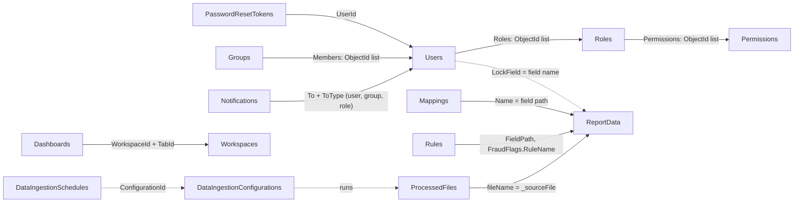
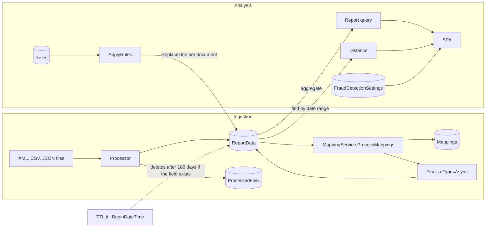
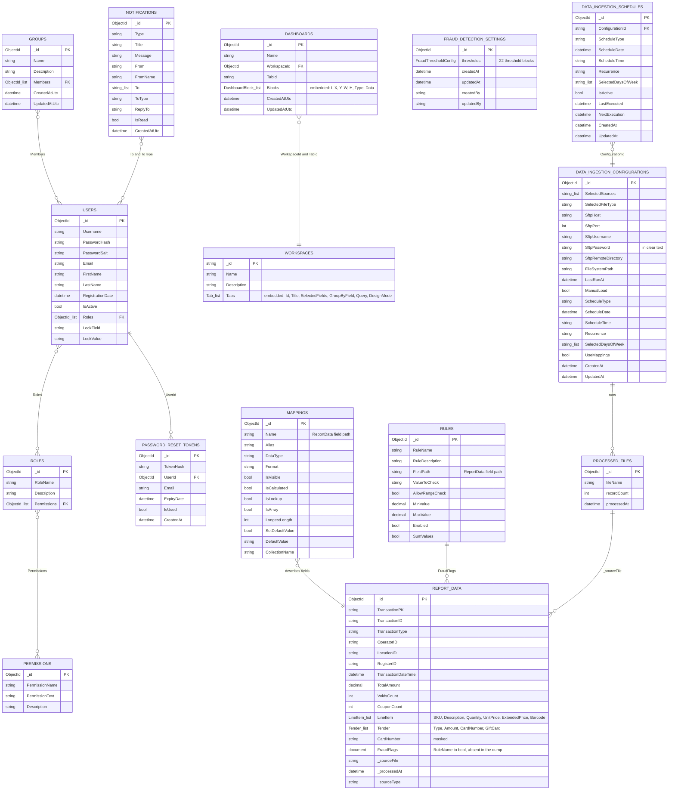

<!-- IMPACT-META
schema: 1
mode: how
step: 08_data
commit: fc7d820908b8b230fb47a2669920ba7efdb413a8
commit_short: fc7d820
branch: main
worktree: dirty
baseline_date: 2026-10-07T18:19:51+02:00
generated_at: 2026-10-08T09:29:30+02:00
-->
# Data - LOSS_PREVENTION Project

> **Baseline commit:** `fc7d820` (`main`) · worktree `dirty` (local changes only in `Docs/` and `.github/`; application code identical to the commit)

**Date**: 2026-10-08  
**Version**: 1.1  
**Authors**: IMPACT REVERSE how (verification 2026-10-08)  
**Audience**: Technical team, architects, developers

---

## Main Sections

1. [Logical Data Model (ER Diagram)](#1-logical-data-model-er-diagram)
2. [Physical Data Model](#2-physical-data-model)
3. [Data Ownership & Governance](#3-data-ownership--governance)
4. [Data Storage & Partitioning](#4-data-storage--partitioning)
5. [Backup & Archive Strategy](#5-backup--archive-strategy)
6. [Data Retention Policy](#6-data-retention-policy)
7. [Log Management](#7-log-management)
8. [ERD Diagram (Mermaid)](#erd-diagram-mermaid)

Sources: entities in `LossPrevention.Domain/Entities/**`, repository registrations in `LossPrevention.Infrastructure/InfrastructureServiceExtensions.cs`, direct `Collection`/`GetCollection` accesses in the services, dump `Data/LossPrevention` (`*.bson` + `*.metadata.json`, read with a BSON parser) and seed `Data/MongoDBScripts`. Paths relative to `customspa-it-loss-prevention-d098a8b97860/`.

---

## 1. Logical Data Model (ER Diagram)

**Summary.** The logical model revolves around a single schema-less transactional entity (`ReportData`, POS transactions) described by the `Mappings` metadata and flagged by the `Rules`; around it are the Identity & Access, ingestion configuration, collaboration (workspaces, dashboards, groups, notifications) and anti-fraud thresholds areas. All relationships are logical: MongoDB does not enforce referential constraints.

### 1.1 Areas and entities

| Area | Entity (C# class) | Collection | Role |
|------|--------------------|-----------|-------|
| Analytical data | `BsonDocument` | `ReportData` | POS transactions (header, `LineItem` lines, `Tender`/card payments, `FraudFlags` flags) |
| Analytical metadata | `MappingItem` | `Mappings` | Catalog of `ReportData` fields (alias, type, visibility) |
| Rules | `RuleConfiguration` | `Rules` | Single-field rules that produce `FraudFlags.<RuleName>` |
| Anti-fraud thresholds | `FraudDetectionSettings` (+22 `*Threshold` blocks) | `FraudDetectionSettings` | Parameters of the client-side statistical engine |
| Identity & Access | `User`, `Role`, `Permission`, `PasswordResetToken` | `Users`, `Roles`, `Permissions`, `PasswordResetTokens` | Authentication, RBAC, password reset, row lock (`LockField/LockValue`) |
| Ingestion | `DataIngestionConfiguration`, `DataIngestionSchedule`, `BsonDocument` | `DataIngestionConfigurations`, `DataIngestionSchedules`, `ProcessedFiles` | Source/scheduling and registry of imported files |
| Collaboration | `Workspace` (+`Tab`, `Field`, `Query`, `Condition`), `DashboardDocument` (+`DashboardBlock`), `GroupDocument`, `NotificationDocument` | `Workspaces`, `Dashboards`, `Groups`, `Notifications` | Saved reports, dashboards, user groups, messages |

### 1.2 Logical diagram (relationships)

The diagram with the actual attributes is in the section [ERD Diagram (Mermaid)](#erd-diagram-mermaid).



### 1.3 Relationships and integrity

| From → To | Field | Cardinality | Integrity managed by the code | Evidence |
|--------|-------|-------------|------------------------------|----------|
| Users → Roles | `Roles` (ObjectId list) | N:M | When a role is deleted, the role is removed from the users (not atomic) | `UserRoleService.cs:59-79` |
| Roles → Permissions | `Permissions` (ObjectId list) | N:M | When a permission is deleted, it is removed from the roles (not atomic) | `UserPermissionService.cs:117-133` |
| PasswordResetTokens → Users | `UserId` | N:1 | No cleanup when the user is deleted | `UserService.cs:113-116` |
| Groups → Users | `Members` | N:M | No cleanup | `GroupDocument` |
| Notifications → Users/Groups/Roles | `To` (string list) + `ToType` | Polymorphic N:M | None; the notification list does not filter by recipient | `ListNotificationsEndpoint.cs:30-31` |
| Dashboards → Workspaces | `WorkspaceId` (ObjectId) + `TabId` (string) | N:1 | None: deleting a workspace leaves the dashboards orphaned; **mismatched type** (`Workspaces._id` is stored as a string) | `DashboardDocument.cs:11-14`, `WorkspaceService.cs:49,75-87` |
| Mappings → ReportData | `Name` (field path) + `CollectionName` | 1:1 per field | Regenerated by sampling | `MappingService.ProcessMappings` |
| Rules → ReportData | `FieldPath` (input), `FraudFlags.<RuleName>` (output) | 1:N | No check that `FieldPath` exists | `RulesService.cs` |
| ProcessedFiles → ReportData | `fileName` = `_sourceFile` | 1:N | Only for ingestion via API | `FileProcessingCoordinator.cs:298,368,385-409` |
| DataIngestionSchedules → DataIngestionConfigurations | `ConfigurationId` | N:1 | Collection never used at runtime | `Program.cs:99` |
| Users → ReportData | `LockField`/`LockValue` (name and value of a field) | — | Applied only in the browser | `UI/src/helpers/fieldLock.ts` |

---

## 2. Physical Data Model

**Summary.** A single MongoDB database (`LossPrevention`) with neither schema validation nor migrations. The code uses **15 collections** (13 from configuration + 2 with a hardcoded name); the versioned dump contains **12 collections**: 10 in common with the code and 2 manual backups (`Mappings_old`, `ReportData_old`). The only secondary indexes are the TTL on `ReportData.BeginDateTime` and the dynamic ones created by the console.

### 2.1 Data store

| Element | Value | Evidence |
|----------|--------|----------|
| DBMS | MongoDB 8.3.2 (dump created with mongodump 100.13.0) | `Data/LossPrevention/prelude.json` |
| Database | `LossPrevention` | `MongoDbSettings.DatabaseName` in `appsettings.json` |
| Connection | `mongodb://localhost:27017` without credentials or TLS | `LossPrevention.API/appsettings.json` |
| Driver | MongoDB.Driver / MongoDB.Bson 3.4.0 | csproj Application/Infrastructure/Domain |
| Access | `MongoRepository<T>` (14 registrations, 13 types) + direct `Collection` / `GetCollection` access | `InfrastructureServiceExtensions.cs:42-149`, `FileProcessingCoordinator.cs:391,409` |
| Schema management | None: no migrations, no `$jsonSchema`; `InsertMany` with `BypassDocumentValidation=true` | `MongoRepository.cs:82` |
| Scripts | Manual JS seeds (`Data/MongoDBScripts/00..04`) | §2.6 |

### 2.2 Collection reconciliation: code vs dump

| # | Collection | Origin of the name in the code | C# type | Registration / access | In the dump | Documents | `.bson` bytes |
|---|-----------|-----------------------------|---------|-------------------------|----------|-----------|--------------|
| 1 | `ReportData` | `CollectionName_ReportData` | `BsonDocument` | `BsonDocument` repository | Yes | 3,000 | 3,528,608 |
| 2 | `Mappings` | `CollectionName_MappingConfiguration` | `MappingItem` | repository | Yes | 52 | 12,500 |
| 3 | `Rules` | `CollectionName_RulesConfiguration` | `RuleConfiguration` | repository | Yes | 3 | 643 |
| 4 | `Users` | `CollectionName_Users` | `User` | repository (registered 2 times) | Yes | 2 | 625 |
| 5 | `Roles` | `CollectionName_Roles` | `Role` | repository | Yes | 1 | 677 |
| 6 | `Permissions` | `CollectionName_Permissions` | `Permission` | repository | Yes | 37 | 5,790 |
| 7 | `Workspaces` | `CollectionName_Workspaces` | `Workspace` | repository | Yes | 3 | 10,495 |
| 8 | `Dashboards` | `CollectionName_Dashboards` | `DashboardDocument` | repository | Yes | 1 | 146 |
| 9 | `DataIngestionConfigurations` | `CollectionName_DataIngestionConfigurations` | `DataIngestionConfiguration` | repository | Yes | 1 | 410 |
| 10 | `ProcessedFiles` | literal `"ProcessedFiles"` | `BsonDocument` | `Collection.Database.GetCollection` | Yes | 3,000 | 258,000 |
| 11 | `PasswordResetTokens` | literal `"PasswordResetTokens"` | `PasswordResetToken` | repository (`InfrastructureServiceExtensions.cs:83`) | **No** | — | — |
| 12 | `FraudDetectionSettings` | `CollectionName_FraudDetectionSettings` | `FraudDetectionSettings` | repository | **No** | — | — |
| 13 | `DataIngestionSchedules` | `CollectionName_DataIngestionSchedules` | `DataIngestionSchedule` | repository (service never injected) | **No** | — | — |
| 14 | `Notifications` | `CollectionName_Notifications` | `NotificationDocument` | repository | **No** | — | — |
| 15 | `Groups` | `CollectionName_Groups` | `GroupDocument` | repository | **No** | — | — |
| 16 | `Mappings_old` | — (not referenced) | — | — | Yes (dump only) | 12 | 3,134 |
| 17 | `ReportData_old` | — (not referenced) | — | — | Yes (dump only) | 100 | 22,505 |

Dump total: 25 files (12 `.bson` + 12 `.metadata.json` + `prelude.json`), 3,845,860 bytes. The 5 collections absent from the dump are created by MongoDB on the first insert.

### 2.3 Physical schema of the configuration collections

| Collection | Primary key | Fields (BSON name = property name, unless otherwise indicated) |
|-----------|-----------------|--------------------------------------------------------|
| `Users` | `_id` ObjectId | `Username`, `PasswordHash`, `PasswordSalt`, `Email`, `FirstName`, `LastName`, `RegistrationDate`, `IsActive`, `Roles` (ObjectId[]), `LockField?`, `LockValue?` |
| `Roles` | `_id` ObjectId | `RoleName`, `Description`, `Permissions` (ObjectId[]) |
| `Permissions` | `_id` ObjectId | `PermissionName`, `PermissionText`, `Description` |
| `PasswordResetTokens` | `_id` (C# string represented as ObjectId) | `TokenHash`, `UserId` (ObjectId), `Email`, `ExpiryDate`, `IsUsed`, `CreatedAt` |
| `Mappings` | `_id` ObjectId | `Name`, `Alias`, `DataType`, `Format`, `IsVisible`, `IsCalculated`, `IsLookup`, `IsArray`, `LongestLength`, `SetDefaultValue`, `DefaultValue`, `CollectionName` (`Mappings_old` additionally has `Path`) |
| `Rules` | `_id` ObjectId | `RuleName`, `RuleDescription`, `FieldPath`, `ValueToCheck`, `AllowRangeCheck`, `MinValue` (decimal?), `MaxValue` (decimal?), `Enabled`, `SumValues` |
| `FraudDetectionSettings` | `_id` ObjectId | **camelCase**: `thresholds` (22 sub-documents: `HighValue` … `ReturnFraud`), `createdAt`, `updatedAt`, `createdBy`, `updatedBy` |
| `DataIngestionConfigurations` | `_id` (string as ObjectId) | `SelectedSources`, `SelectedFileType`, `SftpHost`, `SftpPort` (default 22), `SftpUsername`, `SftpPassword` (in clear text), `SftpRemoteDirectory`, `FileSystemPath`, `LastRunAt?`, `ManualLoad`, `ScheduleType`, `ScheduleDate?`, `ScheduleTime?`, `Recurrence`, `SelectedDaysOfWeek`, `CreatedAt`, `UpdatedAt`, `UseMappings` |
| `DataIngestionSchedules` | `_id` (string as ObjectId) | `ConfigurationId`, `ScheduleType`, `ScheduleDate`, `ScheduleTime`, `Recurrence`, `SelectedDaysOfWeek`, `IsActive`, `LastExecuted`, `NextExecution`, `CreatedAt`, `UpdatedAt` |
| `ProcessedFiles` | `_id` ObjectId | `fileName`, `recordCount`, `processedAt` (camelCase, `BsonDocument` built by hand) |
| `Workspaces` | `_id` **string** (`ObjectId.GenerateNewId().ToString()`) | `Name`, `Description`, `Tabs[]` → `Id`, `Title`, `Description`, `SelectedFields[]` (`Name`, `Alias`, `DataType`, `GroupBy`, `Aggregation`, `IsCalculated`, `Expression`, `Prefix`, `Suffix`, `Visible`), `GroupByField`, `Query` (`Type`, `Conditions[]` → `Field`, `Operator`, `Value`; `Id`), `DesignMode` |
| `Dashboards` | `_id` ObjectId | `Name`, `WorkspaceId` (ObjectId), `TabId` (string), `Blocks[]` (`I`, `X`, `Y`, `W`, `H`, `Type`, `Data` BsonDocument), `CreatedAtUtc`, `UpdatedAtUtc` |
| `Groups` | `_id` ObjectId | `Name`, `Description`, `Members` (ObjectId[]), `CreatedAtUtc`, `UpdatedAtUtc` |
| `Notifications` | `_id` ObjectId | `Type`, `Title`, `Message`, `From`, `FromName`, `To` (string[]), `ToType`, `ReplyTo`, `IsRead`, `CreatedAtUtc` |

### 2.4 Structure of `ReportData` (observed on the 3,000 documents of the dump)

| Group | Fields (BSON type) | Presence |
|--------|-------------------|----------|
| Header | `TransactionPK`, `TransactionID`, `TransactionType` (Sale 2,397 / Refund 231 / Return 230 / Void 142), `OperatorID`, `LocationID`, `RegisterID`, `TransactionDateTime` (date), `TotalAmount` (decimal), `TrainingModeFlag`, `CancelFlag`, `VoidsCount` (int), `CouponCount` (int), `PreExistingRuleFlag` | 3,000 |
| Lines (array) | `LineItem[]`: `SKU`, `Description`, `Quantity`, `UnitPrice`, `ExtendedPrice`, `Barcode` (long) | 2,671 |
| Lines (flat) | `SKU`, `Description`, `Quantity`, `UnitPrice`, `ExtendedPrice`, `Barcode` at the root | 329 |
| Payment (flat) | `Type`, `Amount` | 2,556 |
| Card (flat) | `CardNumber`, `CardBrand`, `Last4`, `Expiry`, `EntryMethod`, `ApprovalCode`, `CardPresent`, `AuthorizationResponse` | 2,101 |
| Payments (array) | `Tender[]` (incl. `GiftCardNumber`, `GiftCardAction`, `GiftCardBalanceAfter`) | 444 |
| Lineage | `_sourceFile`, `_processedAt` (date), `_sourceType` (always `filesystem`) | 3,000 |
| Rule flags | `FraudFlags.*` | **0** (the rules have never been applied to this dump) |
| TTL | `BeginDateTime` | **0** |

Average document size ≈ 1,176 bytes (3,528,608 / 3,000). `TransactionDateTime` covers 2025-08-13 → 2025-11-12; `_processedAt` = 2026-05-13. The coexistence of `LineItem[]` and flat `SKU` (and of `Tender[]` and flat `Type/Amount`) derives from the XML→BSON flattening, depending on whether a file contains a single element or several repeated elements. `ReportData_old` (100 documents) instead has boolean flags at the root (`HighRefund`, `HighValueTransaction`, `HighVoid`, `IsVoid`, `LowValueTransaction`, `OutsideBusinessHours`) and fields `Timestamp`, `TotalAmount`, `TransactionID`, `TransactionType`: it is a previous schema.

### 2.5 Indexes

| Collection | Index | Keys | Options | Origin | Present in the dump |
|-----------|--------|--------|---------|---------|-------------------|
| All 12 of the dump | `_id_` | `{_id: 1}` | — | MongoDB default | Yes (`*.metadata.json`) |
| `ReportData` | `ttl_BeginDateTime` | `{BeginDateTime: 1}` | `expireAfterSeconds: 15552000` (180 days) | `DatabaseInitializationService.cs:97-105` at API startup | Yes (`ReportData.metadata.json`) |
| `ReportData` | dynamic `<campo>_1` (max 20) | ascending on top-level bool/date/array/string/int/long/decimal fields of the first 100 documents | — | `IndexService.ProcessIndexesAsync` (`Services/Data/IndexSuggestionHelper.cs:20-38`) → `MongoRepository.CreateIndexesAsync` (`:29-40`), only from the console | No |
| Code-only collections (5) | none besides `_id` | — | — | — | — |

**Missing** indexes with respect to the code's accesses: `Users.Username` (login, uniqueness), `Roles.RoleName`, `Permissions.PermissionName`, `ProcessedFiles.fileName` (lookup on every file: today a collection scan, no uniqueness), `PasswordResetTokens.TokenHash` + TTL on `ExpiryDate`, `ReportData.TransactionDateTime` (range filter in `DistanceDataservice.cs:34-39`), `Mappings.{CollectionName, Name}`. The vendor documentation `Docs/06_DATABASE_DATA_MODEL.md` (present only in commit `593f6de`, removed in `d768cd9`; `git show 593f6de:customspa-it-loss-prevention-d098a8b97860/Docs/06_DATABASE_DATA_MODEL.md`) listed unique indexes on `Users.Username`/`Email`, `Roles.RoleName`, `Permissions.PermissionName` and indexes on `ReportData.StoreID`/`Total`: they **do not exist** either in the code or in the dump.

### 2.6 Seeds and dump content

| Script | Effect |
|--------|---------|
| `00_CleanupDuplicatePermissions.js` | Removes duplicate permissions (keeps the first occurrence) |
| `01_CreatePermissions.js` | Creates 37 `CAN_*` permissions |
| `02_AddPermissionsToAdminRole.js` | Associates the permissions with the Admin role |
| `03_CleanupStalePermissions.js` | Removes 4 obsolete permissions (`CAN_LOGIN`, `CAN_ADD_USERS`, `CAN_DELETE_USERS`, `CAN_UPDATE_USERS`) and their references in the roles (total distinct names in the scripts: 41) |
| `04_AddLossPreventionRules.js` | Corrects wrong `FieldPath` values (`Total`→`TotalAmount`, `TenderType`/`Tender.Type`→`Type`, lines 13-24), deletes `IsGiftCard` (line 27), inserts 11 rules if absent (lines 37-155) |
| `rules_export.json` | Export of 13 rules = expected state after script 04 |

The dump does **not** reflect script 04: `Rules` contains 3 rules (`LowValueTransaction`, `HighValueTransaction` with `FieldPath: "Total"`, `IsGiftCard` with `FieldPath: "TenderType"`), all referring to fields that do not exist in `ReportData`. Other anomalies: user `lockeddownuser` with `LockField: "StoreID"` (absent field: `LocationID` exists); password hashes of both users in legacy format (without `v2:` prefix, 10,000 iterations); the 52 mappings all have `CollectionName: "ReportData"` and none concerns `FraudFlags`.

---

## 3. Data Ownership & Governance

**Summary.** There are no formal data owner/steward roles or data classification in the code; ownership is implicit in the component that writes each collection. The transactional data contains operator identifiers and masked payment data, accessible to anyone who has `CAN_VIEW_REPORT` without server-side filters.

### 3.1 Technical ownership (writers and readers)

| Collection | Written by | Read by | Main API permissions |
|-----------|-----------|----------|-------------------------|
| `ReportData` | `FileProcessingCoordinator` (API), console `DataIngestionService`, `RuleConfigurationService` (flags), `MappingService.FinalizeTypesAsync` (types) | `ReportDataservice`, `DistanceDataService`, `RuleConfigurationService`, `MappingService` | `CAN_VIEW_REPORT` and rules/ingestion permissions |
| `Mappings` | `MappingService`, Mappings endpoints, `RuleConfigurationService` | Report, distance, SPA | Mappings permissions |
| `Rules` | Rules endpoints | `RuleConfigurationService` | Rules permissions |
| `FraudDetectionSettings` | FraudDetection endpoints (direct repository) | SPA (statistical engine) | FraudDetection permissions |
| `Users`, `Roles`, `Permissions` | `UserService`, `UserRoleService`, `UserPermissionService`, seed | Login, admin | User/Roles/Permissions permissions |
| `PasswordResetTokens` | `PasswordResetService` | `PasswordResetService` | anonymous (`ForgotPassword`, `ResetPassword`, `ValidateResetToken`) |
| `DataIngestionConfigurations` | `DataIngestionService` | Coordinator, background service | DataIngestion permissions |
| `ProcessedFiles` | `FileProcessingCoordinator` | `FileProcessingCoordinator` | — (internal) |
| `Workspaces`, `Dashboards` | `WorkspaceService`, Dashboard endpoints | SPA | Workspaces/Dashboard permissions; **no owner**: data shared among all users |
| `Groups`, `Notifications` | Groups/Notifications endpoints | SPA | no filter by recipient (`ListNotificationsEndpoint.cs:30-31`) |

### 3.2 Data classification (derived from the fields)

| Category | Fields | Collections | Current protection |
|-----------|-------|-----------|--------------------|
| Credentials | `PasswordHash`, `PasswordSalt` | `Users` | PBKDF2; **returned** by `GetUsersEndpoint.cs:36` |
| Integration secrets | `SftpPassword` | `DataIngestionConfigurations` | In clear text |
| Tokens | `TokenHash` | `PasswordResetTokens` | SHA256 hash |
| Personal data (employees/users) | `Username`, `Email`, `FirstName`, `LastName`; `OperatorID` | `Users`, `PasswordResetTokens`, `ReportData` | No masking |
| Payment data | `CardNumber` (masked, e.g. `472805******1016`, 2,545 values), `Last4`, `Expiry`, `CardBrand`, `ApprovalCode`, `GiftCardNumber` | `ReportData` | PAN masking at the source (first 6 + last 4); no further control |
| Business data | amounts, items, stores | `ReportData` | Row lock only client-side |

### 3.3 Lineage and quality



| Aspect | Status | Evidence |
|---------|-------|----------|
| Lineage | `_sourceFile`, `_processedAt`, `_sourceType` on every transaction (API: `sftp`/`filesystem`; console: without `_sourceType`) | `FileProcessingCoordinator.cs:298-300,368-370` |
| Typing | Inferred by sampling (`ProcessMappings` on 1,000 or `int.MaxValue` documents) and `FinalizeTypesAsync` conversion (only documents with `_id` in the current day, London time zone) | `MappingService.cs` |
| Validation | No schema validation; `BypassDocumentValidation=true` | `MongoRepository.cs:82` |
| Audit | Only `createdAt/updatedAt/createdBy/updatedBy` on `FraudDetectionSettings`, `CreatedAtUtc/UpdatedAtUtc` on dashboards/groups; no audit on users, roles, rules | Domain entities |
| Data owner / steward | N/A — not derivable from the code: no ownership metadata or process | — |

---

## 4. Data Storage & Partitioning

**Summary.** All data resides in a single local `mongod`, in a single database and — for transactions — in a single `ReportData` collection; there is no sharding, time partitioning, bucketing or hot/cold separation.

| Aspect | Status | Evidence |
|---------|-------|----------|
| Topology | Single node `localhost:27017` (replica set/sharding not configured in the connection string) | `appsettings.json` |
| Partitioning | None: a single `ReportData` collection for all stores and periods | — |
| Sharding | None | — |
| Growth | `ReportData` grows with the transactions (≈ 1.2 KB/doc in the dump); `ProcessedFiles` +1 document per file (≈ 86 bytes/doc), without limit | §2.2 |
| Temporary files | SFTP files downloaded into `Path.GetTempPath()` and deleted after parsing | `FileProcessingCoordinator.cs:281,320`; `SftpFileProcessingService.cs:153,191` |
| Source file storage | SFTP: moved to `processed/` or `failed/` on the remote server (never deleted); file system: left in the source folder | `SftpFileProcessingService.cs:33-34`; `FileProcessingCoordinator.cs:246` |
| Actual production volumes | N/A — not derivable from the code: the dump contains only development data (3,000 transactions) | — |

Candidate partitioning keys (recommendation, not implemented): `TransactionDateTime` (time-series collection or monthly buckets, consistent with retention) and `LocationID` (compound shard key `{LocationID, TransactionDateTime}`).

---

## 5. Backup & Archive Strategy

**Summary.** The code implements neither backup nor archiving. The only evidence of backup is the `mongodump` dump versioned in Git, which also contains sensitive data; the `_old` collections are ad-hoc manual copies.

| Aspect | Status | Evidence |
|---------|-------|----------|
| Automatic backup | Absent (no script, job or configuration) | repository search |
| Manual backup | Full dump in `Data/LossPrevention` (mongodump 100.13.0, MongoDB 8.3.2), versioned in Git | `prelude.json` |
| Risk of the versioned dump | Contains password hashes, user emails, ingestion configuration and 3,000 transactions with masked card data | §3.2 |
| Archiving | Absent; `Mappings_old` and `ReportData_old` are manual copies of previous schemas, not referenced by the code | §2.2 |
| Archiving before TTL expiry | Absent: the TTL deletes permanently | §6 |
| RPO / RTO | N/A — not derivable from the code: no requirements or procedures defined | — |

Historical note: the vendor's `Docs/12_MAINTENANCE_OPERATIONS.md` (present only in commit `593f6de`, removed in `d768cd9`; `git show 593f6de:customspa-it-loss-prevention-d098a8b97860/Docs/12_MAINTENANCE_OPERATIONS.md`) proposed a `backup-lossprevention.sh` script (`mongodump --gzip`, `tar.gz` archive, 30-day retention, daily cron at 01:00, optional upload to Azure Blob). The script is **not** present in the repository.

---

## 6. Data Retention Policy

**Summary.** The only implemented policy is a TTL index on `ReportData.BeginDateTime` (180 days from configuration), which however does not apply to the observed data because the field does not exist; the other collections grow without limits.

### 6.1 Implemented TTL mechanism

```csharp
// LossPrevention.Application/Interfaces/Data/DatabaseInitializationService.cs
_retentionDays = configuration.GetValue<int>("DataRetention:TransactionRetentionDays", 90);   // :23
// EnsureTtlIndexAsync (:43-116): se esiste già un TTL su BeginDateTime -> return;
// se esiste un indice non-TTL su BeginDateTime -> DropOneAsync; poi:
var indexKeys = Builders<BsonDocument>.IndexKeys.Ascending("BeginDateTime");
// ExpireAfter = TimeSpan.FromDays(_retentionDays), Name = "ttl_BeginDateTime"         // :97-105
// in caso di errore: _logger.LogError(...); throw;  -> l'API non parte
```

| Aspect | Behavior |
|---------|---------------|
| Duration | `DataRetention:TransactionRetentionDays` = 180 in `appsettings.json` (default in the code 90) → `expireAfterSeconds: 15552000` in the dump |
| Field | `BeginDateTime`: **absent** in all 3,000 documents of the dump (`TransactionDateTime` is present) → no document expires |
| Duration change | If the TTL index already exists it is skipped: changing the configuration does **not** update `expireAfterSeconds` (`collMod` would be needed) |
| Type | The TTL acts only on BSON date values; `FinalizeTypesAsync` converts the types only for the documents of the current day |
| Console | Does not create the TTL (only the API runs `DatabaseInitializationService`) |

### 6.2 Retention per collection

| Collection | Effective policy | Risk |
|-----------|--------------------|---------|
| `ReportData` | TTL 180 days on `BeginDateTime` (ineffective on the observed data) | Unlimited growth; personal and payment data retained indefinitely |
| `ProcessedFiles` | None | Unlimited growth; if cleaned up, the files still present in `processed/` would be re-ingested |
| `PasswordResetTokens` | Logical expiry 1 h (`ExpiryDate`), no TTL; used/expired tokens are never deleted | Accumulation of emails and token hashes |
| `Notifications` | None | Unlimited growth |
| `Users`, `Roles`, `Permissions`, `Rules`, `Mappings`, `Workspaces`, `Dashboards`, `Groups`, `FraudDetectionSettings`, `DataIngestionConfigurations`, `DataIngestionSchedules` | Until manual deletion via API | Low volume |
| `Mappings_old`, `ReportData_old` | None (only in the dump) | Obsolete data |

Regulatory retention requirements (e.g. GDPR, PCI-DSS): N/A — not derivable from the code. Historical note: `Docs/12_MAINTENANCE_OPERATIONS.md` (only `593f6de`) suggested a manual cleanup `deleteMany({ _processedAt: { $lt: cutoff } })` at 180 days "if TTL not working": not implemented.

---

## 7. Log Management

**Summary.** Application logs go only to the default `Microsoft.Extensions.Logging` providers (console/debug) and to `Console.WriteLine`; there are no log files, rotation, centralization, log retention or persisted audit trail.

| Aspect | Status | Evidence |
|---------|-------|----------|
| Provider | Default `WebApplication.CreateBuilder` / `Host.CreateDefaultBuilder` (Console, Debug, EventSource, EventLog on Windows) | API and console `Program.cs` |
| Levels | `Default: Information`, `Microsoft.AspNetCore: Warning` | `appsettings.json` (API and console) |
| Structured logger | `ILogger<T>` only in 4 classes: `DatabaseInitializationService`, `DataIngestionBackgroundService`, `FileProcessingCoordinator`, `SftpFileProcessingService` | grep `ILogger<` |
| Unstructured output | 6 backend `Console.WriteLine`; 57 frontend `console.log` (including the API base URL and semantic maps) | see [07_code.md §5](07_code.md#5-exception-handling--logging) |
| File sink / centralization | Absent (no Serilog/NLog/OpenTelemetry/Application Insights) | csproj |
| Log rotation and retention | N/A — no log file produced by the code | — |
| Security audit | Absent: successful/failed logins, password resets, changes to roles/permissions/rules are not recorded | — |
| Sensitive data in logs | The coordinator logs file names and errors; no logging of passwords/tokens identified; the frontend logs report data to the console | `FileProcessingCoordinator.cs` |
| Ingestion run history | Only `ProcessedFiles` (file name, records, date); `LastRunAt` not persisted | `DataIngestionBackgroundService.cs` |

Historical note: the vendor documentation `12_MAINTENANCE_OPERATIONS.md` (only `593f6de`) referred to `/var/log/lossprevention/api.log` and to `LOGIN_FAILED` events: neither the file nor the event exists in the code.

---

## ERD Diagram (Mermaid)

Attributes and types from the C# classes in `LossPrevention.Domain/Entities/**` (BSON types simplified into single tokens; `_list` = array). `REPORT_DATA` shows the fields observed in the dump; `PROCESSED_FILES` is built by hand in the code.



The relationships are **logical** (references by `ObjectId`, by string or by field name): MongoDB does not enforce referential integrity; the only cascades managed by the code are the removal of a role from the users and of a permission from the roles (§1.3).

---

## Reference Documents

- **Deep Dive Analysis**: [00_deep_dive.md](00_deep_dive.md)
- **Context**: [01_context.md](01_context.md)
- **Functional Overview**: [02_functional_overview.md](02_functional_overview.md)
- **Non-Functional Overview**: [03_non_functional_overview.md](03_non_functional_overview.md)
- **Constraints**: [04_constraints.md](04_constraints.md)
- **Principles**: [05_principles.md](05_principles.md)
- **Software Architecture**: [06_software_architecture.md](06_software_architecture.md)
- **Code**: [07_code.md](07_code.md)
- Related downstream documents: [09_infrastructure_architecture.md](09_infrastructure_architecture.md) · [12_operation_and_support.md](12_operation_and_support.md) · [17_backend_deep_assessment.md](17_backend_deep_assessment.md) · [19_modernization_estimation_spec.md](19_modernization_estimation_spec.md)

---

## Change Log

| Version | Date | Author | Changes |
|----------|------|--------|-----------|
| 1.0 | 2026-10-07 | REVERSE how (FULL) | Document creation (replaces run 2026-10-05) |
| 1.1 | 2026-10-08 | IMPACT verify | Restructured into the 7 sections of the prompt + ERD; reconciliation of code collections (15) vs dump (12, not "13 + 2 _old"); Rules in the dump 3 (not 13 seed) with wrong FieldPath; ReportData without `FraudFlags` or `BeginDateTime`; physical schema per collection, index table (metadata.json, DatabaseInitializationService, IndexService) and missing indexes; mismatched type Dashboards.WorkspaceId/Workspaces._id; added sections Ownership & Governance (data classification, lineage), Storage & Partitioning, Backup & Archive, Retention per collection, Log Management; ERD with real fields and single-token types; vendor docs cited as historical (`593f6de`/`d768cd9`); complete Reference Documents |
