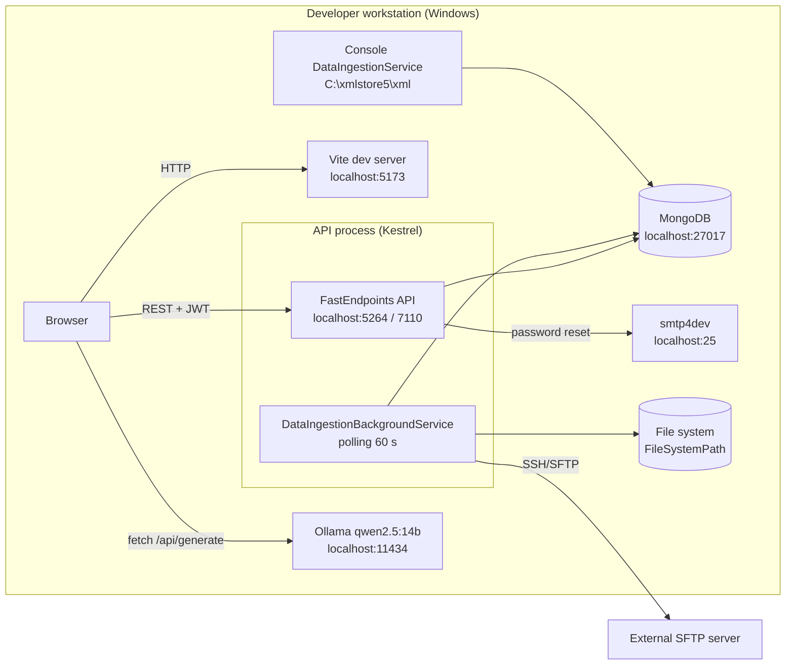
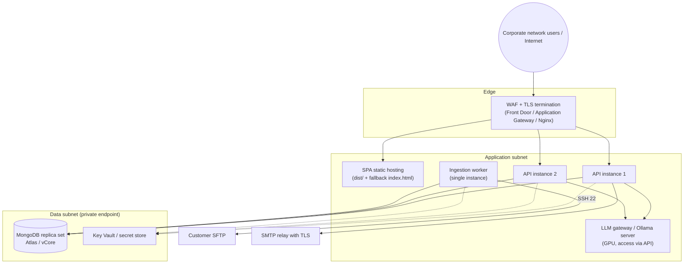

<!-- IMPACT-META
schema: 1
mode: how
step: 09_infrastructure_architecture
commit: fc7d820908b8b230fb47a2669920ba7efdb413a8
commit_short: fc7d820
branch: main
worktree: dirty
baseline_date: 2026-10-07T18:19:51+02:00
generated_at: 2026-10-08T09:41:39.009+02:00
-->
# Infrastructure Architecture - LOSS_PREVENTION Project

> **Baseline commit:** `fc7d820` (`main`) · worktree `dirty` (local changes only in `Docs/` and `.github/`; application code identical to the commit)

**Date**: 2026-10-08  
**Version**: 1.1  
**Authors**: REVERSE how (IMPACT) · verified by IMPACT verify  
**Audience**: Technical team, architects, developers, operations

---

## Main Sections

This document describes the physical/virtual infrastructure and the network topology of the Loss Prevention Tool. Each section explicitly separates:

- **AS-IS** — what can be derived from the code and the configuration at commit `fc7d820` (with `file:riga` reference);
- **TO-BE** — recommendations or proposals (from the vendor or from this analysis), which are **not** implemented in the repository.

**Sources of evidence used**

| Source | Path | Relevant content |
|-------|----------|---------------------|
| API bootstrap | `LossPrevention.API/Program.cs` | CORS, middleware pipeline, DI, hosted service, DB init |
| Launch profiles | `LossPrevention.API/Properties/launchSettings.json` | Kestrel / IIS Express ports, `Development` environment |
| API configuration | `LossPrevention.API/appsettings.json` | MongoDB, JWT, SMTP, retention, logging |
| Console configuration | `LossPrevention.DataIngestionService/appsettings.json` | MongoDB (subset of collections) |
| Batch console | `LossPrevention.DataIngestionService/Program.cs` | Hardcoded file path, parallelism |
| Scheduled ingestion | `LossPrevention.Application/Services/DataIngestion/*.cs` | Background service, SFTP, file system |
| Frontend | `LossPrevention.UI/vite.config.js`, `src/api/api.ts`, `src/stores/aiStore.ts` | Dev server, API base URL, LLM call |
| Development data | `Data/LossPrevention/` (mongodump), `Data/MongoDBScripts/` | Dump of 12 collections (10 in use + `Mappings_old`, `ReportData_old`), 5 seed scripts ordered `00..04` |
| Vendor documentation (historical) | `Docs/04_DEPLOYMENT_GUIDE.md`, `Docs/03_SETUP_INSTALLATION.md`, `Docs/12_MAINTENANCE_OPERATIONS.md`, `Docs/roadmap.txt` | **Not present at the baseline**: they existed only in commit `593f6de` and were removed in `d768cd9`; viewable with `git show 593f6de:customspa-it-loss-prevention-d098a8b97860/Docs/<file>` (run from `C:\repository\LOSS_PREVENTION`) |

---

## 1. Infrastructure Overview

**Summary.** The repository does not contain any infrastructure artifact (IaC, containers, manifests, pipelines): the only infrastructure that can be reconstructed from the code is the **local development one on a Windows workstation**, with all services on `localhost`. The Azure cloud architecture is only a vendor proposal, partially incompatible with the current code.

### 1.1 Inventory of infrastructure artifacts

| Artifact searched for | Present at the baseline | Evidence |
|-------------------|----------------------|----------|
| Dockerfile / `docker-compose.yml` | ❌ No | No file in the repository |
| Kubernetes / Helm manifests | ❌ No | — |
| IaC (Bicep, ARM, Terraform, Pulumi) | ❌ No | — |
| CI/CD pipeline (`.github/workflows`, `azure-pipelines.yml`) | ❌ No | `.github/` contains only `copilot-instructions.md` (local change, not application-related) |
| `web.config` (IIS) | ❌ No | Can only be generated by `dotnet publish` |
| `appsettings.{Environment}.json` | ❌ No | Only `appsettings.json` in API and console |
| `.env*` files for the frontend | ❌ No | `src/api/api.ts:4` reads `VITE_API_BASE_URL` but no `.env` is versioned |
| `launchSettings.json` | ✅ Yes | Development profiles only (`Development`) |
| Development database dump | ✅ Yes | `Data/LossPrevention/` — 12 collections, 3.85 MB, `prelude.json`: `ServerVersion 8.3.2`, `ToolVersion 100.13.0` |
| DB initialization scripts | ✅ Yes | `Data/MongoDBScripts/00..04_*.js` |
| `nuxt.config.ts` | ⚠️ Present but unused | The npm scripts use `vite` (`package.json:7-9`); the app is **not** Nuxt/SSR |

### 1.2 AS-IS runtime components (local development)

| # | Component | Technology | Process / host | Address | Evidence |
|---|-----------|------------|-----------------|-----------|----------|
| 1 | SPA | Vue 3 + Vite 6 (dev server) | `npm run dev` | `http://localhost:5173` (Vite uses `5174` if `5173` is taken) | `package.json:7`; CORS origins in `Program.cs:29`; verified: `VITE v6.4.4 ready … Local: http://localhost:5173/` |
| 2 | REST API | ASP.NET Core 8 + FastEndpoints 6.0.0 on Kestrel | `dotnet run` (`http`/`https` profiles) | `http://localhost:5264`, `https://localhost:7110` | `launchSettings.json:16,25` |
| 2b | REST API (alternative) | IIS Express | `IIS Express` profile | `http://localhost:55993`, SSL `44348` | `launchSettings.json:7-8,31-36` |
| 3 | Ingestion scheduler | **In-process** `BackgroundService` in the API | same process as the API | — (polling every 60 s) | `Program.cs:111`; `DataIngestionBackgroundService.cs:13,28,41` |
| 4 | Bulk ingestion | .NET 8 console (`02. LossPrevention.DataIngestionService`) | manual execution | reads `C:\xmlstore5\xml` | `DataIngestionService/Program.cs:76` |
| 5 | Database | MongoDB (driver 3.4.0) | local `mongod` | `mongodb://localhost:27017`, DB `LossPrevention` | `API/appsettings.json:13-14`; `DataIngestionService/appsettings.json:10-11` |
| 6 | SMTP | `System.Net.Mail.SmtpClient` | smtp4dev (from the comment in the code) | `localhost:25`, `EnableSsl=false` | `appsettings.json:36-37`; `EmailService.cs:63-66` |
| 7 | SFTP source | SSH.NET 2025.1.0 | external server | host/port/credentials stored in MongoDB (`DataIngestionConfigurations`) | `FileProcessingCoordinator.cs:180-211`; `SftpFileProcessingService.cs:56` |
| 8 | File system source | `Directory.GetFiles` | local disk or share | path from DB configuration (in the dump: `C:\xmlxstore4\transactions_xml`) | `FileProcessingCoordinator.cs:137-153` |
| 9 | LLM | Ollama, model `qwen2.5:14b` | **user's workstation** (called from the browser) | `http://localhost:11434/api/generate` | `aiStore.ts:8,88` |
| 10 | Temporary storage | `Path.GetTempPath()` | API host disk | `%TEMP%` | `SftpFileProcessingService.cs:153`; `FileProcessingCoordinator.cs:281` |

### 1.3 AS-IS diagram

### 1.4 Vendor proposal (historical) and compatibility with the code

The guide `Docs/04_DEPLOYMENT_GUIDE.md` (vendor documentation, present only in commit `593f6de`, removed in `d768cd9`) describes at lines 34-46 an Azure architecture: **Azure Front Door (CDN + WAF) → Azure Static Web Apps (UI) + Azure Functions / App Service (API) → Azure Cosmos DB (MongoDB API) or MongoDB Atlas**, with **Application Insights** (Step 5) and **Key Vault** for secrets (line 83). `Docs/roadmap.txt` (same historical provenance), section "Suggested Deployment(Azure)", indicates: Azure Functions, "Mongo API for Cosmos or Container Apps … VCore", alternatively the customer's infrastructure or Atlas, "Load balancing - SOA - At least 2 applications for uptime", separate environments "Sales/UAT and Production".

| Proposed element | Compatibility with the AS-IS code | Rationale (evidence) |
|-------------------|-----------------------------------|------------------------|
| Azure Functions for the API | ❌ Not compatible without redesign | The API is an ASP.NET Core host with `BackgroundService` (`Program.cs:111`), `IMemoryCache` (`Program.cs:49`) and synchronous DB init at startup (`Program.cs:115-119`): a model incompatible with on-demand serverless execution |
| Azure App Service / Container Apps | ✅ Compatible | Standard Kestrel host; however it requires configurable CORS and a single-instance scheduler (§4) |
| Static Web Apps for the SPA | ✅ Compatible with configuration | Router in `createWebHistory()` mode (`router/index.ts:52`) → a fallback to `index.html` is needed; `VITE_API_BASE_URL` must be set at build time |
| Cosmos DB for MongoDB (vCore) | ⚠️ To be verified | The code uses a TTL index (`DatabaseInitializationService.cs:97-105`) and arbitrary aggregation pipelines composed by the UI (`POST /data/report/query`): operator compatibility must be tested |
| MongoDB Atlas | ✅ Compatible | Same MongoDB engine as the dump (`ServerVersion 8.3.2`) |
| Application Insights / Key Vault | ⚠️ Not integrated | No telemetry package or Key Vault provider in the `.csproj` files |

---

## 2. Network Architecture

**Summary.** AS-IS all flows are on `localhost`, without TLS towards the backend services (MongoDB, SMTP) and with a direct browser → LLM call. The code does not contain any network configuration for shared environments (reverse proxy, forced HTTPS, HSTS, forwarded headers): these elements are TO-BE prerequisites.

### 2.1 AS-IS network flow matrix

| # | Source → Destination | Protocol / port | Authentication | Encryption | Evidence |
|---|-------------------------|--------------------|----------------|-----------|----------|
| F1 | Browser → SPA (Vite) | HTTP/5173 | — | No | `package.json:7` |
| F2 | Browser → API | HTTP/5264 or HTTPS/7110 | JWT Bearer HS256 (`Authorization` header from `localStorage`) | Only with the `https` profile | `api.ts:10-14`; `Program.cs:63-76` |
| F3 | Browser → Ollama | HTTP/11434 | None | No | `aiStore.ts:88` |
| F4 | API → MongoDB | TCP/27017 | None (connection string without credentials) | No (no `tls=true`) | `appsettings.json:13` |
| F5 | API → SMTP | SMTP/25 | `UseDefaultCredentials = true` (Windows credentials of the process) | No (`EnableSsl = false`) | `EmailService.cs:63-66` |
| F6 | API (background) → SFTP | SSH/port from configuration (`SftpPort`) | Username/password in clear text from the `DataIngestionConfigurations` collection | SSH; **no host key validation** (no `HostKeyReceived` handler in the code) | `SftpFileProcessingService.cs:56-61`; `FileProcessingCoordinator.cs:236-244` |
| F7 | API (background) → file system | Local or UNC I/O | API process identity | — | `FileProcessingCoordinator.cs:142-153` |
| F8 | Console → file system / MongoDB | Local I/O + TCP/27017 | User identity / none | No | `DataIngestionService/Program.cs:76,101-102` |

> Note: the SFTP port defaults to `22` in the `DataIngestionConfiguration` entity (`SftpPort = 22`); the effective value comes from the configuration saved via the UI (`DataIngestionService.cs:38`).

### 2.2 HTTP/edge configuration in the code

| Aspect | AS-IS | Evidence | Impact in a shared environment |
|---------|-------|----------|----------------------------------|
| CORS | `AllowVueDev` policy with **hardcoded** origins `http://localhost:5173`, `http://localhost:5174`, `AllowCredentials()` | `Program.cs:24-34,128` | Any real domain is blocked until the code is changed |
| HTTPS redirect / HSTS | Absent (no `UseHttpsRedirection`/`UseHsts`) | `Program.cs:121-132` | TLS must be enforced by the reverse proxy |
| Forwarded headers | Absent (no `UseForwardedHeaders`) | `Program.cs` | Behind a proxy, the original scheme and client IP are not visible to the app |
| Host filtering | `AllowedHosts: "*"` | `appsettings.json:11` | No filter on the `Host` header |
| Rate limiting | Absent | `Program.cs` | Anonymous endpoints (`/users/login`, `/users/forgot-password`) exposed to brute force |
| Swagger | Only if `IsDevelopment()` | `Program.cs:121-126` | In `Production` the OpenAPI documentation is not exposed |
| Ollama | Called from the browser towards `localhost` | `aiStore.ts:88` | Requires Ollama **on every user workstation**; not usable from a centrally hosted SPA without changes |

### 2.3 TO-BE network topology (proposal)

### 2.4 TO-BE network requirements derived from the code

| Rule | From → To | Port | Reason (evidence) |
|--------|--------|-------|-------------------|
| HTTPS ingress | Users → WAF/proxy | 443 | Serve SPA and API (today only `localhost`) |
| API → DB | API/worker → MongoDB | 27017 (or the managed service's port) | Sole persistence (`InfrastructureServiceExtensions.cs:33-37`) |
| SFTP egress | Worker → customer SFTP server | 22 (or configured `SftpPort`) | `SftpFileProcessingService.cs:56` |
| SMTP egress | API → relay | 587/465 with TLS (TO-BE; today 25 without TLS) | `EmailService.cs:63-64` |
| Share access | Worker → file server | SMB 445 (if `FileSystemPath` is UNC) | `FileProcessingCoordinator.cs:142` |
| LLM | API (TO-BE, via backend) → LLM gateway | 11434 or HTTPS | Today the browser calls `localhost:11434` (`aiStore.ts:88`) |

---

## 3. Hardware/VM Specifications

**Summary.** No hardware specification is present in the code. Below are the resource consumption factors **derived from the code**, the volumes of the reference dataset and an initial **TO-BE** sizing (estimate, to be validated with load tests).

### 3.1 Resource consumption factors derived from the code

| Area | Behavior | Evidence | Impacted resource |
|------|---------------|----------|-------------------|
| Application of anti-fraud rules | Loads **all** of `ReportData` into memory, `$unset` of `FraudFlags` on the whole collection, then `ReplaceOne` document by document | `RulesService.cs:34,41,58` | API RAM, DB I/O, HTTP request duration |
| Distance analysis | `FindManyAsync(filter)` without limit, in-memory processing | `DistanceDataservice.cs:39,90` | API RAM / CPU |
| Report cache | `IMemoryCache` without `SizeLimit`, 1 h expiry per `QueryPipeline+Skip+Take` combination | `Program.cs:49`; `GetReportDataEndpoint.cs:81,92-97` | API RAM (unbounded growth) |
| SFTP ingestion | File downloaded into `MemoryStream` + copy to a temporary file; download repeated in a second phase | `SftpFileProcessingService.cs:148-161`; `FileProcessingCoordinator.cs:277-288` | RAM, `%TEMP%` disk, bandwidth |
| Post-ingestion mapping | `ProcessMappings("ReportData", int.MaxValue)` | `FileProcessingCoordinator.cs:108` | API CPU/RAM |
| Bulk console | `Parallel.ForEachAsync` with `MaxDegreeOfParallelism = Environment.ProcessorCount` | `DataIngestionService/Program.cs:23,85-89` | All the host's cores |
| SPA bundle | Single JS **6,020 kB** (gzip 2,113 kB), CSS 1,180 kB, MDI fonts ~3.6 MB in total | Verified build (`npm run build`, Vite 6.4.4, 789 modules) | Bandwidth / CDN |
| LLM | Model `qwen2.5:14b` (14 billion parameters) run on the user's workstation | `aiStore.ts:8` | Client GPU/RAM |

### 3.2 Reference dataset (versioned dump)

| Collection | Documents | `.bson` size |
|------------|-----------|--------------------|
| `ReportData` | 3,000 | 3,528,608 B |
| `ProcessedFiles` | 3,000 | 258,000 B |
| `ReportData_old` | 100 | 22,505 B |
| `Mappings` / `Mappings_old` | 52 / 12 | 12,500 / 3,134 B |
| `Workspaces` | 3 | 10,495 B |
| `Permissions` | 37 | 5,790 B |
| Others (`Users` 2, `Roles` 1, `Rules` 3, `Dashboards` 1, `DataIngestionConfigurations` 1) | 8 | < 1 kB each |
| **Total dump folder** | — | **3,845,860 B (~3.7 MiB)** |

The dataset is of demonstration size (transactions with `TransactionDateTime` from 2025-08-13 to 2025-11-12): it is **not** indicative of production volumes, which cannot be derived from the code.

### 3.3 Development workstation requirements (historical)

`Docs/03_SETUP_INSTALLATION.md` (vendor, present only in `593f6de`, lines 49-61): minimum 8 GB RAM, 10 GB disk, dual-core; recommended 16 GB RAM, 50 GB SSD, quad-core. To also run Ollama with `qwen2.5:14b` locally, additional memory/GPU is needed, to be sized according to the chosen quantization.

### 3.4 Initial TO-BE sizing (estimate, not derived from the code)

| Role | Initial sizing | Rationale |
|-------|--------------------------|-------------|
| API | 2 vCPU / 4 GB × 2 instances | In-memory processing (§3.1); to be revised after the pagination of `ApplyRulesAsync` |
| Ingestion worker | 2 vCPU / 4 GB, temporary disk ≥ 2× the size of the file batch | Parsing and double SFTP download |
| MongoDB | 3-node replica set, 4 vCPU / 16 GB, SSD ≥ 100 GB | Actual volume dependent on the retention (`TransactionRetentionDays: 180`) |
| LLM gateway | GPU with memory adequate for a 14B model or managed service | `qwen2.5:14b` |
| SPA hosting | Static storage + CDN | ~6 MB bundle, not split |

---

## 4. Redundancy & Failover

**Summary.** AS-IS every component is single-instance and there is no redundancy. The code also contains some behaviors that **prevent** the API from being scaled horizontally safely until they are fixed.

### 4.1 Obstacles to redundancy present in the code

| # | Obstacle | Evidence | Effect with multiple instances | TO-BE mitigation |
|---|----------|----------|-------------------------|-------------------|
| R1 | In-process ingestion scheduler in every API instance | `Program.cs:111` | N instances run N ingestions in the same window | Extract the worker (single instance) or distributed lock on MongoDB |
| R2 | `LastRunAt` updated only in memory, never saved | `DataIngestionBackgroundService.cs:86-87` | The anti-double-execution check (`< 50 s`, lines 100-104) is not effective: even with **one** instance the ±1 min window (lines 117-124) can trigger two executions | Persist `LastRunAt` with an atomic conditional update |
| R3 | Non-atomic file idempotency | `FileProcessingCoordinator.cs:349-377,387-411`; `ProcessedFiles.metadata.json` (only `_id` index) | Two concurrent executions can import the same file | Unique index on `ProcessedFiles.fileName` + insertion before processing |
| R4 | Local cache per instance | `Program.cs:49`; `GetReportDataEndpoint.cs:81` | Different results across instances for up to 1 h; no invalidation after ingestion or `GET /rules/apply` | Distributed cache or explicit invalidation |
| R5 | DB init at every startup with rethrown exception | `Program.cs:115-119`; `DatabaseInitializationService.cs:36-40,111-115` | Simultaneous startup of multiple instances can compete on index drop/creation; an error blocks the startup | Run the init as a deployment job only once |
| R6 | `MongoClient` registered as `Scoped` | `InfrastructureServiceExtensions.cs:33-37` | One client per request; the practice recommended by MongoDB is a singleton client | `Singleton` registration |
| R7 | Single-host connection string | `appsettings.json:13` | No automatic DB failover | Replica set / SRV connection string |

Elements **already compatible** with redundancy: stateless JWT authentication (same `JwtSettings.SecretKey` on all instances, `Program.cs:63-76`) and absence of server session.

### 4.2 Failover AS-IS vs TO-BE

| Component | AS-IS | TO-BE |
|-----------|-------|-------|
| API | Single process, no health endpoint | ≥ 2 instances behind a load balancer with health probe (`/health` to be implemented) |
| Ingestion worker | In-process in the API | Dedicated single-instance process, automatic restart |
| MongoDB | Single `mongod` | 3-node replica set or managed service |
| SFTP / SMTP / LLM | External dependencies without retry/circuit breaker | Retry with backoff and alerts on failures |

---

## 5. Disaster Recovery

**Summary.** The code implements neither backup, restore nor DR procedures. The dump in `Data/LossPrevention/` is a development dataset, not a backup. RPO/RTO objectives are not defined.

### 5.1 Data to be protected (from the code)

| Category | Collections / files | Reconstructable? | Notes |
|-----------|-------------------|----------------|------|
| Application configuration | `Rules`, `Mappings`, `FraudDetectionSettings`, `DataIngestionConfigurations` | Partially (`04_AddLossPreventionRules.js`, `rules_export.json`) | `DataIngestionConfigurations` contains the SFTP password in clear text (`DataIngestionService.cs:40,59`) |
| Security | `Users`, `Roles`, `Permissions`, `Groups`, `PasswordResetTokens` | `Permissions` yes (script `01`), the others no | PBKDF2 hash (`PasswordHasher.cs:9-10,21`) |
| User content | `Workspaces`, `Dashboards`, `Notifications` | No | Only from backup |
| Transactional data | `ReportData`, `ProcessedFiles` | Yes, if the source files are retained | SFTP files are moved to `processed/` and **not deleted** (`SftpFileProcessingService.cs:179-180`); to re-import them `ProcessedFiles` must be cleaned up |
| Host secrets/configuration | `appsettings.json` (JWT `SecretKey`, connection string) | No | Today versioned in Git |

### 5.2 Retention and TTL (impact on DR)

At API startup the TTL index `ttl_BeginDateTime` is created with `ExpireAfter = TransactionRetentionDays` (180 days from `appsettings.json:9`; default **90** if the key is missing, `DatabaseInitializationService.cs:23,97-105`). Two verified consequences:

1. **The TTL has no effect on the dump data**: the 3,000 `ReportData` documents have the date in `TransactionDateTime` and do **not** have the `BeginDateTime` field (verified by decoding `ReportData.bson`); MongoDB does not expire documents lacking the indexed field. Retention therefore depends on the format of the source files.
2. If the TTL index already exists, a change of `TransactionRetentionDays` is **not** applied (`DatabaseInitializationService.cs:67-71`): a manual intervention is needed (`collMod` or drop/re-creation).

### 5.3 TO-BE DR procedure (recommended)

1. Daily backup (`mongodump --gzip --archive` or managed backup with point-in-time recovery), 30-day retention (value also proposed by the vendor in `Docs/12_MAINTENANCE_OPERATIONS.md`, line 233, historical document present only in `593f6de`).
2. Secrets (JWT, SFTP, connection string) in a secret store with its own backup.
3. Keeping the source files in `processed/` for the duration of the retention period, to allow the reconstruction of `ReportData`.
4. Quarterly restore test with measurement of the actual RPO/RTO.
5. Removal of the dump from Git (it contains user records with password hashes and ingestion configuration).

**RPO/RTO**: N/A — not derivable from the code: no availability requirement or SLA is defined in the repository. The vendor's values (RTO 15 min API, 1 h DB, 4 h server, `12_MAINTENANCE_OPERATIONS.md` lines 617-622, historical) are unimplemented proposals.

---

## 6. Environments (Dev, Test, Staging, Prod)

**Summary.** The only environment defined in the code is local `Development`. The code does not distinguish between environments except for the exposure of Swagger, and the way the configuration is loaded makes per-environment overrides ineffective.

### 6.1 Environment matrix

| Environment | AS-IS | Definition in the code | TO-BE (from `roadmap.txt`, historical) |
|----------|-------|------------------------|-----------------------------------|
| Dev | ✅ Local | `ASPNETCORE_ENVIRONMENT=Development` in all 3 profiles (`launchSettings.json:17-19,27-29,34-36`) | Local ("Development can be done locally to reduce costs") |
| Test / QA | ❌ | — | Not mentioned separately |
| Staging / Sales-UAT | ❌ | — | "Separate Environments for Sales/UAT and Production" |
| Production | ❌ | No `appsettings.Production.json` | ≥ 2 API instances ("At least 2 applications for uptime") |

### 6.2 Behavioral differences per environment (AS-IS)

| Aspect | Development | Other environments |
|---------|-------------|----------------|
| Swagger/OpenAPI (`/swagger`) | Exposed (`Program.cs:121-126`) | Not exposed |
| CORS | `localhost:5173/5174` | Identical (hardcoded) → SPA on another domain blocked |
| Configuration | `appsettings.json` | Identical (no per-environment file) |
| SPA URL | Developer's `.env.local` | `VITE_API_BASE_URL` variable set **at build time** → one SPA artifact per environment |

### 6.3 Configuration constraint: ineffective per-environment overrides

- **API**: `Program.cs:37-39` adds `appsettings.json` again **after** the default sources of `WebApplication.CreateBuilder` (which include `appsettings.{Environment}.json`, environment variables and arguments). The last source added wins: for every key present in `appsettings.json` (e.g. `MongoDbSettings:ConnectionString`, `JwtSettings:SecretKey`) environment variables (`MongoDbSettings__ConnectionString`) and any `appsettings.Production.json` **are ignored**.
- **Console**: the services are registered with a hand-built `ConfigurationBuilder` that reads only `appsettings.json` (`DataIngestionService/Program.cs:31-35,58-59`): environment variables and arguments are not considered.
- Both use `SetBasePath(Directory.GetCurrentDirectory())` with `optional: false`: the process must start with a working directory containing `appsettings.json`.

TO-BE: remove the re-addition of `appsettings.json`, introduce `appsettings.{Environment}.json` and a secret store; make CORS and the frontend URL configurable.

---

## 7. Infrastructure Ownership

**Summary.** Infrastructure ownership is not defined in the code: there are no IaC, CODEOWNERS or runbooks. The Git history shows a single author and a bulk import of the code.

### 7.1 AS-IS evidence

| Aspect | Evidence |
|---------|----------|
| Repository | `https://github.com/saristot/LOSS_PREVENTION.git`, only branch `main` |
| History | 13 commits by a single author; the code was imported in `593f6de` ("add codice"); subsequent commits only add/remove documentation |
| File owner / team | No `CODEOWNERS` |
| Infrastructure | No artifacts (§1.1) |
| Options cited by the vendor | `roadmap.txt` (historical): "Alternatively use Custom's/Customers Infrastructure or look at Atlas" |

### 7.2 TO-BE responsibility model (proposal)

| Scope | Proposed owner | Activities |
|--------|----------------------|----------|
| API/worker/SPA hosting | Customer's or vendor's platform team (to be decided) | Provisioning, patching, scaling |
| Database | DBA / managed service (Atlas) | Backup, replication, monitoring |
| Secrets | Security / platform | JWT rotation, SFTP/SMTP credentials |
| Source SFTP | Customer (POS systems) | Availability, credentials, `processed/`/`failed/` folders |
| LLM | To be defined | Model hosting or managed service |
| Application code | Vendor / development team | Releases, fixes |

---

## 8. Summary of infrastructure gaps (AS-IS → TO-BE)

| # | Gap | Priority | Reference |
|---|-----|----------|-------------|
| G1 | No deployment/IaC artifacts | High | §1.1 |
| G2 | CORS hardcoded on `localhost` | High (blocking for any shared environment) | §2.2 |
| G3 | Ineffective per-environment configuration overrides | High | §6.3 |
| G4 | In-process scheduler and non-atomic idempotency | High (blocking for ≥ 2 instances) | §4.1 R1-R3 |
| G5 | LLM reachable only from the browser's `localhost` | Medium | §2.2 |
| G6 | MongoDB without authentication/TLS; SMTP without TLS; SFTP without host key verification | High | §2.1 |
| G7 | No backup/DR; TTL ineffective on the dump's data format | High | §5 |

---

## Reference Documents

- **Deep Dive Analysis**: [00_deep_dive.md](00_deep_dive.md)
- **Context**: [01_context.md](01_context.md)
- **Functional Overview**: [02_functional_overview.md](02_functional_overview.md)
- **Non-Functional Overview**: [03_non_functional_overview.md](03_non_functional_overview.md)
- **Constraints**: [04_constraints.md](04_constraints.md)
- **Principles**: [05_principles.md](05_principles.md)
- **Software Architecture**: [06_software_architecture.md](06_software_architecture.md)
- **Code**: [07_code.md](07_code.md)
- **Data**: [08_data.md](08_data.md)

Related downstream documents: [10_deployment.md](10_deployment.md) · [11_development_environment.md](11_development_environment.md) · [12_operation_and_support.md](12_operation_and_support.md) · [17_backend_deep_assessment.md](17_backend_deep_assessment.md) · [19_modernization_estimation_spec.md](19_modernization_estimation_spec.md)

---

## Change Log

| Version | Date | Author | Changes |
|----------|------|--------|-----------|
| 1.0 | 2026-10-07 | REVERSE how (FULL) | Document creation (replaces run 2026-10-05) |
| 1.1 | 2026-10-08 | IMPACT verify | Complete rewrite for depth: artifact inventory, component table with verified ports (`launchSettings.json`, Vite 5173 verified), network flow matrix (SFTP without host key verification, SMTP `UseDefaultCredentials`), edge configuration, resource consumption factors and dump dataset (verified counts), obstacles to redundancy (LastRunAt not persisted, ProcessedFiles without unique index, DB init), DR with evidence that the `BeginDateTime` TTL does not apply to the dump data, configuration precedence constraint (`Program.cs:37-39`), ownership, gap summary; vendor documentation cited as historical (`593f6de`, removed in `d768cd9`); complete Reference Documents; `worktree: dirty` header |
