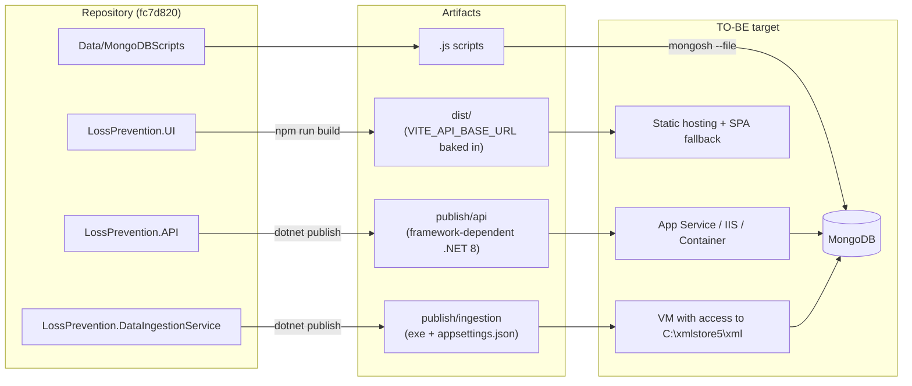
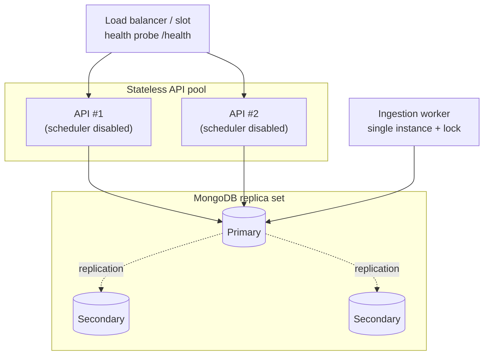
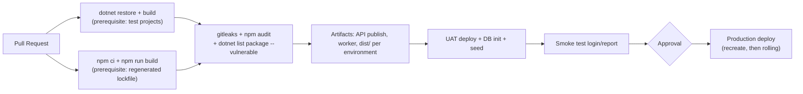

<!-- IMPACT-META
schema: 1
mode: how
step: 10_deployment
commit: fc7d820908b8b230fb47a2669920ba7efdb413a8
commit_short: fc7d820
branch: main
worktree: dirty
baseline_date: 2026-10-07T18:19:51+02:00
generated_at: 2026-10-08T09:41:39.009+02:00
-->
# Deployment - LOSS_PREVENTION Project

> **Baseline commit:** `fc7d820` (`main`) · worktree `dirty` (local changes only in `Docs/` and `.github/`; application code identical to the commit)

**Date**: 2026-10-08  
**Version**: 1.1  
**Authors**: REVERSE how (IMPACT) · verified by IMPACT verify  
**Audience**: Technical team, DevOps, release manager

---

## Main Sections

This document describes how the Loss Prevention Tool software is (or could be) deployed on the infrastructure described in [09_infrastructure_architecture.md](09_infrastructure_architecture.md). At commit `fc7d820` **there is no deploy automation at all**: everything that follows as **AS-IS** is derived from code, project files and configuration; everything that is **TO-BE** is a proposal that has not been implemented.

**Sources of evidence**

| Source | Content |
|-------|-----------|
| `LossPrevention.sln` | 5 `net8.0` projects (VisualStudioVersion 17.11), no test project |
| `LossPrevention.API/01. LossPrevention.API.csproj` | SDK `Microsoft.NET.Sdk.Web`, FastEndpoints 6.0.0 |
| `LossPrevention.DataIngestionService/02. LossPrevention.DataIngestionService.csproj` | `OutputType Exe`; `appsettings.json` copied to output and publish (lines 14-20) |
| `LossPrevention.API/Program.cs` | Startup sequence, DB init, hosted service, pipeline |
| `LossPrevention.UI/package.json`, `vite.config.js`, `src/api/api.ts` | SPA build, `VITE_API_BASE_URL` variable |
| `Data/MongoDBScripts/00..04_*.js`, `Data/LossPrevention/` | Database seed and dump |
| `Docs/04_DEPLOYMENT_GUIDE.md` (historical) | Vendor guide: **not present at the baseline**, only in commit `593f6de`, removed in `d768cd9` (`git show 593f6de:customspa-it-loss-prevention-d098a8b97860/Docs/04_DEPLOYMENT_GUIDE.md`) |

---

## 1. Deployment Topology

**Summary.** The deploy units derivable from the code are four: API (with the ingestion scheduler inside it), static SPA, bulk ingestion console and MongoDB seed scripts. There are no Dockerfiles, pipelines or IaC, so the production topology is not defined in the repository.

### 1.1 Deploy units (AS-IS)

| Unit | Build/publish command | Output | Required configuration | Verified notes |
|-------|-------------------------------|--------|--------------------------|-----------------|
| **API** (including `DataIngestionBackgroundService`) | `dotnet publish ".\LossPrevention.API\01. LossPrevention.API.csproj" -c Release -o .\publish\api` | Framework-dependent folder (`01. LossPrevention.API.dll` + `appsettings.json`) | `appsettings.json` in the process **working directory** (`Program.cs:37-39`) | The `.csproj` name contains spaces and a dot: always use quotes. .NET build **not verified** on this machine (SDK absent) |
| **SPA** | `npm install --no-package-lock` + `npm run build` in `LossPrevention.UI` | `dist/` (`index.html` + `assets/`) | `VITE_API_BASE_URL` **at build time** (`api.ts:4`) | `npm ci` fails (lockfile not aligned, §11). Build verified on Windows: 789 modules, JS 6,020 kB |
| **Bulk ingestion console** | `dotnet publish ".\LossPrevention.DataIngestionService\02. LossPrevention.DataIngestionService.csproj" -c Release -o .\publish\ingestion` | Executable + `appsettings.json` (`.csproj:15-19`) | `appsettings.json` in the working directory (`Program.cs:31-35`); XML files in `C:\xmlstore5\xml` (hardcoded, `Program.cs:76`) | One-off manual execution; no registry of processed files (re-running it duplicates the data) |
| **Database seed** | `mongosh "<connection-string>" --file .\Data\MongoDBScripts\0X_*.js` | — | `LossPrevention` database (hardcoded with `getSiblingDB`) | Order and prerequisites in §5.3 and in [11_development_environment.md](11_development_environment.md) |

> **Correction with respect to the previous version**: the SPA does **not** read `.env.production` from the repository: no `.env*` file is versioned. The historical vendor guide (`04_DEPLOYMENT_GUIDE.md`, lines 187-188 and 466) indicates `VITE_API_URL` with the `/api` suffix, which **does not match** the code: the variable read is `VITE_API_BASE_URL` and most routes have no `/api` prefix (e.g. `POST /users/login`, `GET /rules/apply`; only `/api/data-ingestion*` and `/api/fraud-detection/settings*` have it).

### 1.2 API startup sequence (decisive for the deploy)

| Step | Operation | Evidence | Effect on the deploy |
|-------|-----------|----------|--------------------|
| 1 | `WebApplication.CreateBuilder` + CORS `AllowVueDev` (only `localhost:5173/5174`) | `Program.cs:24-34` | The code must be modified for every real domain |
| 2 | Re-adding of `appsettings.json` from the current directory (`optional: false`) | `Program.cs:37-39` | Startup fails if the cwd does not contain the file; environment variables do **not** override the keys present in the file |
| 3 | Reading of `JwtSettings` from a temporary `ServiceProvider` | `Program.cs:42-47` | The JWT key must be in the file |
| 4 | Registration of FastEndpoints, Swagger, JWT, services, `AddHostedService<DataIngestionBackgroundService>` | `Program.cs:49-111` | Every API instance also starts the scheduler |
| 5 | `IDatabaseInitializationService.InitializeAsync()` **before** accepting requests | `Program.cs:115-119` | Requires MongoDB to be reachable; in case of error the exception is rethrown (`DatabaseInitializationService.cs:36-40`) and the process terminates |
| 6 | Swagger only in `Development` | `Program.cs:121-126` | — |
| 7 | `UseCors` → `UseAuthentication` → `UseAuthorization` → `UseFastEndpoints` → `Run` | `Program.cs:128-132` | No HTTPS redirect, no health check |
| 8 | The scheduler waits 10 s, then checks the configuration every 60 s | `DataIngestionBackgroundService.cs:28,41` | An ingestion can start within ~1 minute of the deploy if the time matches |

### 1.3 Target topologies (TO-BE)

| Option | Origin | API | SPA | Database | Compatibility with the AS-IS code |
|---------|---------|-----|-----|----------|-----------------------------------|
| A — Azure PaaS | Historical vendor guide, lines 34-46 | App Service / Container Apps (Azure Functions proposed by the vendor is **not** compatible, see 09 §1.4) | Static Web Apps | Atlas or Cosmos DB for MongoDB (vCore, to be verified) | Requires externalized CORS and configuration |
| B — On-premise Windows | Historical vendor guide (IIS) | IIS + ASP.NET Core Module (in-process) | IIS static site with URL Rewrite to `index.html` | MongoDB replica set | Verify that the working directory is the app folder (requirement of `Program.cs:38`) |
| C — Container | Historical vendor guide (Docker, line 605 with `npm ci`) | Image `mcr.microsoft.com/dotnet/aspnet:8.0` | Nginx with `try_files ... /index.html` | Managed service | `npm ci` first requires the lockfile to be regenerated |

---

## 2. Software-to-Infrastructure Mapping

**Summary.** Each software component is mapped to the host that runs it and to the network/configuration dependencies that the code requires. The following table is the basis for any deploy plan.

### 2.1 Component → infrastructure map

| Software component | AS-IS host (dev) | TO-BE host | Runtime dependencies | Configuration keys (masked values) |
|---------------------|------------------|-----------|--------------------|----------------------------------------------|
| FastEndpoints API (78 endpoints) | Kestrel `localhost:5264`/`7110` or IIS Express `55993`/`44348` | App Service / IIS / container (≥ 2 instances after the fixes in 09 §4) | MongoDB, SMTP | `MongoDbSettings:ConnectionString`, `MongoDbSettings:DatabaseName`, 13 `CollectionName_*`, `JwtSettings:SecretKey` (`****`, GUID versioned in `appsettings.json:30`), `Issuer`, `Audience`, `ExpiryHours`, `Email:*`, `DataRetention:TransactionRetentionDays` |
| `DataIngestionBackgroundService` | In the same process as the API | Dedicated single-instance worker | MongoDB, SFTP, file system | Configuration **in the DB** (`DataIngestionConfigurations`: source, schedule, `FileSystemPath`, `SftpHost/Port/Username/Password` in clear text) |
| Vue 3 SPA | Vite dev server `localhost:5173` | Static hosting + CDN | API, Ollama (from the browser) | `VITE_API_BASE_URL` (build-time); Ollama `http://localhost:11434` hardcoded (`aiStore.ts:88`) |
| Ingestion console | Manual execution | VM/job with access to the XML folder | MongoDB, local file system | `appsettings.json` (6 `CollectionName_*`); path `C:\xmlstore5\xml` in the code |
| Seed scripts | Local `mongosh` | One-off deploy job | MongoDB | DB `LossPrevention` in the script code |
| Password reset email | smtp4dev `localhost:25` | Corporate SMTP relay | — | `Email:SmtpHost`, `SmtpPort` (string `"25"`), `FromEmail`, `FromName`, `FrontendUrl` (used for the link `{FrontendUrl}/reset-password?token=…`, `EmailService.cs:29`) |

### 2.2 Parameters that change between environments

| Parameter | Where it is today | Dev value | Must it be changed at deploy? | Code change required? |
|-----------|--------------------|-----------|------------------------|-------------------------------|
| CORS origins | `Program.cs:29` | `http://localhost:5173`, `http://localhost:5174` | Yes | **Yes** (hardcoded) |
| MongoDB connection string | `appsettings.json:13` | `mongodb://localhost:27017` (without credentials) | Yes | No, but the file must be modified (environment-variable overrides are nullified by `Program.cs:37-39`) |
| JWT signing key | `appsettings.json:30` | `****` (versioned in Git) | Yes, and rotated | No |
| Frontend URL in emails | `appsettings.json:40` | `http://localhost:5173` | Yes | No |
| SMTP | `appsettings.json:36-37` | `localhost:25`, SSL off | Yes | **Yes** to enable TLS (`EnableSsl = false` hardcoded, `EmailService.cs:64`) |
| API URL for the SPA | Developer's `.env.local` | e.g. `http://localhost:5264` | Yes | No (but one build per environment) |
| LLM endpoint | `aiStore.ts:88` | `http://localhost:11434/api/generate` | Yes | **Yes** |
| Console XML folder | `DataIngestionService/Program.cs:76` | `C:\xmlstore5\xml` | Yes | **Yes** |

---

## 3. Resource Allocation (CPU, Memory)

**Summary.** The code does not define CPU/memory limits (no container, no GC/Kestrel configuration). The application parameters that determine resource consumption can instead be derived; the sizing is a TO-BE estimate.

### 3.1 Application parameters that affect resources (AS-IS)

| Parameter | Value | Evidence | Impact |
|-----------|--------|----------|---------|
| Scheduler polling interval | 60 s, initial delay 10 s | `DataIngestionBackgroundService.cs:13,28` | Negligible CPU; one DB query per minute per instance |
| SFTP operation timeout | 30 s | `SftpFileProcessingService.cs:59` | Thread blocked until the timeout if the host does not respond |
| Console parallelism | `Environment.ProcessorCount` | `DataIngestionService/Program.cs:23,85-89` | Uses all cores |
| Post-ingestion mapping | `ProcessMappings("ReportData", int.MaxValue)` | `FileProcessingCoordinator.cs:108` | CPU/RAM peak proportional to the documents |
| Rule application | Whole `ReportData` in memory | `RulesService.cs:34` | Memory ∝ collection size; long HTTP request |
| Report cache | 1 h per key, no size limit | `GetReportDataEndpoint.cs:81`; `Program.cs:49` | Growing API memory |
| TTL retention | 180 days (default 90) | `appsettings.json:9`; `DatabaseInitializationService.cs:23` | DB disk space (see 09 §5.2 on the `BeginDateTime` field) |
| JWT expiry | 1 h | `appsettings.json:33`; `LoginEndpoint.cs:78` | No refresh token: new login every hour |
| Password reset token expiry | 1 h | `PasswordResetService.cs:19` | — |
| Password hash | PBKDF2-SHA256 600,000 iterations | `PasswordHasher.cs:9,21` | ~Significant CPU for every login: to be considered in sizing and in rate limiting |

### 3.2 TO-BE allocation (initial estimate)

| Unit | CPU | Memory | Instances | Notes |
|-------|-----|---------|---------|------|
| API | 2 vCPU | 4 GB | 2 | Only after separating the scheduler (R1, 09 §4.1) |
| Ingestion worker | 2 vCPU | 4 GB + temporary disk | 1 | Double SFTP download (`FileProcessingCoordinator.cs:226-338`) |
| SPA | — | — | CDN | Unsplit 6 MB bundle: enable compression |
| MongoDB | 4 vCPU | 16 GB | 3 (replica set) | Real volume N/A — not derivable from the code: no estimate of transactions/day |

---

## 4. Deployment Strategy (Blue-Green, Canary, Rolling)

**Summary.** AS-IS there is no strategy: the deploy is a manual operation not documented in the repository. The standard strategies are applicable only after some changes to the code, listed below.

### 4.1 Applicability of the strategies

| Strategy | Applicable today? | Blockers in the code | Prerequisites |
|-----------|-------------------|----------------------|--------------|
| Recreate (stop → deploy → start) | ✅ Yes | — | Maintenance window; MongoDB reachable at startup |
| Rolling | ⚠️ With risk | Scheduler on every instance (`Program.cs:111`); per-instance cache; concurrent DB init (`Program.cs:115-119`) | Separate worker; DB init as a deploy step |
| Blue-Green | ⚠️ With risk | Both slots run the scheduler → double ingestion; no health endpoint for the swap; hardcoded CORS | Disable the scheduler in the inactive slot (impossible today without modifying the code); `/health` endpoint |
| Canary | ❌ No | No API versioning; SPA and API must be compatible; no telemetry to compare the versions | Telemetry (12 §1), feature flags |

### 4.2 Recommended strategy (TO-BE)

1. **Phase 1 (AS-IS code)**: *Recreate* with a maintenance window, a single API instance.
2. **Phase 2 (after the fixes)**: *Rolling* on ≥ 2 API instances + dedicated worker, with health probe.
3. **Phase 3**: *Blue-Green* with slot swap (App Service) or two deployments (container), automated smoke tests before the swap.

### 4.3 Manual deploy checklist (applicable to the AS-IS code)

| # | Step | Command / check |
|---|-------|--------------------|
| 1 | Database backup | `mongodump --uri "<connection-string>" --db LossPrevention --gzip --archive=LossPrevention_<data>.gz` |
| 2 | Update CORS in the code for the real domain | `Program.cs:29` |
| 3 | Prepare the target `appsettings.json` (connection string, new JWT key, SMTP, `FrontendUrl`) | Do not use the versioned file with the development key |
| 4 | Publish the API | `dotnet publish ".\LossPrevention.API\01. LossPrevention.API.csproj" -c Release -o .\publish\api` |
| 5 | Build the SPA with the environment URL | `$env:VITE_API_BASE_URL="https://api.<dominio>"; npm run build` |
| 6 | Stop the API, replace the files, start with cwd = publish folder | Verify in the log `Database initialization completed successfully` |
| 7 | Publish `dist/` with SPA fallback to `index.html` | Router `createWebHistory()` (`router/index.ts:52`) |
| 8 | Run any new seed scripts | `mongosh "<connection-string>" --file <script>` |
| 9 | Smoke test | `POST /users/login`, dashboard loading, `GET /api/data-ingestion` |

---

## 5. Rollback Procedures

**Summary.** There is no rollback procedure at all. Code rollback is a re-deploy of the previous artifact; data rollback is possible only from backup, because several automatic or manual operations are **irreversible**.

### 5.1 Irreversible operations present in the code

| Operation | When it occurs | Evidence | Reversible? |
|-----------|----------------|----------|--------------|
| Drop of a regular index on `BeginDateTime` | API startup | `DatabaseInitializationService.cs:89-94` | Yes, by recreating the index (but at restart it will be dropped again) |
| Creation of the TTL index `ttl_BeginDateTime` | API startup, only if absent | `DatabaseInitializationService.cs:97-105` | **No** for documents already expired: MongoDB deletes them right after the creation |
| `$unset` of `FraudFlags` on the whole `ReportData` + rewrite | `GET /rules/apply` | `RulesService.cs:41,58` | Only from backup |
| Deletion of ingestion configuration | `DELETE /api/data-ingestion` | `DataIngestionService.cs:176-180` | Only from backup |
| Moving of SFTP files to `processed/`/`failed/` | Every SFTP ingestion | `SftpFileProcessingService.cs:179-180,201-238` | Manual on the SFTP server |
| Scripts `00`, `03` (`deleteOne` on `Permissions`), `04` (`deleteOne` of the `IsGiftCard` rule, `updateMany` of the `FieldPath`) | Manual execution | `00_…js:46`, `03_…js:28`, `04_…js:14-27` | Only from backup |

### 5.2 TO-BE rollback procedure

1. **Before every deploy**: backup (`mongodump`) and retention of the previous artifacts (`publish/api`, `dist/`).
2. **Application rollback**: stop the API, restore the previous publish folder, restart; republish the previous `dist/`.
3. **Data rollback** (only if the deploy ran scripts or `GET /rules/apply`): `mongorestore --uri "<connection-string>" --gzip --archive=LossPrevention_<data>.gz --nsInclude "LossPrevention.*" --drop`.
4. **Verification**: login, reports, ingestion configuration; check that the scheduler did not start ingestions during the window.

### 5.3 Order and idempotency of the seed scripts

| Script | Operations | Idempotent | Prerequisites |
|--------|-----------|-------------|--------------|
| `00_CleanupDuplicatePermissions.js` | `deleteOne` of the duplicates in `Permissions` | Yes | — |
| `01_CreatePermissions.js` | `updateOne` if it exists, otherwise `insertOne` (by `PermissionName`, lines 80-93) | Yes | — |
| `02_AddPermissionsToAdminRole.js` | `$set` of **all** permissions on the `Admin` role | Yes | Existing `RoleName: "Admin"` role (lines 7, 20-33: if missing it prints an `insertOne` example and does nothing) |
| `03_CleanupStalePermissions.js` | Deletes `CAN_LOGIN`, `CAN_ADD_USERS`, `CAN_DELETE_USERS`, `CAN_UPDATE_USERS` and the orphan IDs from the roles | Yes | After `02` |
| `04_AddLossPreventionRules.js` | Fixes `FieldPath`, deletes `IsGiftCard`, inserts missing rules | Yes (insertion only if absent, lines 165-175) | — |

---

## 6. High Availability Configuration

**Summary.** AS-IS there is no high availability: one API process, one `mongod`, no load balancer, no health check. The code must be adapted before HA is possible (details in [09_infrastructure_architecture.md](09_infrastructure_architecture.md) §4).

### 6.1 AS-IS status

| HA requirement | Status | Evidence |
|--------------|-------|----------|
| Multiple API instances | ❌ Not safe | Scheduler, cache, DB init per instance |
| Health/readiness probe | ❌ Absent | No `AddHealthChecks`/`MapHealthChecks`; no `/health` route among the 78 endpoints. The `/health` endpoint of the vendor guide (`12_MAINTENANCE_OPERATIONS.md` lines 654-691, historical) **is not implemented** |
| Sessions | ✅ Stateless (JWT) | `Program.cs:63-76` |
| Scheduler graceful shutdown | ✅ Partial | `stoppingToken` honored in `Task.Delay` (`DataIngestionBackgroundService.cs:28,41`) |
| Retry toward MongoDB | Driver default | No option in the code |
| Redundant MongoDB | ❌ | Single host in the connection string |

### 6.2 TO-BE HA configuration

Code prerequisites: (1) `/health` endpoint with MongoDB check; (2) configuration flag to enable the scheduler only on the worker; (3) `LastRunAt` persisted with atomic update; (4) unique index on `ProcessedFiles.fileName`; (5) singleton `MongoClient`; (6) CORS from configuration.

---

## 7. Data Replication

**Summary.** Data replication is entirely delegated to MongoDB and is not configured: the connection string points to a single host without replication options, and the code uses neither transactions nor explicit read/write concerns.

### 7.1 AS-IS

| Aspect | Status | Evidence |
|---------|-------|----------|
| Connection string | `mongodb://localhost:27017` (no `replicaSet`, `retryWrites`, `tls`, credentials) | `appsettings.json:13` |
| Multi-document transactions | Not used | No occurrence of `StartSession`/`WithTransaction` |
| Write concern / read preference | Driver default | No configuration in `InfrastructureServiceExtensions.cs` |
| Non-atomic multi-step operations | `RulesService.ApplyRulesAsync` (global unset + replace per document); file ingestion (insert + `ProcessedFiles`) | `RulesService.cs:41,58`; `FileProcessingCoordinator.cs:349-377` |
| Data copy between environments | Only via the versioned dump `Data/LossPrevention/` (12 collections, MongoDB 8.3.2) | `prelude.json` |

### 7.2 TO-BE recommendations

1. 3-node replica set or managed service; connection string with `replicaSet`/SRV, `retryWrites=true`, `tls=true` and credentials from a secret store.
2. The multi-step operations (`ApplyRulesAsync`, ingestion) would benefit from transactions or from a staging model so as not to leave partial states in case of failover.
3. Non-production data: do not copy the versioned dump (it contains users and configuration) into shared environments; use dedicated seeds.

---

## 8. Proposed CI/CD Pipeline (TO-BE)

**Summary.** Proposed pipeline consistent with the stack; the steps marked as "prerequisite" fail on the AS-IS code.

| Step | Status on the AS-IS code |
|------|------------------------|
| `dotnet build` | Not verified (SDK absent on the analysis machine) |
| `dotnet test` | N/A — no test project in the solution |
| `npm ci` | ❌ Fails (`EUSAGE`, lockfile not synchronized: e.g. `Missing: vue-tsc@2.2.12 from lock file`) |
| `npm run build` | ✅ On Windows; ❌ on Linux agents because of the 12 imports with wrong upper/lower case (see 11 §5) |
| `vue-tsc --noEmit` | ❌ Crash (vue-tsc 1.8.27 incompatible with the installed TypeScript 5.9.3) |
| Secret scanning | Would detect `JwtSettings:SecretKey` in `appsettings.json` |

---

## Reference Documents

- **Deep Dive Analysis**: [00_deep_dive.md](00_deep_dive.md)
- **Context**: [01_context.md](01_context.md)
- **Functional Overview**: [02_functional_overview.md](02_functional_overview.md)
- **Non-Functional Overview**: [03_non_functional_overview.md](03_non_functional_overview.md)
- **Constraints**: [04_constraints.md](04_constraints.md)
- **Principles**: [05_principles.md](05_principles.md)
- **Software Architecture**: [06_software_architecture.md](06_software_architecture.md)
- **Code**: [07_code.md](07_code.md)
- **Data**: [08_data.md](08_data.md)
- **Infrastructure Architecture**: [09_infrastructure_architecture.md](09_infrastructure_architecture.md)

Related downstream documents: [11_development_environment.md](11_development_environment.md) · [12_operation_and_support.md](12_operation_and_support.md) · [19_modernization_estimation_spec.md](19_modernization_estimation_spec.md)

---

## Change Log

| Version | Date | Author | Changes |
|----------|------|--------|-----------|
| 1.0 | 2026-10-07 | REVERSE how (FULL) | Document creation (replaces run 2026-10-05) |
| 1.1 | 2026-10-08 | IMPACT verify | Full expansion: deploy units with quoted commands for the `.csproj` files with spaces, API startup sequence (`Program.cs:24-132`), component→infrastructure map with masked keys, parameters to change between environments, application resource parameters, strategy applicability matrix, manual deploy checklist, irreversible operations and idempotency of seed scripts, HA/replication AS-IS vs TO-BE, actual status of the CI steps. Corrections: `npm ci` → fails (lockfile), `.env.production` → no versioned `.env`, vendor guide (with wrong `VITE_API_URL`) cited as historical (`593f6de`, removed in `d768cd9`); `/health` endpoint declared not implemented; Reference Documents complete; header `worktree: dirty` |
