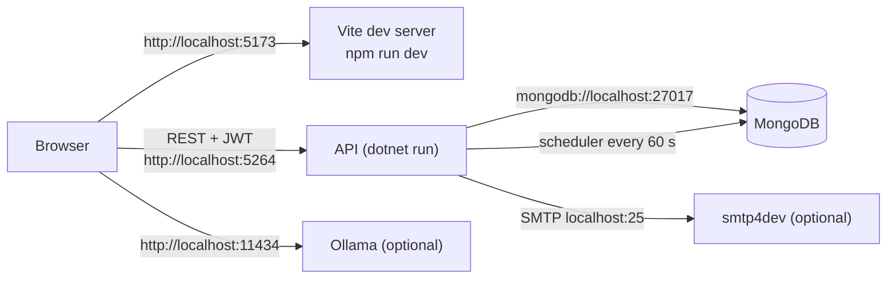

<!-- IMPACT-META
schema: 1
mode: how
step: 11_development_environment
commit: fc7d820908b8b230fb47a2669920ba7efdb413a8
commit_short: fc7d820
branch: main
worktree: dirty
baseline_date: 2026-10-07T18:19:51+02:00
generated_at: 2026-10-08T09:41:39.009+02:00
-->
# Development Environment - LOSS_PREVENTION Project

> **Baseline commit:** `fc7d820` (`main`) · worktree `dirty` (local changes only in `Docs/` and `.github/`; application code identical to the commit)

**Date**: 2026-10-08  
**Version**: 1.1  
**Authors**: REVERSE how (IMPACT) · verification IMPACT verify  
**Audience**: Developers (onboarding), tech leads

---

## Main Sections

This guide serves to get a developer up and running on the Loss Prevention Tool on **Windows**, the only operating system on which the frontend build works at commit `fc7d820` (see §4.3). Each command is marked:

- ✅ **verified**: executed during this analysis (Windows, Node v22.14.0, npm 10.9.2, PowerShell 7.6);
- ⚠️ **not verified**: derived from the code/configuration but not executed because the tool was not available (.NET SDK, `mongosh`, `mongorestore`, Ollama not installed on the analysis machine).

The vendor guide `Docs/03_SETUP_INSTALLATION.md` and the test strategy `Docs/13_TESTING_QA.md` **do not exist at the baseline**: they were present only in commit `593f6de` and were removed in `d768cd9` (viewable with `git show 593f6de:customspa-it-loss-prevention-d098a8b97860/Docs/<file>` from `C:\repository\LOSS_PREVENTION`). They are cited only as a historical source, verifying every statement taken from them.

---

## 1. Prerequisites & Dependencies

**Summary.** You need the .NET 8 SDK, Node.js with npm, MongoDB with its command-line tools and, optionally, smtp4dev and Ollama. The repository does not pin toolchain versions (no `global.json`, `.nvmrc` or `engines` field).

### 1.1 Tools

| Tool | Version | Mandatory | Source / evidence |
|-----------|----------|--------------|------------------|
| .NET SDK | 8.0.x (any SDK ≥ 8 that compiles `net8.0`; no `global.json`) | Yes | `<TargetFramework>net8.0</TargetFramework>` in all 5 `.csproj` files |
| Visual Studio 2022 | ≥ 17.11 recommended (the solution is saved with `VisualStudioVersion = 17.11`) — alternatively VS Code | Recommended | `LossPrevention.sln` |
| Node.js / npm | Verified with Node **22.14.0** / npm **10.9.2**; Vite 6 requires Node ≥ 18 | Yes | `package.json` (`vite ^6.3.5`); the historical guide indicated Node ≥ 18 (`03_SETUP_INSTALLATION.md:24`) |
| MongoDB Server | The dump was created with **MongoDB 8.3.2** (`Data/LossPrevention/prelude.json`); the driver is MongoDB.Driver 3.4.0 | Yes | The historical guide indicated ≥ 6.0 (`03_SETUP_INSTALLATION.md:30`); README indicates 7.0+ |
| MongoDB Shell `mongosh` | Recent | Yes (seed) | Header of `04_AddLossPreventionRules.js:5` |
| MongoDB Database Tools (`mongorestore`, `mongodump`) | The dump was created with **ToolVersion 100.13.0** | Yes (dump) | `prelude.json` |
| smtp4dev (or another SMTP on `localhost:25` without TLS) | — | Only for password reset | `appsettings.json:36-37`; comment in `EmailService.cs:64` |
| Ollama + model `qwen2.5:14b` | — | Only for AI functions | `aiStore.ts:8,88` |
| Git | — | Yes | — |

### 1.2 Main application dependencies

| Area | Packages (declared versions) |
|------|---------------------------------|
| API | FastEndpoints / .Security / .Swagger **6.0.0**; Microsoft.Extensions.Configuration(.Binder) 9.0.4 |
| Application | MongoDB.Driver / MongoDB.Bson **3.4.0**, SSH.NET 2025.1.0, FluentValidation 11.11.0, Newtonsoft.Json 13.0.3, Microsoft.AspNetCore.Http.Features 5.0.17 (obsolete) |
| Infrastructure | MongoDB.Driver 3.4.0, `FrameworkReference Microsoft.AspNetCore.App` |
| Console | Microsoft.Extensions.Hosting 9.0.4 |
| UI | vue ^3.5.12, vuetify ^3.7.3, pinia ^2.2.4, vue-router ^4.6.3, axios ^1.9.0, ag-grid 35, chart.js 4, xlsx, jspdf, pdfmake; devDependencies vite ^6.3.5, typescript ^5.0.0, vue-tsc ^1.2.0, `nuxt ^3.0.0` (unused) |

### 1.3 Hardware requirements

N/A — not derivable from the code: no requirement is defined in the repository. The vendor's historical guide (`03_SETUP_INSTALLATION.md:52-59`) indicated a minimum of 8 GB RAM / 10 GB disk / dual-core, recommended 16 GB / 50 GB SSD / quad-core; running `qwen2.5:14b` locally requires additional memory (GPU recommended).

---

## 2. IDE Setup & Configuration

**Summary.** The repository contains no shared style, lint or static analysis configuration; the only versioned IDE configuration is the recommendation of the Vue extension for VS Code.

| Element | AS-IS status | Evidence |
|----------|-------------|----------|
| `.vscode/extensions.json` | Recommends only `Vue.volar` | `LossPrevention.UI/.vscode/extensions.json` |
| `.vscode/settings.json`, `launch.json` | Absent | The UI `.gitignore` ignores `.vscode/*` except `extensions.json` |
| `.editorconfig`, `Directory.Build.props`, `*.ruleset` | Absent | Repository search |
| ESLint / Prettier | Absent (no config file, no `lint` script) | `package.json` (scripts only `dev`, `build`, `preview`) |
| TypeScript | `strict: true`, but no type-check script | `tsconfig.json`; `vue-tsc` not runnable (§4.3) |
| .NET nullable reference types | `enable` in all projects | `.csproj` |
| API debug profiles | `http`, `https`, `IIS Express` | `Properties/launchSettings.json` |

**Recommended configuration**

- **Visual Studio 2022**: open `LossPrevention.sln`, set `01. LossPrevention.API` as the startup project, `https` profile (opens `/swagger`).
- **VS Code**: extensions *Vue - Official* (`Vue.volar`), *C# Dev Kit*, *MongoDB for VS Code*; open the `customspa-it-loss-prevention-d098a8b97860` folder.
- TO-BE: add `.editorconfig`, ESLint + Prettier and a `type-check` script after aligning `vue-tsc` (§4.3).

---

## 3. Repository Setup & Branching

**Summary.** The code is located in a **subfolder** of the Git repository; there is only one branch (`main`) and no defined branching strategy.

### 3.1 Cloning (PowerShell)

```powershell
git clone https://github.com/saristot/LOSS_PREVENTION.git
Set-Location .\LOSS_PREVENTION\customspa-it-loss-prevention-d098a8b97860
```

### 3.2 Structure

| Path | Content |
|----------|-----------|
| `LossPrevention.sln` | Solution with 5 `net8.0` projects |
| `LossPrevention.API/` | ASP.NET Core + FastEndpoints host (`01. LossPrevention.API.csproj`) |
| `LossPrevention.Application/`, `LossPrevention.Domain/`, `LossPrevention.Infrastructure/` | Services, entities, MongoDB repositories |
| `LossPrevention.DataIngestionService/` | XML bulk loading console (`02. LossPrevention.DataIngestionService.csproj`) |
| `LossPrevention.UI/` | Vue 3 + Vite SPA (`package.json` with name `workflowbuilder`) |
| `Data/LossPrevention/` | `mongodump` dump of 12 collections (10 in use + `Mappings_old`, `ReportData_old`) |
| `Data/MongoDBScripts/` | Seed scripts `00..04`, `rules_export.json`, `PERMISSIONS_LIST.md` |
| `Docs/` | IMPACT documentation |

### 3.3 History and branching

| Aspect | AS-IS |
|---------|-------|
| Branch | Only `main` |
| Commits | 13, a single author; code imported in bulk in `593f6de` ("add codice"); subsequent commits documentation only |
| Branching strategy | Not defined (the historical `roadmap.txt` lists "Branching Strategy" as a to-do activity) |
| Hooks / CI | None |

### 3.4 Notes on `.gitignore` and tracked files

| Aspect | Detail | Consequence |
|---------|-----------|-------------|
| Root `.gitignore` | Visual Studio template; ignores `[Bb]in/`, `[Oo]bj/`, `node_modules/` and **`.github/`** (line 369) | A future `.github/workflows` folder would be ignored (the worktree contains a non-application local change that adds `!.github/` exceptions) |
| `.env` | **Not** ignored by the root `.gitignore`; the UI `.gitignore` ignores `*.local` | Use `.env.local` (never `.env`) for local values |
| Tracked tool artifacts | 5 `*.csproj.lscache` files and `LossPrevention.UI/.vite/deps/_metadata.json`, `package.json` | Noise in diffs; candidates for removal |
| `package-lock.json` | Tracked but **not synchronized** with `package.json` | `npm ci` fails (§4.2) |
| Secrets | `JwtSettings:SecretKey` (GUID, masked) versioned in `LossPrevention.API/appsettings.json:30` | Do not reuse outside local development |

---

## 4. Build Instructions

**Summary.** The backend is compiled with `dotnet build` (not verified: SDK absent on the analysis machine); the frontend is installed with `npm install` (not `npm ci`) and compiled with `npm run build`, verified on Windows.

### 4.1 Backend (.NET) — ⚠️ not verified

```powershell
# dalla cartella customspa-it-loss-prevention-d098a8b97860
dotnet --list-sdks                         # deve elencare un SDK 8.x o superiore
dotnet restore .\LossPrevention.sln
dotnet build .\LossPrevention.sln -c Debug
```

The project names contain spaces and a dot: for commands on a single project use quotes, for example `dotnet build ".\LossPrevention.API\01. LossPrevention.API.csproj"`.

### 4.2 Frontend — ✅ verified

```powershell
Set-Location .\LossPrevention.UI
npm install --no-package-lock --no-audit --no-fund   # ✅ 921 pacchetti, ~3 min; non modifica il lockfile
[IO.File]::WriteAllText("$PWD\.env.local", "VITE_API_BASE_URL=http://localhost:5264`n")   # UTF-8 senza BOM
npm run build                                          # ✅ 789 moduli, ~1 min 10 s
```

| Command | Verified outcome | Detail |
|---------|------------------|-----------|
| `npm ci` | ❌ Fails | `npm error code EUSAGE` — "`npm ci` can only install packages when your package.json and package-lock.json … are in sync"; e.g. `Missing: vue-tsc@2.2.12 from lock file`, `@volar/typescript@2.4.15` |
| `npm install --no-package-lock …` | ✅ | Actual versions different from the lockfile: vite 6.4.4 (lock 6.4.1), vue 3.5.43 (lock 3.5.14), typescript 5.9.3 (lock 5.6.3), nuxt 3.21.11 (lock 3.17.3) |
| `npm run build` | ✅ (Windows) | Output `dist/`: JS **6,020.10 kB** (gzip 2,112.95 kB), CSS 1,180.35 kB, MDI fonts. Warnings: use of `eval` in `resultsGrid.vue` (~line 918) and chunks > 500 kB |
| `npx vue-tsc --noEmit` | ❌ Crash | `Search string not found: "/supportedTSExtensions = .*(?=;)/"` — vue-tsc 1.8.27 incompatible with TypeScript 5.9.3 |
| `npm run dev` | ✅ | `VITE v6.4.4 ready`, `http://localhost:5173/` (HTTP 200) |

> **Why `npm install --no-package-lock`**: it avoids rewriting `package-lock.json` (a tracked file). Whoever is in charge of fixing the lockfile must run `npm install` without flags and commit the result; only then will `npm ci` work.
>
> **Why not `echo … > .env.local`**: in Windows PowerShell 5.1 the `>` redirection writes UTF-16 LE; Vite does not read the variable correctly and `baseURL` ends up `undefined` (calls go to `http://localhost:5173`). `[IO.File]::WriteAllText` writes UTF-8 without BOM.

### 4.3 Known frontend build issues

| # | Issue | Evidence | Effect | Workaround / fix |
|---|----------|----------|---------|------------------|
| B1 | **12 imports with wrong upper/lower case** | `workspaceStore`→`workspacestore.ts` (`dashboard.vue:123`, `dashboardsList.vue:132`, `tabularBlock.vue:43`, `queryBuilderTabs.vue:131`, `workspace.vue:58`, `home.vue:89`); `roleStore`→`rolestore.ts` (`roles.vue:96`, `users.vue:133`); `./chartBlock.vue`→`chartblock.vue` (`dashboardGrid.vue:85`); `./fraudSettingsDialog.vue`→`FraudSettingsDialog.vue` (`resultsGrid.vue:511`); `../stores/passwordResetStore`→`PasswordResetStore.ts` (`ForgotPassword.vue:49`, `ResetPassword.vue:86`) | Build **fails on Linux/macOS** (case-sensitive file system); works on Windows | Develop on Windows; fix: align the imports to the actual file names |
| B2 | **1 unresolvable import** on every operating system | `ScheduleForm.vue:27` imports `@/store/useDataIngestionStore` (nonexistent path; the actual store is `@/stores/dataIngestionStore`, used by `dataingestion.vue:215`) | Does not block the build (orphan component, not imported by anything); in `npm run dev` requesting the module gives **HTTP 500** "Failed to resolve import" (✅ verified) | Fix the import or delete the component |
| B3 | Lockfile not synchronized | §4.2 | `npm ci` unusable (CI) | Regenerate the lockfile |
| B4 | `vue-tsc` not working | §4.2 | No type-check | Upgrade `vue-tsc` to 2.x |
| B5 | Single 6 MB bundle | Build output | Vite warnings; slow loading | Code splitting / lazy routes |

In total, the imports that cannot be resolved on a case-sensitive file system are **13** (B1 + B2), consistent with the IMPACT fact sheet.

### 4.4 Ingestion console — ⚠️ not verified

```powershell
dotnet build ".\LossPrevention.DataIngestionService\02. LossPrevention.DataIngestionService.csproj"
```

`appsettings.json` is copied to the output (`.csproj:15-19`), but the program looks for it in the **current directory** (`Program.cs:31-35`): run it from the project folder (see §7.4).

---

## 5. Test Execution

**Summary.** **There is no test framework and no test in the repository.** It is therefore not possible to run the suite or a single test; the only automated check available is the build.

### 5.1 AS-IS evidence

| Check | Result |
|----------|-----------|
| `*.Tests` projects / references to xUnit, NUnit, MSTest in the solution | None (5 projects, all application projects) |
| `vitest`, `jest`, `@vue/test-utils`, `playwright`, `cypress` in `package.json` | None |
| `test` script in `package.json` | Absent (only `dev`, `build`, `preview`) |
| `*.spec.*` / `*.test.*` files in `src/` | None |
| CI pipeline running tests | None |
| `Docs/13_TESTING_QA.md` (historical, only in `593f6de`) | Describes xUnit, Vitest, Playwright, k6, OWASP ZAP and GitHub Actions — **nothing is implemented** |

### 5.2 How to run a single test

N/A — not derivable from the code: there is no test framework and no test at all. Once the frameworks are introduced (TO-BE), the commands will be:

```powershell
# Backend (TO-BE, dopo aver creato es. tests\LossPrevention.Application.Tests con xUnit)
dotnet test .\LossPrevention.sln
dotnet test .\LossPrevention.sln --filter "FullyQualifiedName~PasswordHasherTests.VerifyPassword_LegacyHash"

# Frontend (TO-BE, dopo `npm install -D vitest @vue/test-utils jsdom`)
npx vitest run
npx vitest run src/stores/__tests__/loginStore.spec.ts -t "login salva il token"
```

### 5.3 Manual verification available today

| Check | How |
|----------|------|
| API | Swagger UI at `https://localhost:7110/swagger` (only `Development`, `Program.cs:121-126`) |
| Login | `POST /users/login` with body `{ "username": "…", "password": "…" }` → `{ "token": "…" }` |
| Frontend | `npm run build` (✅) + manual navigation |

### 5.4 Recommended test priorities (TO-BE)

1. `PasswordHasher` (`v2:` and legacy formats, `PasswordHasher.cs:12-47`).
2. `DataIngestionBackgroundService.ShouldRunNow` (±1 min windows, days of the week, monthly only on day 1).
3. `RulesService` and `FraudDetectionSettings` (anti-fraud rules).
4. Integration tests with containerized MongoDB for ingestion and idempotency (`ProcessedFiles`).

---

## 6. Database Setup

**Summary.** Two paths: (A) restore the versioned dump, which includes users, the `Admin` role with 37 permissions and 3,000 transactions; (B) create a minimal database with the seed scripts, which however do **not** create any user. The database name `LossPrevention` is fixed in the scripts.

### 6.1 Starting MongoDB

```powershell
mongosh "mongodb://localhost:27017" --eval "db.runCommand({ ping: 1 })"   # ⚠️ deve restituire { ok: 1 }
```

The development connection string is `mongodb://localhost:27017` without credentials (`appsettings.json:13` in both projects).

### 6.2 Option A — Restoring the dump (recommended) — ⚠️ not verified

```powershell
# dalla cartella customspa-it-loss-prevention-d098a8b97860
mongorestore --uri "mongodb://localhost:27017" --nsInclude "LossPrevention.*" --nsExclude "LossPrevention.*_old" --drop .\Data
```

| Dump content | Documents |
|--------------------|-----------|
| `ReportData` | 3,000 (`TransactionDateTime` from 2025-08-13 to 2025-11-12) |
| `ProcessedFiles` | 3,000 |
| `Mappings` | 52 |
| `Permissions` | 37 |
| `Roles` | 1 (`Admin`, 37 permissions) |
| `Users` | 2 (active, `Admin` role, hash in legacy format) |
| `Rules` 3, `Workspaces` 3, `Dashboards` 1, `DataIngestionConfigurations` 1 | — |
| `Mappings_old` 12, `ReportData_old` 100 | Obsolete collections, excluded by the command above |

Warnings:

- `ReportData.metadata.json` already contains the `ttl_BeginDateTime` TTL index (`expireAfterSeconds 15552000` = 180 days). The dump documents do **not** have the `BeginDateTime` field (verified), so they are not deleted by the TTL.
- `DataIngestionConfigurations` points to `FileSystemPath = C:\xmlxstore4\transactions_xml` with `ScheduleType one-time`: the scheduler does not execute it (see §8).
- The passwords of the dump users are not derivable from the code: to log in, use the password reset (§6.4).

### 6.3 Option B — Minimal seed with the scripts — ⚠️ not verified

Mandatory order (the scripts use `db.getSiblingDB('LossPrevention')`):

```powershell
$uri = "mongodb://localhost:27017"
mongosh $uri --file .\Data\MongoDBScripts\00_CleanupDuplicatePermissions.js
mongosh $uri --file .\Data\MongoDBScripts\01_CreatePermissions.js
# Prerequisito di 02: il ruolo Admin deve esistere (02 altrimenti stampa un esempio e non fa nulla)
mongosh $uri --eval "db.getSiblingDB('LossPrevention').Roles.insertOne({ RoleName: 'Admin', Description: 'Admin Permissions', Permissions: [] })"
mongosh $uri --file .\Data\MongoDBScripts\02_AddPermissionsToAdminRole.js
mongosh $uri --file .\Data\MongoDBScripts\03_CleanupStalePermissions.js
mongosh $uri --file .\Data\MongoDBScripts\04_AddLossPreventionRules.js
```

| Script | Effect | Idempotent |
|--------|---------|-------------|
| `00` | Removes duplicate permissions | Yes |
| `01` | Creates/updates permissions by `PermissionName` | Yes |
| `02` | Assigns **all** permissions to the `Admin` role | Yes |
| `03` | Deletes `CAN_LOGIN`, `CAN_ADD_USERS`, `CAN_DELETE_USERS`, `CAN_UPDATE_USERS` and orphan IDs in the roles | Yes |
| `04` | Fixes the rules' `FieldPath`, deletes `IsGiftCard`, inserts the missing rules | Yes |

**First user.** No script creates users and `POST /users/create` requires the `CAN_CREATE_USER` permission (hence an already authenticated user). Manual procedure (✅ hash generation verified with PowerShell 7.6; compatible with `PasswordHasher.cs:22`, format `v2:600000:<base64>` with a 16-byte salt):

```powershell
$plain = Read-Host "Password"
$salt = [byte[]]::new(16); [Security.Cryptography.RandomNumberGenerator]::Create().GetBytes($salt)
$kdf  = [Security.Cryptography.Rfc2898DeriveBytes]::new($plain, $salt, 600000, [Security.Cryptography.HashAlgorithmName]::SHA256)
$hash = "v2:600000:" + [Convert]::ToBase64String($kdf.GetBytes(32)); $saltB64 = [Convert]::ToBase64String($salt)
mongosh "mongodb://localhost:27017" --eval "var d=db.getSiblingDB('LossPrevention'); var r=d.Roles.findOne({RoleName:'Admin'}); d.Users.insertOne({ Username:'admin', Email:'admin@lossprevention.local', FirstName:'Admin', LastName:'Local', IsActive:true, RegistrationDate:new Date(), Roles:[r._id], PasswordHash:'$hash', PasswordSalt:'$saltB64' })"
```

The fields match those of the `Users` documents in the dump (`Email`, `FirstName`, `IsActive`, `LastName`, `PasswordHash`, `PasswordSalt`, `RegistrationDate`, `Roles`, `Username`).

### 6.4 Access with the dump users (password reset)

1. Start smtp4dev listening on `localhost:25`.
2. `POST /users/forgot-password` (anonymous) with the username or email of a dump user (`ForgotPasswordEndpoint.cs:39`).
3. Open in smtp4dev the link `http://localhost:5173/reset-password?token=…` (`EmailService.cs:29`, `FrontendUrl` from `appsettings.json:40`); the token expires after 1 h (`PasswordResetService.cs:19`).

### 6.5 Automatic initialization at API startup

At startup `DatabaseInitializationService` (`Program.cs:115-119`):

1. reads `DataRetention:TransactionRetentionDays` (180; default 90);
2. if a TTL index on `BeginDateTime` already exists, it does nothing (`DatabaseInitializationService.cs:67-71`);
3. otherwise it drops any regular index on `BeginDateTime` and creates `ttl_BeginDateTime` (lines 89-105);
4. in case of error (e.g. MongoDB down) the exception is rethrown and **the API does not start**.

The suggested indexes (up to 20 single-field indexes) are created only by the ingestion console (`IndexService.ProcessIndexesAsync`, `IndexSuggestionHelper.cs:21-39`).

---

## 7. Local Development Workflow

**Summary.** To work locally you need four processes: MongoDB, API, Vite dev server and (optional) smtp4dev and Ollama. The only port combination accepted by the API CORS is the frontend on `5173` or `5174`.

### 7.1 Local topology



### 7.2 Ports and URLs

| Service | URL | Evidence |
|----------|-----|----------|
| API `http` profile | `http://localhost:5264` | `launchSettings.json:16` |
| API `https` profile | `https://localhost:7110` (+ `http://localhost:5264`), opens `/swagger` | `launchSettings.json:25-26` |
| API IIS Express | `http://localhost:55993`, SSL `44348` | `launchSettings.json:7-8` |
| SPA | `http://localhost:5173` (Vite default port; `5174` if occupied) | `vite.config.js` without `server.port`; CORS `Program.cs:29` |
| Swagger | `<api>/swagger` (only `Development`) | `Program.cs:121-126` |
| MongoDB | `localhost:27017` | `appsettings.json:13` |
| SMTP | `localhost:25` | `appsettings.json:36-37` |
| Ollama | `http://localhost:11434/api/generate` | `aiStore.ts:88` |

### 7.3 Step-by-step startup (PowerShell, 3 terminals)

```powershell
# Terminale 1 — API (eseguire DALLA cartella del progetto: Program.cs:38 legge appsettings.json dalla directory corrente)
Set-Location .\LossPrevention.API
dotnet dev-certs https --trust            # solo la prima volta, per il profilo https
dotnet run --launch-profile http          # oppure: --launch-profile https

# Terminale 2 — SPA
Set-Location .\LossPrevention.UI
npm run dev                               # ✅ http://localhost:5173

# Terminale 3 — servizi opzionali
ollama pull qwen2.5:14b; ollama serve     # funzioni AI
```

`VITE_API_BASE_URL` in `.env.local` must contain the API origin **without** `/api` and without a trailing slash (the calls use absolute paths such as `/users/login`, `loginStore.ts:73`, and `/api/data-ingestion/run`, `dataingestion.vue:458`). If you use the `https` profile, set it to `https://localhost:7110`. After every change to `.env.local` restart `npm run dev`.

### 7.4 Bulk ingestion console (optional)

```powershell
New-Item -ItemType Directory -Force C:\xmlstore5\xml   # path hardcoded in Program.cs:76
# copiare i file XML di transazione nella cartella, poi:
Set-Location .\LossPrevention.DataIngestionService
dotnet run
```

Caution: the console inserts the documents with `InsertOneAsync` (`Program.cs:101-102`) without recording `ProcessedFiles`: **every re-run duplicates the data**. At the end of the run it executes the mappings, creates the suggested indexes and finalizes the types.

### 7.5 Ingestion from the interface (API)

Configuration and manual start via UI (Data Ingestion page) or API, with the `CAN_MANAGE_DATA_INGESTION` permission:

| Action | Endpoint |
|--------|----------|
| Read the configuration | `GET /api/data-ingestion` (`CAN_VIEW_DATA_INGESTION`) |
| Save the configuration | `PUT /api/data-ingestion` |
| Run immediately | `POST /api/data-ingestion/run` |
| Schedule / sources / recurrence | `PATCH /api/data-ingestion/schedule`, `PATCH /api/data-ingestion/sources`, `PUT /api/data-ingestion/recurrence-options` |
| Delete schedule / configuration | `DELETE /api/data-ingestion/schedule`, `DELETE /api/data-ingestion` |

After ingestion the anti-fraud rules are **not** applied automatically: run `GET /rules/apply` (`CAN_APPLY_RULE`).

### 7.6 Change cycle

| Change | Effect |
|----------|---------|
| `.vue`/`.ts` files | Vite Hot Module Replacement, immediate |
| C# code | Restart `dotnet run` (or `dotnet watch run --launch-profile http` ⚠️ not verified) |
| `appsettings.json` | Restart of the API |
| Permissions of a role | Effective only after a **new login** (`permissions` claims issued in the token, `LoginEndpoint.cs:61`) |

---

## 8. Troubleshooting Guide

**Summary.** Recurring problems derived from the code and from the checks performed, with cause and solution.

| # | Symptom | Cause (evidence) | Solution |
|---|---------|------------------|-----------|
| T1 | `npm ci` → `EUSAGE … not in sync` | Lockfile not aligned | `npm install --no-package-lock` (§4.2) |
| T2 | Build fails on Linux/macOS: `Could not resolve "../stores/passwordResetStore"` (or `workspaceStore`, `roleStore`, …) | 12 imports with wrong case (§4.3 B1) | Use Windows or fix the imports |
| T3 | In dev, error 500 `Failed to resolve import "@/store/useDataIngestionStore"` | `ScheduleForm.vue:27` (§4.3 B2) | Do not open/import the component; fix the import |
| T4 | `npx vue-tsc` terminates with `Search string not found` | vue-tsc 1.8.27 vs TypeScript 5.9.3 | Upgrade vue-tsc to 2.x |
| T5 | Calls to `http://localhost:5173/users/login` (404) or log `API base URL: undefined` | `VITE_API_BASE_URL` missing or `.env.local` in UTF-16 (`api.ts:4,7`) | Recreate `.env.local` as in §4.2 and restart Vite |
| T6 | CORS error in the browser | SPA on a port other than `5173`/`5174` (e.g. `5175` if both are occupied) or on `127.0.0.1` (`Program.cs:29`) | Free port 5173 / use `localhost` |
| T7 | The API terminates at startup with a connection error | MongoDB down: DB init rethrows the exception (`DatabaseInitializationService.cs:36-40`) | Start `mongod` |
| T8 | `FileNotFoundException: appsettings.json` at startup | Current directory different from the project folder (`Program.cs:37-39`, `optional: false`) | Run `dotnet run` from the project folder |
| T9 | Environment variables (`MongoDbSettings__ConnectionString`) ignored | `appsettings.json` re-added last (`Program.cs:37-39`) | Modify the local `appsettings.json` (without committing) |
| T10 | Login with wrong credentials responds **500** instead of 401 | `UserService.LoginAsync` throws `UnauthorizedAccessException`, not handled by `LoginEndpoint` (no global exception handler) | AS-IS behavior; check username/password or use the reset (§6.4) |
| T11 | 401 on all calls after about an hour | JWT expired (`ExpiryHours: 1`), no refresh | Log in again |
| T12 | 403 on an action | Permission missing from the token | Assign the permission to the role and log in again |
| T13 | Certificate warning on `https://localhost:7110` | Untrusted development certificate | `dotnet dev-certs https --trust` |
| T14 | AI functions not responding | Ollama not running or model missing (`aiStore.ts:8,88`) | `ollama serve`; `ollama pull qwen2.5:14b`. If the browser blocks the cross-origin call, check Ollama's `OLLAMA_ORIGINS` configuration (⚠️ not verified) |
| T15 | Report with stale data | 1 h in-memory cache per pipeline/skip/take, with no invalidation (`GetReportDataEndpoint.cs:81`) | Restart the API |
| T16 | Scheduled ingestion never executed | `ScheduleType` `one-time` is **ignored** by the scheduler (`DataIngestionBackgroundService.cs:55`); the UI shows it as "Scheduled" anyway | Use `recurring` or `POST /api/data-ingestion/run` |
| T17 | Ingestion executed twice in the same minute | `LastRunAt` not persisted (`DataIngestionBackgroundService.cs:86-87`) | AS-IS behavior; files already present in `ProcessedFiles` are skipped |
| T18 | File not re-imported | File name already present in `ProcessedFiles` (`FileProcessingCoordinator.cs:349`) | Remove the corresponding document from `ProcessedFiles` |
| T19 | Weekly schedule does not trigger | Comparison with the English names of `DayOfWeek` and the server's local time (`DataIngestionBackgroundService.cs:97,137`) | Check the host's days and time zone |
| T20 | Reset email not received | SMTP not listening on `localhost:25` (`EnableSsl=false`) | Start smtp4dev |
| T21 | Duplicate data after the console | No `ProcessedFiles` check in the console | Empty `ReportData` before re-running |

---

## Reference Documents

- **Deep Dive Analysis**: [00_deep_dive.md](00_deep_dive.md)
- **Context**: [01_context.md](01_context.md)
- **Functional Overview**: [02_functional_overview.md](02_functional_overview.md)
- **Non-Functional Overview**: [03_non_functional_overview.md](03_non_functional_overview.md)
- **Constraints**: [04_constraints.md](04_constraints.md)
- **Principles**: [05_principles.md](05_principles.md)
- **Software Architecture**: [06_software_architecture.md](06_software_architecture.md)
- **Code**: [07_code.md](07_code.md)
- **Data**: [08_data.md](08_data.md)
- **Infrastructure Architecture**: [09_infrastructure_architecture.md](09_infrastructure_architecture.md)
- **Deployment**: [10_deployment.md](10_deployment.md)

Related downstream documents: [12_operation_and_support.md](12_operation_and_support.md) · [16_frontend_deep_assessment.md](16_frontend_deep_assessment.md) · [17_backend_deep_assessment.md](17_backend_deep_assessment.md)

---

## Change Log

| Version | Date | Author | Changes |
|----------|------|--------|-----------|
| 1.0 | 2026-10-07 | REVERSE how (FULL) | Document creation (replaces run 2026-10-05) |
| 1.1 | 2026-10-07 | REVERSE how (FULL) | Added frontend build outcome on Linux |
| 1.1 | 2026-10-08 | IMPACT verify | Complete rewrite with verified Windows commands: `npm ci` → fails (EUSAGE), replaced by `npm install --no-package-lock`; `echo > .env.local` → `[IO.File]::WriteAllText` (UTF-8); Windows build verified (789 modules, JS 6,020 kB), `vue-tsc` crashing, dev server on 5173 verified; detailed build issues (12 imports with wrong case + 1 unresolvable import in `ScheduleForm.vue:27` = 13); test section with explicit statement of the absence of frameworks and TO-BE commands for a single test; DB setup corrected (order 00→01→Admin role→02→03→04, first user, password reset, dump content verified); ports from `launchSettings.json`; extended troubleshooting (T1-T21); vendor documentation cited as historical (`593f6de`, removed in `d768cd9`); complete Reference Documents; `worktree: dirty` header |
