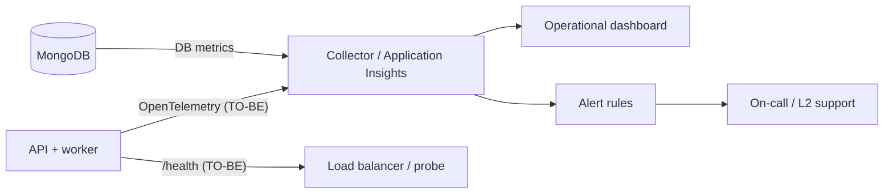
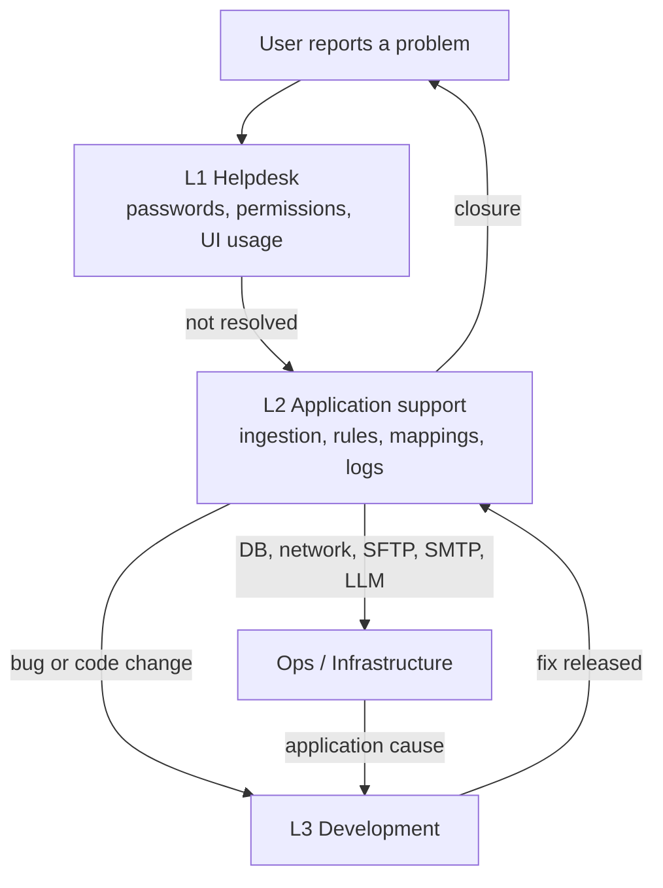

<!-- IMPACT-META
schema: 1
mode: how
step: 12_operation_and_support
commit: fc7d820908b8b230fb47a2669920ba7efdb413a8
commit_short: fc7d820
branch: main
worktree: dirty
baseline_date: 2026-10-07T18:19:51+02:00
generated_at: 2026-10-08T09:41:39.009+02:00
-->
# Operation and Support - LOSS_PREVENTION Project

> **Baseline commit:** `fc7d820` (`main`) · worktree `dirty` (local changes only in `Docs/` and `.github/`; application code identical to the commit)

**Date**: 2026-10-08  
**Version**: 1.1  
**Authors**: REVERSE how (IMPACT) · verified by IMPACT verify  
**Audience**: Operations, application support (L1/L2), tech lead

---

## Main Sections

This document gathers what is needed to operate and support the Loss Prevention Tool in production: monitoring, logs, configuration, diagnostics, backup, maintenance and escalation. The code at commit `fc7d820` offers **very limited operational tools** (only console logs from 4 service classes, no health check, no metrics, no backup), therefore many sections distinguish:

- **AS-IS**: what the code does today, with `file:riga` evidence;
- **TO-BE**: recommended procedures and tools, not implemented.

The vendor's operations guide `Docs/12_MAINTENANCE_OPERATIONS.md` and `Docs/roadmap.txt` **do not exist at the baseline**: they were present only in commit `593f6de` and were removed in `d768cd9` (viewable with `git show 593f6de:customspa-it-loss-prevention-d098a8b97860/Docs/<file>` from `C:\repository\LOSS_PREVENTION`). The procedures they describe (e.g. `/health` endpoint, logs in `/var/log/lossprevention/api.log`, systemd service `lossprevention-api`) **are not implemented** in the code.

---

## 1. Monitoring & Alerting

**Summary.** AS-IS there is no form of application monitoring: no health check, no metrics, no tracing, no alerts. The only available signals are the console logs of the ingestion/initialization services and some data persisted in MongoDB.

### 1.1 AS-IS status

| Capability | Status | Evidence |
|----------|-------|----------|
| Health / readiness endpoint | ❌ Absent | No `AddHealthChecks`/`MapHealthChecks` in `Program.cs`; no `/health` route among the 78 endpoints. The `HealthCheckEndpoint` proposed by the vendor (`12_MAINTENANCE_OPERATIONS.md` lines 654-691, historical) does not exist |
| Metrics (latency, errors, throughput) | ❌ Absent | No OpenTelemetry/Prometheus/Application Insights package in the `.csproj` files |
| Distributed tracing | ❌ Absent | — |
| Frontend APM / RUM | ❌ Absent | Only `console.log` (57 occurrences in the frontend) |
| Alerting | ❌ Absent | Scheduled ingestion failures produce only an `Error` log (`DataIngestionBackgroundService.cs:91`) |
| In-app notifications | `Notifications` collection | Not connected to operational events (ingestion/rules) |

### 1.2 Operational signals available today

| Signal | Where | How to use it |
|---------|------|-------------|
| API startup completed | Log `Database initialization completed successfully` (`DatabaseInitializationService.cs:34`) | Confirms that MongoDB is reachable and the TTL index has been verified |
| Scheduler active | Log `Data Ingestion Background Service is starting` (`DataIngestionBackgroundService.cs:25`) | Post-deployment check |
| Scheduled ingestion outcome | Log `Scheduled ingestion completed: {Files} files, {Records} records` / `…completed with errors: {Errors}` / `Scheduled ingestion failed` (lines 74-91) | Only trace of the outcome: `LastRunAt` is not saved |
| Manual ingestion outcome | JSON response of `POST /api/data-ingestion/run`: `success`, `filesProcessed`, `recordsInserted`, `durationSeconds`, `errors`, `message`; HTTP 500 if it fails (`RunDataIngestionEndpoint.cs:25-59`) | Immediate diagnosis from UI/API |
| History of imported files | `ProcessedFiles` collection (`fileName`, `recordCount`, `processedAt`, `FileProcessingCoordinator.cs:399-410`) | File/record count per period |
| Failed SFTP files | Remote `failed/` folder (`SftpFileProcessingService.cs:201-220`) | Daily check |
| Document traceability | Fields `_sourceFile`, `_processedAt`, `_sourceType` added to every `ReportData` document | Trace back to the source file |

### 1.3 Recommended KPIs and alerts (TO-BE)

| KPI | Proposed source | Suggested alert threshold |
|-----|----------------|---------------------------|
| API availability | `/health` endpoint (to be implemented, with MongoDB ping) | 2 consecutive failed probes |
| Ingestion outcome | Structured log / `ingestion_runs{result}` metric | Any failed run; no successful run in the last 24 h with an active schedule |
| Records ingested per run | `recordsInserted` | 0 records for 2 consecutive runs |
| Files in `failed/` | SFTP listing | > 0 |
| `GET /rules/apply` duration | Request duration metric | > measured reference value |
| P95 latency of `POST /data/report/query` | HTTP metric | To be defined after a baseline |
| 5xx errors | HTTP metric | > 1% over 5 min |
| Failed logins | `/users/login` log/metric (today it returns 500, §4.3) | Anomalous spikes (brute force) |
| MongoDB disk space | DB monitoring | > 80% |



---

## 2. Logging & Log Access

**Summary.** The API uses the default ASP.NET Core logging (no file or structured sink), with `Information` level and `Warning` for `Microsoft.AspNetCore`. Only 4 service classes write logs through `ILogger`; the endpoints do not log anything and there is no audit trail.

### 2.1 AS-IS configuration

| Aspect | Value | Evidence |
|---------|--------|----------|
| Default level | `Information` | `LossPrevention.API/appsettings.json:2-6` (identical in the console, lines 2-7) |
| `Microsoft.AspNetCore` | `Warning` | same |
| Providers | Defaults of `WebApplication.CreateBuilder`: Console, Debug, EventSource and, on Windows, EventLog | No provider configuration in `Program.cs` |
| File / structured sinks (Serilog, NLog, OTel) | Absent | No package in the `.csproj` files |
| Correlation ID / request logging | Absent | No `UseHttpLogging`/middleware |
| Audit (who viewed/exported/modified) | **Absent** | No audit collection or log |

**Where to read the logs (AS-IS)**: it depends on the host, because logs go only to console/stdout.

| Hosting | Access |
|---------|---------|
| `dotnet run` / Visual Studio | Terminal window / Visual Studio Output |
| IIS (TO-BE) | Only if `stdoutLogEnabled` is enabled in the `web.config` generated by `dotnet publish`; otherwise Event Viewer for Warning+ events ⚠️ not verified |
| Container / App Service (TO-BE) | `docker logs` / App Service Log stream |

### 2.2 Catalog of emitted logs

| Component | `ILogger` calls | Main events (level) |
|-----------|--------------------|-----------------------------|
| `DatabaseInitializationService` | 7 | `Starting database initialization...` (Info); `TTL index on BeginDateTime already exists` (Info); `Dropping existing regular index '{IndexName}'…` (Info); `Created TTL index on BeginDateTime with {RetentionDays} days retention` (Info); `Failed to create TTL index on BeginDateTime` (Error) |
| `DataIngestionBackgroundService` | 7 | `…is starting` / `…is stopping` (Info); `Scheduled ingestion triggered` (Info); `Scheduled ingestion completed…` (Info); `…completed with errors: {Errors}` (Warning); `Scheduled ingestion failed` (Error); `Error in Data Ingestion Background Service` (Error) |
| `FileProcessingCoordinator` | 17 | `Starting data ingestion...`; `Processing files from: {Path}`; `Found {Count} files to process`; `File already processed, skipping: {FileName}`; `Data ingestion completed. Files: …, Records: …, Duration: …s` (Info); `No documents extracted from file` / `Processed folder does not exist` (Warning); `Error processing file: {File}`, `Data ingestion failed` (Error) |
| `SftpFileProcessingService` | 13 | `Connecting to SFTP server {Host}:{Port}`; `Found {Count} {FileType} files in {Directory}`; `Moved {FileName} to processed folder`; `Creating processed/failed folder` (Info); `Failed to delete temp file` (Warning); `Error processing SFTP file`, `Failed to move file to failed folder`, `SFTP processing failed` (Error) |
| `Console.WriteLine` (6) | — | `DistanceDataservice.cs:86` (`Target not found.`), `MappingService.cs:336,421`, console `Program.cs:80,108,122` (`Starting Processing`, per-file errors, `Completed in {s} Seconds`) |
| FastEndpoints endpoints (78) | **0** | No logs; 16 endpoint files contain `try/catch`, 13 return `ex.Message` to the client |
| Frontend | 57 `console.log` | Includes logging of the API URL at every load (`api.ts:7`) |

Confidentiality note: the SFTP logs include host, port and directory but **not** the password; no log contains tokens or passwords.

### 2.3 TO-BE recommendations

1. Structured logging (Serilog or OpenTelemetry) with a centralized sink and defined retention (the vendor proposed daily rotation with 30 files, `12_MAINTENANCE_OPERATIONS.md` lines 432-449, historical).
2. Request logging middleware with correlation ID; logging of exceptions in the endpoints instead of returning `ex.Message`.
3. Audit trail for login, export, changes to rules/ingestion configuration, `GET /rules/apply`.
4. Removal of the `console.log` calls from the production bundle.

---

## 3. Configuration Management

**Summary.** The configuration is distributed across three levels: `appsettings.json` (API and console), MongoDB (functional configuration modifiable from the UI) and the SPA build variable. Several operational values are **hardcoded** in the code, and the way the API loads the configuration makes environment variables and per-environment files ineffective.

### 3.1 Configuration precedence (AS-IS)

- **API**: `Program.cs:37-39` adds `appsettings.json` again (from the current directory, `optional: false`) **after** the standard sources. For every key present in the file, environment variables (`Sezione__Chiave`), command-line arguments and `appsettings.{Environment}.json` are **ignored**.
- **Console**: the services use a `ConfigurationBuilder` that reads only `appsettings.json` (`DataIngestionService/Program.cs:31-35,58-59`).
- **Changing a value** = changing the `appsettings.json` file on the host + restarting the process (no reload of the values already read; `JwtSettings` is read only once at startup, `Program.cs:42-47`).

### 3.2 `appsettings.json` keys — API

| Key | Dev value (masked where sensitive) | Line | Use |
|--------|----------------------------------------|------|-----|
| `Logging:LogLevel:Default` / `Microsoft.AspNetCore` | `Information` / `Warning` | 2-6 | Log levels |
| `DataRetention:TransactionRetentionDays` | `180` (code default 90) | 8-10 | TTL `ReportData.BeginDateTime`, applied only at the first creation of the index |
| `AllowedHosts` | `*` | 11 | Host filtering |
| `MongoDbSettings:ConnectionString` | `mongodb://localhost:27017` (no credentials) | 13 | DB connection |
| `MongoDbSettings:DatabaseName` | `LossPrevention` | 14 | DB name |
| `MongoDbSettings:CollectionName_*` | **13 keys**: `Mappings`, `Rules`, `Users`, `Roles`, `Permissions`, `ReportData`, `Workspaces`, `Dashboards`, `DataIngestionConfigurations`, `DataIngestionSchedules`, `Notifications`, `Groups`, `FraudDetectionSettings` | 15-27 | Collection names |
| `JwtSettings:SecretKey` | `****` (36-character GUID **versioned in Git**) | 30 | HS256 signature of the tokens |
| `JwtSettings:Issuer` / `Audience` / `ExpiryHours` | `LossPrevention` / `User` / `1` | 31-33 | Token validation and expiry |
| `Email:SmtpHost` / `SmtpPort` | `localhost` / `"25"` (string) | 36-37 | Sending of reset emails |
| `Email:FromEmail` / `FromName` | `noreply@lossprevention.local` / `Loss Prevention System` | 38-39 | Sender |
| `Email:FrontendUrl` | `http://localhost:5173` | 40 | Link `{FrontendUrl}/reset-password?token=…` (`EmailService.cs:29`) |

**Console** (`LossPrevention.DataIngestionService/appsettings.json`): same `Logging` and `MongoDbSettings:ConnectionString`/`DatabaseName`, but only **6** `CollectionName_*` keys (lines 12-17: `Mappings`, `Rules`, `Users`, `Roles`, `Permissions`, `ReportData`).

### 3.3 Configuration persisted in MongoDB (modifiable from the UI)

| Collection | Content | Operational notes |
|-----------|-----------|----------------|
| `DataIngestionConfigurations` | `SelectedSources` (`filesystem`/`sftp`), `SelectedFileType`, `FileSystemPath`, `UseMappings`, `ManualLoad`, schedule (`ScheduleType` default `one-time`, `ScheduleDate`, `ScheduleTime`, `Recurrence`, `SelectedDaysOfWeek`), `LastRunAt` (never updated in the DB), `SftpHost`, `SftpPort` (default 22), `SftpUsername`, `SftpRemoteDirectory`, **`SftpPassword` in clear text** | The password is stored in clear text (`DataIngestionService.cs:40,59`) and **returned to the UI** by `GET /api/data-ingestion` (`GetDataIngestionConfigurationEndpoint.cs:41`) |
| `FraudDetectionSettings` | Anti-fraud thresholds/parameters | `/api/fraud-detection/settings` |
| `Rules` | Anti-fraud rules | Seed `04_AddLossPreventionRules.js`, export `rules_export.json` |
| `Mappings` | Field mappings | Applied during ingestion if `UseMappings` |
| `Roles` / `Permissions` | RBAC | Seed `00..03` |

### 3.4 Hardcoded values (require a code change)

| Value | Evidence |
|--------|----------|
| CORS origins `http://localhost:5173`, `http://localhost:5174` | `Program.cs:29` |
| LLM endpoint and model `http://localhost:11434/api/generate`, `qwen2.5:14b` | `aiStore.ts:8,88` |
| SMTP `EnableSsl = false`, `UseDefaultCredentials = true` | `EmailService.cs:64-65` |
| Collections `PasswordResetTokens` and `ProcessedFiles` | `InfrastructureServiceExtensions.cs:83`; `FileProcessingCoordinator.cs:391,409` |
| Scheduler interval 60 s, initial delay 10 s | `DataIngestionBackgroundService.cs:13,28` |
| SFTP timeout 30 s, `processed`/`failed` folders | `SftpFileProcessingService.cs:59,201-220` |
| Report cache 1 h | `GetReportDataEndpoint.cs:81` |
| Reset token expiry 1 h | `PasswordResetService.cs:19` |
| Console XML folder `C:\xmlstore5\xml` | `DataIngestionService/Program.cs:76` |

### 3.5 Frontend

| Variable | Use | Note |
|-----------|-----|------|
| `VITE_API_BASE_URL` | axios `baseURL` (`api.ts:4`) | Embedded **at build time**: a URL change requires a new build. No `.env*` file versioned |

### 3.6 Secrets inventory

| Secret | Where it is today | Risk | TO-BE |
|---------|--------------------|---------|-------|
| JWT signing key | `appsettings.json:30`, versioned | Anyone with access to the repository can sign valid tokens | Secret store + rotation |
| SFTP password | MongoDB in clear text, exposed via API | Exposure to users with `CAN_VIEW_DATA_INGESTION` | Encryption / secret store, never return it |
| MongoDB credentials | Absent (DB without authentication) | Unrestricted access to the DB on the network | Enable authentication + TLS |
| User password hashes and salts | `Users` | `GET /users` returns `PasswordHash` and `PasswordSalt` (`GetUsersEndpoint.cs:36`) | Exclude from the DTOs |
| Development dump | `Data/LossPrevention/` in Git (users, configuration) | Personal data/hashes in the repository | Remove from the repository |

---

## 4. Diagnostics & Troubleshooting

**Summary.** The available diagnostic tools are the console logs, Swagger (only in `Development`) and direct queries on MongoDB. Below is a runbook by symptom, with the commands to use.

### 4.1 Diagnostic tools

| Tool | Use | Limits |
|-----------|-----|--------|
| Console log | DB initialization, ingestion, SFTP | No logs in the endpoints |
| Swagger UI `/swagger` | Testing the endpoints | Only with `ASPNETCORE_ENVIRONMENT=Development` (`Program.cs:121-126`) |
| `mongosh` | Data state, indexes, configuration | Direct access to the DB required |
| Browser developer tools | CORS errors, 401/403, console | — |

### 4.2 MongoDB diagnostic queries (⚠️ not executed: `mongosh` not available on the analysis machine)

```javascript
use LossPrevention
// Configurazione ingestione senza esporre la password
db.DataIngestionConfigurations.findOne({}, { SftpPassword: 0 })
// Ultimi file importati
db.ProcessedFiles.find().sort({ processedAt: -1 }).limit(20)
// Indici di ReportData (verificare ttl_BeginDateTime ed expireAfterSeconds)
db.ReportData.getIndexes()
// Documenti senza campo BeginDateTime (non soggetti a TTL)
db.ReportData.countDocuments({ BeginDateTime: { $exists: false } })
// Documenti di un file specifico
db.ReportData.countDocuments({ _sourceFile: "<nomefile>" })
// Token di reset scaduti (nessun TTL)
db.PasswordResetTokens.countDocuments({ ExpiryDate: { $lt: new Date() } })
```

### 4.3 Runbook by symptom

| Symptom | Diagnosis | Cause in the code | Action |
|---------|----------|------------------|--------|
| The API does not start | Log `Error during database initialization` | MongoDB not reachable; the exception is rethrown (`DatabaseInitializationService.cs:36-40`) | Bring MongoDB back online, restart |
| The API does not start with `FileNotFoundException` | Working directory | `appsettings.json` read from the cwd (`Program.cs:38`) | Start from the app folder |
| Scheduled ingestion never executed | `findOne` on `DataIngestionConfigurations` | `ScheduleType: one-time` **ignored** by the scheduler (`DataIngestionBackgroundService.cs:55`); time outside the ±1 min window; days in English for weekly; monthly only on day 1 (line 142); server local time (`DateTime.Now`, line 97) | Use `recurring` or `POST /api/data-ingestion/run` |
| Ingestion executed twice | Log `Scheduled ingestion triggered` repeated in the same minute, or from multiple instances | `LastRunAt` not persisted (lines 86-87); scheduler on every instance | Run a single instance; files already in `ProcessedFiles` are skipped, but the check is not atomic |
| File not imported | Log `File already processed, skipping` | Name already in `ProcessedFiles` (idempotency by **name**: a corrected file with the same name is ignored) | `db.ProcessedFiles.deleteOne({ fileName: "<nome>" })` and re-run |
| File in `failed/` on SFTP | Log `Error processing SFTP file` | Parsing or transfer error | Fix the file and re-upload it to the source folder |
| `POST /api/data-ingestion/run` → 500 | `errors` / `message` field of the response | Error returned with details (`RunDataIngestionEndpoint.cs:39-59`) | Analyze the message and the logs |
| Anti-fraud flags missing after ingestion | — | Rules are not applied automatically | `GET /rules/apply` (`CAN_APPLY_RULE`); heavy operation (§6) |
| Report not updated | — | In-memory cache of 1 h per pipeline/skip/take, without invalidation and **not distinct per user** (`GetReportDataEndpoint.cs:81,92-97`) | Restart the API |
| User sees data outside their own scope | `LockField`/`LockValue` claims in the token | The filter is applied only by the UI: no server-side use (`LoginEndpoint.cs:67-68` is the only consumer) | AS-IS behavior (see 17/18) |
| Login with wrong credentials → 500 | Log/console | `UnauthorizedAccessException` not handled in `LoginEndpoint` | AS-IS behavior; verify credentials |
| 401 after one hour | — | `ExpiryHours: 1`, no refresh token | New login |
| 403 after permission change | — | Permissions are in the token (`LoginEndpoint.cs:61`) | New login |
| CORS error | Browser console | Origin not in `Program.cs:29` | Code change |
| Reset email does not arrive | No logs for the email | SMTP `localhost:25`, no TLS | Check the SMTP relay |
| AI functions do not respond | Browser console | Ollama not reachable from the user's browser (`aiStore.ts:88`) | Start Ollama on the workstation |
| Data does not expire | `getIndexes()` + `countDocuments` above | The TTL uses `BeginDateTime`; the dump documents only have `TransactionDateTime` | Check the format of the source files; evaluate the TTL on the correct field |
| Retention change without effect | `getIndexes()` | Existing TTL index not updated (`DatabaseInitializationService.cs:67-71`) | `collMod` (§6.2) |

---

## 5. Backup & Restore Procedures

**Summary.** There are no backup or restore procedures in the code. The dump in `Data/LossPrevention/` is a development dataset versioned in Git, **not** a backup. The following procedures are TO-BE recommendations with standard MongoDB Database Tools commands.

### 5.1 Backup scope

| Element | Content | Priority |
|----------|-----------|----------|
| `LossPrevention` database | All collections (transactions, rules, mappings, users, roles, ingestion configuration, workspaces, dashboards) | Critical |
| `appsettings.json` of every host | Connection string, JWT key, SMTP, retention | High (in a secret store) |
| Source files in the SFTP / file system `processed/` folders | Allow `ReportData` to be reconstructed | Medium |
| Deployment artifacts (API publish, `dist/`) | Application rollback | Medium |

### 5.2 Commands (TO-BE, ⚠️ not executed)

```powershell
# Backup completo compresso
mongodump --uri "<connection-string>" --db LossPrevention --gzip --archive="D:\backup\LossPrevention_$(Get-Date -Format yyyyMMdd_HHmm).gz"

# Restore completo (sovrascrive le collezioni)
mongorestore --uri "<connection-string>" --gzip --archive="D:\backup\LossPrevention_<data>.gz" --nsInclude "LossPrevention.*" --drop

# Restore di una sola collezione (es. Rules)
mongorestore --uri "<connection-string>" --gzip --archive="D:\backup\LossPrevention_<data>.gz" --nsInclude "LossPrevention.Rules" --drop
```

### 5.3 Recommended policy

| Aspect | Proposal |
|---------|----------|
| Frequency | Daily + before every deployment, before `GET /rules/apply` on production data and before every seed script |
| Retention | 30 days (value also proposed in the vendor's historical script, `12_MAINTENANCE_OPERATIONS.md` lines 233 and 260, with cron at 01:00, line 268) |
| Managed service | If Atlas/vCore: continuous backups with point-in-time restore |
| Restore test | Quarterly, on a separate environment, measuring the times |
| Encryption | Encrypted archives (they contain password hashes and the SFTP password in clear text) |

**Restore warnings**

- The `ReportData` metadata include the TTL index `ttl_BeginDateTime`: after the restore MongoDB removes the documents with `BeginDateTime` older than the retention.
- After a restore, restart the API to clear the in-memory report cache.
- If `ReportData` is restored without `ProcessedFiles` (or vice versa), the ingestion idempotency becomes inconsistent: restore them together.

**RPO/RTO**: N/A — not derivable from the code: no availability requirement or SLA is defined in the repository (the vendor's values, `12_MAINTENANCE_OPERATIONS.md` lines 617-622, are unimplemented historical proposals).

---

## 6. Maintenance Tasks

**Summary.** No maintenance activity is automated. Below are the activities derived from the code, with suggested frequency and command or procedure.

### 6.1 Recurring activities

| # | Activity | Suggested frequency | AS-IS | Procedure |
|---|----------|---------------------|-------|-----------|
| M1 | Application of anti-fraud rules after ingestion | At every ingestion | Manual | `GET /rules/apply`. Caution: it loads all of `ReportData` into memory, removes `FraudFlags` from all documents and rewrites them one by one (`RulesService.cs:34-58`): run outside business hours and after a backup |
| M2 | Check of files in `failed/` and error logs | Daily | Manual | §4.3 |
| M3 | Cleanup of expired `PasswordResetTokens` | Weekly | Absent (no TTL, hardcoded collection) | `db.PasswordResetTokens.deleteMany({ ExpiryDate: { $lt: new Date() } })` |
| M4 | Check of indexes and query plans | Monthly / after new file formats | Suggested indexes created only by the console (`IndexSuggestionHelper.cs:21-39`, up to 20 single-field indexes) | `db.ReportData.getIndexes()`; remove useless indexes |
| M5 | Cleanup of the API host's `%TEMP%` | Monthly | SFTP temporary files deleted in `finally` (warning if it fails, `SftpFileProcessingService.cs:195`) | Check for leftover `*.xml`/`*.json` with GUID names |
| M6 | Archiving of the SFTP `processed/` folders | Monthly | Files are moved, never deleted (`SftpFileProcessingService.cs:179-180`) | Archive beyond the retention |
| M7 | npm dependency update | Monthly | Absent | `npm audit --package-lock-only` on the tracked lockfile: **71 vulnerabilities** (4 low, 15 moderate, 46 high, 6 critical; ✅ verified on 2026-10-08, the result depends on the advisory database of the day) |
| M8 | NuGet dependency update | Monthly | Absent | `dotnet list .\LossPrevention.sln package --vulnerable --include-transitive` (⚠️ not verified: SDK absent); `Microsoft.AspNetCore.Http.Features 5.0.17` is obsolete |
| M9 | JWT key rotation | Quarterly and immediately (it is versioned) | Absent | Change `JwtSettings:SecretKey` and restart: **all issued tokens become invalid** |
| M10 | SFTP password rotation | According to the customer's policy | Absent | `PUT /api/data-ingestion` from the UI |
| M11 | Cleanup of obsolete collections `Mappings_old`, `ReportData_old` | One-off | Present in the dump | Verify that they are not used, then `drop()` |
| M12 | .NET 8 runtime upgrade | Before the end of support of .NET 8 (November 10, 2026) | To be planned | Retarget to .NET 10 LTS |

### 6.2 Extraordinary activities

| Activity | Procedure |
|----------|-----------|
| Data retention change | The code does not update an existing TTL index. `db.runCommand({ collMod: "ReportData", index: { name: "ttl_BeginDateTime", expireAfterSeconds: <giorni*86400> } })` and update `TransactionRetentionDays` for consistency (⚠️ not verified) |
| Re-import a file | `db.ProcessedFiles.deleteOne({ fileName: "<nome>" })`; `db.ReportData.deleteMany({ _sourceFile: "<nome>" })`; put the file back in the source folder; `POST /api/data-ingestion/run` |
| Reset the ingestion configuration | `DELETE /api/data-ingestion` (deletes **all** configurations, `DataIngestionService.cs:176-180`) |
| Update permissions/rules | Run the seed scripts in the order `00 → 01 → 02 → 03 → 04` (idempotent, see [10_deployment.md](10_deployment.md) §5.3); users must log in again |
| Clear the report cache | Restart of the API (no invalidation endpoint) |

---

## 7. Support Escalation

**Summary.** There is no support process in the repository: no runbook, contact, SLA or severity classification. The following model is a TO-BE proposal based on the skills required by the code.

### 7.1 AS-IS evidence

| Aspect | Status |
|---------|-------|
| Runbook / on-call | Absent |
| Contacts | N/A — not derivable from the code: the only contact in the historical documentation is the placeholder `ops-team@yourdomain.com` (`12_MAINTENANCE_OPERATIONS.md` line 792, present only in `593f6de`) |
| SLA / response times | N/A — not derivable from the code: no requirement defined |
| Feedback collection | `roadmap.txt` (historical): "Testing - We will need users to give feedback with reproducable steps" |
| Ticketing tools | N/A — not derivable from the code |

### 7.2 Proposed support levels (TO-BE)

| Level | Scope | Required skills / access |
|---------|--------|--------------------------------|
| L1 — Helpdesk | Password reset (`forgot-password` flow), deactivated user, missing permissions (new login), use of the UI | UI with user/role management permissions |
| L2 — Application support | Ingestion configuration and schedule, files in `failed/`, `ProcessedFiles`, rules and mappings, `GET /rules/apply`, reading the logs | Access to the logs, read-only `mongosh`, `CAN_MANAGE_DATA_INGESTION`, `CAN_APPLY_RULE` permissions |
| L3 — Development | Bugs, changes to hardcoded values (CORS, LLM, SMTP TLS), performance | Repository, test environments |
| Ops / Infrastructure | MongoDB, network, SFTP, SMTP, LLM hosting, backup/restore, certificates | Administrative access to the infrastructure |



### 7.3 Proposed severities (TO-BE)

| Severity | Examples | Escalation |
|----------|--------|-----------|
| S1 — Blocking | API cannot be started, MongoDB unavailable, login impossible for everyone | Immediate to Ops + L3 |
| S2 — High | Ingestion failed or not executed, rules not applied, inconsistent data | L2 within the day |
| S3 — Medium | AI functions unavailable, slow reports, reset emails not delivered | L2 |
| S4 — Low | Change requests, cosmetic issues | L3 backlog |

### 7.4 Information to collect for each report

1. User (username) and exact time (UTC and local; the scheduler uses the server's local time).
2. Page/action and message shown (screenshot, browser console).
3. For ingestion: response of `POST /api/data-ingestion/run` or log excerpt, file name, source (`filesystem`/`sftp`).
4. For data: report pipeline or filter used, `_sourceFile` of the documents involved.
5. Deployment version (commit) and environment.

---

## Reference Documents

- **Deep Dive Analysis**: [00_deep_dive.md](00_deep_dive.md)
- **Context**: [01_context.md](01_context.md)
- **Functional Overview**: [02_functional_overview.md](02_functional_overview.md)
- **Non-Functional Overview**: [03_non_functional_overview.md](03_non_functional_overview.md)
- **Constraints**: [04_constraints.md](04_constraints.md)
- **Principles**: [05_principles.md](05_principles.md)
- **Software Architecture**: [06_software_architecture.md](06_software_architecture.md)
- **Code**: [07_code.md](07_code.md)
- **Data**: [08_data.md](08_data.md)
- **Infrastructure Architecture**: [09_infrastructure_architecture.md](09_infrastructure_architecture.md)
- **Deployment**: [10_deployment.md](10_deployment.md)
- **Development Environment**: [11_development_environment.md](11_development_environment.md)

Related downstream documents: [13_decision_log.md](13_decision_log.md) · [14_metrics.md](14_metrics.md) · [17_backend_deep_assessment.md](17_backend_deep_assessment.md) · [18_antipattern_deep_dive.md](18_antipattern_deep_dive.md)

---

## Change Log

| Version | Date | Author | Changes |
|----------|------|--------|-----------|
| 1.0 | 2026-10-07 | REVERSE how (FULL) | Document creation (replaces run 2026-10-05) |
| 1.1 | 2026-10-08 | IMPACT verify | Full expansion: available operational signals and TO-BE KPIs/alerts; log configuration and catalog (7+7+17+13 `ILogger` calls, 6 `Console.WriteLine`, no logs in the endpoints); configuration precedence (`Program.cs:37-39`), masked keys table (correction: 13 `CollectionName_*` in the API, not 14; 6 in the console), configuration in MongoDB, hardcoded values, secrets inventory (including `GET /users` returning hash/salt); diagnostic queries and runbook by symptom; backup/restore with commands and TTL warnings; maintenance M1-M12 (npm audit 71 vulnerabilities now verified with breakdown by severity); escalation with levels, severities and checklist. Vendor documentation cited as historical (`593f6de`, removed in `d768cd9`); complete Reference Documents; `worktree: dirty` header |
