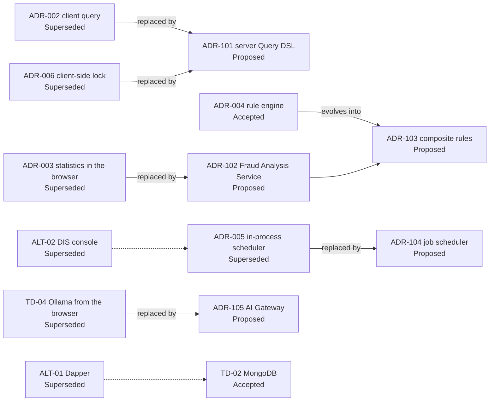

<!-- IMPACT-META
schema: 1
mode: how
step: 13_decision_log
commit: fc7d820908b8b230fb47a2669920ba7efdb413a8
commit_short: fc7d820
branch: main
worktree: dirty
baseline_date: 2026-10-07T18:19:51+02:00
generated_at: 2026-10-08T09:36:49+02:00
-->
# Decision Log - LOSS_PREVENTION Project

> **Baseline commit:** `fc7d820` (`main`) · worktree `dirty` (local changes only in `Docs/` and `.github/`; application code identical to the commit)

**Date**: 2026-10-08  
**Version**: 1.1  
**Authors**: REVERSE how (IMPACT) · IMPACT verification 2026-10-08  
**Audience**: Technical team, architects, developers, tech lead

> The repository **contains no ADRs**. The following decisions are **reconstructed from the code** at commit `fc7d820`; each entry reports the evidence (file:line) and a status:
> - **Accepted** — decision in force, *inferred from the code*;
> - **Superseded** — decision in force that this analysis recommends replacing (it indicates the proposal that replaces it), or an abandoned alternative visible in the code;
> - **Proposed** — *recommendation* of the analyst, not present in the code.

---

## Main Sections

1. [Technology Decisions](#1-technology-decisions)
2. [Architectural Decisions (ADRs)](#2-architectural-decisions-adrs)
3. [Pattern Decisions](#3-pattern-decisions)
4. [Trade-offs Analysis](#4-trade-offs-analysis)
5. [Alternative Solutions Considered](#5-alternative-solutions-considered)
6. [Decision Context & Rationale](#6-decision-context--rationale)

---

## 1. Technology Decisions

The chosen stack is mainstream and recent (.NET 8, Vue 3, MongoDB); the weak points are the duplication of libraries and the AI integration from the browser.

| ID | Decision (inferred from the code) | Evidence | Plausible alternatives | Status | Assessment |
|----|-------------------------------|----------|------------------------|-------|-------------|
| TD-01 | .NET 8 backend + **FastEndpoints 6.0.0** (REPR pattern) with Swagger | `LossPrevention.API.csproj` (FastEndpoints 6.0.0, .Security, .Swagger); `Program.cs:53` `AddFastEndpoints()`, `Program.cs:124` `UseSwaggerGen()` | ASP.NET Minimal API, MVC Controllers | Accepted | ✅ Adequate; declarative permissions (`Permissions("CAN_…")` on 74/78 endpoints) |
| TD-02 | **MongoDB** (driver 3.4.0) as the only store | `InfrastructureServiceExtensions.cs:33` (`IMongoClient`), `:48-147` `MongoRepository<>` registrations; 15 collections | PostgreSQL + JSONB, SQL Server (see ALT-01 Dapper) | Accepted | ✅ Consistent with heterogeneous POS data; ⚠️ dynamic aggregations exposed to the client (ADR-002) |
| TD-03 | **Vue 3 + Vite 6 + Vuetify 3 + Pinia** frontend (SPA) | `package.json:27,31,25,44`; `main.ts:2,6,17,19`; script `dev: vite` (`package.json:7`) | React/MUI, Angular, Nuxt SSR (see ALT-03) | Accepted | ✅ Adequate |
| TD-04 | Local LLM **Ollama `qwen2.5:14b`** called from the browser | `stores/aiStore.ts:8` (model), `:88` `fetch` to `localhost:11434` | Azure OpenAI, server-side LLM gateway | Superseded → ADR-105 | 🟡 Good for data privacy, but not deployable: every user must have a local Ollama |
| TD-05 | Two grid libraries: **AG Grid** and **Tabulator** | AG Grid `main.ts:12`, `resultsGrid.vue`, `tabularBlock.vue`; Tabulator `distanceTable.vue`; `package.json:13-14,26` | A single library | Accepted | 🟡 Duplication (bundle, skills) |
| TD-06 | **Symmetric JWT** (HMAC-SHA256) with `permissions` and `LockField/LockValue` claims | `Program.cs:64-74` (`AddJwtBearer`, `SymmetricSecurityKey`); `LoginEndpoint.cs:48-80`; `SecretKey` in `appsettings.json` | OIDC / external IdP (Entra ID) | Accepted | 🟡 Simple; planned SSO will require an IdP; key committed to version control |
| TD-07 | Password hashing **PBKDF2-SHA256 600,000 iterations** with migration from the legacy format | `Infrastructure/Helpers/PasswordHasher.cs:21,44` (prefix `v2:`, legacy 10,000) | BCrypt/Argon2, external IdP | Accepted | ✅ Aligned with current OWASP recommendations |
| TD-08 | PDF export with **pdfmake**, XLSX with **SheetJS `xlsx` 0.18.5** | `resultsGrid.vue:513` (pdfmake), `:1922`, `:1944` | jsPDF (declared but not used, ALT-04) | Accepted | 🟡 `xlsx` 0.18.5 has a high-severity advisory with no fix on npm |

---

## 2. Architectural Decisions (ADRs)

Seven architectural decisions are reconstructed from the code; four are marked *Superseded* because this analysis recommends replacing them (proposals in §5).

### ADR-001 — Schema-on-read for transactions
- **Context**: POS files (XML, CSV, JSON) in different formats per client.
- **Decision (inferred)**: flatten each file into a BSON document and derive the schema in `Mappings` by sampling the data.
- **Evidence**: `XmlToBsonConverterHelper.cs:9` `ConvertFlattened`, `:17` `FlattenElement`; `XmlProcessingService.cs:26,36`; `MappingService.cs:147` `ProcessMappings`, `:223` `FinalizeTypesAsync`; 3 `IFileProcessingService` strategies (`Program.cs:102-104`).
- **Consequences**: + onboarding of new formats without code; − no validation, dependency on field names, types inferred afterwards.
- **Status**: **Accepted** — keep, adding validation and explicit semantic mapping.

### ADR-002 — Client-side query builder generating MongoDB pipelines
- **Decision (inferred)**: the frontend builds the aggregation pipeline and the backend executes it as is, with in-memory cache.
- **Evidence**: `helpers/queryUtils.ts:63` `buildTypeAwareCondition`; `GetReportDataEndpoint.cs` (`POST /data/report/query`) → `ReportDataservice.cs:25` `QueryReportDataAsync`; `IMemoryCache` cache 1 h (`GetReportDataEndpoint.cs:55-81`) with SHA-256 key of pipeline+skip+take (`:92-96`) **not tied to the user**.
- **Consequences**: + maximum flexibility of the report builder; − query injection, bypass of the row lock, cached results shared between users with different locks.
- **Status**: **Superseded** (recommendation) by ADR-101.

### ADR-003 — Statistical anti-fraud engine in the browser
- **Decision (inferred)**: compute statistics, heuristic rules and analyses in the client.
- **Evidence**: `stores/aiStore.ts:555` `computeStats`, `:1203` `buildGenericFraudRuleTemplates` (CCN 87), `:1535` `generateFraudRules`, `:1667` `analyzeFraudInData`; code generated at runtime with `new Function` (`:1769`) and `eval` (`resultsGrid.vue:1377`).
- **Consequences**: + no server load, interactivity; − results neither persisted nor auditable, limited by browser memory, thresholds computed on the first block of data.
- **Status**: **Superseded** (recommendation) by ADR-102.

### ADR-004 — Single-field rule engine with materialized flags
- **Decision (inferred)**: store `FraudFlags.<Rule>` on each document and create the corresponding boolean mapping.
- **Evidence**: `RulesService.cs:32-78` `ApplyRulesAsync` (`UpdateMany` + `Unset` `:40-41`, `ReplaceOneAsync` per document `:58`, mapping rebuild `:68-78`); `:97-113` creation adds the `FraudFlags.<RuleName>` mapping; `:180-201` deletion removes the flag from all documents. Manual application only (`GET /rules/apply`). Defect: `UpdateRuleAsync` writes the flag at the root (`:147`) instead of in `FraudFlags.`.
- **Consequences**: + flags queryable as normal fields; − full recomputation at each application, poorly expressive rules (one field, value or range).
- **Status**: **Accepted** → evolution proposed in ADR-103.

### ADR-005 — In-process ingestion scheduler
- **Decision (inferred)**: `BackgroundService` in the API that checks every minute whether to run the ingestion.
- **Evidence**: `DataIngestionBackgroundService.cs:13` 1 min interval, `:28` initial delay 10 s; `Program.cs:111` `AddHostedService`.
- **Consequences**: + simplicity; − with multiple API instances the ingestion would be run multiple times (no distributed lock); no execution history besides `ProcessedFiles`.
- **Status**: **Superseded** (recommendation) by ADR-104.

### ADR-006 — Row-level security via JWT claims interpreted by the client
- **Decision (inferred)**: the row lock (`LockField`/`LockValue`) is a token claim applied by the frontend.
- **Evidence**: claims issued in `LoginEndpoint.cs:67-68`; decoding in the browser in `helpers/fieldLock.ts:2-10` (`localStorage` + `atob`); configuration in `users.vue:268-273` and `UserService.cs:100-103`; no server-side filter in the queries.
- **Consequences**: + quick implementation; − the constraint can be bypassed by calling the API directly.
- **Status**: **Superseded** (recommendation) by ADR-101 (server-side enforcement).

### ADR-007 — Retention with TTL index
- **Decision (inferred)**: automatic deletion of transactions after N days.
- **Evidence**: `DatabaseInitializationService.cs:23` (`DataRetention:TransactionRetentionDays`, default 90), `:97-105` creation of the `ttl_BeginDateTime` index.
- **Consequences**: + controlled volume without jobs; − depends on the presence of `BeginDateTime` as a `Date` in the documents (with schema-on-read this is not guaranteed).
- **Status**: **Accepted** — good choice; to be aligned with the actual date field of the files.

---

## 3. Pattern Decisions

The main patterns are applied consistently in the API; some are set up but unused or only partially applied.

| Pattern | Where (evidence) | Status | Outcome |
|---------|-----------------|-------|-------|
| REPR (Request-Endpoint-Response) | 78 classes in `LossPrevention.API/Endpoints/**` | Accepted | ✅ |
| Generic Repository | `MongoRepository.cs`; exposes `Collection` (`:27`) and creates its own `MongoClient` (`:22`) | Accepted | 🟡 "Leaky" abstraction; 20/78 endpoints use the repository directly, bypassing Application |
| Strategy (file processors) | 3 `IFileProcessingService` (`Program.cs:102-104`) selected by `SupportedFileType` | Accepted | ✅ |
| Chain of responsibility (`IXmlEnrichmentRule`) | `XmlEnrichmentService.cs:8-10` | Accepted (set up) | ⚪ No registered implementation |
| Cache-aside (`IMemoryCache`) | `Program.cs:49`; `GetReportDataEndpoint.cs:55-81` | Accepted | 🟡 Without invalidation and without per-user scoping |
| Hosted service / polling scheduler | `DataIngestionBackgroundService.cs` | Accepted | 🟡 See ADR-005 |
| Runtime code generation | `aiStore.ts:1769` (`new Function`), `resultsGrid.vue:1377` (`eval`) | Accepted | 🔴 Security/maintainability risk |
| Centralized store (Pinia) | 15 stores in `src/stores` | Accepted | 🟡 `aiStore.ts` (1,994 lines) concentrates business logic |

---

## 4. Trade-offs Analysis

The current choices favor development speed and flexibility at the expense of security, auditability and scalability.

| Trade-off | Current choice | Benefit obtained | Hidden cost |
|-----------|---------------|--------------------|----------------|
| Flexibility vs security (ADR-002, ADR-006) | Flexibility | Free-form report builder | Access to data outside the user's perimeter |
| Development speed vs auditability (ADR-003) | Speed | Analysis without backend | Results neither reproducible nor usable as proof |
| Simplicity vs scalability (ADR-005, in-memory cache) | Simplicity | No additional infrastructure | Only one API instance possible |
| Local LLM privacy vs operability (TD-04) | Privacy | No data sent to third parties | AI not available without a local Ollama |
| Schema-on-read vs integrity (ADR-001, ADR-007) | Flexibility | New formats without code | No validation; TTL effective only if `BeginDateTime` is a date |

---

## 5. Alternative Solutions Considered

The code shows alternatives that were evaluated and abandoned (ALT, evidence in the repository); these are followed by the alternatives recommended by this analysis (ADR-1xx, *Proposed*).

### 5.1 Abandoned alternatives (inferred from the code)

| ID | Alternative | Evidence | Status | Decision that replaced it |
|----|-------------|----------|-------|-------------------------------|
| ALT-01 | Relational persistence with **Dapper** | `LossPrevention.Infrastructure/Repositories/DapperRepository.cs`: 205 lines, entirely commented out (184 comment lines, 0 code lines) | Superseded | TD-02 MongoDB |
| ALT-02 | Ingestion with a **separate console** (`LossPrevention.DataIngestionService`) from a local folder | `DataIngestionService/Program.cs:76` fixed path `C:\xmlstore5\xml`, `:85` `Parallel.ForEachAsync`, `:114` `ProcessMappings`, `:119` `FinalizeTypesAsync`; the only one to register `IndexService` | Superseded (remains in the solution) | ADR-005 in-process scheduler + SFTP |
| ALT-03 | **Nuxt 3 with SSR** | `nuxt.config.ts:4` `ssr: true`; `nuxt` in `package.json:22`, never imported; build with Vite | Superseded | TD-03 Vite SPA |
| ALT-04 | **jsPDF / jspdf-autotable** for PDF export | `package.json:20` and following, no import in `src` | Superseded | TD-08 pdfmake |
| ALT-05 | **grid-layout-plus** for the dashboards | `package.json:18`, no import; `vue-grid-layout-v3` is used (`dashboardGrid.vue:84`) | Superseded | `vue-grid-layout-v3` |
| ALT-06 | Previous data and mapping schema | dump `Data/LossPrevention/Mappings_old.bson`, `ReportData_old.bson` | Superseded | ADR-001 current schema |

### 5.2 Recommended alternatives (Proposed)

| ID | Proposal | Replaces | Content |
|----|----------|-------------|-----------|
| ADR-101 | **Server-side validated query DSL** | ADR-002, ADR-006 | The client sends a query model (fields, filters, group-by, aggregations — already present in `Workspace/Tab/Query/Condition`); the server generates the pipeline, adds the `$match` on `LockField/LockValue`, restricts the allowed stages and includes the user in the cache key |
| ADR-102 | **Server-side Fraud Analysis Service** | ADR-003 | Porting of `computeStats` and `build*Rules` to a .NET service (asynchronous job); results persisted in a `FraudFindings` collection (transaction, type, severity, values, threshold version, run-id) with audit; removal of `eval`/`new Function` |
| ADR-103 | **Composite rules** | evolves ADR-004 | Multiple conditions (AND/OR), time windows, per-entity aggregations; execution with `$set`/`$merge` pipelines instead of `ReplaceOne` per document; automatic post-ingestion application |
| ADR-104 | **Persistent job scheduler** | ADR-005 | Hangfire/Quartz with MongoDB storage or a dedicated worker with a distributed lock; execution history in the UI |
| ADR-105 | **AI Gateway** | TD-04 | Backend endpoint `/ai/*` to a server-side Ollama or Azure OpenAI, with model/token/temperature configuration ("AI Configuration" item of `Docs/roadmap.txt`, historical vendor documentation present only in commit `593f6de`, removed in `d768cd9`), authentication, prompt logging and limits |

---

## 6. Decision Context & Rationale

The context is that of a product in a rapid prototyping phase (13 commits, no tests, no ADRs): the reconstructed choices maximize the delivery speed of visible features. The proposals aim to make it **secure, auditable and scalable without changing the stack**, reusing the existing query model (`Workspace/Tab/Query/Condition`) and the algorithms already written (porting from TypeScript to C#).

| Decision | Context driver | Rationale |
|-----------|--------------------|-----------|
| TD-02, ADR-001 | Heterogeneous POS formats, no common schema | Flexible documents + derived mappings avoid development for each client |
| ADR-002, ADR-003 | Report builder and interactive analyses as a selling point | Maximum freedom on the UI side with a minimal backend |
| TD-04 | Sensitive transactional data | Local LLM avoids sending data to third parties |
| ADR-005 | A single deployment, no dedicated infrastructure | Scheduler in the same process as the API |
| ADR-101…105 | Production use on real data (roadmap item "Real world data testing") | Close the security risks and make results verifiable before extending the functionality |

---

## Reference Documents

- **Deep Dive Analysis**: [00_deep_dive.md](00_deep_dive.md)
- **Context**: [01_context.md](01_context.md)
- **Functional Overview**: [02_functional_overview.md](02_functional_overview.md)
- **Non-Functional Overview**: [03_non_functional_overview.md](03_non_functional_overview.md)
- **Constraints**: [04_constraints.md](04_constraints.md)
- **Principles**: [05_principles.md](05_principles.md)
- **Software Architecture**: [06_software_architecture.md](06_software_architecture.md)
- **Code**: [07_code.md](07_code.md)
- **Data**: [08_data.md](08_data.md)
- **Infrastructure Architecture**: [09_infrastructure_architecture.md](09_infrastructure_architecture.md)
- **Deployment**: [10_deployment.md](10_deployment.md)
- **Development Environment**: [11_development_environment.md](11_development_environment.md)
- **Operation and Support**: [12_operation_and_support.md](12_operation_and_support.md)

---

## Change Log

| Version | Date | Author | Changes |
|----------|------|--------|-----------|
| 1.0 | 2026-10-07 | REVERSE how (FULL) | Document creation (replaces run 2026-10-05) |
| 1.1 | 2026-10-08 | IMPACT verify | file:line evidence for each TD/ADR/pattern; normalized statuses (Accepted/Superseded/Proposed), distinguishing between what is inferred from the code and what is a recommendation (ADR-006 "Rejected" → Superseded); added TD-07 (PBKDF2), TD-08 (pdfmake/xlsx), abandoned alternatives ALT-01…06 (Dapper, DIS console, Nuxt SSR, jsPDF, grid-layout-plus, `_old` collections), `UpdateRuleAsync` defect, cache not tied to the user; driver/rationale table; Mermaid diagram with quoted labels; vendor documentation cited as historical (`593f6de` → `d768cd9`); Reference Documents complete |
