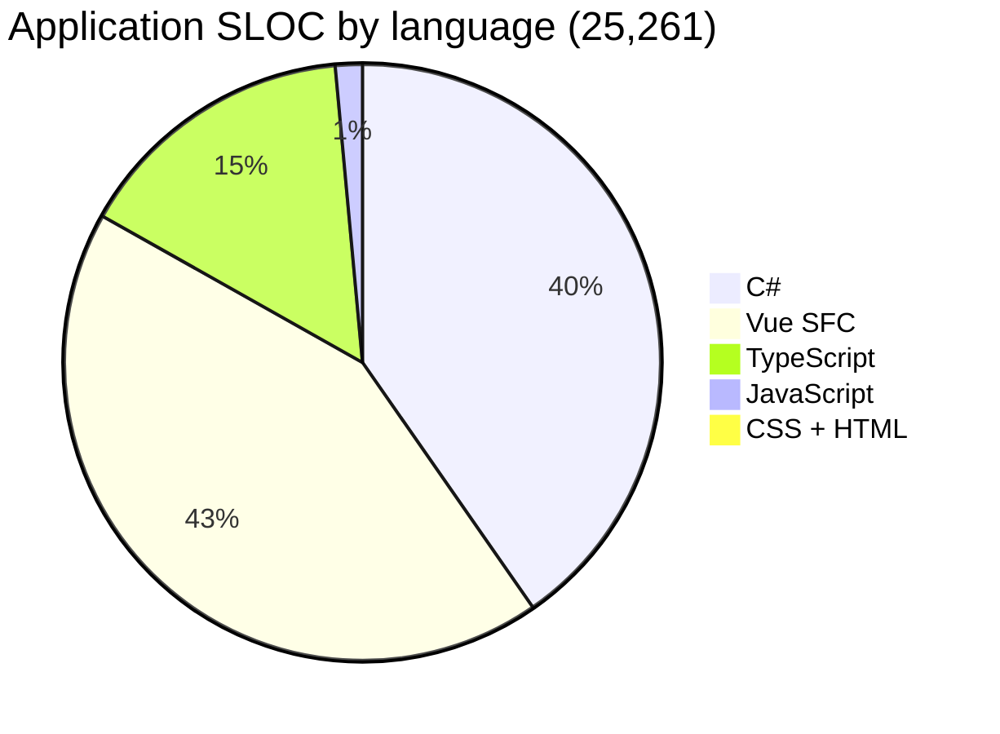
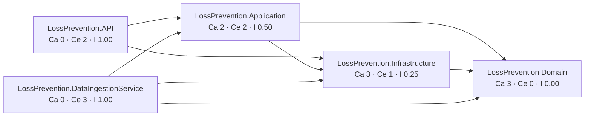
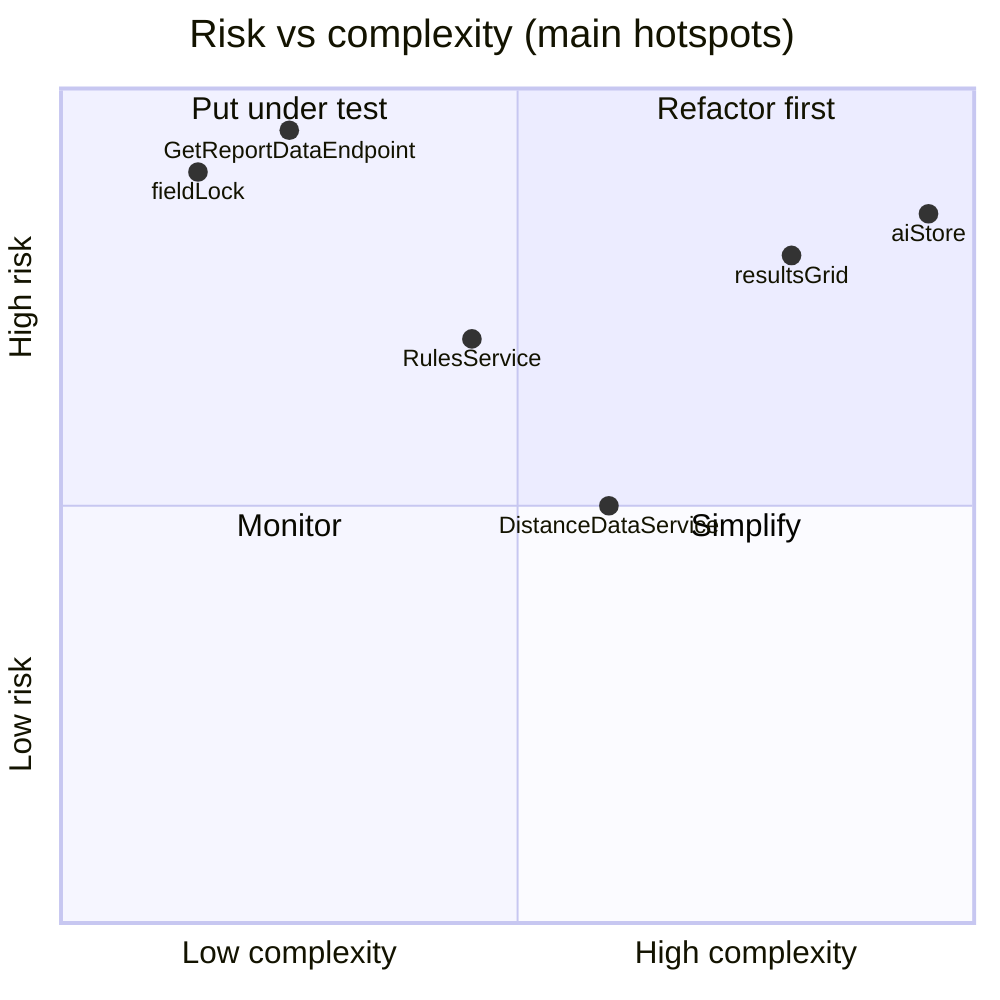

<!-- IMPACT-META
schema: 1
mode: how
step: 14_metrics
commit: fc7d820908b8b230fb47a2669920ba7efdb413a8
commit_short: fc7d820
branch: main
worktree: dirty
baseline_date: 2026-10-07T18:19:51+02:00
generated_at: 2026-10-08T09:26:01+02:00
-->
# Metrics - LOSS_PREVENTION Project

> **Baseline commit:** `fc7d820` (`main`) · worktree `dirty` (local changes only in `Docs/` and `.github/`; application code identical to the commit)

**Date**: 2026-10-08  
**Version**: 1.1  
**Authors**: REVERSE how (IMPACT) · IMPACT verification 2026-10-08  
**Audience**: Technical team, architects, developers, PM (input for the estimates in [15_fp_cocomo.md](15_fp_cocomo.md) and [19_modernization_estimation_spec.md](19_modernization_estimation_spec.md))

---

## Main Sections

0. [Measurement method and reproducibility](#0-measurement-method-and-reproducibility)
1. [Total Lines of Code (SLOC)](#1-total-lines-of-code-sloc)
2. [Language Distribution](#2-language-distribution)
3. [Complexity Metrics](#3-complexity-metrics)
4. [Module/Component Count](#4-modulecomponent-count)
5. [Dependency Metrics](#5-dependency-metrics)
6. [Code Quality Metrics](#6-code-quality-metrics)
7. [Test Coverage Metrics](#7-test-coverage-metrics)

---

## 0. Measurement method and reproducibility

All metrics are measured on the **content of commit `fc7d820`** (extracted with `git archive`), so as not to be affected by the local changes in `Docs/`. The tools are cloc 2.10 (SLOC), lizard 1.24.1 (cyclomatic complexity), PowerShell (cross-check and specific counts) and `npm audit` (vulnerabilities).

| Measure | Tool / command (run from `C:\repository\LOSS_PREVENTION`) |
|--------|-------------------------------------------------------------------|
| Baseline extraction | `git archive --format=tar -o fc7d820.tar fc7d820` → `tar -xf fc7d820.tar -C <dir>` |
| Full repository SLOC | `cloc-2.10.exe <dir>\customspa-it-loss-prevention-d098a8b97860` (official `AlDanial/cloc` v2.10 binary; `npx cloc` not usable because it requires Perl, absent on the machine) |
| SLOC per project | `cloc-2.10.exe <progetto>` for each `LossPrevention.*`, `Data`, `Docs` folder |
| SLOC of the `<script>` sections only of the `.vue` files | Python script that extracts the content of every `<script …>…</script>` block of the 41 SFCs into temporary `.ts` files, then `cloc` on the extracted files |
| Cyclomatic complexity (CCN) | `pip install lizard` → `python -m lizard -l csharp LossPrevention.API LossPrevention.Application LossPrevention.Domain LossPrevention.Infrastructure LossPrevention.DataIngestionService` and `python -m lizard -l typescript -l vue LossPrevention.UI\src` (`--csv` output for the hotspots) |
| npm vulnerabilities | `npm audit --package-lock-only --json` in `LossPrevention.UI` (run on 2026-10-08; the result depends on the date of the advisory DB) |

PowerShell cross-check (**non-blank** lines = cloc code + comment), runnable on the working tree because the code is identical to the commit:

```powershell
cd C:\repository\LOSS_PREVENTION\customspa-it-loss-prevention-d098a8b97860
foreach ($p in 'LossPrevention.API','LossPrevention.Application','LossPrevention.Domain',
               'LossPrevention.Infrastructure','LossPrevention.DataIngestionService') {
  $files = Get-ChildItem $p -Recurse -File -Filter *.cs | Where-Object { $_.FullName -notmatch '\\(bin|obj)\\' }
  $nb = ($files | ForEach-Object { Get-Content $_.FullName | Where-Object { $_.Trim() -ne '' } } | Measure-Object).Count
  "{0,-38} files={1,4} nonblank={2,6}" -f $p, $files.Count, $nb }
$fe = Get-ChildItem LossPrevention.UI\src -Recurse -File -Include *.vue,*.ts
"UI/src (*.vue,*.ts) files={0} nonblank={1}" -f $fe.Count, (($fe | % { Get-Content $_.FullName | ? { $_.Trim() -ne '' } }) | Measure-Object).Count
```

| Scope | Files | Non-blank lines (PowerShell) | cloc code + comment | Outcome |
|-----------|------|------------------------------|---------------------|-------|
| LossPrevention.API (C#) | 79 | 4,347 | 4,312 + 35 | ✅ matches |
| LossPrevention.Application (C#) | 121 | 5,005 | 4,763 + 242 | ✅ |
| LossPrevention.Domain (C#) | 21 | 519 | 513 + 6 | ✅ |
| LossPrevention.Infrastructure (C#) | 10 | 784 | 459 + 325 | ✅ |
| LossPrevention.DataIngestionService (C#) | 1 | 105 | 96 + 9 | ✅ |
| LossPrevention.UI/src (`.vue` + `.ts`) | 69 | 15,836 | (10,773 + 670) + (3,847 + 546) | ✅ |

---

## 1. Total Lines of Code (SLOC)

The repository contains **25,261 application SLOC** (C#, Vue, TypeScript, JavaScript, CSS, HTML) out of a total of 42,444 cloc lines of code; the rest is `package-lock.json` (14,001), Markdown documentation and build files. The **estimation baseline** (logical SLOC used for backfiring and COCOMO in documents 15 and 19) is **19,774 SLOC**.

### 1.1 Total Lines of Code (cloc 2.10) — full repository

Analysis performed with cloc 2.10 on the whole tree of commit `fc7d820` (no exclusions; `node_modules`, `bin`, `obj` are not versioned):

```
Linguaggio               Files      Blank    Comment      Code
──────────────────────────────────────────────────────────────
JSON                        23          1          0     14216
Vuejs Component             41       1614        670     10773
C#                         232       1506        617     10143
TypeScript                  29        601        546      3868
Markdown                    24        767        220      2825
JavaScript                   6         61         71       368
CSS                          1         15          3        96
MSBuild script               5         23          0        94
Visual Studio Solution       1          1          1        47
HTML                         1          0          0        13
SVG                          1          0          0        1
──────────────────────────────────────────────────────────────
TOTALE                     364       4589       2128     42444
```

Reading notes:
- **JSON 14,216**: `LossPrevention.UI/package-lock.json` 14,001 lines (generated), `package.json` 48, `appsettings.json` API 42 + DIS 19 and `launchSettings.json` 39 (= 100), `tsconfig.json` 25, `rules_export.json` 15, 12 `*.metadata.json` + `prelude.json` of the Mongo dump 13 (1 line each, minified), `.vite/deps` 2 versioned Vite cache files 11, `.vscode/extensions.json` 3.
- **Markdown 2,825**: 21 IMPACT documents present in `Docs/` **at commit `fc7d820`** (2,577), `README.md` 132, `Data/MongoDBScripts/PERMISSIONS_LIST.md` 113, `LossPrevention.UI/README.md` 3. The vendor documentation (`Docs/01_EXECUTIVE_OVERVIEW.md` … `Docs/roadmap.txt`, 17 files, ≈17,500 lines) **does not exist at the baseline**: it was present only in commit `593f6de` and was removed in `d768cd9` (can be consulted with `git show 593f6de:customspa-it-loss-prevention-d098a8b97860/Docs/<file>`); it is not counted.
- **JavaScript 368**: 5 Mongo scripts in `Data/MongoDBScripts` (357) + `LossPrevention.UI/vite.config.js` (11).
- The `.bson` files of the dump (`Data/LossPrevention`, 12 collections) are binary and are not counted.

### 1.2 Third-party libraries included in the source (mandatory analysis)

Check performed by searching for minified files (`*.min.js`, `*.min.css`), `vendor/`, `lib/`, `assets/js` folders and copies of known libraries inside `src/` and in the .NET projects.

| Item | Path | Type | Treatment in the count |
|----------|----------|------|---------------------------|
| No third-party library copied into the source | — | — | No exclusion needed: all libraries (Vuetify, AG Grid, Tabulator, Chart.js, xlsx, pdfmake, FastEndpoints, MongoDB.Driver, SSH.NET …) are referenced as npm/NuGet packages |
| `package-lock.json` | `LossPrevention.UI/` | File generated by npm | Included in the cloc table (JSON) but **excluded** from the application SLOC |
| `.vite/deps/_metadata.json`, `.vite/deps/package.json` | `LossPrevention.UI/.vite/` | Vite build cache versioned by mistake | Excluded from the application SLOC |
| `vite.svg` | `LossPrevention.UI/public/` | Vite template asset | Excluded |

### 1.3 Summary by scope

| Scope | SLOC (cloc code) | Composition |
|-----------|------------------|--------------|
| **Application** | **25,261** | C# 10,143 + Vue 10,773 + TS 3,868 + JS 368 + CSS 96 + HTML 13 |
| of which C# backend (5 projects) | 10,143 | 232 files |
| of which frontend (`LossPrevention.UI`) | 14,761 | Vue 10,773 + TS 3,868 (28 in `src` + `nuxt.config.ts` 21) + CSS 96 + HTML 13 + `vite.config.js` 11 |
| of which DB scripts (`Data/MongoDBScripts/*.js`) | 357 | 5 scripts ordered `00`…`04` |
| Build/config (MSBuild, `.sln`, JSON, SVG) | 14,358 | of which `package-lock.json` 14,001 |
| Documentation (Markdown) | 2,825 | see §1.1 |
| **cloc total** | **42,444** | |

### 1.4 By project (cloc, all files in the folder)

| Project / folder | Files | Blank | Comment | Code | Detail |
|---------------------|------|-------|---------|------|-----------|
| LossPrevention.API | 82 | 562 | 35 | 4,414 | C# 79 files / 4,312; JSON 2 / 81; csproj 21 |
| LossPrevention.Application | 122 | 744 | 242 | 4,782 | C# 121 / 4,763; csproj 19 |
| LossPrevention.Domain | 22 | 79 | 6 | 523 | C# 21 / 513 (of which 19 files in `Entities`) |
| LossPrevention.Infrastructure | 11 | 118 | 325 | 477 | C# 10 / 459; 184 comment lines are `DapperRepository.cs`, entirely commented out |
| LossPrevention.DataIngestionService | 3 | 26 | 9 | 141 | C# 1 / 96 (`Program.cs`) |
| LossPrevention.UI (whole folder) | 81 | 2,234 | 1,219 | 28,853 | of which `package-lock.json` 14,001 |
| └ LossPrevention.UI/src | 70 | 2,229 | 1,219 | 14,716 | Vue 41 / 10,773; TS 28 / 3,847; CSS 1 / 96 |
| Data | 20 | 92 | 71 | 498 | JS 5 / 357; MD 1 / 113; JSON 14 / 28 |
| Docs (IMPACT at the commit) | 21 | 697 | 220 | 2,577 | |
| Root (`README.md`, `.sln`) | 2 | 37 | 1 | 179 | |
| **Total** | **364** | **4,589** | **2,128** | **42,444** | |

### 1.5 Estimation baseline (logical SLOC)

This is the only dimensional baseline used in [15_fp_cocomo.md](15_fp_cocomo.md) and [19_modernization_estimation_spec.md](19_modernization_estimation_spec.md).

| Component | Logical SLOC | Origin |
|------------|--------------|---------|
| C# | 10,143 | cloc, C# language |
| TypeScript | 3,868 | cloc, TypeScript language (includes `nuxt.config.ts`, 21 SLOC) |
| Vue — `<script>` blocks only | 5,395 | cloc on the 41 extracted `<script>` blocks (blank 1,054, comment 486) |
| JavaScript | 368 | cloc (Mongo scripts + `vite.config.js`) |
| **Baseline total** | **19,774** (19.774 KSLOC) | |
| Excluded: template/style/tags of the `.vue` files | 5,378 | 10,773 − 5,395 |
| Excluded: CSS + HTML | 109 | markup/styles |

---

## 2. Language Distribution

The application code is split almost in half between the C# backend (40%) and the Vue/TypeScript frontend (59%); over half of the frontend is script logic, a sign that a significant part of the business logic resides in the browser.



| Language | SLOC | % of application |
|-----------|------|---------------|
| Vue SFC | 10,773 | 42.6% |
| C# | 10,143 | 40.2% |
| TypeScript | 3,868 | 15.3% |
| JavaScript | 368 | 1.5% |
| CSS + HTML | 109 | 0.4% |

Composition of the 41 Vue SFCs (non-blank lines, Python count per block): template 4,043 · script 5,881 (of which 5,395 logical SLOC, see §1.5) · style 1,296; the remaining lines are the opening/closing tags of the blocks.

### 2.1 Largest files (physical lines, `(Get-Content <file>).Count`)

| # | File | Physical lines | Non-blank lines |
|---|------|---------------|-----------------|
| 1 | `LossPrevention.UI/src/components/reports/resultsGrid.vue` | 2,271 | 1,971 |
| 2 | `LossPrevention.UI/src/stores/aiStore.ts` | 1,994 | 1,703 |
| 3 | `LossPrevention.UI/src/components/reports/selectFields.vue` | 823 | 732 |
| 4 | `LossPrevention.UI/src/stores/fraudDetectionStore.ts` | 728 | 674 |
| 5 | `LossPrevention.UI/src/components/reports/queryBuilderTabs.vue` | 694 | 594 |
| 6 | `LossPrevention.UI/src/components/reports/FraudSettingsDialog.vue` | 595 | 541 |
| 7 | `dataingestion.vue` | 567 | 502 |
| 8 | `notifications.vue` | 562 | 497 |
| 9 | `dashboard.vue` | 449 | 383 |
| 10 | `heatmapPreview.vue` | 448 | 398 |
| 11 | `home.vue` | 432 | 377 |
| 12 | `LossPrevention.Application/Services/Data/MappingService.cs` | 428 | 351 |
| 13 | `LossPrevention.Application/Services/DataIngestion/FileProcessingCoordinator.cs` | 424 | 358 |
| 14 | `LossPrevention.API/Endpoints/FraudDetection/UpdateFraudDetectionSettingsEndpoint.cs` | 407 | 392 |
| 15 | `App.vue` | 397 | 341 |

The first two files (frontend) alone contain 16.7% of the non-blank lines of the frontend `src` (3,674 / 15,836).

---

## 3. Complexity Metrics

The average complexity is low (CCN 2.5 backend, 3.1 frontend), but concentrated in a few hotspots: 20 functions exceed CCN 15 and the most complex one (`buildGenericFraudRuleTemplates`, CCN 87) is in the browser-side anti-fraud engine.

| Scope (lizard 1.24.1) | lizard NLOC (file total) | Functions | Avg NLOC/func. | Avg CCN | Functions CCN > 10 | Functions CCN > 15 (lizard warning) |
|---------------------------|-------------|----------|------------------|-----------|-------------------|------------------------------------|
| C# backend (5 projects) | 10,140 | 475 | 14.9 | **2.5** | 17 | 6 |
| Frontend `src` — TypeScript | 3,857 | 296 | 11.3 | 3.5 | 17 | 10 |
| Frontend `src` — Vue | 2,285 | 273 | 6.4 | 2.7 | 7 | 4 |
| **Frontend total** | 6,142 | 569 | 8.9 | **3.1** | 24 | 14 |

Note: for the `.vue` files lizard measures only the functions recognized by its `VueReader`; its NLOC is not comparable with the cloc SLOC and is used **only** for CCN and function count.

### 3.1 Hotspot (CCN > 15)

| CCN | NLOC | Function | File:line |
|-----|------|----------|-----------|
| 87 | 254 | `buildGenericFraudRuleTemplates` | `stores/aiStore.ts:1203` |
| 43 | 124 | `enrichWithCrossTransactionMetrics` | `stores/aiStore.ts:986` |
| 36 | 55 | `save` | `stores/dataIngestionStore.ts:164` |
| 34 | 131 | `analyzeFraudInData` | `stores/aiStore.ts:1667` |
| 28 | 44 | `buildPipeline` | `components/dashboard/chartblock.vue:69` |
| 24 | 68 | `UpdateDataIngestionConfigurationEndpoint.HandleAsync` | `Endpoints/DataIngestion/UpdateDataIngestionConfigurationEndpoint.cs:23` |
| 21 | 66 | `BsonHelper.TryToDateTimeUtc` | `Application/Helpers/BsonHelper.cs:269` |
| 21 | 35 | `BsonHelper.ConvertToMappedType` | `Application/Helpers/BsonHelper.cs:115` |
| 21 | 61 | `classifyFields` | `stores/aiStore.ts:379` |
| 21 | 43 | `buildTypeAwareCondition` | `helpers/queryUtils.ts:63` |
| 20 | 122 | `DistanceDataService.GetDistanceAsync` | `Application/Services/Data/DistanceDataservice.cs:22` |
| 20 | 29 | `BsonHelper.TryToBoolean` | `Application/Helpers/BsonHelper.cs:236` |
| 20 | 33 | `handleDrill` | `components/reports/heatmapPreview.vue:400` |
| 20 | 23 | anonymous function | `components/manage/dataingestion.vue:123` |
| 19 | 17 | `NotificationMapping.ToDocument` | `Application/Mappings/NotificationMapping.cs:25` |
| 18 | 65 | `buildVelocityRules` | `stores/aiStore.ts:620` |
| 16 | 65 | `buildSweetheartingRules` | `stores/aiStore.ts:838` |
| 16 | 50 | `detectUniqueTransactionFields` | `stores/fraudDetectionStore.ts:595` |
| 16 | 35 | `afterDraw` | `components/reports/heatmapPreview.vue:273` |
| 16 | 23 | `load` | `stores/dataIngestionStore.ts:230` |

Longest backend function: `CreateFraudDetectionSettingsEndpoint.MapToEntity` (162 NLOC, CCN 1 — field-by-field mapping, see §6).

---

## 4. Module/Component Count

The system consists of 5 .NET projects with 78 endpoints and of an SPA with 41 components and 15 stores; the data is in 15 MongoDB collections.

| Item | Number | Evidence / method |
|----------|--------|-------------------|
| .NET projects | 5 | `LossPrevention.sln` (API, Application, Domain, Infrastructure, DataIngestionService) |
| Test projects | 0 | no `.csproj` with xUnit/NUnit/MSTest |
| REST endpoints (FastEndpoints classes) | 78 | `LossPrevention.API/Endpoints/**`: 27 GET · 24 POST · 11 PUT · 2 PATCH · 14 DELETE |
| Anonymous endpoints | 4 | `AllowAnonymous()`: login, forgot-password, reset-password, validate-reset-token |
| `CAN_*` permissions used by the endpoints | 37 | `Permissions("CAN_…")` |
| `CAN_*` permissions defined in the seed scripts | 41 | `Data/MongoDBScripts/01_CreatePermissions.js` |
| Application services registered in DI (API) | 20 | `Program.cs` (`AddScoped`, incl. 3 `IFileProcessingService` XML/CSV/JSON) + 1 `AddHostedService` + 1 singleton `MongoDbSettings` |
| FluentValidation validators | 2 files | only `CreateDashboardValidator.cs`, `UpdateDashboardValidator.cs` |
| Domain entities | 19 files | `LossPrevention.Domain/Entities/**` (+ 2 exceptions) |
| Classes in `FraudDetectionSettings.cs` | 24 | root + `FraudThresholdConfig` + 22 threshold blocks |
| MongoDB collections used by the code | 15 | 13 from `MongoDbSettings` + `PasswordResetTokens` + `ProcessedFiles` |
| Collections in the `Data/LossPrevention` dump | 12 | 12 `.bson`/`.metadata.json` pairs (incl. `Mappings_old`, `ReportData_old`); missing from the dump: `Groups`, `Notifications`, `DataIngestionSchedules`, `FraudDetectionSettings`, `PasswordResetTokens` |
| Field mappings in the dump (`Mappings.bson`) | 52 | all on `ReportData` |
| Vue components (SFC) | 41 | `LossPrevention.UI/src/**/*.vue` |
| Pinia stores | 15 | `LossPrevention.UI/src/stores` |
| Routes (`path:` entries in `router/index.ts`) | 18 | 17 routes with a component + 1 alias redirect (`/dashboardsList`) |
| Server-side anti-fraud rules in the seed | 11 / 13 | 11 in `04_AddLossPreventionRules.js`; 13 in `rules_export.json` |
| Client-side anti-fraud heuristic types | 30 | distinct values of `fraudType` in `aiStore.ts` |
| Configurable threshold blocks | 22 | `*Threshold` classes in `FraudDetectionSettings.cs` |

---

## 5. Dependency Metrics

The direct dependencies are 15 distinct NuGet packages and 33 npm packages; the frontend has 71 known vulnerabilities, many of them in dependencies that are declared but not used.

### 5.1 Inter-project dependencies (coupling)



Ca = afferent coupling, Ce = efferent, I = Ce/(Ca+Ce). No cycles. Anomaly: `Application → Infrastructure` (downward dependency from the application layer to the infrastructure) and `Domain → MongoDB.Bson` (persistence attributes in the domain).

At service level, `IMappingService` is the most coupled node (Ca = 10): it is injected into 4 services (`RulesService`, `ReportDataservice`, `DistanceDataService`, `FileProcessingCoordinator`) and into 6 endpoints (`GetReportDataEndpoint`, `GetDistanceEndpoint`, `Create/Get/Update/DeleteMappingEndpoint`).

### 5.2 Packages

| Ecosystem | Direct | Detail | Known vulnerabilities |
|-----------|---------|-----------|--------------------|
| NuGet | 15 distinct packages (18 references in 5 `.csproj`) | FastEndpoints 6.0.0 (+Security, +Swagger), FluentValidation 11.11.0, MongoDB.Driver/Bson 3.4.0, SSH.NET 2025.1.0, Newtonsoft.Json 13.0.3, Microsoft.AspNetCore.Http.Features 5.0.17, Microsoft.Extensions.* 9.0.4 (Configuration, Configuration.Binder, Configuration.Abstractions, DependencyInjection.Abstractions, Options, Hosting) | N/A — not derivable: .NET SDK not available for `dotnet list package --vulnerable`. `Microsoft.AspNetCore.Http.Features 5.0.17` is an obsolete package (ASP.NET Core 5) |
| npm | 21 `dependencies` + 12 `devDependencies` | see `LossPrevention.UI/package.json` | **71** (`npm audit --package-lock-only`, 2026-10-08): 6 critical · 46 high · 15 moderate · 4 low |

Direct dependencies with advisories (npm audit): `@nuxt/devtools` (critical), `jspdf` (critical), `jspdf-autotable` (critical), `nuxt` (high), `axios` (high), `vite` (high), `vue` (high, via dependencies), `vue-tsc` (moderate) — fix available; `xlsx` (high) — **no fix** on the npm registry.

Dependencies declared but **never imported** in `src/`: `nuxt` (only `nuxt.config.ts` is present, the app is a Vite SPA), `jspdf`, `jspdf-autotable` (the PDF uses `pdfmake`), `grid-layout-plus` (`vue-grid-layout-v3` is used), `vuedraggable`. Operational note: `package-lock.json` is not aligned with `package.json` (`npm ci` fails).

---

## 6. Code Quality Metrics

Automated quality tools are missing (0 linters/analyzers) and there is significant duplication, dead code and unstructured logging.

| Indicator | Value | Method / evidence |
|-----------|--------|-------------------|
| Generic `catch (Exception …)` (BE) | 31 | `Select-String 'catch\s*\(\s*Exception\b'` on the `.cs` files |
| `Console.WriteLine` (BE) | 6 | `DistanceDataservice.cs:86`, `MappingService.cs:336,421`, `DataIngestionService/Program.cs:80,108,122` |
| `console.log` (FE) | 57 | 134 including `console.warn/error/debug/info` |
| `TODO/FIXME/HACK` (case-sensitive) | 4 | `GetUserRolesPermissionEndpoint.cs:36`, `UserService.cs:160`, `DapperRepository.cs:59`, `queryBuilderTabs.vue:477` |
| `eval` / `new Function` (FE) | 1 / 1 | `resultsGrid.vue:1377` / `aiStore.ts:1769` |
| Endpoints that use `IMongoRepository<>` directly | 20 / 78 (26%) | bypass of the Application layer |
| Dead code | `DapperRepository.cs` 205 physical lines (184 comment, 0 code); `IXmlEnrichmentRule` interface without implementations; `nuxt.config.ts` (21 SLOC, Nuxt not used); 5 npm dependencies not imported | cloc per file, grep |
| Duplication | `MapThresholdsToDTO` (162 NLOC) copied into 3 endpoints (`Create/Get/UpdateFraudDetectionSettingsEndpoint`) and `MapToEntity` (162 NLOC) into 2 → 810 NLOC of which 648 duplicated | lizard CSV |
| Double `MongoClient` | `InfrastructureServiceExtensions.cs:33` (scoped) + `new MongoClient` in `MongoRepository.cs:22` | grep |
| Wrong case-sensitive imports | 13 (build broken on Linux/macOS) + 1 unresolvable import (`ScheduleForm.vue:27` → `@/store/useDataIngestionStore`) | see [16_frontend_deep_assessment.md](16_frontend_deep_assessment.md) |
| Configured lint / analyzer / formatter | 0 | no `.editorconfig`, ESLint, Prettier, `Directory.Build.props`, StyleCop |
| npm quality scripts | 0 | only `dev`, `build`, `preview` |



Qualitative positioning: X axis from CCN/size (§3, §2.1); Y axis from security/data impact (arbitrary Mongo pipeline in `GetReportDataEndpoint`, row lock applied only in `helpers/fieldLock.ts`, `ReplaceOne` per document in `RulesService.ApplyRulesAsync`).

---

## 7. Test Coverage Metrics

There is no automated test at all: coverage is 0% and no test quality metric can be measured.

| Indicator | Value | Evidence |
|-----------|--------|----------|
| .NET test projects | 0 | no reference to xUnit/NUnit/MSTest/`Microsoft.NET.Test.Sdk` |
| FE test files (`*.spec.ts`, `*.test.ts`) | 0 | recursive search |
| E2E tests (Playwright/Cypress) | 0 | no configuration |
| `test` script in `package.json` | absent | |
| CI pipeline running tests | absent | no CI/CD in the repository |
| Coverage | **0%** | |

---

## Reference Documents

- **Deep Dive Analysis**: [00_deep_dive.md](00_deep_dive.md)
- **Context**: [01_context.md](01_context.md)
- **Functional Overview**: [02_functional_overview.md](02_functional_overview.md)
- **Non-Functional Overview**: [03_non_functional_overview.md](03_non_functional_overview.md)
- **Constraints**: [04_constraints.md](04_constraints.md)
- **Principles**: [05_principles.md](05_principles.md)
- **Software Architecture**: [06_software_architecture.md](06_software_architecture.md)
- **Code**: [07_code.md](07_code.md)
- **Data**: [08_data.md](08_data.md)
- **Infrastructure Architecture**: [09_infrastructure_architecture.md](09_infrastructure_architecture.md)
- **Deployment**: [10_deployment.md](10_deployment.md)
- **Development Environment**: [11_development_environment.md](11_development_environment.md)
- **Operation and Support**: [12_operation_and_support.md](12_operation_and_support.md)
- **Decision Log**: [13_decision_log.md](13_decision_log.md)
- Documents that use this baseline: [15_fp_cocomo.md](15_fp_cocomo.md), [19_modernization_estimation_spec.md](19_modernization_estimation_spec.md)

---

## Change Log

| Version | Date | Author | Changes |
|----------|------|--------|-----------|
| 1.0 | 2026-10-07 | REVERSE how (FULL) | Document creation (replaces run 2026-10-05) |
| 1.1 | 2026-10-08 | IMPACT verify | Recalculation with cloc 2.10 on the content of `fc7d820` (Vue 10,720→10,773, application 25,208→25,261, total recalculated); added reproducible method and PowerShell cross-check, table of included libraries, estimation baseline 19,774 SLOC (Vue script 5,600→5,395), CCN verified with lizard 1.24.1 and hotspots with file:line, Ca/Ce coupling, largest files recounted (`queryBuilderTabs.vue` 693→694); corrected routes 17→18 entries, seed rules 13→11/13, Dapper 204→205 physical lines (184 comment), threshold duplication (~300 lines→810 NLOC); vendor documentation cited as historical (`593f6de`→`d768cd9`); Reference Documents complete |
