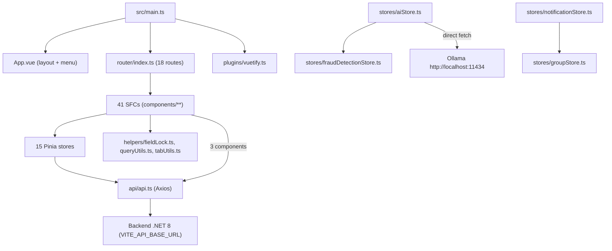
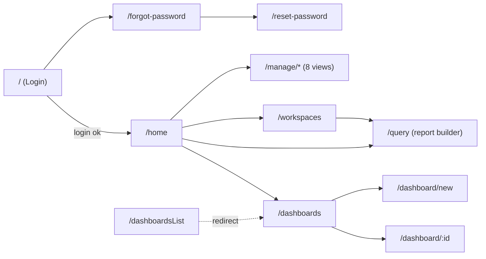
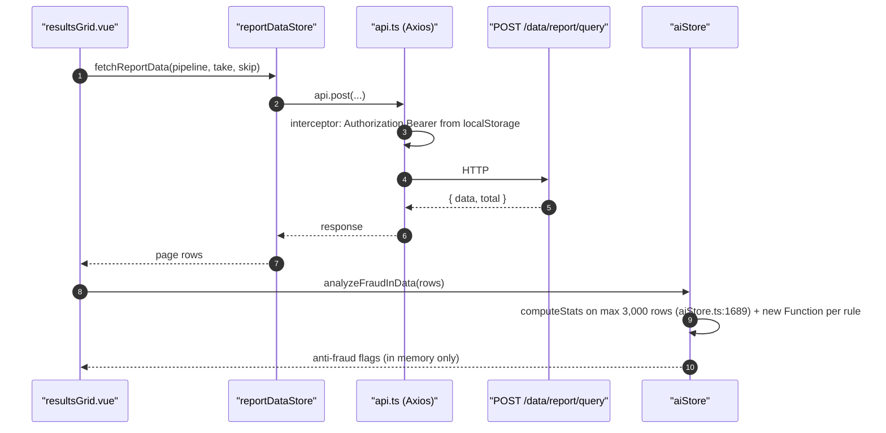

<!-- IMPACT-META
schema: 1
mode: how
step: 16_frontend_deep_assessment
commit: fc7d820908b8b230fb47a2669920ba7efdb413a8
commit_short: fc7d820
branch: main
worktree: dirty
baseline_date: 2026-10-07T18:19:51+02:00
generated_at: 2026-10-08T09:41:25+02:00
-->
# Frontend Deep Assessment - LOSS_PREVENTION Project

> **Baseline commit:** `fc7d820` (`main`) · worktree `dirty` (local changes only in `Docs/` and `.github/`; application code identical to the commit)

**Date**: 2026-10-08 · **Version**: 1.1 · **Authors**: REVERSE how / IMPACT verify · **Audience**: Frontend Architect, Tech Lead, Senior Frontend Developer

> **Prompt adaptation (Angular → Vue 3).** The reference prompt is written for Angular/Micro Frontend; the analyzed frontend (`LossPrevention.UI/`) is a **Vue 3 + Vite 6 + Vuetify 3 + Pinia** SPA. Each requirement has been mapped to the Vue equivalent; where no equivalent exists, `N/A for Vue stack: <reason>` is indicated.

| Angular concept in the prompt | Equivalent analyzed in this project |
|---|---|
| Module Federation / remote modules | None: monolithic SPA, single entry `src/main.ts` |
| `angular.json`, Angular CLI | `vite.config.js`, `package.json` scripts, `tsconfig.json` |
| NgRx Store / selectors / effects | Pinia (`defineStore`), getters, asynchronous actions |
| RxJS, `takeUntil`, `async` pipe | N/A for Vue stack: RxJS is not a dependency; equivalent = cleanup in `onBeforeUnmount`, `watch` stop handle |
| `ChangeDetectionStrategy.OnPush`, Zone.js | Vue reactivity (Proxy), `markRaw`/`shallowRef`; Zone.js N/A |
| `@Input`/`@Output`, `EventEmitter` | `defineProps` / `defineEmits` |
| `*ngFor trackBy` | `v-for` + `:key` |
| CDK Virtual Scroll | Manual virtual scrolling / AG Grid row virtualization |
| AuthGuard / CanActivate | `router.beforeEach` (vue-router 4) |
| Keycloak Angular adapter | Custom authentication: JWT issued by `POST /users/login` of the .NET backend |
| `DomSanitizer` | Automatic escaping of Vue templates; risk only with `v-html`/`eval` |
| Angular Material theming | Vuetify theme (`src/plugins/vuetify.ts`) |
| Jasmine/Karma, Protractor/Cypress | No test framework present (suggested target: Vitest + Playwright) |

---

## Executive Summary

The frontend is a functionally rich Vue 3 SPA (report builder, dashboards, client-side statistical anti-fraud engine, LLM integration), but it is **not buildable on Linux**, lacks tests/lint/type-check, and has security and business logic executed in the browser. The overall health is **3.4 / 10**.

### Overall Health Score: **3.4 / 10**

Derivation: simple arithmetic mean (equal weights) of the 11 dimension scores, each 0–10 and justified with evidence in the indicated sections.

| # | Dimension (section) | Score | Main evidence |
|---|---|---|---|
| D1 | Architecture & routing (§1) | 5 | Simple layered SPA; 18 static routes without lazy loading; `requiresAuth` guard only (`router/index.ts:56-70`) |
| D2 | State management (§2) | 5 | 15 consistent Pinia stores; `aiStore.ts` 1,994 lines; anti-fraud state in memory only |
| D3 | Component architecture, template & styling (§3) | 5 | 41 SFCs, `<script setup>` in 39/41; god component `resultsGrid.vue` 2,271 lines |
| D4 | Services & HTTP (§4) | 5 | One Axios client with a request interceptor; no response/retry interceptor; direct `fetch` to Ollama |
| D5 | Security (§5) | 2 | `eval` (`resultsGrid.vue:1377`), `new Function` (`aiStore.ts:1769`), lock and permissions decided by the client, JWT in `localStorage` and logged (`App.vue:292`) |
| D6 | Performance (§6) | 4 | Single JS bundle 5,726.55 kB (2,028.16 kB gzip); listener not removed (`resultsGrid.vue:635`); `markRaw` and virtual scroll present |
| D7 | Testing (§7) | 0 | No unit/component/E2E tests |
| D8 | Build & deployment (§8) | 2 | `npm ci` fails (lock not synchronized); 12 imports with wrong case not resolvable on a case-sensitive FS (+ unresolvable import in the orphan `ScheduleForm.vue`); no type-check in the build |
| D9 | Accessibility (§9) | 3 | Only 1 `aria-*` attribute in the whole of `src/`; `lang="en"` on the UI; accessible Vuetify base |
| D10 | Developer experience (§10) | 3 | `strict: true` but 336 `: any`; no ESLint/Prettier; Vite template README |
| D11 | Third-party dependencies (§11) | 3 | 71 npm vulnerabilities (6 critical, 46 high); 6 unused runtime/dev dependencies |

**Calculation**: (5 + 5 + 5 + 5 + 2 + 4 + 0 + 2 + 3 + 3 + 3) / 11 = 37 / 11 = **3.36 → 3.4 / 10**.

> Version note: v1.0 reported 4.5/10 without derivation; the value has been recalculated with the scorecard above.

**Top 3 Issues**
1. 🔴 **Security in the client** — `eval(expr)` on calculated-field expressions saved in the workspaces (`components/reports/resultsGrid.vue:1377`) + JWT in `localStorage` (`api/api.ts:11`, `stores/loginStore.ts:92-93`) ⇒ persistent XSS with token theft; row-level lock enforced only by the browser (`helpers/fieldLock.ts:1-48`).
2. 🔴 **Non-reproducible build** — `npm ci` fails (`EUSAGE`, lock not synchronized with `package.json`) and 12 imports with wrong upper/lower case + 1 non-existent import (`ScheduleForm.vue:27`) make the build impossible on Linux/macOS: no CI/container pipeline can be activated.
3. 🟠 **Business logic in the browser** — statistical anti-fraud engine and rule generation in `stores/aiStore.ts` (1,994 lines, `buildGenericFraudRuleTemplates` CCN 87) executed with `new Function` (`aiStore.ts:1769`), results neither persisted nor auditable; LLM reached directly at `http://localhost:11434` (`aiStore.ts:88`).

**Top 3 Recommendations**
1. ✅ Eliminate `eval`/`new Function` (whitelisted expression parser) and move lock/permissions/anti-fraud analysis to the backend — closes the critical vulnerabilities (see FE-TD3, FE-TD4, FE-TD1).
2. ✅ Restore a reproducible build: fix the 12 imports with wrong case (and `ScheduleForm.vue`), regenerate `package-lock.json`, add `vue-tsc --noEmit` + ESLint to the build script — unblocks Linux CI/CD (FE-TD8, FE-TD6).
3. ✅ Clean up the dependencies: remove the 6 unused ones (including the critical `jspdf`/`jspdf-autotable` and `nuxt`), update `axios`/`vite`/`vue`, replace `xlsx` 0.18.5 — drastically reduces the 71 vulnerabilities (FE-TD5).

### Metrics Snapshot

| Metric | Current | Target | Status |
|---|---|---|---|
| Initial JS bundle | 5,726.55 kB (2,028.16 kB gzip), 1 chunk | < 1 MB initial gzip, chunk per route | 🔴 |
| CSS | 1,095.06 kB (163.75 kB gzip) | < 300 kB | 🔴 |
| FCP / LCP / TTI / CLS | N/A — not measured (no deployed environment, Lighthouse cannot be run) | < 1.8 s / < 2.5 s / < 3.8 s / < 0.1 | ⚪ |
| Test coverage | 0 % (no tests) | > 60 % | 🔴 |
| WCAG score | N/A — no automated audit can be run without an environment; 1 `aria-*` attribute in the code | > 95 % | 🔴 (qualitative) |
| npm vulnerabilities | 71 (6 C / 46 H / 15 M / 4 L) | 0 C/H | 🔴 |
| Build on Linux | ❌ (12 imports with wrong case) | ✅ | 🔴 |
| Functions with CCN > 15 | 14 (max 87) | 0 | 🟠 |

---

## 1. Micro Frontend Architecture

The application is **not** a micro frontend: it is a monolithic Vue 3 SPA with a single entry point and a single bundle. The prompt's requests on Module Federation are therefore reported as N/A, while routing and bundle are analyzed on the single application.

### 1.1 Module Federation Analysis

- **Module identification**: N/A for Vue stack: no Module Federation configuration (no `@originjs/vite-plugin-federation` or `ModuleFederationPlugin`; `vite.config.js` registers only `@vitejs/plugin-vue` and the `@` alias). Single "host" = `src/main.ts`:

```ts
// src/main.ts
const app = createApp(App);
app.use(createPinia());
app.use(router);
app.use(vuetify); // Use Vuetify
app.use(ToastPlugin); // Use Toast notifications
app.mount("#app");
```

- **Meta-framework declared but not used**: `nuxt.config.ts` (Nuxt 2 `buildModules` syntax, `ssr: true`) and the `nuxt` 3.17.3 / `@nuxt/devtools` 1.7.0 dependencies are present, but no file imports `nuxt` and the scripts are `vite`/`vite build`/`vite preview`. The root `README.md` and the vendor's historical documentation declare "Nuxt 3 SSR" (e.g. `Docs/01_EXECUTIVE_OVERVIEW.md:66` and `Docs/07_FRONTEND_ARCHITECTURE.md:23,836` — vendor documentation **present only in commit `593f6de`, removed in `d768cd9`**; can be consulted with `git show 593f6de:customspa-it-loss-prevention-d098a8b97860/Docs/07_FRONTEND_ARCHITECTURE.md` run from `C:\repository\LOSS_PREVENTION`): the claim is **false** at the baseline.
- **Shared dependencies / versioning**: N/A for Vue stack (no remote); all libraries are in the single bundle.
- **Internal dependency graph** (layers, verified on the imports): `components → stores → api/api.ts → backend`; `aiStore.ts:3` imports `fraudDetectionStore`; `notificationStore.ts:3` imports `groupStore`. The store/helper/api graph is **acyclic** (manual verification of the imports of `stores/`, `helpers/`, `api/`, `router/`; `madge` not applicable to SFCs: the parser fails on the templates).



- **Bundle size analysis** (build run on 2026-10-08 on a Windows copy of the source, `npm install` + `vite build`, Vite 6.4.1, Node 22.14.0): 705 modules transformed, **a single JS chunk** `index-*.js` 5,726.55 kB (gzip 2,028.16 kB), CSS 1,095.06 kB (gzip 163.75 kB), MDI font woff2 403 kB / woff 588 kB / ttf 1.3 MB / eot 1.3 MB; build time 1 min 04 s; Vite reports `Use of eval ... is strongly discouraged` (resultsGrid.vue). Lazy chunks: 0. Shared vs duplicated code: N/A (a single chunk). Vendor bundle: not separated (no `manualChunks`). Tree-shaking: limited by `import * as components from "vuetify/components"` and `* as directives` (`plugins/vuetify.ts:3-4`, registers **all** Vuetify components) and by AG Grid's `ModuleRegistry.registerModules([AllCommunityModule])` (`main.ts:12-13`).

### 1.2 Routing Architecture

Routing is centralized in `src/router/index.ts` (72 lines) with `createWebHistory()`; it protects only authentication, not authorization.

- **Root routing**: **18 entries** in `routes` (17 with a component + 1 redirect `/dashboardsList` → `dashboards-list`, line 30). Public: `/`, `/forgot-password`, `/reset-password`; all the others `meta.requiresAuth: true`. No catch-all 404 route.
- **Lazy loading**: absent — all 16 views are imported statically (`router/index.ts:2-17`).
- **Route guard**: a single `router.beforeEach` (`router/index.ts:56-70`) that calls `loginStore.validateToken()` and redirects to `login` if `requiresAuth && !isLoggedIn`. **No per-route permission check**: an authenticated user lacking `CAN_*` can open `/manage/users` by typing the URL (the backend responds 403 on the APIs, but the view is mounted).
- **Menu vs permissions**: the menu in `App.vue` is filtered by `hasPermission()` (`App.vue:282-311`), which decodes the JWT from `localStorage`; the computed properties `canManageUsers`/`canViewPermissions`/`canViewRoles`/`canManageGroups` (`App.vue:314-340`) also use `CAN_ADD_USERS`, `CAN_DELETE_USERS`, `CAN_UPDATE_USERS`, which **no endpoint requires** (they exist only in the seed scripts `Data/MongoDBScripts/*.js`): menu visibility is not aligned with the actual authorization. The activity was planned in the vendor's roadmap ("API - Permissions - Review - Ensure all are correct and present. Remove features that the user does not have access to on the UI.", `Docs/roadmap.txt:44` — **present only in commit `593f6de`, removed in `d768cd9`**; `git show 593f6de:customspa-it-loss-prevention-d098a8b97860/Docs/roadmap.txt`).
- **Deep linking**: supported (history mode, parametric routes `/dashboard/:id` with `props: true`); requires a web-server-side rewrite to `index.html` (not configured in the repo).
- **Navigation flow**:



- **Back navigation**: handled natively by vue-router; `dashboard.vue:444-448` registers/removes a `beforeunload` handler for unsaved changes (no `onBeforeRouteLeave`).

## 2. State Management

State is managed with **Pinia** (15 stores, 12 in Options API and 3 in Setup API, 4,445 lines in total) following the flow `component → store action → api.ts → backend`. The critical points are `aiStore.ts`, which concentrates LLM, statistics and rules, and the persistence entrusted to `localStorage`.

### 2.1 State Architecture

| Store | Lines | Style | Responsibility | Notes |
|---|---|---|---|---|
| `aiStore.ts` | 1,994 | Options | LLM (Ollama), NLQ, field classification, statistics, generation/execution of anti-fraud rules | God store; `MODEL = "qwen2.5:14b"` line 8 |
| `fraudDetectionStore.ts` | 728 | Options | Anti-fraud thresholds, fraud metadata, rule cache | `DEFAULT_FRAUD_THRESHOLDS` (line 177) defined **only** in the FE: the backend entity `FraudDetectionSettings` has no defaults |
| `dataIngestionStore.ts` | 275 | Options | Ingestion configuration | `save` CCN 36 (lines 164-228) |
| `notificationStore.ts` | 259 | Options | Notifications, notification permissions | Client-side JWT decoding (lines 47-66) |
| `loginStore.ts` | 150 | Setup | JWT, expiry, automatic logout | Reads `response.data?.token?.result` (line 78) |
| `groupStore.ts` | 145 | Options | Groups | — |
| `rolestore.ts` | 133 | Options | Roles | Lowercase file name, imported as `roleStore` |
| `userStore.ts` | 114 | Options | Users | Imports `axios` directly (line 4) in addition to `api` |
| `reportDataStore.ts` | 104 | Options | Report queries, distance | — |
| `workspacestore.ts` | 102 | Setup | Active workspace | `activeWorkspaceId` in `localStorage` (lines 74, 79) |
| `permissionStore.ts` | 100 | Options | Permissions | — |
| `ruleStore.ts` | 93 | Options | Backend rules | — |
| `dashboardStore.ts` | 90 | Options | Dashboards | — |
| `PasswordResetStore.ts` | 87 | Setup | Password reset | PascalCase file name, imported in camelCase |
| `mappingStore.ts` | 71 | Options | Field mapping | — |

- **Local vs global**: all stores are global (Pinia); local state is in `ref`/`reactive` in the components. State shared between micro frontends: N/A (no MFE).
- **Data flow** (report example): `resultsGrid.vue:1192` → `reportStore.fetchReportData(pipelineCache, pageSize, skip)` → `api.post('/data/report/query')` → `GetReportDataEndpoint`. 14 stores out of 15 call `api.*`; 3 components call the API without a store (`dataingestion.vue:458`, `groups.vue:205`, `notifications.vue:451,460`).



- **Side effects / error handling**: `async` actions with local `try/catch`; 48 `console.error`, toasts via `vue-toast-notification`; no global handler (`app.config.errorHandler` absent in `main.ts`).
- **State persistence**: `localStorage` used for `token`, `username`, expiry (`loginStore.ts:92-120`), `activeWorkspaceId` (`workspacestore.ts:74,79`), read notifications (`notificationStore.ts:49,213`; `notifications.vue:347-358`). No `sessionStorage`, no cookies. Rehydration: `loginStore.initializeFromStorage()` (`App.vue:135`). Synchronization between tabs: absent (no `storage` listener). The anti-fraud state (`fraudMetadataMap`, `fraudRulesCache`) lives only in memory: a refresh loses the analysis.

### 2.2 Performance State

- **Memoization**: Pinia getters and 93 `computed()`; 10 uses of `storeToRefs`. `markRaw` applied once to the cache of generated rules (`aiStore.ts:1652`; imported but not used in `fraudDetectionStore.ts:2`); `shallowRef` for the Chart.js instance (`heatmapPreview.vue:56`). These are good practices, Vue equivalents of exclusion from change tracking, but applied sporadically: the row datasets remain deeply reactive.
- **Change detection**: N/A for Vue stack (no OnPush/Zone.js); reactivity is fine-grained via Proxy. 29 `watch()`.
- **Memory leaks**: `resultsGrid.vue:635` registers `document.addEventListener('click', ...)` in `onMounted` **without** removal in `onBeforeUnmount` → leak on every mount of the grid. Handled correctly: `dashboard.vue:444-448` (`beforeunload`), `setInterval` with `clearInterval` in `aiStore.ts:1980` and `fraudDetectionStore.ts:692`, `destroy()` of the charts in `chartblock.vue`, `heatmapPreview.vue`, `radarChart.vue`. `takeUntil`/`async pipe`: N/A for Vue stack.

## 3. Component Architecture

The 41 SFCs almost all use `<script setup>` (39/41) and Vuetify; complexity is concentrated in a few very large components that mix presentation, data access and domain logic.

### 3.1 Component Design

- **Inventory** (total lines): `reports/resultsGrid.vue` 2,271 · `reports/selectFields.vue` 823 · `reports/queryBuilderTabs.vue` 694 · `reports/FraudSettingsDialog.vue` 595 · `manage/dataingestion.vue` 567 · `manage/notifications.vue` 562 · `dashboard/dashboard.vue` 449 · `heatmapPreview.vue` 448 · `home.vue` 432 · `App.vue` 397; remaining 31 SFCs < 400 lines.
- **Smart vs presentational**: smart (access stores/API) 28; presentational (props/emits only, e.g. `conditionRow.vue`, `formattingRow.vue`, `textblock.vue`, `imageblock.vue`, `*ConfigDialog.vue`) 13 → ratio ≈ 68 % / 32 % (automatic classification: SFCs that contain `use*Store(` or `api.` calls).
- **Shared components**: no common library; folders per feature (`components/reports`, `dashboard`, `manage`, `workspace`).
- **Complexity** (lizard, 569 FE functions, average CCN 3.09): 14 functions CCN > 15, 24 > 10, 11 functions > 50 NLOC. Top: `buildGenericFraudRuleTemplates` (`aiStore.ts:1203-1530`, CCN 87), `enrichWithCrossTransactionMetrics` (`aiStore.ts:986-1142`, CCN 43), `save` (`dataIngestionStore.ts:164-228`, CCN 36), `analyzeFraudInData` (`aiStore.ts:1667-1922`, CCN 34), `buildPipeline` (`chartblock.vue:69-124`, CCN 28).
- **Communication**: 24 `defineProps`, 17 `defineEmits`, 1 `provide/inject`; cross-view communication via Pinia stores. EventEmitter/Subject: N/A for Vue stack.
- **Reuse/duplication**: jscpd (min 50 tokens) on `src/`: 31 clones, 854 duplicated lines (**3.42 %**). Duplicate libraries with the same responsibility: AG Grid (`resultsGrid.vue`, `tabularBlock.vue:44`) **and** Tabulator (`distanceTable.vue:25`); `vue-grid-layout-v3` (`dashboardGrid.vue:84`) **and** `grid-layout-plus` (not used).

### 3.2 Template & Styling

- **Template complexity**: non-empty lines in the `<template>` blocks = 4,125 across 41 SFCs (average **100.6** lines/template); maximums `resultsGrid.vue` 466, `FraudSettingsDialog.vue` 405, `selectFields.vue` 291, `notifications.vue` 283. Logic in the template: inline expressions with type annotations, e.g. `queryBuilderTabs.vue:17` `@copy-tab="({ index }: { index: number }) => duplicateSelectedTabFromIndex(index)"` (reported as a syntax error by `vue-tsc`, §10). Total `v-for` 24; all with `:key` (0 without key detected). Custom directives: none (Vuetify directives only).
- **Styling**: 30 `<style>` blocks, all `scoped` (≈ ViewEncapsulation.Emulated); no preprocessor (0 `lang="scss"`); global CSS `src/style.css` 114 lines (99 non-empty) vs 1,356 non-empty lines of style in the components (global/component ratio ≈ 7 % / 93 %); theming via `createVuetify` with defaults `density: 'compact'` (`plugins/vuetify.ts`); CSS custom properties: 0 `var(--…)`; responsive: 2 `@media`, 46 uses of the Vuetify grid/breakpoints (`cols=`, `md=`, `useDisplay`).

## 4. Services & HTTP

There is a single HTTP client (`src/api/api.ts`, 21 lines) used by 14 stores and 3 components; there are no application services separate from the stores, nor centralized handling of errors, retries or versioning.

### 4.1 Service Layer

- **Types**: API service = `api/api.ts`; business logic = Pinia stores (`aiStore`, `fraudDetectionStore`) and pure helpers (`helpers/queryUtils.ts`, `tabUtils.ts`); utility = `helpers/fieldLock.ts`; state = stores.
- **HTTP client**:

```ts
// src/api/api.ts
const api = axios.create({ baseURL: import.meta.env.VITE_API_BASE_URL });
console.log('API base URL:', import.meta.env.VITE_API_BASE_URL);   // line 7
api.interceptors.request.use((config) => {                       // lines 10-18
  const token = localStorage.getItem('token');                   // line 11
  if (token) config.headers.Authorization = `Bearer ${token}`;
  return config;
});
```

  - Interceptors: request only (auth). **No response interceptor**: 401/403 are not handled centrally (logout happens only on local expiry, `loginStore.ts:54-66`). Logging: `console.log` of the base URL in production.
  - Retry: absent. Client caching: absent (caching is server-side, 1 h on `/data/report/query`).
  - Typing: 24 `interface` + 1 `type` alias in `src/`; many responses typed `any` (336 occurrences of `: any`, 40 `as any`, 12 `<any>`).
- **API integration**: base URL from `VITE_API_BASE_URL` (compile-time, no committed `.env*` or `.env.example`); no API versioning (backend without `/v1`); per-action error handling with toasts; mock services: none.
- **LLM**: `fetch("http://localhost:11434/api/generate")` (`aiStore.ts:88`) with the `qwen2.5:14b` model (`aiStore.ts:8`) hardcoded. The vendor's historical documentation cited `VITE_OLLAMA_URL`/`VITE_OLLAMA_MODEL` (`Docs/07_FRONTEND_ARCHITECTURE.md:866-867`, **present only in commit `593f6de`, removed in `d768cd9`**), variables **never read** by the code at the baseline.

### 4.2 RxJS Patterns

N/A for Vue stack: RxJS is not among the dependencies (`package.json`) and is not imported. Verified equivalents: `async/await` promises in all actions; no "subscription" to manage except `watch` (auto-stop on unmount) and the DOM listeners/timers discussed in §2.2 and §6.2.

## 5. Security Frontend

Frontend security is the weakest point: authentication and authorization are partly decided by the browser, the token is exposed to any script, and two dynamic code execution primitives are present.

### 5.1 Authentication & Authorization

- **Token management** (Keycloak equivalent: custom HS256 JWT of the backend): login `POST /users/login`, the token is read from `response.data?.token?.result` (`loginStore.ts:78`) because the backend serializes an un-awaited `Task` (`LoginEndpoint.cs:39-40`). No refresh token, no silent refresh: on expiry (1 h, `ExpiryHours` in appsettings) the `scheduleExpiryLogout` timer (`loginStore.ts:54-66`) performs the logout.
- **Token storage**: `localStorage` (`loginStore.ts:92-93`, read in `api.ts:11`, `fieldLock.ts:2`, `App.vue:284`, `notificationStore.ts:49`). Accessible by any script ⇒ amplifies FE-S1.
- **Route guards / RBAC**: see §1.2 — authentication only, no per-route RBAC; menu RBAC based on client-side decoding of the JWT (`App.vue:282-311`) with permission names not used by the backend.
- **HTTP security**: CSRF N/A (Bearer token in header, no session cookie); **no Content-Security-Policy** (`index.html` has no `<meta http-equiv>`, no header configured in the repo); XSS: automatic Vue escaping, 0 `v-html`, 0 `innerHTML`, but `eval` nullifies the protection.

| # | Problem | Evidence | Severity |
|---|---|---|---|
| FE-S1 | `eval(expr)` on user-defined expressions saved in the (shared) workspaces | `components/reports/resultsGrid.vue:1371-1377` | 🔴 Critical (persistent cross-user XSS) |
| FE-S2 | Row-level lock computed by the client by reading `LockField`/`LockValue` from the JWT | `helpers/fieldLock.ts:1-48`, used in `resultsGrid.vue:1687`, `toolbar.vue:180` | 🔴 Critical (trivial bypass; the server does not filter) |
| FE-S3 | JWT in `localStorage` | `loginStore.ts:92-93`, `api.ts:11` | 🟠 High (combined with FE-S1) |
| FE-S4 | `new Function("row", ...)` on conditions that embed field names coming from the imported files | `stores/aiStore.ts:1769-1772` | 🟠 Medium |
| FE-S5 | JWT payload and permissions printed to the console | `App.vue:292` (`console.log('JWT Payload:', payload)`), `App.vue:296` | 🟠 Medium |
| FE-S6 | No Content-Security-Policy | `index.html` | 🟠 Medium |
| FE-S7 | Menu permissions decided by the client and with names not used by the backend | `App.vue:314-340` | 🟡 Low (UX/perceived security; the backend remains authoritative) |
| FE-S8 | Local LLM reached in clear text from the browser with transactional data | `aiStore.ts:88` | 🟡 Low (in dev); 🟠 if extended to a shared server |

```ts
// components/reports/resultsGrid.vue:1371-1377
const expr = expression.replace(/\b(\w+)\b/g, (m: any) => {
  if (Object.prototype.hasOwnProperty.call(row, m)) {
    return row[m] === undefined || row[m] === null ? '""' : `row["${m}"]`;
  }
  return m;
});
const result = eval(expr);
```

### 5.2 Data Protection

- **Sensitive data in `localStorage`**: JWT token (contains `permissions`, `LockField`, `LockValue`), username. High risk in the presence of XSS.
- **Logging**: 127 console calls in `src/` (57 `console.log`, 48 `console.error`, 20 `console.warn`, 2 `console.debug`), including the JWT payload (`App.vue:292`) and the lock mapping type (`fieldLock.ts:17`). No removal in the build (no `esbuild.drop`).
- **Sanitization** (`DomSanitizer` equivalent): not necessary given the absence of `v-html`; not applied to the expressions passed to `eval`/`new Function`.
- **Input validation**: 12 `<v-form>` and 34 Vuetify `:rules=` bindings (inline validators: required, email, length); no schema library (zod/yup/vee-validate); custom business validators: none (the anti-fraud thresholds are validated neither client-side nor server-side).

## 6. Performance Optimization

Loading performance is penalized by the single 5.7 MB bundle; at runtime the main cost is the anti-fraud analysis executed in the browser page by page.

### 6.1 Loading Performance

- **Lazy loading**: no lazy routes, no `defineAsyncComponent`; preloading strategy N/A.
- **Bundle optimization**: code splitting absent (1 chunk); vendor not separated; Vuetify and AG Grid registered in full (§1.1); heavy libraries loaded at startup: pdfmake + `vfs_fonts` (`resultsGrid.vue:513-514`), xlsx (`resultsGrid.vue:515`), papaparse (`resultsGrid.vue:512`), Chart.js. Polyfill/differential loading: N/A for Vite 6 (modern ES targets, no legacy plugin).
- **Asset optimization**: images: 1 `/<v-img>` tag and only `public/vite.svg` (1.5 kB); full MDI font in 4 formats (≈ 3.6 MB in total on disk, the browser downloads only woff2 403 kB) imported globally (`main.ts:3`); external third-party scripts: none.

### 6.2 Runtime Performance

- **Change detection**: N/A (see §2.2); `markRaw` on the rule cache and `shallowRef` on the charts reduce the reactivity overhead, but they are not applied to the row datasets.
- **Lists**: `v-for` always with `:key`; AG Grid virtualizes the rows; `selectFields.vue` implements manual virtual scrolling (lines ~102, 290, 340, 354); debounce on `heatmapPreview.vue:71`. `requestAnimationFrame`: not used.
- **Anti-fraud analysis**: for each page, fetch + evaluation of all rules on all rows (O(pages × rules × rows)); statistics computed on a sample of max 3,000 rows (`aiStore.ts:1546`, `aiStore.ts:1689`); fixed wait `setTimeout(..., 3000)` in `resultsGrid.vue:1258`.
- **Memory management**: see §2.2 (leak `resultsGrid.vue:635`; timers and charts correctly destroyed).

## 7. Testing Strategy

There is no form of automated testing in the frontend; the indicated priorities target the most critical pure functions.

### 7.1 Unit Testing

- **Coverage**: 0 % (no `*.spec.ts`/`*.test.ts` files, no `test` script in `package.json`, no framework installed). Coverage per module: N/A. Untested critical paths: `aiStore.ts` (`computeStats`, `classifyFields`, `build*Rules`, `analyzeFraudInData`), `helpers/queryUtils.ts:63-122` (`buildTypeAwareCondition`, CCN 21), `helpers/fieldLock.ts`, `loginStore.ts`.
- **Test quality** (framework, mocking, async): N/A — no tests present. Recommended: Vitest + `@vue/test-utils` + `@pinia/testing`.

### 7.2 E2E Testing

Framework: none; coverage of critical flows: 0; flakiness: N/A — not derivable (no CI and no logs). The vendor's test guide reported coverage "TBD" and proposed Vitest (`Docs/13_TESTING_QA.md:33-40,76`, **present only in commit `593f6de`, removed in `d768cd9`**).

## 8. Build & Deployment

At the baseline the build is not reproducible: the lockfile is not aligned and on a case-sensitive file system 12 imports do not resolve. There are no deployment artifacts, pipelines or per-environment configurations.

### 8.1 Build Configuration

- **Configuration** (`angular.json` equivalent): `vite.config.js` with only `plugins: [vue()]` and alias `@ → src`; no dev/prod distinction beyond the Vite defaults; no custom Rollup configuration. `tsconfig.json`: `strict: true`, `sourceMap: true`.
- **Reproducibility**: `npm ci --dry-run` **fails** (`EUSAGE: package.json and package-lock.json ... are not in sync`; npm reports `Missing: vue-tsc@2.2.12 from lock file`). v1.0 of this document stated "verified with `npm ci && npm run build`, Node 24": **incorrect** — the build was verified with `npm install` + `vite build` on a Windows copy (case-insensitive FS) on 2026-10-08.
- **Imports not resolvable on Linux/macOS (13)** — 12 upper/lower case differences + 1 non-existent path:

| # | Import in the code | Actual file | Occurrences (file:line) |
|---|---|---|---|
| 1-6 | `@/stores/workspaceStore` | `stores/workspacestore.ts` | `dashboard.vue:123`, `dashboardsList.vue:132`, `tabularBlock.vue:43`, `queryBuilderTabs.vue:131`, `workspace.vue:58`, `home.vue:89` |
| 7-8 | `@/stores/roleStore` | `stores/rolestore.ts` | `roles.vue:96`, `users.vue:133` |
| 9 | `./chartBlock.vue` | `chartblock.vue` | `dashboardGrid.vue:85` |
| 10 | `./fraudSettingsDialog.vue` | `FraudSettingsDialog.vue` | `resultsGrid.vue:511` |
| 11-12 | `../stores/passwordResetStore` | `stores/PasswordResetStore.ts` | `ForgotPassword.vue:49`, `ResetPassword.vue:86` |
| 13 | `@/store/useDataIngestionStore` (default import) | non-existent; the actual store is the named export `useDataIngestionStore` in `stores/dataIngestionStore.ts:7` | `ScheduleForm.vue:27` (unreferenced component: it does not break the Windows build, but it is non-compilable dead code) |

  > Note: the IMPACT fact sheet states "13" but lists 12; the 13th is the non-existent import of `ScheduleForm.vue`.

- **Type-check**: not run in the build (`"build": "vite build"`). Manual result: `vue-tsc` 1.8.27 (version in the lock) **crashes** with TypeScript 5.6 (`Search string not found: "for (const existingRoot of buildInfoVersionMap.roots)"`); with `vue-tsc` 2.2.12 there are 4 syntax errors (TS1005 ×3, TS1136 ×1) in `queryBuilderTabs.vue:17`; in the presence of syntax errors `tsc` does not emit the semantic diagnostics, so the number of type errors remains **N/A — not derivable until the syntax error is fixed**.
- **Environment configuration**: only `VITE_API_BASE_URL` (compile-time); no committed `.env*` file, no runtime configuration (`config.json`), feature flags: none.
- **Build performance**: 1 min 04 s on a Windows workstation (single measurement); incremental build = HMR of the Vite dev server; cache: `.vite/deps/_metadata.json` **committed by mistake** (not excluded by `.gitignore`).

### 8.2 Deployment Strategy

- **Artifacts**: `dist/index.html` + `dist/assets/` (1 JS, 1 CSS, 4 MDI fonts); names with content hash (native Vite cache busting); source maps in production: **not generated** (Vite default `build.sourcemap: false`; `tsconfig sourceMap` does not affect the bundle).
- **Versioning**: `package.json` `"name": "workflowbuilder"`, `"version": "0.0.0"`, never incremented; no Git tags; no rollback strategy.
- **Deploy**: no Dockerfile, pipeline or web server configuration in the repo. The vendor's guide proposed Azure Static Web Apps or Nginx (`Docs/04_DEPLOYMENT_GUIDE.md:36,172,288,399`, **present only in commit `593f6de`, removed in `d768cd9`**): historical indication, not verifiable at the baseline.

## 9. Accessibility (a11y)

Accessibility relies entirely on the Vuetify defaults; in the application code there is no explicit work on ARIA, focus or contrast.

### 9.1 WCAG 2.1 Compliance

- **Semantic HTML**: Vuetify layout (`v-app`, `v-navigation-drawer`, `v-main`) that generates `<nav>`/`<main>` landmarks; `index.html` has `lang="en"` while the UI texts are in English (consistent), but `<title>` is "Vite + Vue" (not descriptive).
- **ARIA**: only **1** `aria-*` attribute in the whole of `src/` (`App.vue:19`); no custom `role`; no live region for toasts/notifications beyond what `vue-toast-notification` provides.
- **Keyboard navigation**: entrusted to the Vuetify components; the grid's custom context menus and the clickable heatmap (`heatmapPreview.vue:400-440`, `handleDrill`) have no keyboard handlers; no skip link; focus management in dialogs: Vuetify default.
- **Color contrast**: N/A — not measurable without rendering; the heatmap and the fraud highlighting convey information **only through color**.

### 9.2 A11y Testing

No tool (axe-core, Lighthouse, pa11y) and no automated test. Only 1 ``/`<v-img>` in the code.

## 10. Developer Experience

TypeScript is active in `strict` mode, but the massive use of `any` and the absence of lint/format and of type-check in the build cancel out its benefits.

### 10.1 Code Quality

- **Linting**: no ESLint/TSLint (no configuration file or dependency); lint in CI: N/A (no CI).
- **Formatting**: no Prettier/EditorConfig.
- **TypeScript**: `strict: true` in `tsconfig.json`; `lang="ts"` in 31/41 SFCs (10 SFCs in JavaScript: `chartblock.vue`, `chartConfigDialog.vue`, `conditionRow.vue`, `dashboardGrid.vue`, `formattingRow.vue`, `imageblock.vue`, `imageConfigDialog.vue`, `tabularDialog.vue`, `textblock.vue`, `textConfigDialog.vue`); `any`: 336 `: any`, 40 `as any`, 12 `<any>`; interface vs type alias: 24 / 1. `@types/vue-router` 2.0.0 is an obsolete package (vue-router 4 includes the types).

### 10.2 Documentation

- JSDoc: 64 `/** */` blocks across 69 `.vue/.ts` files, concentrated in `aiStore.ts`/`fraudDetectionStore.ts`.
- UI README: unmodified Vite template ("Vue 3 + Vite"); root README with links to non-existent `docs/0X_*.md` and a false Nuxt SSR claim.
- Storybook/Compodoc: absent.

### 10.3 Development Workflow

- **Hot reload**: Vite dev server (native HMR); `.vscode/extensions.json` committed.
- **Debugging**: source maps in dev (Vite default); none in production.
- **Error handling**: no `app.config.errorHandler`, no `onErrorCaptured`; errors handled locally with `console.error` + toast.

## 11. Third-Party Dependencies

The dependencies are recent for the core (Vue 3.5, Vite 6), but the lockfile contains 71 known vulnerabilities, six unused packages and one library (`xlsx`) without a fix on npm.

### 11.1 Dependency Analysis

Method: installed versions from `package-lock.json` (copy in a work area, `npm install`), latest versions with `npm view <pkg> version` and audit with `npm audit --package-lock-only` (2026-10-08, npm 10.9.2 / Node 22.14.0), usage verified with grep on the imports.

| Package | Lock | Latest (npm) | Usage in the code | Audit | License | Action |
|---|---|---|---|---|---|---|
| `vue` | 3.5.14 | 3.5.43 | core | High | MIT | Update patch |
| `vue-router` | 4.6.3 | 5.4.0 | `router/index.ts` | — | MIT | Stay on the latest 4.x; evaluate 5 |
| `pinia` | 2.2.4 | 4.0.3 | 15 stores | — | MIT | Update to 3.x/4.x with tests |
| `vuetify` | 3.7.3 | 4.2.4 | UI | — | MIT | Update 3.x; 4 = major |
| `axios` | 1.13.1 | 1.20.0 | `api/api.ts`, `userStore.ts:4` | High | MIT | Update |
| `ag-grid-community` / `ag-grid-vue3` | 35.0.0 | 36.2.0 | `main.ts:12`, `resultsGrid.vue:504`, `tabularBlock.vue:44` | — | MIT | Update minor |
| `tabulator-tables` | 6.3.1 | 6.6.1 | only `distanceTable.vue:25` | — | MIT | Evaluate removal (duplicates AG Grid) |
| `chart.js` | 4.5.0 | 4.5.1 | chartblock/heatmap/radar | — | MIT | — |
| `chartjs-chart-matrix` | 3.0.0 | 3.0.0 | `heatmapPreview.vue:10` | — | MIT | — |
| `pdfmake` | 0.2.20 | 0.3.11 | `resultsGrid.vue:513-514` | — | MIT | Update |
| `papaparse` | 5.5.3 | 5.7.0 | `resultsGrid.vue:512` | — | MIT | Update |
| `xlsx` | 0.18.5 | 0.18.5 (npm) | `resultsGrid.vue:515` | High, **no fix on npm** | Apache-2.0 | Replace (e.g. `exceljs`) or use the official SheetJS distribution outside npm |
| `json5` | 2.2.3 | current | `aiStore.ts:2` | — | MIT | — |
| `vue-grid-layout-v3` | 3.1.2 | current | `dashboardGrid.vue:84` | — | **not declared** in the package's `package.json` | Verify license (legal risk) |
| `vue-toast-notification`, `@mdi/font` | 3.1.3 / 7.4.47 | current | `main.ts` | — | MIT / Apache-2.0 | — |
| `jspdf` / `jspdf-autotable` | 3.0.3 / 5.0.2 | 4.2.1 / 5.0.8 | **not used** | **Critical** | MIT | Remove |
| `nuxt` / `@nuxt/devtools` | 3.17.3 / 1.7.0 | 4.6.0 / 4.0.0-beta.4 | **not used** | High / **Critical** | MIT | Remove together with `nuxt.config.ts` |
| `grid-layout-plus` | 1.1.0 | — | **not used** | — | MIT | Remove |
| `vuedraggable` (dev) | 4.1.0 | — | **not used** | — | MIT | Remove |
| `@vitejs/plugin-vue-jsx` (dev) | 1.3.10 | 5.1.6 | not registered in `vite.config.js` | — | MIT | Remove |
| `@types/vue-router` (dev) | 2.0.0 | — | obsolete | — | MIT | Remove |
| `vite` (dev) | 6.4.1 | 8.3.3 | build | High | MIT | Update 6.x patch, then major |
| `typescript` (dev) | 5.6.3 | 7.0.2 | — | — | Apache-2.0 | Align with `vue-tsc` |
| `vue-tsc` (dev) | 1.8.27 | 3.3.12 | not in the build script | Moderate | MIT | Update to 2.x/3.x and add to `build` |
| `@vitejs/plugin-vue` (dev) | 5.2.4 | 6.0.9 | build | — | MIT | — |

- **Total audit**: **71** vulnerabilities = 6 critical, 46 high, 15 moderate, 4 low. Direct: critical `@nuxt/devtools`, `jspdf`, `jspdf-autotable`; high `axios`, `nuxt`, `vite`, `vue`, `xlsx`; moderate `vue-tsc`. Transitive critical: `shell-quote`, `simple-git`, `tar` (brought in by `nuxt`/`@nuxt/devtools`). Removing the 6 unused packages eliminates most of the critical ones.
- **Specific CVEs**: N/A — the CVE/GHSA identifiers are in the `npm audit --json` report (not reported individually: rerun `npm audit` on the lock for up-to-date details).
- **Bundle impact** (qualitative estimate, no `rollup-plugin-visualizer` available): AG Grid AllCommunityModule, full Vuetify, pdfmake + `vfs_fonts`, xlsx, Chart.js are the main contributors to the 5.7 MB chunk.

### 11.2 Upgrade Path

- **Framework**: Vue 3.5.14 → 3.5.43 (patch, effort ≤ 0.5 days); Vite 6 → 8 (2 majors, 1–2 days + plugin verification); Vuetify 3.7 → latest 3.x (1 day) and 4.x (major, 3–5 days of UI regression); Pinia 2 → 3/4 (1–2 days); vue-router 4 → 5 (1–2 days).
- **Main breaking changes**: Vuetify 4 (components/styles), Pinia 3 (removal of deprecated APIs), Vite 7+ (Node ≥ 20.19, browser targets), `vue-tsc` 2+ (requires fixing the syntax error in `queryBuilderTabs.vue:17`).
- **Prerequisite**: regression tests (currently absent) and a working Linux build.

## 12. Metrics & KPI

The code metrics were measured on the source at the baseline; the runtime metrics (Core Web Vitals) are not measurable without a running environment.

### 12.1 Performance Metrics

| Metric | Target | Value | Notes |
|---|---|---|---|
| First Contentful Paint (FCP) | < 1.8 s | N/A — not measured | No deploy/Lighthouse; the 2.0 MB gzip bundle makes it likely to be exceeded on mobile networks (qualitative estimate) |
| Time to Interactive (TTI) | < 3.8 s | N/A — not measured | ditto |
| Largest Contentful Paint (LCP) | < 2.5 s | N/A — not measured | ditto |
| Cumulative Layout Shift (CLS) | < 0.1 | N/A — not measured | — |
| Total bundle size | — | JS 5,726.55 kB + CSS 1,095.06 kB (gzip 2,028.16 + 163.75 kB); lazy chunks 0 | build 2026-10-08 |
| Core Web Vitals score | Good | N/A — not measured | — |

### 12.2 Code Metrics

| Metric | Value | Method |
|---|---|---|
| `src/` files | 69 (`.vue` 41 + `.ts` 28) + `style.css` | file count |
| Non-empty `.vue`+`.ts` lines | **15,836** (IMPACT canonical) | non-empty lines |
| Lines by type | TS (`.ts`) 4,393 · SFC script 5,961 · SFC template 4,125 · SFC style 1,356 · `style.css` 99 | non-empty lines per block |
| Per module | `stores/` 4,445 total lines (15 files) · `components/reports/` (resultsGrid, selectFields, queryBuilderTabs, FraudSettingsDialog…) is the largest module | `Get-Content` |
| Cyclomatic complexity | 569 functions, average CCN 3.09, 14 > 15, 24 > 10, max 87 | lizard |
| Maintainability Index | N/A — not computable: no MI tool available for Vue SFCs; proxy = CCN/NLOC above | — |
| Duplication rate | 3.42 % (31 clones, 854 lines) | jscpd 4, min 50 tokens |
| Test coverage | 0 % | no tests |
| Components / stores / routes | 41 / 15 / 18 entries (17 views + 1 redirect) | — |

> v1.0 reported "14,663 SLOC" (`cloc` lines of code, without comments): the IMPACT canonical value is 15,836 non-empty lines; the difference depends on the method (comments included).

## 13. Issues & Technical Debt

The frontend debt is concentrated on security (dynamic execution, client-side enforcement) and on the impossibility of building/testing reproducibly.

### 13.1 Critical Issues

1. **Security**: FE-S1 `eval` (`resultsGrid.vue:1377`), FE-S2 client-side lock (`fieldLock.ts`), FE-S3 JWT in `localStorage`, FE-S4 `new Function` (`aiStore.ts:1769`), 6 critical npm vulnerabilities.
2. **Performance**: single 5.7 MB bundle; leak `resultsGrid.vue:635`; O(pages × rules × rows) anti-fraud analysis in the browser.
3. **Accessibility**: 1 ARIA attribute; color-only information (heatmap, fraud highlighting); custom controls not keyboard-accessible.
4. **Code smells**: god files `resultsGrid.vue` (2,271) and `aiStore.ts` (1,994), CCN 87, 336 `any`, duplicate libraries, dead code (`ScheduleForm.vue`, `nuxt.config.ts`).

### 13.2 Technical Debt

| ID | Priority | Description (what and where) | Impact | Effort | Recommendation |
|---|---|---|---|---|---|
| FE-TD3 | P1 | `eval` in the calculated fields (`resultsGrid.vue:1366-1385`) | Persistent XSS, JWT theft | 2–3 days | Whitelisted expression parser (e.g. `expr-eval`/`jsep`) + server validation when saving the workspace |
| FE-TD4 | P1 | Data lock and permissions decided by the client (`fieldLock.ts`, `App.vue:282-340`, `notificationStore.ts:47-66`) | Authorization/GDPR bypass | 1 day FE + backend (BE-02) | Lock filter and permissions server-side only; the FE uses a `/me/permissions` endpoint |
| FE-TD8 | P1 | 12 imports with wrong case + unresolvable orphan import (`ScheduleForm.vue`) + npm lock not synchronized | No Linux CI/CD possible | 0.5–1 days | Rename imports/files, remove/fix `ScheduleForm.vue`, regenerate the lock |
| FE-TD5 | P1 | 71 vulnerabilities, 6 unused dependencies, `xlsx` without a fix | Supply chain | 1–2 days | Removal, `npm audit fix`, replacement of `xlsx` |
| FE-TD9 | P1 | JWT in `localStorage` + `console.log` of the payload (`App.vue:292`) | Token exposure | 0.5 days (log) + 3–5 days (HttpOnly cookie with BE) | Remove the log; HttpOnly cookie + refresh token |
| FE-TD1 | P2 | `aiStore.ts` god store (LLM + statistics + rules + `new Function`) | Maintainability, testability, security | 8–12 days | Split into pure modules + port the engine to the backend |
| FE-TD2 | P2 | `resultsGrid.vue` god component | Maintainability, regressions | 6–10 days | Extract export, calculated fields, fraud highlighting, menus into components/composables |
| FE-TD6 | P2 | Absence of tests, lint, type-check | Quality, regressions | 10–15 days baseline | Vitest + Playwright + ESLint + `vue-tsc --noEmit` in the build script |
| FE-TD7 | P2 | No permission guard on routes; menu permission names not aligned | UX/perceived security | 2–3 days | `meta.permissions` + check in `beforeEach` |
| FE-TD10 | P2 | Single 5.7 MB bundle, Vuetify/AG Grid imported in full | Loading time | 2–3 days | Lazy routes, `vite-plugin-vuetify` (auto-import), selective AG Grid modules, `manualChunks` |
| FE-TD11 | P2 | Hardcoded LLM `localhost:11434` | Not deployable | 1 day FE + BE gateway | Backend AI gateway + per-environment config |
| FE-TD12 | P3 | Listener leak `resultsGrid.vue:635` | Memory | 0.5 h | `removeEventListener` in `onBeforeUnmount` |
| FE-TD13 | P3 | A11y: ARIA, keyboard, color | User exclusion, regulatory risk | 5–8 days | axe audit + WCAG 2.1 AA fixes |
| FE-TD14 | P3 | Duplicate libraries (Tabulator, grid-layout-plus), `@types/vue-router`, committed `.vite/` | Noise, bundle | 1–2 days | Single grid library, repo cleanup |

**Estimated total**: 43–66.5 person-days (sum of the minimums and of the maximums of the rows; FE-TD12 ≈ 0.06 days is neglected; the backend shares are excluded).

## 14. Recommendations

The recommendations are ordered by time horizon and linked to the debt IDs.

### 14.1 Quick Wins (< 1 week)

- Fix the 12 imports with wrong case, fix `ScheduleForm.vue` and regenerate `package-lock.json` (FE-TD8) — 0.5–1 days.
- Remove `jspdf`, `jspdf-autotable`, `nuxt`, `@nuxt/devtools`, `grid-layout-plus`, `vuedraggable`, `@vitejs/plugin-vue-jsx`, `@types/vue-router`, `nuxt.config.ts`; `npm audit fix` (FE-TD5) — 1 day.
- Replace `eval` with a whitelisted evaluator (FE-TD3) — 2–3 days.
- Remove the `console.log` of the JWT/permissions and the `console.log` of the base URL; `esbuild.drop: ['console','debugger']` in production — 0.5 days.
- Add `vue-tsc --noEmit` (after fixing `queryBuilderTabs.vue:17`) + ESLint (`plugin:vue/vue3-recommended`, `no-eval`, `no-new-func`) — 1 day.
- Fix the leak in `resultsGrid.vue:635` — 0.5 h.

### 14.2 Short Term (1–3 months)

- Permission guard on routes and menus aligned with the permissions actually required by the backend (FE-TD7).
- Move anti-fraud analysis and lock to asynchronous backend APIs; the FE shows progress and persisted results (FE-TD1, FE-TD4).
- Lazy routes + Vuetify auto-import + split of `resultsGrid.vue` (FE-TD2, FE-TD10).
- Vitest on the pure functions of `aiStore`/`queryUtils` and Playwright on the login → report → export journeys (FE-TD6).
- Backend AI gateway and per-environment configuration (FE-TD11).

### 14.3 Long Term (6–12 months)

- HttpOnly cookie + refresh token instead of `localStorage` (FE-TD9).
- WCAG 2.1 AA audit and compliance, i18n (FE-TD13).
- Single grid library and internal design system (FE-TD14); upgrade to Vuetify 4 / Pinia 3+.

---

## Metrics Dashboard

Summary of the key metrics measured (details in §12).

| Area | Metric | Value | Target | Status |
|---|---|---|---|---|
| Build | Linux build / `npm ci` | ❌ / ❌ | ✅ / ✅ | 🔴 |
| Bundle | Initial JS (gzip) | 2,028.16 kB | < 1,000 kB | 🔴 |
| Bundle | Lazy chunks | 0 | ≥ 1 per functional area | 🔴 |
| Quality | Average / max CCN | 3.09 / 87 | < 5 / < 15 | 🟠 |
| Quality | Duplication | 3.42 % | < 5 % | 🟢 |
| Quality | Explicit `any` | 388 (336 + 40 + 12) | < 50 | 🔴 |
| Test | Coverage | 0 % | > 60 % | 🔴 |
| Security | Critical/high vulns | 6 / 46 | 0 / 0 | 🔴 |
| Security | `eval`/`new Function` | 1 / 1 | 0 / 0 | 🔴 |
| A11y | ARIA attributes | 1 | — | 🔴 |
| Runtime | FCP/LCP/TTI/CLS | N/A | Good | ⚪ |

## Action Plan

Prioritized roadmap with effort estimates (person-days of a senior frontend developer).

### Phase 1: Critical Fixes (2–4 weeks)
- [ ] FE-TD8 Reproducible build (imports, lock) — 0.5–1 days
- [ ] FE-TD5 Dependency cleanup — 1–2 days
- [ ] FE-TD3 Removal of `eval` — 2–3 days
- [ ] FE-TD9 (part 1) Removal of sensitive logs — 0.5 days
- [ ] FE-TD12 Listener leak — 0.5 h
- [ ] FE-TD6 (part 1) ESLint + `vue-tsc` in the build — 1 day

### Phase 2: Performance & Application Security (1–2 months)
- [ ] FE-TD10 Code splitting and tree-shaking — 2–3 days
- [ ] FE-TD7 Permission guard — 2–3 days
- [ ] FE-TD4 Server-side lock/permissions (with BE-02) — 1 day FE
- [ ] FE-TD11 AI gateway (with backend) — 1 day FE
- [ ] FE-TD6 (part 2) Vitest + Playwright baseline — 9–14 days

### Phase 3: Technical Debt (3–6 months)
- [ ] FE-TD1 Split/porting of `aiStore.ts` — 8–12 days
- [ ] FE-TD2 Split of `resultsGrid.vue` — 6–10 days
- [ ] FE-TD9 (part 2) HttpOnly cookie + refresh — 3–5 days
- [ ] FE-TD13 A11y WCAG 2.1 AA — 5–8 days
- [ ] FE-TD14 Cleanup of duplicate libraries — 1–2 days

---

## Appendix — Method and tools

| Activity | Tool / command | Result |
|---|---|---|
| File/line counts | PowerShell `Get-ChildItem`/`Get-Content` on the source at the baseline | ✅ |
| Complexity | lizard (TS + Vue) | ✅ 569 functions |
| Duplication | `npx jscpd@4 src --min-tokens 50` | ✅ 3.42 % |
| Dependencies | `npm view <pkg> version`, `npm audit --package-lock-only` (copy of the lock) | ✅ |
| Reproducibility | `npm ci --dry-run` | ❌ lock not synchronized |
| Build | `npm install` + `vite build` on a Windows copy | ✅ 1 m 04 s |
| Type-check | `npx vue-tsc --noEmit` (1.8.27 and 2.2.12) | ❌ crash / 4 syntax errors |
| Circular dependencies | `madge` | N/A for SFCs (parser); manual verification: store/helper acyclic |
| Core Web Vitals, runtime a11y | Lighthouse/axe | N/A — no running environment |

## Reference Documents

- [00_deep_dive.md](00_deep_dive.md)
- [01_context.md](01_context.md)
- [02_functional_overview.md](02_functional_overview.md)
- [03_non_functional_overview.md](03_non_functional_overview.md)
- [04_constraints.md](04_constraints.md)
- [05_principles.md](05_principles.md)
- [06_software_architecture.md](06_software_architecture.md)
- [07_code.md](07_code.md)
- [08_data.md](08_data.md)
- [09_infrastructure_architecture.md](09_infrastructure_architecture.md)
- [10_deployment.md](10_deployment.md)
- [11_development_environment.md](11_development_environment.md)
- [12_operation_and_support.md](12_operation_and_support.md)
- [13_decision_log.md](13_decision_log.md)
- [14_metrics.md](14_metrics.md)
- [15_fp_cocomo.md](15_fp_cocomo.md)
- [17_backend_deep_assessment.md](17_backend_deep_assessment.md)
- [18_antipattern_deep_dive.md](18_antipattern_deep_dive.md)
- [19_modernization_estimation_spec.md](19_modernization_estimation_spec.md)

## Change Log

| Version | Date | Author | Changes |
|----------|------|--------|-----------|
| 1.0 | 2026-10-07 | REVERSE how (FULL) | Document creation (replaces the 2026-10-05 run) |
| 1.1 | 2026-10-07 | REVERSE how (FULL) | Actual build result: case-sensitive imports, bundle size |
| 1.1 | 2026-10-08 | IMPACT verify | Full coverage of sections 1–14 of the prompt with Angular→Vue mapping; 11-dimension scorecard with explicit calculation (4.5 → 3.4/10); corrected: routes 17→18, broken imports 12→13 (12 case + 1 non-existent), `npm ci` fails (not "verified"), SLOC→15,836 non-empty lines, `queryBuilderTabs.vue` 694 lines, threshold defaults FE-only; added dependency table with lock/latest/licenses, `vue-tsc` result, jscpd duplication, listener leak, JWT log, Metrics Dashboard, Action Plan; historical references to the vendor Docs (`593f6de`/`d768cd9`); header and references updated |
