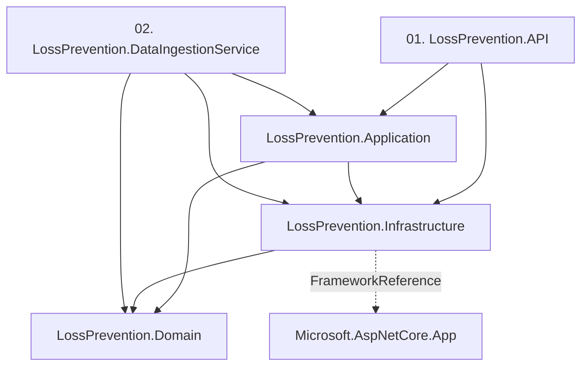
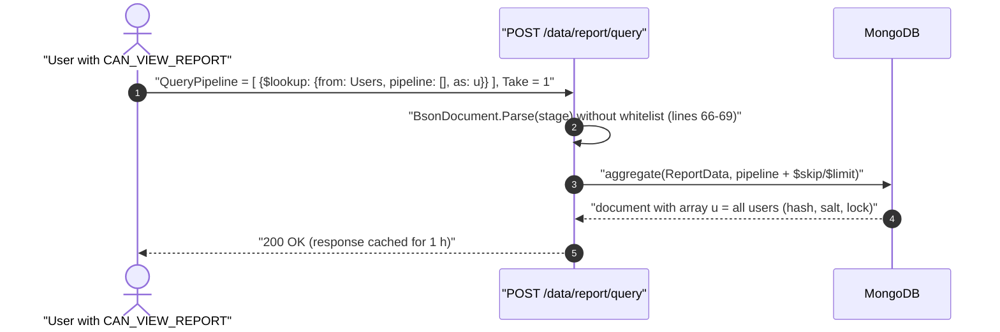
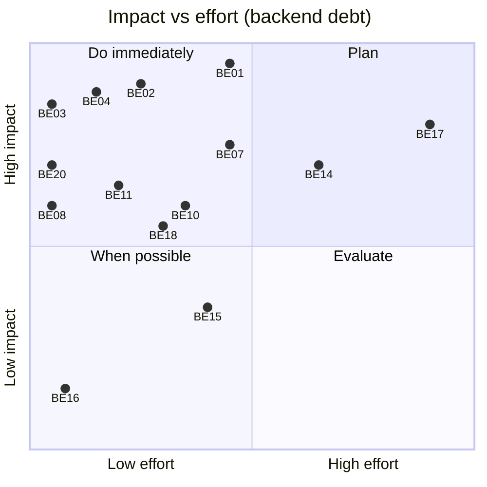
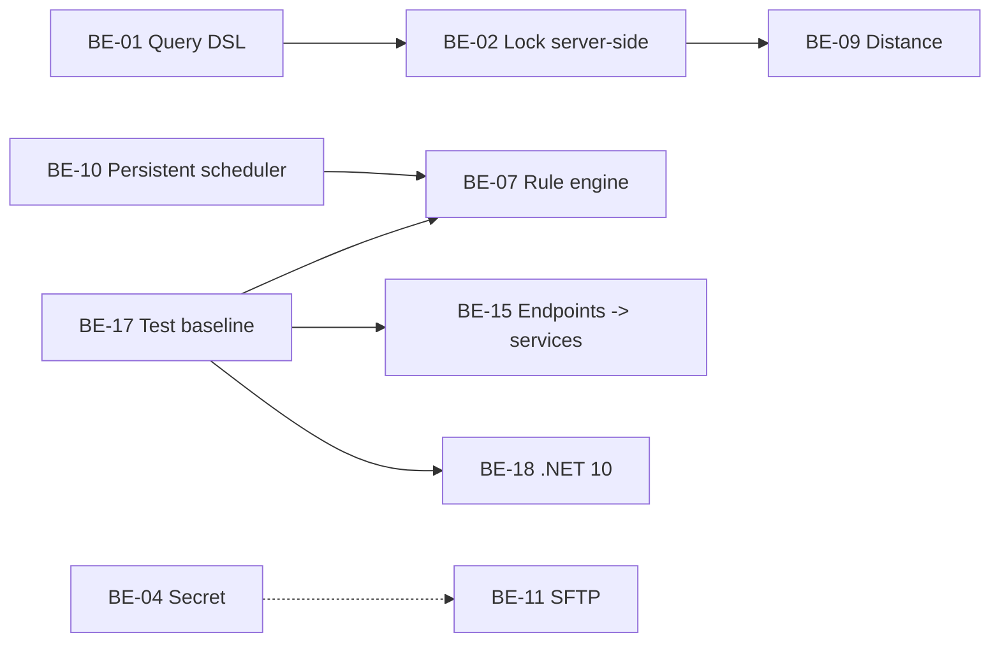
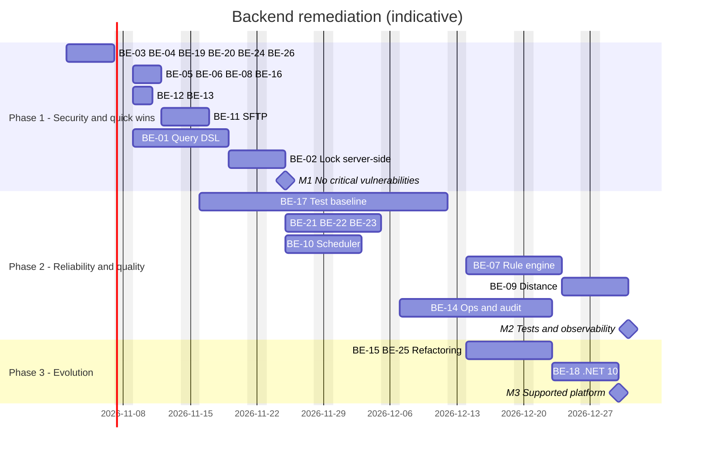
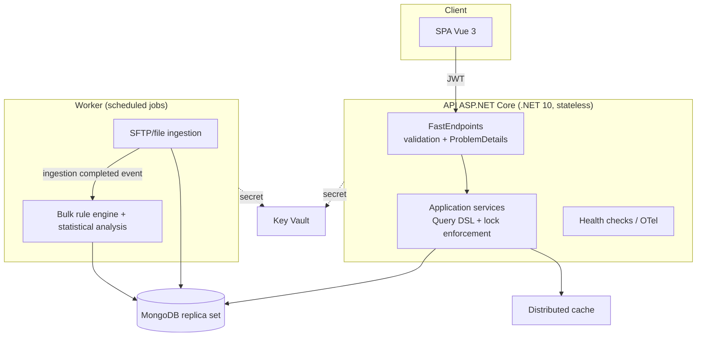

<!-- IMPACT-META
schema: 1
mode: how
step: 17_backend_deep_assessment
commit: fc7d820908b8b230fb47a2669920ba7efdb413a8
commit_short: fc7d820
branch: main
worktree: dirty
baseline_date: 2026-10-07T18:19:51+02:00
generated_at: 2026-10-08T10:05:26+02:00
-->
# Backend Deep Assessment - LOSS_PREVENTION Project

> **Baseline commit:** `fc7d820` (`main`) · worktree `dirty` (local changes only in `Docs/` and `.github/`; application code identical to the commit)

**Date**: 2026-10-08 · **Version**: 1.1 · **Authors**: REVERSE how / IMPACT verify · **Audience**: Backend Architect, Tech Lead, Senior Backend Developer, CTO

> **Prompt adaptation (Java/Spring Boot → .NET 8).** The reference prompt is written for Java/Spring Boot; the analyzed backend is **.NET 8 + FastEndpoints 6 + MongoDB.Driver 3.4**. Each requirement has been mapped to the .NET equivalent indicated below; requirements without an equivalent are marked `N/A per stack .NET: <motivo>`.

| Java/Spring requirement in the prompt | Analyzed .NET equivalent |
|---|---|
| Maven multi-module, `pom.xml`, parent POM/BOM | Solution `LossPrevention.sln` with 5 `.csproj` projects (SDK-style), `PackageReference`, `ProjectReference` |
| Spring Boot / Spring MVC `@RestController` | ASP.NET Core 8 minimal hosting + **FastEndpoints** (REPR pattern: one class per endpoint) |
| JPA/Hibernate, Spring Data repositories | **MongoDB.Driver** + generic repository `MongoRepository<T>`; no relational ORM |
| Flyway / Liquibase | No migration tool; `Data/MongoDBScripts/*.js` scripts and initialization code |
| Spring Security, `@PreAuthorize` | `AddAuthentication().AddJwtBearer` + FastEndpoints `Permissions("CAN_*")` (claim `permissions`) |
| Bean Validation (JSR-380), `@Valid` | FluentValidation (FastEndpoints `Validator<T>`) + manual validations in the handlers |
| `@ControllerAdvice` | ASP.NET Core middleware/exception handler, `ProblemDetails` (absent) |
| `@Transactional` | MongoDB sessions/transactions (`IClientSessionHandle`), absent |
| Spring Cache `@Cacheable` / Hibernate L2 | `IMemoryCache` (1 point of use); L2 cache N/A |
| Spring Boot Actuator, Micrometer | `AddHealthChecks`, OpenTelemetry/`System.Diagnostics.Metrics` (absent) |
| SLF4J/Logback, MDC | `ILogger<T>` (Microsoft.Extensions.Logging), logging scopes (used in 4 files) |
| `@Scheduled`, Spring Batch | `BackgroundService` (`DataIngestionBackgroundService`) + bulk load console app |
| RestTemplate/WebClient | `HttpClient` (no usage), SSH.NET for SFTP, `SmtpClient` |
| JUnit/Mockito/TestContainers | xUnit/NUnit, Moq/NSubstitute, `WebApplicationFactory`, Testcontainers.MongoDb (none present) |
| `mvn dependency:tree`, OWASP Dependency-Check | `dotnet list package --vulnerable/--outdated` (SDK not available during the analysis) → replaced by querying the NuGet API |
| HikariCP, Tomcat thread pool, GC JVM | `MongoClient` connection pool, .NET/Kestrel thread pool, .NET GC (`ServerGarbageCollector`) |
| Java 17/21 LTS, Spring Boot LTS | .NET 8 LTS (end of support 10-nov-2026) → .NET 10 LTS |

---

## Executive Summary

The backend is a .NET 8 modular monolith with readable layering but **not production-ready**: it exposes a critical attack surface (arbitrary MongoDB pipelines from the client, password hashes and SFTP passwords returned by the APIs, versioned secrets), does not enforce the row-level lock server-side, has no tests or observability, and implements the rule engine with full scans and document-by-document writes.

### Overall Health Score: **3.9 / 10**

**Assessment Date**: 2026-10-08 · **Codebase Version**: commit `fc7d820` (`main`) · **Total**: 232 C# files, **10,760 non-blank lines** (IMPACT canonical; 10,143 SLOC cloc, see [14_metrics.md](14_metrics.md)) · **Modules analyzed**: 5 `.csproj` projects (net8.0)

### Architecture Quality Assessment

Scorecard on the 7 dimensions required by the prompt, scores 0–10 with evidence; the overall score is the simple arithmetic mean (equal weights).

| Dimension | Score | Status | Main evidence (section) |
|-----------|-------|--------|-------------------------------|
| Modularity | 6/10 | 🟠 | 5 acyclic projects, consistent REPR (§1); but Application → Infrastructure (inversion), Domain entities coupled to `MongoDB.Bson` (22 `[Bson*]` attributes), inconsistent namespaces |
| Security | 3/10 | 🔴 | PBKDF2 600k ✅ and permissions on 74/78 endpoints ✅; but arbitrary pipeline (`GetReportDataEndpoint.cs:66-71`), hash/salt in `UserDTO.cs:7-8`, SFTP password returned by `GET /api/data-ingestion`, versioned JWT secret, lock not enforced by the server, 2 High advisories on SSH.NET (§4.3, §8) |
| Performance | 4/10 | 🔴 | Scoped `MongoClient` (`InfrastructureServiceExtensions.cs:33-37`), full scan + `ReplaceOneAsync` per document (`RulesService.cs:34-58`), double aggregation per query (`ReportDataservice.cs:40-52`); 1 h cache and TTL indexes present (§3, §9) |
| Scalability | 4/10 | 🔴 | Stateless JWT API ✅; in-process scheduler with in-memory `LastRunAt`, local `IMemoryCache`, no distributed lock ⇒ only a single instance is safe (§9.2) |
| Testability | 2/10 | 🔴 | 0 tests; constructor DI everywhere and pure static helpers (`RuleHelper`, `DistanceHelper`, `BsonHelper`, `PasswordHasher`) easily testable; 20 endpoints access the repository directly (§11) |
| Maintainability | 6/10 | 🟠 | Average CCN 2.5, 6 functions with CCN > 15; duplication 8.58 % (FraudDetection Create/Update 341 cloned lines), dead code (Dapper 205 commented-out lines) (§15) |
| Observability | 2/10 | 🔴 | `ILogger` in only 4 files, 6 `Console.WriteLine`, no health check, metric, tracing or audit log (§10, §16) |

**Calculation**: (6 + 3 + 4 + 4 + 2 + 6 + 2) / 7 = 27 / 7 = 3.857 → **3.9 / 10**.

> Version note: v1.0 reported 5.0/10 on 7 dimensions different from those of the prompt (including "Stack/aggiornamento" = 8) and without an explicit calculation; the value has been recalculated on the prompt's dimensions.

**Overall Assessment**: **poor** health. The foundations (REPR, DI, PBKDF2, validated JWT) are recoverable, but before any network exposure Phase 1 of the roadmap must be completed (§19.1: P1 vulnerabilities and quick wins, ≈ 18.5–25.5 days).

### Top 5 Critical Issues

#### 1. 🔴 Arbitrary aggregation pipeline from the client (Priority: CRITICAL)
- **Impact**: HIGH — `POST /data/report/query` converts every received stage with `BsonDocument.Parse(x.ToString())` and runs the aggregation on `ReportData` without a whitelist (`GetReportDataEndpoint.cs:66-71`, `ReportDataservice.cs:40-52`).
- **Affected**: all users with `CAN_VIEW_REPORT`.
- **Business Impact**: with `$lookup`/`$unionWith` **other collections** can be read (`Users` with hash/salt, `PasswordResetTokens`, `DataIngestionConfigurations` with SFTP passwords); costly stages without limits cause DoS. Writing via `$out`/`$merge` is instead blocked in practice because the server always appends `$count` or `$limit` (lines 41 and 50): v1.0 indicated it as possible, and this has been corrected.
- **Effort**: 6–8 days · **Recommendation**: server-side query DSL with a whitelist of stages/operators/fields (BE-01).

#### 2. 🔴 Credentials exposed by the APIs and in the repository (Priority: CRITICAL)
- **Impact**: HIGH — `UserDTO` includes `PasswordHash`/`PasswordSalt` (`UserDTO.cs:7-8`), returned by 5 endpoints (`GetUsersEndpoint.cs:36`, `GetUserByIdEndpoint.cs:56-57`, `GetUserByUsernameEndpoint.cs:55-56`, `GetUserRolesPermissionEndpoint.cs:59-60`, `CreateUserEndpoint.cs:63-64`); `GET /api/data-ingestion` returns `SftpPassword` in clear text (`GetDataIngestionConfigurationEndpoint.cs:41`); `JwtSettings.SecretKey` (36 characters, value omitted) versioned in `appsettings.json`; `Data/LossPrevention/*.bson` dump versioned with user hashes and SFTP passwords.
- **Business Impact**: account compromise and forging of valid JWTs by anyone with access to the repository.
- **Effort**: 2.5–3.5 days · **Recommendation**: BE-03 + BE-04.

#### 3. 🔴 Row-level lock not enforced by the server (Priority: CRITICAL)
- **Impact**: HIGH — the login puts `LockField`/`LockValue` into the JWT (`LoginEndpoint.cs:65-69`), but no backend service reads them: the filter is applied only by the frontend (`helpers/fieldLock.ts`).
- **Business Impact**: a store manager sees the data of all stores (GDPR, necessity principle).
- **Effort**: 2–4 days (after BE-01) · **Recommendation**: BE-02.

#### 4. 🟠 Non-scalable rule engine and data access (Priority: HIGH)
- **Impact**: MEDIUM-HIGH — `ApplyRulesAsync` loads the entire collection (`RulesService.cs:34`) and rewrites every document with `ReplaceOneAsync` (`:57-58`); `UpdateRuleAsync` writes the flag at the root of the document instead of in `FraudFlags.*` (`:147`, bug); scoped `MongoClient` creates a pool per request.
- **Business Impact**: time and memory proportional to the volume; wrong anti-fraud flags after a rule update.
- **Effort**: 5.5–8.5 days · **Recommendation**: BE-07 + BE-08.

#### 5. 🟠 No tests, observability or audit (Priority: HIGH)
- **Impact**: MEDIUM — 0 test projects, no health check, structured log, metric or audit trail of anti-fraud decisions.
- **Business Impact**: undetectable regressions, high MTTR, no traceability for disputes or compliance checks.
- **Effort**: 23–32 days · **Recommendation**: BE-17 + BE-14.

### Top 5 Recommendations (with ROI)

> ROI is expressed qualitatively: infrastructure costs, rates and production volumes are not derivable from the code (N/A — not derivable from the code: no economic or load data in the repository).

| # | Recommendation | Effort | Expected impact | ROI |
|---|---|---|---|---|
| 1 | User DTO without hash, SFTP password never returned nor in clear text, secrets in a vault + rotation (BE-03, BE-04) | 2.5–3.5 days | Closes 2 critical vectors at minimal cost | ⭐⭐⭐⭐⭐ |
| 2 | Server-side query DSL + lock enforcement (BE-01, BE-02) | 8–12 days | Eliminates cross-collection exfiltration and row-level violation | ⭐⭐⭐⭐⭐ |
| 3 | Singleton `MongoClient` + rule engine with server-side bulk updates (BE-08, BE-07) | 5.5–8.5 days | From N round-trips to a few operations; fixes the `UpdateRuleAsync` bug | ⭐⭐⭐⭐ |
| 4 | xUnit + Testcontainers.MongoDb test baseline (BE-17) | 15–20 days | Enables safe refactoring and upgrades | ⭐⭐⭐⭐ |
| 5 | Health checks, structured logging, exception handler + ProblemDetails, audit (BE-14, BE-21) | 10–15 days | Operability and compliance | ⭐⭐⭐ |

### Metrics Snapshot

#### Performance Metrics

| Metric | Current | Target | Status |
|---|---|---|---|
| P95 / P99 latency, throughput, error rate | N/A — not derivable from the code: no running environment, logs or APM | p95 < 500 ms on `/data/report/query` | ⚪ |
| DB queries per report request | 2 aggregations + 1 mapping read in the service + 1 unused mapping read in the endpoint (`GetReportDataEndpoint.cs:64`) | 1 aggregation (`$facet`) | 🟠 |
| Writes per `ApplyRules` | N `ReplaceOneAsync` (N = `ReportData` documents) | 1 `UpdateMany`/pipeline update per rule | 🔴 |

#### Code Quality Metrics

| Metric | Current | Target | Status |
|---|---|---|---|
| Test coverage | 0 % | > 70 % core services | 🔴 |
| Cyclomatic complexity | 475 functions, average 2.5, 6 > 15, 17 > 10, max 24 | < 10 per method | 🟢 average / 🟠 hotspot |
| Code duplication | 8.58 % (56 clones, 1,052 lines) | < 5 % | 🟠 |
| Methods > 50 NLOC | 18 | 0 | 🟠 |
| Tech debt ratio / maintainability rating | N/A — not derivable from the code: SonarQube not run | A | ⚪ |

#### Security Metrics

| Metric | Current | Target | Status |
|---|---|---|---|
| Advisories on direct packages | 2 High (SSH.NET 2025.1.0) | 0 | 🔴 |
| Deprecated packages | 1 (`Microsoft.AspNetCore.Http.Features` 5.0.17) | 0 | 🟠 |
| Direct packages not on the latest stable | 14/15 (the only exception `Microsoft.AspNetCore.Http.Features`, stuck at 5.0.17 because deprecated) | < 20 % | 🔴 |
| Security hotspots in the code | 8 (BE-01, 02, 03, 04, 11, 12, 13, 19) | 0 | 🔴 |

#### Operational Metrics

| Metric | Current | Target | Status |
|---|---|---|---|
| Uptime, MTTR, MTBF, deployment frequency | N/A — not derivable from the code: no environment, pipeline or incident history | 99.5 % / < 1 h | ⚪ |
| Health check / metrics / tracing | 0 / 0 / 0 | present | 🔴 |

---


## Detailed Technical Analysis

### 1. Modular Architecture Assessment (≙ Maven Multi-Module)

The solution is a modular monolith of 5 projects with acyclic dependencies; the layering is recognizable but has an inversion (Application → Infrastructure) and inconsistent namespace boundaries.

#### 1.1 Multi-Module Structure

**Mapping**: parent `pom.xml`/BOM → `LossPrevention.sln` + SDK-style `.csproj`; there is no `Directory.Build.props`, `Directory.Packages.props` (Central Package Management), `global.json`, `nuget.config` nor `.editorconfig` ⇒ versions and properties are repeated in every project.

| Project (`.csproj`) | Target | C# files | Non-blank lines | ProjectReference | Responsibility |
|---|---|---|---|---|---|
| `01. LossPrevention.API` | net8.0 (Web SDK) | 79 | 4,347 | Application, Infrastructure | Kestrel host, 78 FastEndpoints endpoints, DI, JWT |
| `LossPrevention.Application` | net8.0 | 121 | 5,005 | Domain, Infrastructure | Services, DTOs, request/response handlers, helpers, validators |
| `LossPrevention.Domain` | net8.0 | 21 | 519 | — (only `MongoDB.Bson`) | 19 entities + 2 exceptions |
| `LossPrevention.Infrastructure` | net8.0 | 10 | 784 | Domain + `FrameworkReference Microsoft.AspNetCore.App` | Mongo repositories, DI, `PasswordHasher`, `EmailService` |
| `02. LossPrevention.DataIngestionService` | net8.0 (console) | 1 | 105 | Application, Domain, Infrastructure | XML bulk load from the file system |
| **Total** | | **232** | **10,760** | | |

All projects have `Nullable` and `ImplicitUsings` enabled. The `.csproj` names contain spaces and numeric prefixes ("01. …", "02. …"), which complicates CLI scripts and Dockerfiles.



| Prompt criterion | Assessment | Evidence |
|---|---|---|
| Separation of concerns | 🟠 | Application depends on Infrastructure (in Clean/Onion, dependencies should point toward Domain/Application) |
| Circular dependencies | ✅ absent | Graph above is acyclic |
| Shared/common module | 🟠 | No "Contracts/Shared" project; DTOs in Application, used directly by the endpoints |
| Module boundaries | 🟠 | `DataIngestionBackgroundService` lives in `LossPrevention.Application/Services/DataIngestion/` with namespace `LossPrevention.Infrastructure.Services`; the Workspace entities in Domain use the namespace `LossPrevention.Application.Entities.Workspaces` |
| Build/versioning | 🟠 | No central build file; assembly version not set |
| Empty folders | 🟡 | `<Folder Include="Endpoints\Login\" />` in the API csproj, while the login lives in `Endpoints/User/` |

#### 1.2 Package Structure Analysis

**Mapping**: Java package → C# namespace/folders. The organization is **by layer** at project level and **by feature** inside API (`Endpoints/<Feature>`) and partially in Application.

| Project | Folders (no. of files) |
|---|---|
| API `Endpoints/` | Dashboard 5 · Data 3 · DataIngestion 8 · FraudDetection 3 · Groups 7 · Mappings 4 · Notifications 5 · Rules 6 · User 32 · Workspaces 5 = **78** |
| Application | DTO 21 · Handlers 52 (Requests 47, Responses 5) · Helpers 6 · Interfaces 17 · Mappings 3 · Services 20 · Validators 2 |
| Infrastructure | Configuration 2 · Helpers 1 · Interfaces 1 · Repositories 4 · Services 1 |
| Domain | Entities 19 (in 11 subfolders) · Exceptions 2 |

- Naming: `Endpoint` suffix consistent except for `Workspaces/CreateWorkspace.cs`; `ReportDataservice`, `IDistanceDataservice` with a lowercase "s" (but the class in `DistanceDataservice.cs:11` is `DistanceDataService`); the file `IndexSuggestionHelper.cs` contains the class `IndexService`.
- Visibility: classes are `public`; neither `internal` nor `InternalsVisibleTo` is used, so layer boundaries are not enforced by the compiler.
- God package: `Endpoints/User` (32 files: users, roles, permissions, login, password reset) should be split into `Users`, `Roles`, `Permissions` and `Auth`.

---

### 2. Domain Model & Business Logic

The domain is **anemic**: 19 entities with properties only and 22 `[Bson*]` attributes; all the logic lives in services, static helpers and endpoints. The statistical anti-fraud engine (z-score, thresholds, distance) is implemented **in the frontend** (`fraudDetectionStore.ts`); the backend only runs min/max rules and the Euclidean distance.

#### 2.1 Domain-Driven Design Assessment

| DDD concept | Status | Evidence |
|---|---|---|
| Entities | Present as persisted POCOs | `Domain/Entities/**` (e.g. `User.cs` 21 lines, `FraudDetectionSettings.cs` 230 lines of properties only) |
| Value Objects | Absent | thresholds, ranges and coordinates are `decimal`/`double`/`string` (primitive obsession) |
| Aggregates / invariants | Absent | e.g. adding a member to a group is done in the endpoint by reading the document and rewriting the entire `Members` list (`AddMemberToGroupEndpoint.cs:56-63`): read-modify-write without optimistic concurrency, hence with possible lost updates |
| Domain services | Absent as a concept | the logic is in `Application/Services` and `Application/Helpers` |
| Domain events | Absent | no event mechanism; ingestion → mapping → rules are direct or manual calls |
| Repository | Generic per document | `IMongoRepository<T>` (Infrastructure) |
| Bounded context | Implicit | Users/IAM, Ingestion, Reporting/Query, Rules/Anti-fraud, Collaboration (groups, notifications, workspaces, dashboards) |
| Ubiquitous language | Partial | "ReportData" denotes both the transactions and the analysis dataset; states as magic strings (`"one-time"`, `"recurring"`, `"daily"`, `"weekly"`) |
| Domain exceptions | Defined but unused | `DeleteUserRoleException`, `InvalidCustomerException`: 0 references in the code |
| Coupling to the driver | 🔴 | Domain entities decorated with `[BsonId]`, `[BsonRepresentation]`, `[BsonElement]` ⇒ the Domain depends on MongoDB.Bson |

#### 2.2 Business Logic Organization

| Prompt topic | .NET equivalent | Status | Evidence |
|---|---|---|---|
| Service layer | `*Service` classes registered as scoped in DI | 🟠 | 20 services, but **20 endpoints** inject `IMongoRepository<T>` directly (CRUD of groups, notifications, dashboards, fraud settings) |
| Transaction management (`@Transactional`) | `IClientSessionHandle` / `WithTransaction` | 🔴 absent | 0 occurrences of `StartSession`/`TransactionScope`; in `FileProcessingCoordinator` the `InsertManyAsync` of the data (`:304`) and the marking in `ProcessedFiles` (`:408-410`) are not atomic ⇒ a crash between the two causes duplicate re-imports |
| Validation | FluentValidation / `AddError` | 🟠 | only 4 validator classes (dashboard: `CreateDashboardValidator.cs:7,18,29`, `UpdateDashboardValidator.cs:6`, with **two** `UpdateDashboardValidator` for the same request type in different namespaces); in the other endpoints, manual checks with `AddError` |
| Business rule complexity | lizard | 🟢/🟠 | Average CCN 2.5; hotspots: `UpdateDataIngestionConfigurationEndpoint.HandleAsync` CCN 24 (`:23-101`), `BsonHelper` CCN 20-21, `MappingService` (428 lines) |
| God classes | > 400 lines / many responsibilities | 🟠 | `MappingService` 428 lines (schema discovery + CRUD + batch), `FileProcessingCoordinator` 424 lines (orchestration, SFTP, parsing, persistence, idempotency) |
| Logic in the wrong place | | 🔴 | statistical anti-fraud algorithm and row-level lock only in the frontend; rules loaded and then ignored in the console (`DataIngestionService/Program.cs:38-47`) |

Verified business logic bugs:
- `RulesService.UpdateRuleAsync` (`RulesService.cs:141-155`) updates the flag at the **root** of the document instead of in `FraudFlags.<campo>`, so the flags remain inconsistent with `ApplyRulesAsync`.
- `CreateTransactionEndpoint.cs:49-50` does not work (see BE-05).
- `XmlProcessingService.cs:43` throws `NotImplementedException` on `InsertManyAsync`, even though it is registered as `IFileProcessingService` (`Program.cs:102`).
- `IXmlEnrichmentRule` has 0 implementations.

---

### 3. Persistence Layer Deep Dive

**Mapping**: JPA/Hibernate → MongoDB.Driver 3.4 with a generic repository. The prompt's requests about lazy loading, entity graphs and dirty checking are `N/A per stack .NET: nessun ORM né change tracking, il driver Mongo mappa i documenti con BsonSerializer`. Projection, indexes, the N+1 pattern and pooling remain relevant instead.

#### 3.1 JPA/Hibernate Usage (≙ MongoDB.Driver)

| Topic | Observation | Evidence | Severity |
|---|---|---|---|
| Client lifetime / pool (≙ HikariCP) | `AddScoped<IMongoClient>(… new MongoClient(...))`: a new client, with its own connection pool, for every HTTP request; the MongoDB guidance recommends a singleton | `InfrastructureServiceExtensions.cs:33-37`; second constructor with `new MongoClient(connectionString)` in `MongoRepository.cs:20-25` | 🔴 |
| Mapping | Typed POCOs + dynamic `BsonDocument` for `ReportData` | `IMongoRepository<BsonDocument>` in `FileProcessingCoordinator.cs:27` | 🟢 (intended dynamic schema) |
| Fetch / projections | No projection: entire documents are loaded even when only a few fields are needed | `RulesService.cs:34`, `DistanceDataservice.cs:34-36` | 🟠 |
| N+1 (≙ lazy loading) | `ReplaceOneAsync` per document in the rules loop; permission lookup per role in the login | `RulesService.cs:57-58`; `LoginEndpoint.cs:55-63` | 🔴 / 🟡 |
| Full scan | `FindManyAsync(_ => true …)` / `Filter.Empty` | `MappingService.cs:149,163`; `IndexSuggestionHelper.cs:23`; `DataIngestionService.cs:23,178`; `ListNotificationsEndpoint.cs:30` | 🟠 |
| Double aggregation | count + page executed as two separate pipelines | `ReportDataservice.cs:40-52` | 🟠 |
| Batch insert | API: `InsertManyAsync` per file ✅; console: `InsertOneAsync` per document | `FileProcessingCoordinator.cs:304,374`; `DataIngestionService/Program.cs:102` (constant `BatchSize` at `:25` never used) | 🟠 |

#### 3.2 Repository Pattern

`IMongoRepository<T>` / `MongoRepository<T>` (Infrastructure) offers generic CRUD; there are no derived query methods (≙ Spring Data) nor specifications.

| Problem | Evidence |
|---|---|
| Leaky abstraction: `public IMongoCollection<TDocument> Collection` exposed to callers | `MongoRepository.cs:27`; used to access **other** collections, e.g. `ProcessedFiles` via `Collection.Database.GetCollection` (`FileProcessingCoordinator.cs:390-392, 408-410`) |
| Duplicate registration of `IMongoRepository<User>` (the second one wins) | `InfrastructureServiceExtensions.cs:65-70` and `:72-77` |
| Collection names hardcoded outside the configuration | `"PasswordResetTokens"` (`InfrastructureServiceExtensions.cs:83`), `"ProcessedFiles"` (`FileProcessingCoordinator.cs:391`) |
| Generic and naive index creation: only ascending single-field indexes, `.Take(20)` | `MongoRepository.cs:29-40` |
| Dead code: `DapperRepository` of 205 lines entirely commented out | `LossPrevention.Infrastructure/Repositories/DapperRepository.cs` |
| Bypass of the service layer: 20 endpoints use the repository directly | e.g. `ListNotificationsEndpoint.cs:30`, `CreateGroupEndpoint.cs:34` |

#### 3.3 Database Schema Analysis

MongoDB is schemaless: there are no DB constraints, FKs nor JSON Schema validators. The 13 collections are configured in `appsettings.json` (`MongoDbSettings`), plus `PasswordResetTokens` and `ProcessedFiles` hardcoded.

| Aspect | Status | Evidence |
|---|---|---|
| Application indexes | Only a TTL on `ReportData.BeginDateTime` (expireAfter = retention days) created by the API | `DatabaseInitializationService.cs:43-105` |
| Suggested indexes | Created **only** by the console job through `IndexService.ProcessIndexesAsync`, on a sample of 100 documents | `DataIngestionService/Program.cs:68,116-117`; `IndexSuggestionHelper.cs:23` |
| Uniqueness | No unique index on `Users.Username`/`Email`: uniqueness checked only by the application (race condition possible) | `UserService.cs:56-67` |
| Reset token TTL | No TTL index on `PasswordResetTokens` (expiry is only logical, `PasswordResetService.cs:65`) | — |
| Retention | `TransactionRetentionDays` = 180 in config, default in the code 90 | `appsettings.json`; `DatabaseInitializationService.cs:23` |
| Referential integrity | Managed by the application (user ids in groups, roles in permissions); no cascading deletion | `AddMemberToGroupEndpoint.cs:56-59` |
| Normalization | Transactional data denormalized and "flattened" from XML into `ReportData` (a choice suited to reports); metadata `_sourceFile`, `_processedAt`, `_sourceType` | `FileProcessingCoordinator.cs:298-300, 368-370` |
| Versioned dump | `Data/LossPrevention/*.bson` (e.g. `ReportData.bson` ≈ 3.5 MB; `Users.bson` with hashes; `DataIngestionConfigurations.bson` with SFTP passwords) + scripts `Data/MongoDBScripts/00…04 *.js` | `Data/` folder |

---

### 4. API Layer Assessment

The API exposes 78 FastEndpoints endpoints protected by declarative permissions (74/78), but with an inconsistent REST design, documentation only in Development and some critical vulnerabilities in the contract.

#### 4.1 REST API Design

| Verb | Endpoints |
|---|---|
| GET | 27 |
| POST | 24 |
| PUT | 11 |
| DELETE | 14 |
| PATCH | 2 |
| **Total** | **78** (4 `AllowAnonymous`, 74 with `Permissions(...)`) |

| Criterion | Status | Evidence / example |
|---|---|---|
| Resource naming | 🟠 | 10 routes with verbs in the URL (e.g. `Post("/permissions/create")` `CreatePermissionEndpoint.cs:17`, `Post("/users/update")` `UpdateUserEndpoint.cs:20`, `Delete("/roles/delete")` `DeleteRoleEndpoint.cs:16`, `Post("/data/create-transactions")` `CreateTransactionEndpoint.cs:18`) |
| Use of HTTP verbs | 🔴 | `GET /rules/apply` performs a massive **write** (`ApplyRulesEndpoint.cs:18-19`); the report and distance queries use POST (`/data/report/query`, `/distance`) to have a body (acceptable, but not idempotent by semantics) |
| Prefixes / versioning | 🔴 | only 11 routes have the `/api` prefix (data-ingestion, fraud-detection); no versioning (neither `/v1` nor header) |
| Status codes | 🟠 | use of the FastEndpoints helpers (`SendOkAsync` 72, `SendErrorsAsync` 45, `SendNotFoundAsync` 40, `SendNoContentAsync` 5, `SendCreatedAtAsync` 2, `SendUnauthorizedAsync` 1); creations often returned with 200 instead of 201 |
| Login response contract | 🔴 | `CreateTokenAsync` is not awaited (`LoginEndpoint.cs:39`): a `Task` is serialized, and the frontend reads `token.result` |
| DTO pattern | 🟠 | dedicated requests/responses in `Application/Handlers`, but `UserDTO` exposes `PasswordHash`/`PasswordSalt` (`UserDTO.cs:7-8`); manual mapping (no AutoMapper/Mapster) |
| Pagination | 🟠 | `Skip`/`Take` only on the report query; lists (notifications, groups, dashboards, users) without pagination |
| HATEOAS | N/A for the .NET stack: neither required by the frontend nor adopted; no benefit for an internal SPA |

#### 4.2 API Documentation

| Aspect | Status | Evidence |
|---|---|---|
| OpenAPI (≙ SpringDoc) | `FastEndpoints.Swagger` (NSwag), document "Loss Prevention API" v1.0 | `Program.cs:53-61` |
| Exposure | only in Development | `Program.cs:121-126` |
| Descriptions | 33 `/// <summary>` comments in the whole backend; 54 occurrences of `Summary(` and 31 of `Description(` in the endpoint configuration; no request/response examples | grep on `*.cs` |
| Security scheme | N/A — not derivable from the code without a runtime: the presence of the bearer scheme in the generated document cannot be verified (SDK not available); no explicit configuration in `SwaggerDocument` |
| Contract-first / client generation | Absent: the frontend uses hand-written axios calls | `LossPrevention.UI/src/api/api.ts` |

#### 4.3 API Security

| Control | Status | Evidence |
|---|---|---|
| Authentication | ✅ JWT Bearer HS256 with validation of issuer, audience, lifetime and signature | `Program.cs:63-76` |
| Authorization | ✅ declarative on 74/78 endpoints (`Permissions("CAN_*")`); ❌ no row-level/ownership check | e.g. `GetReportDataEndpoint.cs:29` |
| Input validation / injection | 🔴 arbitrary pipeline: `BsonDocument.Parse(x.ToString())` on every stage | `GetReportDataEndpoint.cs:66-69` |
| Mass assignment / fields chosen by the client | 🟠 `StartDateField`/`EndDateField` chosen by the client in `/distance` | `GetDistanceEndpoint.cs:39-40` |
| Sensitive data exposure | 🔴 hash/salt in 5 responses; `SftpPassword` in `GET /api/data-ingestion` and in the update response | `GetDataIngestionConfigurationEndpoint.cs:41,83` |
| Information leakage | 🟡 `ex.Message` returned to the client in 13 places | e.g. `GetReportDataEndpoint.cs:87`, `ClearDataIngestionConfigurationEndpoint.cs:31` |
| Rate limiting (≙ Bucket4j) | 🔴 absent (`AddRateLimiter` not used); no lockout on `/users/login` nor on forgot-password | grep: 0 occurrences |
| CORS | 🟠 hardcoded origins `http://localhost:5173`, `http://localhost:5174` with `AllowCredentials` | `Program.cs:24-34` |
| CSRF | N/A for the .NET stack: token in the `Authorization` header, not in a cookie ⇒ CSRF not applicable |
| Notifications | 🟠 `ListNotificationsEndpoint` returns all notifications (`Filter.Empty`) to anyone with `CAN_VIEW_NOTIFICATIONS` | `ListNotificationsEndpoint.cs:20-21,30` |



---

### 5. Microservices Architecture (if applicable)

The system is a **monolith** (1 API + 1 batch console, shared database): the microservices requirements are assessed only as readiness.

#### 5.1 Service Decomposition
- N/A for the .NET stack: monolith, no independent services, service discovery (≙ Eureka) or API gateway (≙ Spring Cloud Gateway).
- Future candidates for extraction, based on the bounded contexts (§2.1): **Ingestion/analysis worker** (SFTP, parsing, rules, statistical analysis: CPU/IO load different from the API) and **Identity** (replaceable with an OIDC IdP).

#### 5.2 Resilience Patterns
| Pattern (≙ Resilience4j) | .NET equivalent | Status |
|---|---|---|
| Circuit breaker, retry, timeout, bulkhead | Polly / `Microsoft.Extensions.Http.Resilience` | 🔴 absent; only explicit timeout: SFTP 30 s (`SftpFileProcessingService.cs:59`); no `HttpClient` in the backend |
| Mongo retry | driver `retryWrites`/`retryReads` (default `true` in driver 3.x) | 🟢 driver default, not configured explicitly |
| Fallback | — | 🔴 an SFTP/SMTP error terminates the operation with `catch (Exception)` and a log |
| Distributed tracing (≙ Sleuth/Zipkin) | OpenTelemetry | 🔴 absent |

---

### 6. Integration Layer Analysis

The integrations are SFTP (SSH.NET), local file system and SMTP; messaging is absent.

#### 6.1 External Integrations

| Integration | Implementation | Problems | Evidence |
|---|---|---|---|
| SFTP (SSH.NET 2025.1.0) | `SftpClient` with password | password in clear text in the DB (`DataIngestionConfiguration.cs:19`) and returned by the API; **no host key verification** (no `HostKeyReceived` handler); 30 s timeout; the file is downloaded and processed, then **downloaded again** from the `processed/` folder with a second client for insertion into the DB; at every run the whole `processed/` folder is listed again | `SftpFileProcessingService.cs:56,59`; `FileProcessingCoordinator.cs:226-338` (second client `:236-240`, `ListDirectory` `:255`) |
| File system | Reading of local files (XML/CSV/JSON) and temporary files in `Path.GetTempPath()` | hardcoded console path `C:\xmlstore5\xml` | `DataIngestionService/Program.cs:76`; `FileProcessingCoordinator.cs:281` |
| SMTP | `System.Net.Mail.SmtpClient` (API obsolete for new development) | `EnableSsl = false`, `UseDefaultCredentials = true`, host `localhost:25` | `EmailService.cs:63-66` |
| HTTP to third parties (≙ RestTemplate/WebClient/Feign) | `HttpClient` | N/A: no outgoing HTTP calls from the backend (the Ollama LLM is called by the frontend) | grep `HttpClient`: 0 |

#### 6.2 Messaging & Event-Driven

N/A for the .NET stack: no broker (≙ Kafka/RabbitMQ; in .NET MassTransit, Azure Service Bus); the ingestion → mapping → rules pipeline is synchronous (`FileProcessingCoordinator.cs:105-108`) or manual (`GET /rules/apply`). An "ingestion completed" event is the most natural decoupling point for a future worker.

---

### 7. Caching Strategy

The only cache is `IMemoryCache` on the report queries: useful to reduce the load, but never invalidated and independent of the user.

#### 7.1 Application-Level Caching

| Aspect (≙ Spring Cache/Caffeine/Redis) | Status | Evidence |
|---|---|---|
| Provider | In-process `IMemoryCache` | `Program.cs:49` |
| Points of use | 1: `GetReportDataEndpoint` | `GetReportDataEndpoint.cs:55-62,81` |
| Key | `report-query:` + Base64(SHA256(serialized request)) | `GetReportDataEndpoint.cs:92-97` |
| TTL | 1 h absolute | `:81` |
| Invalidation | 🔴 absent: after ingestion, `ApplyRules` or rule changes, stale data is served for up to 1 h | — |
| Security | 🟠 the key contains neither the user nor the lock: irrelevant today (lock only client-side), it becomes a cross-user leak when BE-02 is introduced | — |
| Distribution | 🔴 local per instance; no `IDistributedCache`/Redis | — |
| Cache stampede | 🟡 no protection (identical concurrent requests all run the aggregation) | — |

#### 7.2 Second-Level Cache

N/A for the .NET stack: no ORM with a second-level cache (Hibernate L2/EhCache); the MongoDB driver has no equivalent. The query cache is covered in §7.1.

---


### 8. Security Assessment

Security is the weakest dimension: the cryptographic foundations are correct, but the data perimeter is not defended (arbitrary queries, client-only lock, exposed secrets) and transport and anti-abuse controls are missing.

#### 8.1 Spring Security Configuration (≙ ASP.NET Core Authentication/Authorization)

| Aspect | Status | Evidence |
|---|---|---|
| Authentication scheme | JWT Bearer (`AddJwtBearer`) with `SymmetricSecurityKey` HS256; `ValidateIssuer`, `ValidateAudience`, `ValidateLifetime` and `ValidateIssuerSigningKey` = true; `ClockSkew` not set (default 5 min) | `Program.cs:63-76`; signature `LoginEndpoint.cs:72` |
| Reading of the JWT configuration | Service locator: temporary `ServiceCollection` + `BuildServiceProvider()` to read `JwtSettings` during configuration | `Program.cs:42-47` |
| Token expiry | `ExpiryHours` = 1 | `appsettings.json`; `LoginEndpoint.cs:78` |
| Refresh / revocation | 🔴 absent: no refresh token, no blacklist; a stolen token remains valid for up to 1 h | — |
| Claims | `permissions` (one per permission), `LockField`/`LockValue` | `LoginEndpoint.cs:55-69` |
| Method security (≙ `@PreAuthorize`) | `Permissions("CAN_*")` per endpoint; 4 `AllowAnonymous` endpoints: login, forgot-password, reset-password, validate-reset-token | `LoginEndpoint.cs:31`, `ForgotPasswordEndpoint.cs:19`, `ResetPasswordEndpoint.cs:19`, `ValidateResetTokenEndpoint.cs:24` |
| Password storage | ✅ PBKDF2-SHA256 600,000 iterations with `v2:` prefix, transparent upgrade from the legacy at 10,000 iterations; 🟡 comparison with `string.Equals` (not constant-time; use `CryptographicOperations.FixedTimeEquals`) | `PasswordHasher.cs:9-10,46` |
| Password reset | ✅ token stored only as a hash, previous tokens invalidated, `TokenExpiryHours` expiry; 🟡 no TTL index on the collection | `PasswordResetService.cs:47-53,59-62,65` |
| Transport | 🔴 neither `UseHttpsRedirection` nor `UseHsts` | `Program.cs:121-131` |
| Security headers | 🔴 no CSP/X-Content-Type-Options/X-Frame-Options header on the API side (the CSP appears only as an example in the historical vendor documentation: `git show 593f6de:customspa-it-loss-prevention-d098a8b97860/Docs/09_SECURITY_DOCUMENTATION.md`, line 426) | — |
| Middleware pipeline | `UseCors` → `UseAuthentication` → `UseAuthorization` → `UseFastEndpoints` (correct order) | `Program.cs:128-131` |

#### 8.2 Data Security

| Topic | Status | Evidence |
|---|---|---|
| Encryption at rest | 🔴 SFTP password in clear text in the configuration document; no field-level encryption (≙ Jasypt/Data Protection API) | `DataIngestionConfiguration.cs:19` |
| Sensitive data in responses | 🔴 `PasswordHash`/`PasswordSalt` in `UserDTO` (5 endpoints); `SftpPassword` returned in clear text | `UserDTO.cs:7-8`; `GetDataIngestionConfigurationEndpoint.cs:41,83` |
| Row-level security | 🔴 the lock claims are never read by the backend | `LoginEndpoint.cs:65-69`; no consumption of the claims in the services |
| PII in logs | 🟡 limited logs (4 files); no masking, but no payload logging either | — |
| Audit logging | 🔴 absent: no trace of who changed rules, thresholds, users or performed exports | — |
| Input validation | 🟠 4 FluentValidation validators (dashboard only); manual validation elsewhere; report pipeline not validated | §2.2, §4.3 |
| SQL/NoSQL injection | 🔴 arbitrary aggregation (`GetReportDataEndpoint.cs:66-71`); 🟠 field names chosen by the client in distance (`GetDistanceEndpoint.cs:39-40` → `DistanceDataservice.cs:34-36`) | — |
| XSS | N/A on the backend side: the API returns JSON; the `v-html` risk is covered in [16_frontend_deep_assessment.md](16_frontend_deep_assessment.md) |
| Path traversal | 🟡 SFTP file names are used only for the extension of the temporary file (`FileProcessingCoordinator.cs:281`) ⇒ low risk | — |

#### 8.3 Secrets Management

| Secret | Where | Status |
|---|---|---|
| `JwtSettings.SecretKey` | `LossPrevention.API/appsettings.json` (literal value of 36 characters, **omitted here**) | 🔴 versioned; anyone with access to the repository can forge JWTs with any permission |
| SFTP password | `DataIngestionConfigurations` collection (in clear text) + versioned dump `Data/LossPrevention/DataIngestionConfigurations.bson` | 🔴 |
| User hashes | versioned dump `Data/LossPrevention/Users.bson` | 🟠 (PBKDF2 hashes, but the Git history must be cleaned) |
| Mongo connection string | `mongodb://localhost:27017` without credentials | 🟢 for development; in production a vault is needed |
| SMTP | `localhost:25`, no credentials | 🟢 dev |
| Vault (≙ Spring Cloud Config/HashiCorp) | .NET equivalent: User Secrets (dev), Azure Key Vault / environment variables | 🔴 not used; no `AddUserSecrets`/`AddAzureKeyVault` |
| Rotation | 🔴 absent; after cleaning up the repository it is mandatory to rotate the JWT key and the SFTP password | — |

---

### 9. Performance & Scalability

The bottlenecks are structural (pool per request, full scan, N round-trips, double aggregation) and horizontal scalability is blocked by the in-process state. No runtime metric is available: the assessments are static.

#### 9.1 Performance Analysis

| Area (prompt) | .NET equivalent | Status | Evidence |
|---|---|---|---|
| Connection pool (≙ HikariCP) | internal pool of `MongoClient` (default `maxPoolSize` 100) | 🔴 one client per HTTP scope ⇒ handshake/TLS and pool recreated at every request | `InfrastructureServiceExtensions.cs:33-37` |
| Thread pool (≙ Tomcat) | .NET ThreadPool / Kestrel | 🟠 synchronous SSH.NET calls wrapped in `Task.Run` (`FileProcessingCoordinator.cs:278`); console with `Parallel.ForEachAsync` and `MaxDegree = ProcessorCount` (`DataIngestionService/Program.cs:23,85-87`) | — |
| Memory / GC (≙ JVM heap) | .NET GC (Server GC by default on ASP.NET Core) | 🔴 loading of all documents into memory in `ApplyRulesAsync` and `GetDistanceAsync`; SFTP file copied into a `MemoryStream` and then to disk | `RulesService.cs:34`; `DistanceDataservice.cs:34-36`; `FileProcessingCoordinator.cs:277-288` |
| Concurrency | `async/await` | 🟢 asynchronous I/O almost everywhere; 🔴 `CreateTokenAsync` not awaited (`LoginEndpoint.cs:39`); no lock or optimistic concurrency on updates | — |
| Queries | — | 🟠 double count+page aggregation (`ReportDataservice.cs:40-52`); `GetAllMappings()` read and discarded (`GetReportDataEndpoint.cs:64`) | — |

| Hotspot | Complexity | Risk with 1 M documents (estimate) |
|---|---|---|
| `ApplyRulesAsync` | loads N documents + N `ReplaceOneAsync` | memory in the order of GB, very long execution, HTTP timeout on `GET /rules/apply` |
| `UpdateRuleAsync` | update per document, wrong field | same + inconsistent data |
| `GetDistanceAsync` | loads all documents of the interval + O(N·F) in memory | timeout |
| `ProcessMappings("ReportData", int.MaxValue)` after every ingestion | full scan in batches | ingestion increasingly slow as data grows (`FileProcessingCoordinator.cs:108`) |
| Report query | 2 aggregations without indexes on the filtered fields | slow; mitigated by the 1 h cache |

#### 9.2 Scalability Assessment

| Aspect | Status | Evidence |
|---|---|---|
| API statelessness | 🟢 JWT, no server session | — |
| In-process scheduler | 🔴 `DataIngestionBackgroundService` in every instance: with N instances → N executions; `LastRunAt` updated in memory/config; 50 s anti-double-execution guard only local | `DataIngestionBackgroundService.cs:13,28,86,100-101` |
| Cache | 🔴 local per instance | `Program.cs:49` |
| Distributed lock / leader election | 🔴 absent | — |
| DB scaling | 🟠 replica set/sharding not configured in the repository; no read preference | `appsettings.json` |
| Capacity planning | see §20.1 | — |

#### 9.3 Batch Processing (≙ Spring Batch)

| Job | Implementation | Problems | Evidence |
|---|---|---|---|
| Scheduled ingestion | `BackgroundService` with polling every minute (first start after 10 s) and an execution window | `DateTime.Now` (server local time) for scheduling; `monthly` case handled in the code but absent from the model (`"daily"`/`"weekly"`); no execution history, no restart/checkpoint | `DataIngestionBackgroundService.cs:13,28,97,129,132,140`; `DataIngestionConfiguration.cs:31,34` |
| File ingestion | `FileProcessingCoordinator` | double download from SFTP, non-atomic idempotency on `ProcessedFiles`, synchronous `ProcessMappings(int.MaxValue)` | §6.1, §2.2 |
| Console bulk load | `Parallel.ForEachAsync` on `C:\xmlstore5\xml` | `InsertOneAsync` per document; `ChannelCapacity`/`BatchSize` declared and not used; rules loaded and ignored | `DataIngestionService/Program.cs:23-25,38-47,76,85-87,102` |
| Rule application | synchronous via `GET /rules/apply` | does not start automatically after ingestion; no chunking | `ApplyRulesEndpoint.cs:18-19`; `RulesService.cs:34-58` |

---

### 10. Error Handling & Logging

Error handling is local (try/catch in every endpoint/service) and exception messages reach the client; logging is scarce and unstructured.

#### 10.1 Exception Handling

| Aspect | Status | Evidence |
|---|---|---|
| Global handler (≙ `@ControllerAdvice`) | 🔴 no `UseExceptionHandler`/`IExceptionHandler`; FastEndpoints uses its own validation error format | `Program.cs:121-131` |
| Error format | 🟠 no `ProblemDetails` (RFC 9457); `SendErrorsAsync` responses with free-form keys (`"query"`, `"clear"`, `"save"`, …) | e.g. `GetReportDataEndpoint.cs:47,87` |
| Generic catches | 🔴 31 `catch (Exception)` + 4 empty untyped catches | `BsonHelper.cs:221,280`; `XmlToBsonConverterHelper.cs:149`; `DashboardMapping.cs:89` |
| Leakage | 🟡 `ex.Message` returned in 13 places | §4.3 |
| Custom exceptions | 🟡 2 domain exceptions defined and never used | `Domain/Exceptions/*` |
| "Silent" errors | 🟠 row/file errors added to `result.Errors` and logged, but the job ends as completed | `FileProcessingCoordinator.cs:324-327` |

#### 10.2 Logging Strategy

| Aspect (≙ SLF4J/Logback) | .NET equivalent | Status |
|---|---|---|
| Framework | `Microsoft.Extensions.Logging` (default console provider) | 🟠 `ILogger<T>` injected in only **4** files (ingestion/SFTP/background services) |
| Unstructured logs | `Console.WriteLine` | 🟠 6 occurrences (e.g. `DistanceDataservice.cs:86`) |
| Levels | default `Logging:LogLevel` section in `appsettings.json` | 🟢 standard |
| Structured logging (JSON) | Serilog / OpenTelemetry Logs | 🔴 absent; where `ILogger` is present the message templates are structured (e.g. `FileProcessingCoordinator.cs:116-117`) |
| Correlation id (≙ MDC) | `ILogger.BeginScope`, `Activity.TraceId` | 🔴 absent |
| Log aggregation (≙ ELK) | N/A — not derivable from the code: no sink/infrastructure configuration in the repository |
| Audit | 🔴 absent (§8.2) |

#### 10.3 Monitoring & Alerting

N/A — not derivable from the code: no application metrics, dashboards, alerts, SLOs or APM integration in the repository. Recommendation: OpenTelemetry (traces + metrics) with an OTLP exporter toward Azure Monitor/Prometheus (see §16).

---

### 11. Testing Strategy

The backend has no automated tests at all: this is the main obstacle to refactoring and upgrades.

#### 11.1 Unit Testing

| Aspect (≙ JUnit/Mockito) | .NET equivalent | Status |
|---|---|---|
| Test projects | xUnit/NUnit/MSTest | 🔴 0 projects, 0 tests; coverage 0 % |
| Mocking | Moq/NSubstitute | — |
| Code testability | Constructor DI everywhere; interfaces for 17 services (`Application/Interfaces`) | 🟢 |
| Immediate candidates (pure static functions) | `RuleHelper`, `DistanceHelper` (`Sqrt` at `:24`, `TryNormalize` at `:27`), `BsonHelper` (type coercion), `XmlToBsonConverterHelper`, `PasswordHasher` | 🟢 high value, low cost |
| Documented test plan | Only in the historical vendor documentation, with coverage "TBD" and xunit/vitest mentioned but never introduced: `git show 593f6de:customspa-it-loss-prevention-d098a8b97860/Docs/13_TESTING_QA.md` (lines 33-40, 68-69, 76) | 🔴 not implemented |

#### 11.2 Integration Testing

| Aspect (≙ `@SpringBootTest`/TestContainers) | .NET equivalent | Status |
|---|---|---|
| End-to-end HTTP tests | `WebApplicationFactory<Program>` or `FastEndpoints.Testing` | 🔴 absent |
| Real database | `Testcontainers.MongoDb` / Mongo2Go | 🔴 absent; the dump in `Data/LossPrevention` can serve as a seed |
| Contract testing | Pact / OpenAPI snapshot | 🔴 absent; the contract with the frontend is not protected |

#### 11.3 Performance Testing

N/A — not derivable from the code: no JMeter/Gatling/k6/NBomber scripts nor load baseline. Recommended priorities: `POST /data/report/query`, `POST /distance`, `GET /rules/apply` and ingestion on a dataset of at least 1 M documents.

---

### 12. Build & Deployment

Build and deployment are not automated: only the Visual Studio solution exists, with no containers or pipelines.

#### 12.1 Build Configuration

| Aspect (≙ Maven) | .NET equivalent | Status |
|---|---|---|
| Build | `dotnet build LossPrevention.sln` | 🟡 N/A — not run: .NET SDK not available in the analysis environment |
| Centralized version management | `Directory.Packages.props` | 🔴 absent; versions repeated in the csproj files |
| SDK pinning | `global.json` | 🔴 absent |
| Analyzers / rules | `.editorconfig`, `TreatWarningsAsErrors`, `AnalysisLevel` | 🔴 absent |
| Quality plugins (≙ Checkstyle/SpotBugs) | Roslyn analyzers, SonarAnalyzer.CSharp | 🔴 absent |
| Project names | `01. LossPrevention.API.csproj`, `02. LossPrevention.DataIngestionService.csproj` | 🟡 spaces in the names |

#### 12.2 Containerization

🔴 No `Dockerfile` nor `docker-compose` in the repository. The historical vendor documentation described Azure Static Web Apps and Nginx (`git show 593f6de:customspa-it-loss-prevention-d098a8b97860/Docs/04_DEPLOYMENT_GUIDE.md`, lines 36, 172 and 288-401), but no corresponding artifacts exist. Recommended: multi-stage build `mcr.microsoft.com/dotnet/sdk:8.0` → `aspnet:8.0` (chiseled), non-root user, health check.

#### 12.3 CI/CD Pipeline

🔴 No pipeline (`.github/workflows`, `azure-pipelines.yml` or similar absent for the application code). The recommended minimum stages are: restore → build → test → `dotnet list package --vulnerable --include-transitive` → static analysis → container build → deploy. Deployment strategy (blue-green/canary) and rollback: N/A — not derivable from the code.

---

### 13. Configuration Management

The configuration uses the Options pattern only partially and does not distinguish between environments.

#### 13.1 Application Configuration

| Aspect (≙ `application.yml`, `@ConfigurationProperties`) | .NET equivalent | Status | Evidence |
|---|---|---|---|
| Files | `appsettings.json` (API and console) | 🟠 only the base file | `LossPrevention.API/appsettings.json`, `LossPrevention.DataIngestionService/appsettings.json` |
| Typed binding | `Options.Create(config.Get<T>())` for `MongoDbSettings` and `JwtSettings` | 🟠 no `IOptions<T>` with `ValidateOnStart`/`ValidateDataAnnotations`; duplicated `AddSingleton<MongoDbSettings>()` | `InfrastructureServiceExtensions.cs:25-31`; `Program.cs:83` |
| Reload | `reloadOnChange: true` added explicitly, but no consumer uses `IOptionsMonitor` | 🟡 | `Program.cs:37-39` |
| Hardcoded values | CORS, collection names `PasswordResetTokens`/`ProcessedFiles`, console path, scheduler intervals | 🟠 | `Program.cs:24-34`; §3.2; §9.3 |
| Inconsistent defaults | retention 180 (config) vs 90 (code) | 🟡 | `DatabaseInitializationService.cs:23` |
| `AllowedHosts` | `"*"` | 🟡 acceptable behind a reverse proxy | `appsettings.json` |

#### 13.2 Environment Management

| Aspect | Status | Evidence |
|---|---|---|
| Profiles (≙ Spring profiles) | 🔴 no `appsettings.{Environment}.json`; `ASPNETCORE_ENVIRONMENT=Development` only in `launchSettings.json` (http://localhost:5264, https://localhost:7110) | `Properties/launchSettings.json` |
| Environment variables | 🟡 supported by default by ASP.NET Core, but not documented | — |
| Feature flags | 🔴 absent (`Microsoft.FeatureManagement` not used) | — |
| Parity between environments | N/A — not derivable from the code: no environment other than the local one described | — |

---


### 14. Dependencies & Libraries

The backend depends on 15 direct NuGet packages. One is deprecated, one has 2 High advisories and 14 out of 15 are not on the latest stable version. The .NET 8 runtime goes out of support on 10-nov-2026.

#### 14.1 Dependency Analysis

**Method** (≙ `mvn dependency:tree` + OWASP Dependency-Check): .NET SDK not available, so `dotnet list package --outdated/--vulnerable --include-transitive` was not run. Latest versions, deprecations and advisories were read on 2026-10-08 from the public NuGet API: `v3-flatcontainer/<id>/index.json` and the `vulnerabilities`/`deprecation` field of the registration `catalogEntry`. Transitive dependencies are not assessed.

| Package | Project(s) | Version | Latest stable | License | Status |
|---|---|---|---|---|---|
| FastEndpoints, .Security, .Swagger | API | 6.0.0 | 8.3.0 | MIT | 🟠 2 majors behind |
| FluentValidation | Application | 11.11.0 | 12.1.1 | Apache-2.0 | 🟡 1 major behind (used in 2 files) |
| **Microsoft.AspNetCore.Http.Features** | Application | 5.0.17 | 5.0.17 (latest) | MIT | 🔴 **deprecated** on NuGet (reason "Legacy"); needed only for `IFormFile` in `CreateTransactionRequest.cs:1` ⇒ replace with `<FrameworkReference Include="Microsoft.AspNetCore.App" />` |
| MongoDB.Bson | Domain, Application | 3.4.0 | 3.12.0 | Apache-2.0 | 🟡 minor behind |
| MongoDB.Driver | Application, Infrastructure | 3.4.0 | 3.12.0 | Apache-2.0 | 🟡 minor behind |
| Newtonsoft.Json | Application | 13.0.3 | 13.0.4 | MIT | 🟡 double JSON library: 3 files with `using Newtonsoft`, 4 with `System.Text.Json` |
| **SSH.NET** | Application | 2025.1.0 | 2026.0.0 | MIT | 🔴 **2 High advisories**: GHSA-q939-rpr3-3284, GHSA-mggc-4xg6-vcxf |
| Microsoft.Extensions.Configuration, .Binder | API, Infrastructure | 9.0.4 | 10.0.12 (latest 9.x: 9.0.20) | MIT | 🟡 9.x on runtime 8 (compatible), 9.0.x patches not applied |
| Microsoft.Extensions.Configuration.Abstractions, DependencyInjection.Abstractions, Options | Infrastructure | 9.0.4 | 10.0.12 (latest 9.x: 9.0.20) | MIT | 🟡 same |
| Microsoft.Extensions.Hosting | Console | 9.0.4 | 10.0.12 | MIT | 🟡 same |

| Prompt check | Outcome |
|---|---|
| Outdated versions | 14/15 direct packages behind the latest stable |
| Known vulnerabilities | 2 High (SSH.NET); no advisories on the other direct packages; transitive N/A (SDK absent) |
| Version conflicts | No declared conflict; `MongoDB.Bson` and `MongoDB.Driver` aligned at 3.4.0 in all projects |
| Unused dependencies | `Microsoft.AspNetCore.Http.Features` replaceable by the framework; commented-out Dapper code (no Dapper package referenced) |
| Licenses | MIT/Apache-2.0: no copyleft constraints |

#### 14.2 Upgrade Path (≙ Spring Boot / Java LTS)

| Component | Current | Target | Effort | Risk | Notes |
|---|---|---|---|---|---|
| Runtime | .NET 8 LTS (end of support 10-nov-2026) | .NET 10 LTS | 3–5 days (BE-18) | Medium | prerequisite: test baseline (BE-17) |
| SSH.NET | 2025.1.0 | 2026.0.0 | 0.5 days (BE-20) | Low | closes 2 High advisories; to be done immediately, independently of the runtime |
| FastEndpoints | 6.0.0 | 8.x | included in BE-18 | Medium | breaking changes between majors (`Send*` API, Swagger configuration) to be verified against the official changelog |
| MongoDB.Driver | 3.4.0 | 3.12.x | included in BE-18 | Low | same major |
| FluentValidation | 11.11 | 12.x | included in BE-18 | Low | 4 validators |
| Microsoft.Extensions.* | 9.0.4 | aligned with the target runtime (10.0.x) | included in BE-18 | Low | — |
| Http.Features 5.0.17 | deprecated | removal + `FrameworkReference` | 0.1 days (in BE-16) | Low | — |
| `SmtpClient` | API discouraged for new development | MailKit | 0.5–1 days | Low | together with enabling TLS |

---

### 15. Code Quality Metrics

Low average complexity and readable code, but with concentrated hotspots (ingestion configuration endpoint, BSON helpers), duplication above the threshold and dead code.

#### 15.1 Static Analysis Results

**Tools** (≙ SonarQube/PMD/SpotBugs): `lizard` (complexity), `jscpd` (duplication), non-blank line count and grep. SonarQube/Roslyn analyzers not run (SDK absent).

| Metric | Value | Threshold | Status |
|---|---|---|---|
| C# files / non-blank lines | 232 / 10,760 | — | — |
| Classes | 264 (0 enums) | — | — |
| Functions (lizard) | 475 | — | — |
| Average CCN | 2.5 | < 5 | 🟢 |
| Functions CCN > 10 / > 15 | 17 / 6 | 0 | 🟠 |
| Maximum CCN | 24: `UpdateDataIngestionConfigurationEndpoint.HandleAsync` (`:23-101`) | ≤ 15 | 🔴 |
| Functions > 50 NLOC | 18 | 0 | 🟠 |
| Duplication (jscpd) | 56 clones, 1,052 lines, **8.58 %** | < 5 % | 🟠 |
| Main clone | `CreateFraudDetectionSettingsEndpoint.cs:47-388` ≈ `UpdateFraudDetectionSettingsEndpoint.cs:66-407` (341 lines) | — | 🔴 |
| Largest files (services) | `MappingService` 428, `FileProcessingCoordinator` 424, `ReportDataservice` 256, `SftpFileProcessingService` 251, `UserService` 220, `RulesService` 211 | < 300 | 🟠 |
| Maintainability Index | N/A — not derivable from the code: requires the Roslyn/Visual Studio analyzers (SDK absent) | — | ⚪ |

#### 15.2 Code Smells & Anti-Patterns

| Smell / SOLID violation | Evidence | Principle |
|---|---|---|
| Fat endpoint / business logic in endpoints | 20 endpoints with direct repository access; FraudDetection Create/Update of ~340 lines | SRP |
| Dependency on concretions | `new MongoClient` in the repository (`MongoRepository.cs:20-25`), `new SmtpClient` (`EmailService.cs:63`) | DIP |
| Service locator | `BuildServiceProvider()` in `Program.cs:42-47` | DIP |
| Leaky abstraction | public `MongoRepository.Collection` (`:27`) | ISP/encapsulation |
| Primitive obsession / magic strings | `ScheduleType`/`Recurrence` as strings (`DataIngestionConfiguration.cs:31,34`); 0 enums in the backend | OCP |
| Duplicate registrations | `IMongoRepository<User>` (`InfrastructureServiceExtensions.cs:65-77`); `XmlProcessingService` both as `IXmlProcessingService` and as `IFileProcessingService` (`Program.cs:90,102`) | — |
| Liskov | `XmlProcessingService.InsertManyAsync` throws `NotImplementedException` (`:43`) despite implementing the interface | LSP |
| Dead code | `DapperRepository` (205 commented-out lines), unused `GetAllMappings()` (`GetReportDataEndpoint.cs:64`), unused console constants, domain exceptions never thrown, empty `Endpoints\Login\` folder | — |
| Tautological condition | `ReportDataservice.cs:75` (visibility always true) | — |
| Generic catches | 31 `catch (Exception)` + 4 empty catches | — |

The complete anti-pattern analysis is in [18_antipattern_deep_dive.md](18_antipattern_deep_dive.md).

#### 15.3 Code Style & Conventions

| Aspect | Status |
|---|---|
| .NET naming (PascalCase, `I` for interfaces, `Async` for asynchronous methods) | 🟢 mostly respected; exceptions: class `ReportDataservice` and interfaces `IReportDataservice`/`IDistanceDataservice` with a lowercase "s", while the class in `DistanceDataservice.cs:11` is named `DistanceDataService`; `CreateWorkspace` without suffix, file `IndexSuggestionHelper.cs` with class `IndexService` |
| Namespaces consistent with folders | 🔴 `LossPrevention.Infrastructure.Services` inside Application; `LossPrevention.Application.Entities.Workspaces` inside Domain; `LossPrevention.Application.Dashboards.Validation` vs `…Handlers.Requests.Dashboard` for two validators with the same name |
| XML documentation | 🟠 33 `/// <summary>` (≈ 0.12 per class); `GenerateDocumentationFile` not enabled |
| Formatting / `.editorconfig` | 🔴 absent; comments with anomalous prefixes (`//////` in `GetReportDataEndpoint.cs:54`) |
| TODO/obsolete comments | 🟡 block-commented code (Dapper) instead of being removed |

---

### 16. Observability & Monitoring

Observability is almost nonexistent: unstructured logs in a few files, no metrics, traces or health checks.

#### 16.1 Logging & Tracing

| Aspect (≙ Logback JSON, Sleuth/Zipkin) | Status |
|---|---|
| Structured JSON logs | 🔴 default console provider; no Serilog/OTel |
| Coverage | 🔴 `ILogger<T>` in 4 files: `DatabaseInitializationService`, `DataIngestionBackgroundService`, `FileProcessingCoordinator`, `SftpFileProcessingService` |
| Correlation id / trace id | 🔴 absent |
| Distributed tracing | 🔴 absent (OpenTelemetry not configured); with a single service, HTTP + MongoDB tracing is enough (`MongoDB.Driver` exposes diagnostic events) |

#### 16.2 Metrics & APM

| Aspect (≙ Micrometer/Prometheus, APM) | Status |
|---|---|
| Runtime metrics (GC, thread pool, requests) | 🔴 not exported (available with `OpenTelemetry.Instrumentation.AspNetCore/Runtime`) |
| Business metrics (ingested files, records, anti-fraud flags, rule duration) | 🔴 absent; the counts exist only in the log of `FileProcessingCoordinator.cs:116-117` |
| APM | N/A — not derivable from the code: no agent or configuration |

#### 16.3 Health Checks (≙ Spring Boot Actuator)

| Aspect | Status |
|---|---|
| `AddHealthChecks`/`MapHealthChecks` | 🔴 absent |
| Liveness/readiness (Kubernetes probes) | N/A for the .NET stack: no Kubernetes deployment in the repository; `/health/live` and `/health/ready` (with MongoDB check, optional SFTP) are recommended anyway for any orchestrator (App Service, Container Apps) |
| Dependency health checks | 🔴 absent |

---

### 17. Database Operations

The MongoDB schema evolves implicitly, without versioned migrations; indexes and retention are managed partly by the API and partly by the console job.

#### 17.1 Database Migrations (≙ Flyway/Liquibase)

| Aspect | Status | Evidence |
|---|---|---|
| Migration tool | 🔴 none (.NET/Mongo equivalents: Mongo.Migration, `mongodb-migrations`, versioned scripts applied in CI) | — |
| Scripts | `Data/MongoDBScripts/00…04 *.js` versioned but without a runner or a version table | `Data/MongoDBScripts` folder |
| Initialization | `DatabaseInitializationService` creates the TTL index at API startup (scope created in `Program.cs:115-119`) | `DatabaseInitializationService.cs:43-105` |
| Seed | dump `Data/LossPrevention/*.bson` (contains sensitive data: see §8.3) | — |
| Rollback | 🔴 absent | — |
| Document schema versioning | 🔴 no `schemaVersion` field; the dynamic `ReportData` depends on the ingested files | — |

#### 17.2 Database Monitoring

N/A — not derivable from the code: no configuration of the MongoDB profiler, slow query log, pool metrics (`ConnectionPoolCheckedOutEvent`) or alerts. Recommended: profiler at 100 ms in staging, monitoring of the driver commands (`ClusterConfigurator.Subscribe`) exported via OpenTelemetry, and verification that the indexes suggested by `IndexService` cover the filters of the saved workspaces.

---


### 18. Technical Debt Assessment

The backend debt is estimated at **67.5–97.5 person-days** across 26 items (BE-01…BE-26). The 9 P1 items are vulnerabilities or blocking defects and amount to 15.5–22 days.

#### 18.1 Critical Technical Debt

| # | Critical debt | Risk | Evidence | Item |
|---|---|---|---|---|
| 1 | Arbitrary aggregation from the client | cross-collection exfiltration, DoS | `GetReportDataEndpoint.cs:66-71` | BE-01 |
| 2 | Client-only row-level lock | violation of data segregation | `LoginEndpoint.cs:65-69`; `fieldLock.ts` | BE-02 |
| 3 | Hash/salt and SFTP password in the responses | credential compromise | `UserDTO.cs:7-8`; `GetDataIngestionConfigurationEndpoint.cs:41,83` | BE-03, BE-04 |
| 4 | Versioned JWT secret and dumps | forging of administrative tokens | `appsettings.json`; `Data/LossPrevention/*.bson` | BE-04 |
| 5 | SFTP without host key verification; SSH.NET with 2 High advisories | MITM on the data source | `SftpFileProcessingService.cs:56`; §14.1 | BE-11, BE-20 |
| 6 | 0 automated tests | undetected regressions | — | BE-17 |
| 7 | .NET 8 out of support from 10-nov-2026 | no security patches | csproj `net8.0` | BE-18 |

#### 18.2 Technical Debt Inventory

Effort in person-days (days), analytical estimate for a single senior developer. "Depends on" indicates the prerequisites.

**P1 — Critical (do immediately)**

| ID | Location | Description | Impact | Remediation | Effort | Depends on |
|---|---|---|---|---|---|---|
| BE-01 | `GetReportDataEndpoint.cs:66-71`; `ReportDataservice.cs:25-86` | Client pipeline executed without a whitelist | Security (Critical) | Typed query DSL (filters, sorting, projection, group on mapped fields) translated server-side into a pipeline; blocking of `$lookup`, `$unionWith`, `$out`, `$merge`, `$function`, `$where`, `$accumulator` | 6–8 | — |
| BE-02 | report/distance/export/rules services | `LockField`/`LockValue` claims never applied by the server | Security (Critical) | Lock filter injected as the first `$match` in every query; cache key per user/lock | 2–4 | BE-01 |
| BE-03 | `UserDTO.cs:7-8` + 5 endpoints | Hash and salt in the response | Security (Critical) | Output DTO without credentials; contract test | 0.5 | — |
| BE-04 | `appsettings.json`; `DataIngestionConfiguration.cs:19`; `GetDataIngestionConfigurationEndpoint.cs:41,83`; `Data/LossPrevention` | Versioned secrets and SFTP password in clear text, read and returned by the API | Security (Critical) | User Secrets/Key Vault, rotation of the JWT key, encrypted SFTP password (Data Protection) and write-only in the API, removal of the dumps from the Git history | 2–3 | — |
| BE-05 | `CreateTransactionEndpoint.cs:49-50`; `XmlProcessingService.cs:43` | Non-working transaction creation endpoint; `NotImplementedException` | Bug (High) | Implement or remove endpoint and registration | 0.5–1 | — |
| BE-11 | `SftpFileProcessingService.cs:56`; `FileProcessingCoordinator.cs:226-338` | Host key not verified; double download and parse | Security/Perf | `HostKeyReceived` with configured fingerprint; a single download per file | 2–3 | — |
| BE-12 | `ListNotificationsEndpoint.cs:30` | Everyone's notifications visible to everyone | Security (High) | Filter by recipient/group of the current user | 1 | — |
| BE-19 | `Program.cs:24-34,121-131` | Hardcoded CORS, no HTTPS redirection/HSTS | Security/Ops | Origins from per-environment configuration; `UseHttpsRedirection`, `UseHsts` | 1 | — |
| BE-20 | Application csproj | SSH.NET 2025.1.0 with 2 High advisories | Security | Upgrade to 2026.0.0 | 0.5 | — |

**P2 — High (next quarter)**

| ID | Location | Description | Impact | Remediation | Effort | Depends on |
|---|---|---|---|---|---|---|
| BE-06 | `LoginEndpoint.cs:39-40` | `CreateTokenAsync` not awaited: the token is serialized as a `Task` | Bug/contract | `await` + `{ token }` contract, with alignment of the frontend (`token.result`) | 0.5 | — |
| BE-07 | `RulesService.cs:34-58,78,141-155` | Full scan + `ReplaceOne` per document; `UpdateRuleAsync` bug; no post-ingestion trigger | Perf/Bug | `UpdateMany` with pipeline update per rule, fix of the `FraudFlags.*` path, asynchronous execution after ingestion | 5–8 | BE-10, BE-17 |
| BE-08 | `InfrastructureServiceExtensions.cs:33-37`; `MongoRepository.cs:20-25` | Scoped `MongoClient` | Perf | `AddSingleton<IMongoClient>`; remove the constructor with connection string | 0.5 | — |
| BE-09 | `DistanceDataservice.cs:22-185`; `GetDistanceEndpoint.cs:39-40` | Loads the whole interval into memory, fields chosen by the client, CCN 20 | Perf/Security | Projection, field whitelist, row limit, feature normalization | 3–5 | BE-02 |
| BE-10 | `DataIngestionBackgroundService.cs:13-140` | In-process scheduler, `LastRunAt` not persisted, `DateTime.Now` | Reliability | Hangfire/Quartz.NET with Mongo job store, or distributed lock + execution history; UTC | 4–6 | — |
| BE-13 | `LoginEndpoint`, `ForgotPasswordEndpoint` | No rate limit or lockout | Security | `AddRateLimiter` (fixed window per IP/user) + progressive lockout | 1 | — |
| BE-14 | cross-cutting | No health check, structured log, metric, audit | Ops/Compliance | `AddHealthChecks` (Mongo), Serilog/OTel, audit trail for rules/thresholds/users/exports | 8–12 | — |
| BE-21 | `Program.cs`; 31 generic catches | Non-uniform errors, `ex.Message` exposed | Ops/Security | `AddProblemDetails` + `IExceptionHandler`; generic messages to the client | 2–3 | — |
| BE-22 | `UserService.cs:56-67` | Username/email uniqueness only at application level | Data integrity | Unique indexes (case-insensitive collation) + handling of `DuplicateKey` | 1 | — |

**P3 — Medium (6 months)**

| ID | Location | Description | Impact | Remediation | Effort | Depends on |
|---|---|---|---|---|---|---|
| BE-15 | 20 endpoints with repository; `Create/UpdateFraudDetectionSettingsEndpoint.cs` | Logic in the endpoints, 341 cloned lines | Maintainability | Application services; single mapping (Mapperly or shared mapper) | 4–6 | BE-17 |
| BE-17 | — | 0 tests | Quality | xUnit + FluentAssertions; unit tests on the helpers; integration with `WebApplicationFactory` + Testcontainers.MongoDb; target ≥ 60 % on core services | 15–20 | — |
| BE-23 | endpoints with manual `AddError` | Declarative validation only on dashboards | Quality/Security | FluentValidation validators for all requests; remove the duplicate validator | 3–5 | — |
| BE-24 | `PasswordHasher.cs:46` | Non-constant-time comparison | Security (Low) | `CryptographicOperations.FixedTimeEquals` | 0.25 | — |
| BE-18 | all csproj files | .NET 8 EOL 10-nov-2026; packages behind | Lifecycle | .NET 10 LTS, FastEndpoints 8, Driver 3.12, FluentValidation 12; `Directory.Packages.props` | 3–5 | BE-17 |

**P4 — Low (backlog)**

| ID | Location | Description | Impact | Remediation | Effort | Depends on |
|---|---|---|---|---|---|---|
| BE-16 | `DapperRepository.cs`; `InfrastructureServiceExtensions.cs:65-77`; `GetReportDataEndpoint.cs:64`; `DataIngestionService/Program.cs:24-25,38-47`; API csproj (`Endpoints\Login\`); Application csproj (Http.Features) | Dead code, duplicate registrations, deprecated package | Maintainability | Removal | 0.5–1 | — |
| BE-25 | namespaces/names (§15.3) | Naming inconsistencies | Maintainability | Align namespaces and folders; enums for `ScheduleType`/`Recurrence` | 1 | — |
| BE-26 | `Program.cs:42-47` | Service locator for `JwtSettings` | Maintainability | `IConfigureOptions<JwtBearerOptions>` or direct reading from `builder.Configuration` | 0.25 | — |

| Priority | Items | Effort (days) |
|---|---|---|
| P1 | 9 | 15.5–22 |
| P2 | 9 | 25–37 |
| P3 | 5 | 25.25–36.25 |
| P4 | 3 | 1.75–2.25 |
| **Total** | **26** | **67.5–97.5** |

> Version note: v1.0 reported ≈ 59–85 days across 19 items. The increase derives from the added items (BE-20…BE-26) and from the extension of BE-04 to the SFTP password returned by the API.

#### 18.3 Dependency Debt

| Dependency | Debt | Action | Item |
|---|---|---|---|
| .NET 8 | end of support 10-nov-2026 | .NET 10 LTS | BE-18 |
| SSH.NET 2025.1.0 | 2 High advisories | 2026.0.0 | BE-20 |
| Microsoft.AspNetCore.Http.Features 5.0.17 | deprecated | `FrameworkReference` | BE-16 |
| FastEndpoints 6.0.0 | 2 majors behind | 8.x | BE-18 |
| Newtonsoft.Json + System.Text.Json | double library | consolidate on System.Text.Json | BE-25 |
| `System.Net.Mail.SmtpClient` | discouraged API | MailKit with TLS | BE-14 |
| Versions repeated in the csproj files | drift | Central Package Management | BE-18 |

---

### 19. Recommendations & Roadmap

The roadmap has 3 phases: first close the low-cost vulnerabilities, then build structural security, tests and reliability, and finally evolve platform and structure.

#### 19.1 Quick Wins (< 2 weeks — Phase 1, 18.5–25.5 days with 2 developers in parallel)
BE-03, BE-04, BE-05, BE-06, BE-08, BE-12, BE-13, BE-16, BE-19, BE-20, BE-24, BE-26 (8.5–10.5 days in total) and, in parallel, the start of BE-01, BE-02 and BE-11, which complete Phase 1.

#### 19.2 Short Term (1–3 months — Phase 2, 41–60 days)
BE-17 (test baseline, to be started first), BE-21, BE-22, BE-23, BE-10, BE-07, BE-09, BE-14. In addition, move the statistical anti-fraud engine, currently in the frontend, into the backend (see [19_modernization_estimation_spec.md](19_modernization_estimation_spec.md)).

#### 19.3 Long Term (6–12 months — Phase 3, 8–12 days + evolutions)
BE-15, BE-18 (.NET 10), BE-25; extraction of a worker for ingestion and analysis (§5.1); OIDC SSO instead of the custom identity; complete OpenTelemetry; possible multi-tenancy.

#### 19.4 Non-Functional Improvements

| NFR | Recommendation | Item |
|---|---|---|
| Performance | Singleton client, bulk updates, `$facet` for count+page, code-managed indexes on the workspace fields | BE-07, BE-08, BE-01 |
| Scalability | Scheduler with distributed lock, `IDistributedCache` (Redis) with invalidation on ingestion/rules | BE-10 |
| Reliability | Ingestion idempotency with a transaction or upsert on `ProcessedFiles`, Polly retry on SFTP/SMTP | BE-10, BE-11 |
| Security | §8, P1 items + BE-13, BE-21, BE-23, BE-24 | — |
| Maintainability | Application services, CPM, Roslyn analyzers, `.editorconfig` | BE-15, BE-18, BE-25 |
| Observability | Health checks, OTel, audit | BE-14 |

---

### 20. Resource & Cost Analysis

Sizing and costs are not derivable from the code. The following tables are **starting assumptions**, to be validated against the real volumes.

#### 20.1 Resource Requirements

| Resource | Initial estimate (assumption) | Driver from the code |
|---|---|---|
| API | 2 instances × (2 vCPU, 4 GB) after BE-10 (today only 1 instance is safe) | report aggregations, in-memory distance |
| Ingestion/rules worker | 1 × (2–4 vCPU, 4–8 GB) | XML parsing, `ProcessMappings`, rule application |
| MongoDB | 3-node replica set, 16 GB RAM | `ReportData` working set with 180-day retention (`appsettings.json`) |
| LLM | 16 GB GPU or managed service | model `qwen2.5:14b` called by the frontend on `localhost:11434` (`LossPrevention.UI/src/stores/aiStore.ts:8,88`) |
| Volumes, concurrent users, data growth | N/A — not derivable from the code: no load or production data | — |

#### 20.2 Cost Optimization
- On-demand worker (scheduled container jobs) instead of an always-on scheduler in every API instance.
- Managed MongoDB with storage autoscaling and targeted indexes (less CPU for aggregations).
- Distributed cache with targeted invalidation, instead of the fixed 1 h expiry.
- Shared LLM through a gateway, instead of an instance on every workstation.
- € costs of the individual items: N/A — not derivable from the code (no price list or contract); formula: **cost = days × daily rate** (see Effort Summary).

---

## Technical Debt Register — Matrices

Impact/effort matrix and dependencies between the remediation items.





---

## Action Plan & Roadmap

Indicative plan in 3 phases starting from 2026-11-02, working days, with 2 backend developers in parallel.



| Milestone | Exit criterion |
|---|---|
| M1 | No open critical vulnerability: BE-01…BE-04, BE-11, BE-12, BE-19 and BE-20 closed; secrets rotated |
| M2 | Tests ≥ 60 % on core services, bulk rule engine, persistent scheduler, health check and audit active |
| M3 | .NET 10 LTS runtime (before 10-nov-2026 if the plan starts earlier), lean endpoints, duplication < 5 % |

**Resource allocation (assumption)**: 2 senior backend developers (Phases 1-3), 0.5 QA/automation (Phase 2), DevOps support for vault, secret rotation and pipeline (Phase 1-2).

**Risk mitigation**
- Characterization tests **before** BE-07 and BE-15.
- BE-01 behind a feature flag, with comparison of the results between the old and new pipeline on the saved workspaces.
- Rotation of the JWT key coordinated with the frontend: all existing tokens are invalidated.
- Rewriting of the Git history (removal of dumps/secrets) agreed upon with all clones of the repository.

### Effort Summary

| Phase | Items | Effort (days) | Cost |
|---|---|---|---|
| Phase 1 | BE-01…06, 08, 11, 12, 13, 16, 19, 20, 24, 26 | 18.5–25.5 | days × daily rate |
| Phase 2 | BE-07, 09, 10, 14, 17, 21, 22, 23 | 41–60 | days × daily rate |
| Phase 3 | BE-15, 18, 25 | 8–12 | days × daily rate |
| **Total** | 26 items | **67.5–97.5** | N/A — not derivable from the code: rate not available |

---

## Appendices

### Appendix A: Dependency Tree

```text
LossPrevention.sln
├── 01. LossPrevention.API (net8.0, Web)
│   ├── FastEndpoints / .Security / .Swagger 6.0.0
│   ├── Microsoft.Extensions.Configuration / .Binder 9.0.4
│   ├── → LossPrevention.Application
│   └── → LossPrevention.Infrastructure
├── LossPrevention.Application (net8.0)
│   ├── FluentValidation 11.11.0
│   ├── Microsoft.AspNetCore.Http.Features 5.0.17 (DEPRECATO)
│   ├── MongoDB.Bson / MongoDB.Driver 3.4.0
│   ├── Newtonsoft.Json 13.0.3
│   ├── SSH.NET 2025.1.0 (2 advisory High)
│   ├── → LossPrevention.Domain
│   └── → LossPrevention.Infrastructure
├── LossPrevention.Infrastructure (net8.0, FrameworkReference Microsoft.AspNetCore.App)
│   ├── Microsoft.Extensions.Configuration.Abstractions / .Binder / DependencyInjection.Abstractions / Options 9.0.4
│   ├── MongoDB.Driver 3.4.0
│   └── → LossPrevention.Domain
├── LossPrevention.Domain (net8.0)
│   └── MongoDB.Bson 3.4.0
└── 02. LossPrevention.DataIngestionService (net8.0, console)
    ├── Microsoft.Extensions.Hosting 9.0.4
    └── → Application, Domain, Infrastructure
```
Transitive: N/A — not derivable without the .NET SDK (`dotnet list package --include-transitive`).

### Appendix B: Performance Benchmarks

N/A — not derivable from the code: no benchmarks, load tests or running environment. The benchmarks to be produced (BenchmarkDotNet for the helpers, k6/NBomber for the endpoints) are listed in §11.3.

### Appendix C: Security Vulnerability Details

| ID | Vulnerability | CWE / OWASP API 2023 | Location | Scenario | Fix |
|---|---|---|---|---|---|
| S-01 | NoSQL injection via pipeline | CWE-943 / OWASP Top 10 A03 Injection | `GetReportDataEndpoint.cs:66-71` | `$lookup` on `Users`/`PasswordResetTokens`/`DataIngestionConfigurations` (see diagram §4.3); heavy stages for DoS; `$out`/`$merge` not executable because the server appends `$count`/`$limit` | BE-01 |
| S-02 | Missing object-level authorization | CWE-639 / API1 (BOLA) | lock not enforced; `ListNotificationsEndpoint.cs:30` | a user locked to one store reads the data of all stores and all notifications | BE-02, BE-12 |
| S-03 | Exposure of sensitive properties | CWE-200 / API3 (BOPLA) | `UserDTO.cs:7-8`; `GetDataIngestionConfigurationEndpoint.cs:41,83` | hash/salt for offline attacks; SFTP password in clear text | BE-03, BE-04 |
| S-04 | Hardcoded / clear-text credentials | CWE-798, CWE-312 | `appsettings.json` (JwtSettings.SecretKey, value omitted); `DataIngestionConfiguration.cs:19`; `.bson` dump | forging of JWTs with arbitrary permissions | BE-04 |
| S-05 | SFTP host key not verified | CWE-322 | `SftpFileProcessingService.cs:56` | MITM and injection of fake transaction files | BE-11 |
| S-06 | Vulnerable dependency | GHSA-q939-rpr3-3284, GHSA-mggc-4xg6-vcxf (High) | SSH.NET 2025.1.0 | details in the GitHub advisories | BE-20 |
| S-07 | No limit on attempts | CWE-307 / API4 | `LoginEndpoint`, `ForgotPasswordEndpoint` | brute force and spam of reset e-mails | BE-13 |
| S-08 | Unprotected transport | CWE-319 | `Program.cs` (no HTTPS redirection/HSTS); `EmailService.cs:63-66` (`EnableSsl = false`) | interception of tokens and reset e-mails | BE-19, BE-14 |
| S-09 | Information exposure through errors | CWE-209 | 13 places with `ex.Message` | internal details (driver/stack) returned to the client | BE-21 |
| S-10 | Non-constant-time comparison | CWE-208 | `PasswordHasher.cs:46` | timing attack (low risk: comparison of derived hashes) | BE-24 |
| S-11 | Write via GET | CWE-650 | `ApplyRulesEndpoint.cs:18-19` | prefetch/crawler or malicious link that re-runs the rules | BE-07 |

### Appendix D: Code Quality Report

Functions with CCN > 15 (lizard, all 6):

| CCN | NLOC | Function | Location |
|---|---|---|---|
| 24 | 68 | `UpdateDataIngestionConfigurationEndpoint.HandleAsync` | `LossPrevention.API/Endpoints/DataIngestion/UpdateDataIngestionConfigurationEndpoint.cs:23-101` |
| 21 | 66 | `BsonHelper.TryToDateTimeUtc` | `LossPrevention.Application/Helpers/BsonHelper.cs:269-347` |
| 21 | 35 | `BsonHelper.ConvertToMappedType` | `BsonHelper.cs:115-162` |
| 20 | 122 | `DistanceDataService.GetDistanceAsync` | `LossPrevention.Application/Services/Data/DistanceDataservice.cs:22-185` |
| 20 | 29 | `BsonHelper.TryToBoolean` | `BsonHelper.cs:236-267` |
| 19 | 17 | `NotificationMapping.ToDocument` | `LossPrevention.Application/Mappings/NotificationMapping.cs:25-41` |

Longest functions: 5 threshold mapping methods of 162 NLOC each, all clones:
- `CreateFraudDetectionSettingsEndpoint.MapToEntity` (`:50-211`) and `.MapThresholdsToDTO` (`:226-387`);
- `GetFraudDetectionSettingsEndpoint.MapThresholdsToDTO` (`:60-221`);
- `UpdateFraudDetectionSettingsEndpoint.MapToEntity` (`:69-230`) and `.MapThresholdsToDTO` (`:245-406`).

Duplication (jscpd): 56 clones, 1,052 lines, 8.58 %.

### Appendix E: Reference Architecture



### Appendix F: Method and tools

- **Executed**: count of files and non-blank lines (PowerShell), `lizard` (complexity), `jscpd` (duplication), grep/ripgrep, manual reading of `Program.cs`, configuration, endpoints and services, NuGet API (latest versions, deprecations, advisories) on 2026-10-08.
- **Not executed**: `dotnet build`, tests, `dotnet list package --vulnerable --include-transitive`, profiling and load tests (.NET SDK/runtime not available in the analysis environment).
- **Historical vendor documentation**: present only in commit `593f6de` and removed in `d768cd9`. It can be consulted with `git show 593f6de:customspa-it-loss-prevention-d098a8b97860/Docs/<file>`, run from `C:\repository\LOSS_PREVENTION`. Cited only as context, not as evidence of the current state.

---

## Reference Documents

- [00_deep_dive.md](00_deep_dive.md)
- [01_context.md](01_context.md)
- [02_functional_overview.md](02_functional_overview.md)
- [03_non_functional_overview.md](03_non_functional_overview.md)
- [04_constraints.md](04_constraints.md)
- [05_principles.md](05_principles.md)
- [06_software_architecture.md](06_software_architecture.md)
- [07_code.md](07_code.md)
- [08_data.md](08_data.md)
- [09_infrastructure_architecture.md](09_infrastructure_architecture.md)
- [10_deployment.md](10_deployment.md)
- [11_development_environment.md](11_development_environment.md)
- [12_operation_and_support.md](12_operation_and_support.md)
- [13_decision_log.md](13_decision_log.md)
- [14_metrics.md](14_metrics.md)
- [15_fp_cocomo.md](15_fp_cocomo.md)
- [16_frontend_deep_assessment.md](16_frontend_deep_assessment.md)
- [18_antipattern_deep_dive.md](18_antipattern_deep_dive.md)
- [19_modernization_estimation_spec.md](19_modernization_estimation_spec.md)

## Change Log

| Version | Date | Author | Changes |
|----------|------|--------|-----------|
| 1.0 | 2026-10-07 | REVERSE how (FULL) | Document creation (replaces run 2026-10-05) |
| 1.1 | 2026-10-08 | IMPACT verify | Structure realigned to sections 1-20 of the prompt, with a Java/Spring → .NET mapping table and justified N/As; scorecard on 7 dimensions recalculated (5.0 → 3.9/10); lines 10,143 SLOC → 10,760 non-blank; pipeline risk corrected (exfiltration/DoS, not writing); added SFTP password returned by `GET /api/data-ingestion`, 2 High advisories on SSH.NET, deprecation of Http.Features and latest NuGet versions; debt register extended to 26 P1-P4 items (67.5–97.5 days); added appendices, vendor documentation cited as historical and complete references |
